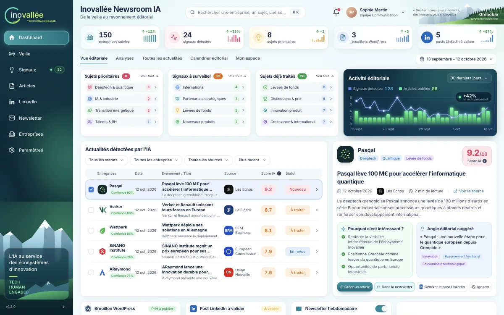

# KORA Newsroom IA — Inovallée

Espace éditorial d'Inovallée : veille des entreprises de l'écosystème, signaux scorés et sourcés, rédaction assistée, circuit d'approbation, et préparation de la diffusion sur WordPress, LinkedIn et la newsletter.



## Démarrer

```bash
nvm use 24
bun install
bun run dev        # http://localhost:8080
```

| Commande | Effet |
|---|---|
| `bun run test` | Tests Vitest |
| `npx tsc --noEmit -p .` | Vérification TypeScript |
| `bun run lint` | ESLint et Prettier |
| `bun run build` | Build de production (Cloudflare Workers) |

Variable d'environnement facultative : `AI_API_KEY` (clé OpenAI, lue côté serveur uniquement) pour améliorer les textes générés.

## Documentation

Toute la documentation est dans [`docs/`](docs/README.md) : démarrage, architecture, référence API, dictionnaire des données, règles métier, sécurité, frontend, guide utilisateur, exploitation, et couverture du cahier des charges.

## Lovable

Ce projet est connecté à [Lovable](https://lovable.dev/projects/40d714f1-3fc5-491b-9623-447358a56672) : chaque commit poussé sur `main` est synchronisé avec l'éditeur, et inversement. Ne réécrivez jamais un historique déjà poussé (pas de `push --force`, de rebase ni d'amend de commits publiés) et gardez `main` dans un état qui fonctionne. Voir [`AGENTS.md`](AGENTS.md).
