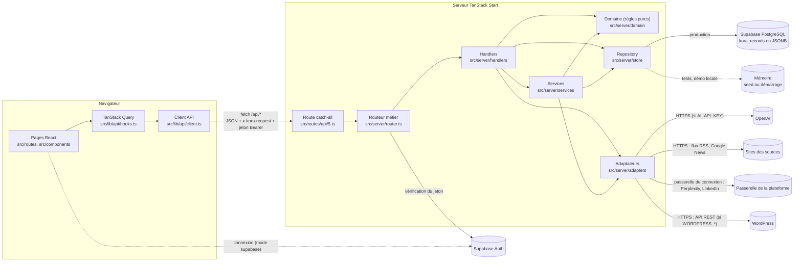
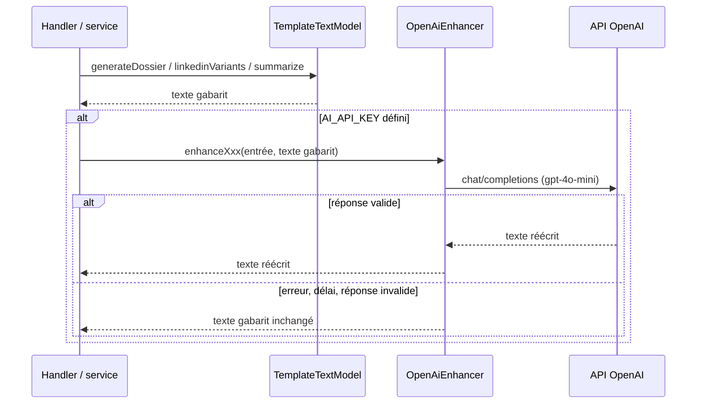

# Architecture

**Objet.** Décrire comment l'application est construite : les grands blocs, l'organisation du code, le trajet d'une requête, la persistance, les adaptateurs vers les services tiers, et l'écart entre l'architecture actuelle et l'architecture cible du cahier des charges (§5). Public : ingénieurs back-end, front-end et devops.

## Sommaire

1. [Vue d'ensemble](#vue-densemble)
2. [Arborescence du dépôt](#arborescence-du-dépôt)
3. [Trajet d'une requête API](#trajet-dune-requête-api)
4. [Couches du serveur](#couches-du-serveur)
5. [Persistance](#persistance)
6. [Adaptateurs et services tiers](#adaptateurs-et-services-tiers)
7. [Budget et appels payants](#budget-et-appels-payants)
8. [Frontend](#frontend)
9. [Horloge et déterminisme](#horloge-et-déterminisme)
10. [Build et cible d'exécution](#build-et-cible-dexécution)
11. [Architecture actuelle et architecture cible](#architecture-actuelle-et-architecture-cible)

## Vue d'ensemble

L'application est un **monolithe TanStack Start** : un seul projet sert à la fois les pages React (rendu serveur puis hydratation) et l'API métier REST sous `/api`. Le code serveur ([`src/server/`](../src/server)) n'est jamais importé par le front ; le front ne parle au serveur que par HTTP, via le client typé [`src/lib/api/client.ts`](../src/lib/api/client.ts).



Le contrat entre le front et le back est figé dans trois fichiers partagés :

| Fichier | Contenu |
|---|---|
| [`src/lib/api/types.ts`](../src/lib/api/types.ts) | Tous les DTO échangés (entités, requêtes, réponses, énumérations). Importé par le front **et** par le serveur. |
| [`src/lib/api/client.ts`](../src/lib/api/client.ts) | `apiFetch`, `ApiError`, l'objet `api.*` (une méthode par endpoint) et `downloadUrl` pour les fichiers. |
| [`src/lib/api/hooks.ts`](../src/lib/api/hooks.ts) | Clés de cache `qk`, hooks de lecture `useXxx`, et `useKoraMutation` (toasts + invalidation du cache). |

## Arborescence du dépôt

```text
.
├── .env                      Valeurs publiques Supabase, versionnées par Lovable (aucun secret)
├── CONTRIBUTING.md           Règles de contribution (à lire avant tout commit)
├── db/postgres/schema.sql    Schéma relationnel cible (non branché)
├── db/data/                  Scripts de données ponctuels, exécutés à la main
├── drizzle/migrations/       Migrations appliquées par Lovable (kora_records, kora_settings, app_user_connections)
├── supabase/config.toml      Identifiant du projet Supabase de Lovable Cloud
├── docs/                     Cette documentation
├── public/                   Fichiers statiques (favicon, robots.txt)
├── src/
│   ├── routes/               Pages (routage par fichiers) + route API catch-all
│   │   ├── __root.tsx        Document HTML, layout global, 404, erreurs, toasts
│   │   ├── index.tsx         Dashboard
│   │   ├── veille.tsx, signaux.tsx, articles.tsx, linkedin.tsx,
│   │   │   newsletter.tsx, entreprises.tsx, parametres.tsx
│   │   ├── connexion/        Connexion et choix du mot de passe (mode supabase)
│   │   └── api/$.ts          Toutes les requêtes /api/* vers handleApiRequest
│   ├── routeTree.gen.ts      Généré automatiquement, ne pas éditer
│   ├── components/
│   │   ├── layout/           Sidebar, en-tête, illustrations
│   │   ├── kora/             Primitives visuelles, logos, libellés français
│   │   ├── auth/             Garde de session, formulaires de connexion
│   │   ├── dashboard/, signals/, veille/, entreprises/, parametres/,
│   │   │   articles/, linkedin/, newsletter/   Composants par domaine
│   │   └── ui/               Composants shadcn/ui (Radix), base générique
│   ├── integrations/supabase/ Clients Supabase générés par Lovable (ne pas éditer)
│   ├── lib/api/              Contrat front/back (types, client, hooks)
│   ├── lib/auth/             Session Supabase côté navigateur, mode d'authentification
│   ├── server/               API métier (jamais importée par le front)
│   │   ├── router.ts         Table des routes et contrôles transverses
│   │   ├── auth/             Mode, vérification des jetons, utilisateurs, invitations
│   │   ├── http.ts           Réponses JSON, HttpError, cookies
│   │   ├── context.ts        Type Ctx (contexte de requête) et Handler
│   │   ├── validation.ts     Validation des corps de requête
│   │   ├── clock.ts          Horloge surchargeable (tests)
│   │   ├── handlers/         Un fichier par domaine d'API
│   │   ├── services/         Orchestrations réutilisables (collecte, audit, quotas…)
│   │   ├── domain/           Règles métier pures (scoring, preuves, droits, budget…)
│   │   ├── store/            Repository, dépôts base et mémoire, seed, catalogue
│   │   ├── adapters/         Modèle de texte, OpenAI, collecteur, canaux
│   │   ├── wordpress/        Client REST WordPress et envoi des brouillons
│   │   └── linkedin/         Publication sur le compte LinkedIn relié
│   ├── server.ts             Entrée serveur : filet de sécurité des erreurs SSR
│   ├── start.ts              Middlewares TanStack Start (erreurs, CSRF des server functions)
│   ├── router.tsx            Création du routeur et du QueryClient
│   ├── styles.css            Tokens du design system (Tailwind v4)
│   └── test/                 Tests Vitest (server/ pour l'API)
├── vite.config.ts            Configuration Lovable (ne pas y dupliquer les plugins)
└── vitest.config.ts          Configuration des tests (jsdom, alias @)
```

## Trajet d'une requête API

Toutes les requêtes `/api/*` passent par la route fichier [`src/routes/api/$.ts`](../src/routes/api/$.ts), qui délègue à `handleApiRequest` dans [`src/server/router.ts`](../src/server/router.ts). Ce point d'entrée applique, dans l'ordre :

1. **Normalisation du chemin** : le préfixe `/api` et la barre oblique finale sont retirés ; `HEAD` est traité comme `GET`.
2. **Contrôle anti-CSRF** : toute méthode autre que `GET` et `OPTIONS` doit porter l'en-tête `x-kora-request: 1`, sinon la réponse est 403 `csrf_header_missing`. Un formulaire tiers ne peut pas poser cet en-tête sans requête CORS préalable.
3. **Résolution de la route** dans la table `ROUTES` (méthode + motif à paramètres `:id`). Si le chemin existe pour d'autres méthodes : 204 avec en-tête `allow` pour `OPTIONS`, 405 `method_not_allowed` sinon. Si le chemin est inconnu : 404 `not_found`.
4. **Identification**, sauf pour les routes publiques `GET /auth/config`, `POST /auth/session` et `POST /auth/logout` ([`auth/session.ts`](../src/server/auth/session.ts)). En mode supabase (application hébergée), la requête doit porter un jeton Supabase dans l'en-tête `Authorization: Bearer`. Ce jeton est vérifié auprès de Supabase Auth puis rattaché à un utilisateur KORA : 401 `unauthenticated` si le jeton manque ou est invalide, 403 `account_not_authorized` si aucun utilisateur n'est rattaché au compte, 503 `auth_unavailable` si le service ne répond pas. Les seules routes marquées `download: true` acceptent à la place le cookie `__Host-kora_session`. En mode démonstration (Vitest, ou local sans `SUPABASE_URL`), l'utilisateur est lu dans le cookie `kora_uid`, à défaut `u_sophie`. Le détail est dans [Sécurité](06-securite-et-flux-tiers.md#session-et-identité).
5. **Lecture du corps** : JSON limité à 1 Mo (413 `payload_too_large`, 400 `invalid_json`), ou multipart pour les routes marquées `multipart: true` (imports de fichiers).
6. **Construction du contexte** `Ctx` ([`context.ts`](../src/server/context.ts)) : requête, URL, paramètres, query string, repository, utilisateur (absent pour les routes publiques), instant courant (`now()`), corps.
7. **Appel du handler**, qui valide l'entrée, vérifie les droits (`assertCan`), applique les règles du domaine, écrit dans le repository, journalise, et renvoie une `Response` JSON.
8. **Gestion des erreurs** : une `HttpError` devient une réponse `{ "error": { "code", "message", … } }` avec son statut ; toute autre exception est journalisée (`[api] erreur interne`) et renvoyée en 500 `internal_error`, sans détail technique côté client.

La liste exhaustive des endpoints, avec rôles, corps et erreurs, est dans la [Référence API](03-reference-api.md).

## Couches du serveur

| Couche | Dossier | Responsabilité | Règle de dépendance |
|---|---|---|---|
| Routeur | [`router.ts`](../src/server/router.ts) | Table des routes, contrôles transverses, construction du `Ctx`. | Ne contient aucune règle métier. |
| Handlers | [`handlers/`](../src/server/handlers) | Un handler par endpoint : lecture et validation de l'entrée, droits, appel des services et du domaine, mise en forme de la réponse. | Peut tout appeler sauf un autre handler. |
| Services | [`services/`](../src/server/services) | Orchestrations partagées entre handlers : collecte (`collection.ts`), audit et notifications (`journal.ts`), quotas et budget (`usage.ts`), signaux, newsletters, Editorial DNA, vues DTO (`view.ts`). | Utilisent le repository, le domaine et les adaptateurs. |
| Domaine | [`domain/`](../src/server/domain) | Règles métier **pures** : scoring, indicateur documentaire, regroupement, workflow, droits, budget, dates, CSV, sécurité des URL, extraction DOCX, calculs du dashboard. | N'accède ni au repository ni au réseau ; n'importe que des types (`lib/api/types.ts`, `store/records.ts`) et d'autres modules du domaine (seule dépendance externe : `fflate` pour lire les DOCX). Testable sans serveur. |
| Store | [`store/`](../src/server/store) | Interface `Repository`, implémentation en base Supabase (`db.ts`) et en mémoire (`memory.ts`), seed de démonstration, générateur pseudo-aléatoire déterministe. | Ne connaît pas HTTP. |
| Adaptateurs | [`adapters/`](../src/server/adapters) | Accès aux services tiers derrière des interfaces remplaçables. | Ne connaissent ni le repository ni HTTP. |

Conventions communes : messages d'erreur et libellés en français, dates au format ISO 8601 en UTC dans l'API, identifiants préfixés générés par `repo.nextId(prefix)` (par exemple `sig_mgo4k2x1a3f9c2` en base, `sig_n1042` en mémoire), chaque action significative tracée par `audit()` dans le journal.

## Persistance

### Interface `Repository`

Tout accès aux données passe par l'interface asynchrone `Repository` de [`store/repository.ts`](../src/server/store/repository.ts) : une `Collection<T>` par entité (`get`, `list`, `insert`, `update`, `remove`), plus `getSettings` / `saveSettings` (quotas, budget, état de suspension) et `nextId`. Les handlers et services n'utilisent que cette interface : changer de stockage consiste à fournir une autre implémentation, sans toucher au reste du code.

`getRepository()` ([`store/memory.ts`](../src/server/store/memory.ts)), appelé par le routeur pour chaque requête, choisit l'implémentation :

| Condition | Implémentation | Usage |
|---|---|---|
| `SUPABASE_URL` définie et hors Vitest | `DbRepository` ([`store/db.ts`](../src/server/store/db.ts)) | Application hébergée par Lovable. |
| Sinon | `MemoryRepository` avec le seed | Tests, et démonstration locale lancée avec `SUPABASE_URL=` vide. |

### Implémentation de production : base Supabase

`DbRepository` stocke les données dans la base PostgreSQL du projet Supabase de Lovable Cloud, au moyen du client `supabaseAdmin` ([`client.server.ts`](../src/integrations/supabase/client.server.ts)), qui utilise la clé de service `SUPABASE_SERVICE_ROLE_KEY`. Trois tables, créées par les migrations [`0000_kora_records.sql`](../drizzle/migrations/0000_kora_records.sql) et [`0001_app_user_connections.sql`](../drizzle/migrations/0001_app_user_connections.sql) :

| Table | Contenu |
|---|---|
| `kora_records` | Une ligne par enregistrement : `collection` (nom de la collection : `companies`, `signals`, `articles`…), `id`, `data` (l'enregistrement complet en JSONB, au format de [`records.ts`](../src/server/store/records.ts)), `created_at`, `updated_at`. Clé primaire `(collection, id)`. La collection interne `locks` porte les verrous. |
| `kora_settings` | Les réglages (quotas, budget réservé, suspension, alertes déjà envoyées) en JSONB, une ligne par espace (clé `"kora"`). |
| `app_user_connections` | La clé de connexion LinkedIn de chaque utilisateur, chiffrée par le serveur ; une ligne par utilisateur et par connecteur. |

La sécurité par ligne est activée sur les trois tables sans aucune règle d'accès : seul le rôle de service, donc seul le serveur, peut les lire ou les écrire. Le client Supabase navigateur généré par Lovable ([`client.ts`](../src/integrations/supabase/client.ts)) ne sert qu'à l'authentification (Supabase Auth) et n'accède à aucune table.

Au premier usage, `ensureReady()` installe les grilles de score, les règles éditoriales et les réglages du seed (budget réservé remis à zéro). **Aucune donnée de démonstration et aucun utilisateur ne sont créés** : la production démarre vide, et le premier administrateur s'installe à sa première connexion grâce à `KORA_ADMIN_EMAILS` (voir [Sécurité](06-securite-et-flux-tiers.md#session-et-identité)). Les identifiants sont générés par `nextId` à partir de l'horodatage et d'un fragment aléatoire (`sig_mgo4k2x1a3f9c2`).

Limites à connaître :

- **Pas de transactions** : chaque opération du `Repository` est une requête indépendante, et une opération composée interrompue (fusion de signaux, suppression d'une entreprise, publication) peut laisser un état partiel. Les opérations exposées aux demandes simultanées sont sérialisées par des **verrous à expiration** : `acquireLock` insère une ligne `locks` sans écraser, la clé primaire garantissant un seul détenteur, et `withLock` ([`services/locks.ts`](../src/server/services/locks.ts)) exécute l'opération puis libère le verrou. Un verrou déjà pris répond 409 tout de suite, ou après quelques secondes d'attente pour les sections courtes. Sont ainsi protégés : la collecte (un verrou global de 15 minutes, 409 `collection_in_progress`), les générations d'articles et de variantes LinkedIn (409 `generation_in_progress`), l'ajout de sujets aux newsletters (`generation_in_progress` ou `newsletter_busy`), la conversion d'un import (`conversion_in_progress`), la décision sur une proposition de règle (`already_decided`), le budget (verrou `budget`, `budget_busy`), les publications WordPress et LinkedIn (`publication_in_progress`) et la gestion des utilisateurs (`users_busy`). `saveSettings` réécrit tout le JSON des réglages, mais tous ses appels passent par le verrou `budget`.
- **`list()` charge toute la collection**, par pages de 1 000 lignes : chaque liste, chaque compteur du dashboard et chaque contrôle de doublon relit toutes les lignes de la collection concernée. Insuffisant pour l'épreuve de charge R13 (100 000 signaux).
- **Fichiers importés dans le JSON** : l'original d'un import (`bytes`, un `Uint8Array`) est sérialisé dans `data`. `JSON.stringify` transforme un `Uint8Array` en objet `{"0": …, "1": …}` : le fichier occupe environ dix fois sa taille et ne se relit pas comme un `Uint8Array`.
- **Requêtes non filtrées par espace** : la colonne d'espace du schéma cible n'existe pas dans `kora_records`.

### Implémentation de test et de démonstration : mémoire

`MemoryRepository` est conservé comme singleton sur `globalThis` (clé `__koraNewsroomStore__`) pour survivre au rechargement à chaud du code serveur. Il est construit par `resetStore()` à partir de `buildSeed(now)` ([`seed.ts`](../src/server/store/seed.ts)). La constante `STORE_VERSION` doit être incrémentée quand la forme des enregistrements change : le store est alors reconstruit au prochain appel. Aucune durabilité : un redémarrage efface toutes les modifications.

### Cible : schéma relationnel

Le schéma relationnel cible est dans [`db/postgres/schema.sql`](../db/postgres/schema.sql) : une table par entité, clés étrangères, contraintes et colonne d'espace. Il n'est pas utilisé : le stockage actuel en JSONB a été retenu par Lovable pour persister les données sans réécrire le `Repository`. Passer au schéma relationnel permettra de filtrer, paginer et contraindre en base. La correspondance entités/tables et les points d'attention sont détaillés dans le [Dictionnaire des données](04-dictionnaire-des-donnees.md).

## Adaptateurs et services tiers

Les adaptateurs sont regroupés dans [`adapters/index.ts`](../src/server/adapters/index.ts) : `adapters()` renvoie l'ensemble courant, `setAdapters()` permet d'en remplacer une partie (tests ou branchement d'un vrai fournisseur), `resetAdapters()` revient aux valeurs par défaut.

| Rôle | Interface | Implémentation par défaut | Statut |
|---|---|---|---|
| Génération de textes (dossier factuel, brouillon, variantes LinkedIn, résumés, notes éditoriales) | `TextModel` ([`text-model.ts`](../src/server/adapters/text-model.ts)) | `TemplateTextModel` : gabarits déterministes à partir des données du signal. | Réel, sans IA. |
| Amélioration IA des textes | `AiTextEnhancer` ([`openai.ts`](../src/server/adapters/openai.ts)) | `OpenAiEnhancer` (OpenAI `gpt-4o-mini`), actif seulement si `AI_API_KEY` est défini et hors Vitest ; sinon `null`. | Réel si clé configurée. |
| Collecte des sources | `Collector` ([`collector.ts`](../src/server/adapters/collector.ts)) | `RealCollector` : lit le flux RSS ou Atom de la source (découvert dans la page HTML au besoin) ou interroge Google News RSS avec le nom de l'entreprise ; chaque GET passe par [`safeFetchText`](../src/server/domain/safeHttp.ts) (SSRF, redirections manuelles, plafond 2 Mio, délai 15 s par appel). Pour les recherches presse rattachées à une entreprise, interroge en parallèle l'API Search de Perplexity par la passerelle de connexion de la plateforme d'hébergement (si `LOVABLE_API_KEY` et `PERPLEXITY_API_KEY` sont définies, délai de 20 s). Ne garde que les publications datées de moins de 30 jours. Sous Vitest : `SimulatedCollector` (observations plausibles et échecs reproductibles). | Réel (flux RSS, Google News et Perplexity ; pages HTML lues pour y découvrir un flux). |
| WordPress | `WordPressClient` ([`channels.ts`](../src/server/adapters/channels.ts)) | Choisi par `createWordPressClient` ([`wordpress/client.ts`](../src/server/wordpress/client.ts)) : `RestWordPress` (API REST du site, mot de passe d'application) si les trois variables `WORDPRESS_*` sont définies ; `SimulatedWordPress` sans aucune de ces variables, sous Vitest ou sans base ; sinon un client « non configuré » qui refuse l'envoi. | Réel en production si configuré ; simulé en démonstration. |
| LinkedIn | `LinkedInClient` ([`channels.ts`](../src/server/adapters/channels.ts)) | `ExportOnlyLinkedIn` : API indisponible pour l'adaptateur. La publication passe par le compte LinkedIn que chaque utilisateur relie ([`linkedin/publish.ts`](../src/server/linkedin/publish.ts), passerelle de connexion de la plateforme). | Publication réelle pour un compte relié ; export manuel sinon. |

### Chaîne de génération avec OpenAI

Le modèle à gabarits produit toujours un premier texte. Si un `AiTextEnhancer` est configuré, ce texte et les données sources lui sont transmis pour réécriture ; en cas d'erreur réseau, de délai dépassé (30 s), de réponse non JSON ou incomplète, le texte gabarit est conservé. L'application ne dépend donc jamais de la disponibilité d'OpenAI.



Points d'insertion actuels : résumé des signaux à la collecte ([`services/collection.ts`](../src/server/services/collection.ts)) et à la défusion ([`handlers/signals.ts`](../src/server/handlers/signals.ts)), dossier et brouillon d'article ([`handlers/articles.ts`](../src/server/handlers/articles.ts)), variantes LinkedIn ([`handlers/distribution.ts`](../src/server/handlers/distribution.ts)), résumés de newsletter ([`services/newsletters.ts`](../src/server/services/newsletters.ts)). Les garde-fous du prompt et les données transmises sont décrits dans [Sécurité et flux tiers](06-securite-et-flux-tiers.md).

### Brancher un vrai fournisseur

`Collector` accepte déjà un résultat asynchrone (`collect(input): CollectResult | Promise<CollectResult>`, attendu par `services/collection.ts`) : `RealCollector` sert de modèle pour un fournisseur de recherche payant ; sa recherche Perplexity (`perplexitySearch`) montre comment ajouter une source complémentaire qui ne fait jamais échouer la collecte. `TextModel` est encore **synchrone** : un modèle distant demandera de rendre ses méthodes asynchrones (`Promise<…>`) et d'ajouter `await` aux points d'appel. `WordPressClient` et `AiTextEnhancer` sont asynchrones. Le nouvel adaptateur s'enregistre dans `defaults()` de `adapters/index.ts`, avec ses secrets lus dans `process.env`.

## Budget et appels payants

Toute opération susceptible de coûter (collecte, génération de dossier, variantes LinkedIn, résumés de newsletter) est enveloppée par `paidCall()` de [`services/usage.ts`](../src/server/services/usage.ts). Avant l'appel, le coût estimé (constantes `COSTS` de [`domain/budget.ts`](../src/server/domain/budget.ts)) est **réservé**, sous le verrou `budget` qui sérialise réservations, libérations, suspension et alertes (attente de 5 s au plus, sinon 409 `budget_busy`) ; si le plafond mensuel serait dépassé, rien n'est appelé, les appels payants sont suspendus pour le mois, un événement d'audit et une notification sont créés, et l'API répond 402 `budget_exhausted`. Après l'appel, la consommation est enregistrée avant la libération de la réservation, puis les alertes à 80 % et 100 % sont vérifiées. La lecture et les exports ne passent jamais par `paidCall` et restent disponibles.

Exception à corriger : les résumés réécrits par OpenAI via `enhanceSummary()` lors de l'ingestion des observations ([`services/collection.ts`](../src/server/services/collection.ts), après le `paidCall` de la collecte) et lors d'une défusion ([`handlers/signals.ts`](../src/server/handlers/signals.ts)) ne sont pas enveloppés par `paidCall` : ils ne sont ni réservés ni bloqués quand les appels payants sont suspendus. Les autres points d'insertion d'OpenAI (dossier d'article, variantes LinkedIn, résumés de newsletter) sont bien à l'intérieur d'un `paidCall`.

La collecte reste facturée comme un appel payant : une recherche à 0,012 € plus jusqu'à trois observations à 0,021 € par source et par exécution, les publications déjà connues n'étant pas comptées. Les flux RSS et Google News lus par `RealCollector` sont pourtant gratuits, et le coût réel de la recherche Perplexity n'est pas lu. Une collecte complète de 150 sources consomme entre 1,80 € (aucune nouvelle publication) et environ 11 € du budget de 150 €.

Le coût enregistré est l'**estimation** de `COSTS`, pas le coût réellement facturé par OpenAI. Pour un suivi exact, `OpenAiEnhancer` devra remonter l'usage en jetons de la réponse et le convertir en euros via le paramètre `actual` de `paidCall`. Les règles détaillées sont dans [Règles métier](05-regles-metier.md).

## Frontend

Le front est une application React rendue par TanStack Start. Le rendu serveur produit la structure de la page ; les données sont chargées côté navigateur par TanStack Query (les pages affichent des squelettes pendant le chargement). Chaque page de `src/routes/` ne rend que son contenu : la barre latérale, l'en-tête et le fond sont fournis par `AppLayout` depuis [`__root.tsx`](../src/routes/__root.tsx). Le design system (tokens, primitives, règles de conformité à la maquette) est documenté dans [Frontend](07-frontend.md).

## Horloge et déterminisme

- [`clock.ts`](../src/server/clock.ts) expose `now()` ; les tests figent l'instant avec `setClock()`. Le code serveur ne doit jamais appeler `new Date()` directement pour une règle métier.
- Le seed utilise un générateur pseudo-aléatoire déterministe ([`prng.ts`](../src/server/store/prng.ts)) : à instant égal, il produit exactement les mêmes données. Les tests s'appuient sur cette propriété pour vérifier les chiffres de la maquette.
- Les tests réinitialisent store, horloge et adaptateurs avec `setup()` de [`src/test/server/helpers.ts`](../src/test/server/helpers.ts).

## Build et cible d'exécution

`bun run build` produit un bundle Nitro avec le preset `cloudflare-module` dans `.output/` : `server/index.mjs` (Worker), `public/` (fichiers statiques), et un `wrangler.json` généré (drapeau `nodejs_compat`). [`src/server.ts`](../src/server.ts) enveloppe l'entrée serveur pour transformer les erreurs SSR non rattrapées en page d'erreur HTML propre, et [`src/start.ts`](../src/start.ts) installe un middleware d'erreurs et la protection CSRF des server functions de TanStack Start. Le déploiement et l'exploitation sont décrits dans [Exploitation](09-exploitation.md).

## Architecture actuelle et architecture cible

Le cahier des charges (§5) décrit une cible composée d'une API métier, de PostgreSQL, d'un stockage de fichiers, de traitements asynchrones et d'adaptateurs séparant recherche, modèles de texte et canaux de publication.

| Brique cible | État actuel | Travail restant |
|---|---|---|
| API métier KORA | En place : `/api`, contrôles transverses, authentification Supabase Auth sur invitation, droits, audit. | MFA pour l'administration, décision sur les droits de lecture (voir [Sécurité](06-securite-et-flux-tiers.md#écarts-à-combler-avant-production)). |
| PostgreSQL | Base Supabase de Lovable Cloud, stockage générique en JSONB (`kora_records`), sans transactions, avec des verrous applicatifs à expiration ; schéma relationnel écrit mais non branché. | Schéma relationnel, transactions, pagination en base, sauvegardes et restauration testée. |
| Stockage de fichiers | Les originaux importés sont sérialisés dans le JSON de l'import (`bytes`). | Stockage objet (par exemple Supabase Storage, R2 ou S3), avec la même règle : original conservé tel quel. |
| Traitements asynchrones | La collecte, déclenchée à la main, s'exécute pendant la requête HTTP, avec un nombre d'essais borné et une seule collecte à la fois. | File de travaux et planification quotidienne par source (le cahier des charges prévoit une collecte quotidienne). |
| Adaptateurs | En place ; OpenAI réel si clé ; collecte réelle par flux RSS, Google News et Perplexity ; WordPress réel si configuré ; LinkedIn publié par le compte relié de chaque utilisateur, export sinon. | Lecture des pages sans flux ; décision sur l'usage de Google News au regard de ses conditions (voir [Sécurité](06-securite-et-flux-tiers.md#collecteur-web)). |
| Secrets hors navigateur | Respecté : clés lues côté serveur uniquement. | Rotation et révocation documentées. |

La liste complète des écarts avec le cahier des charges, exigence par exigence, est dans la [Couverture du cahier des charges](10-couverture-cahier-des-charges.md).
