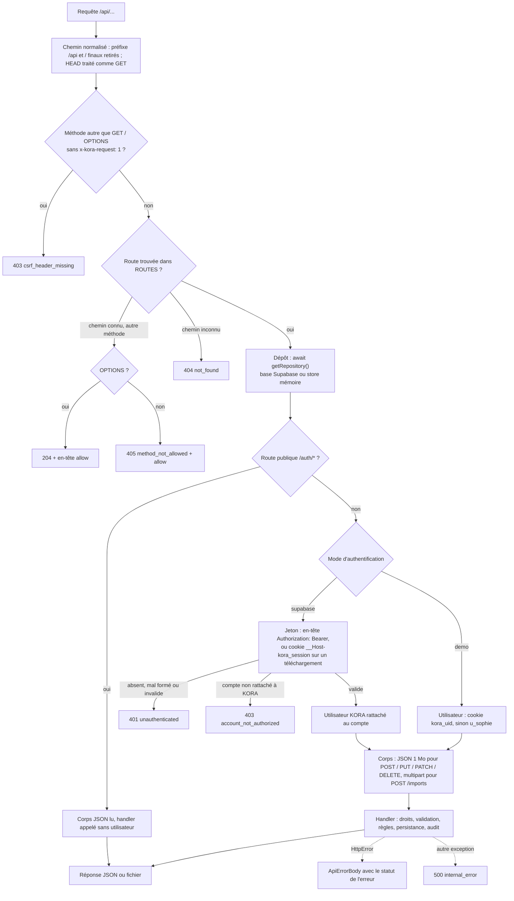
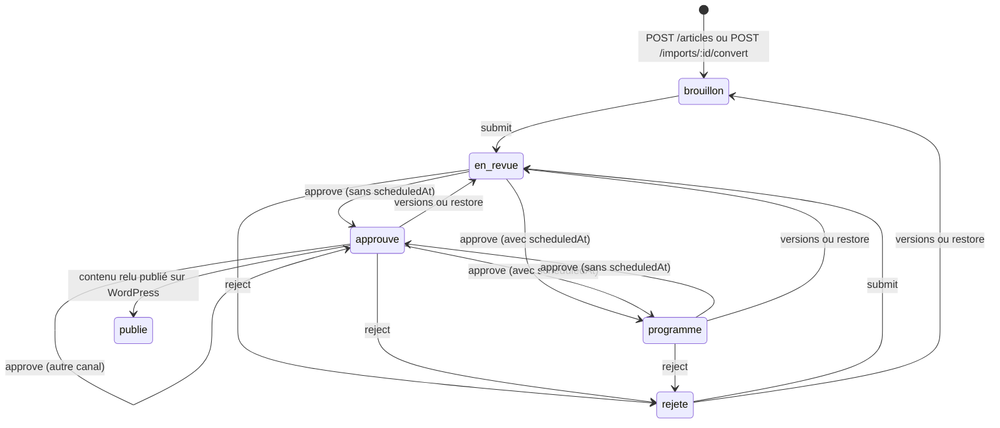
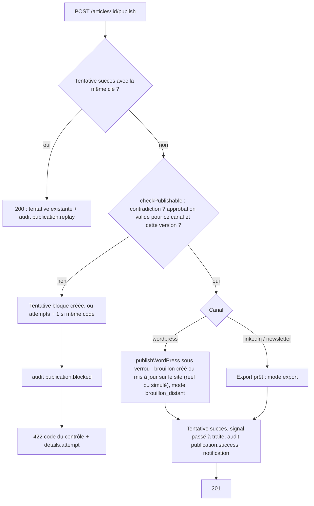
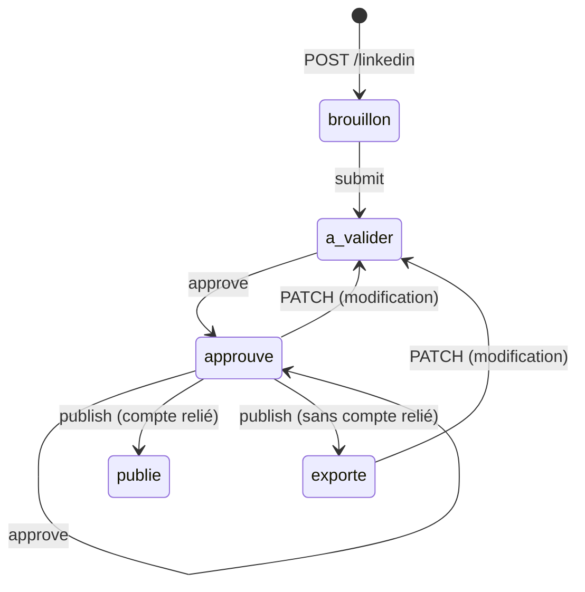
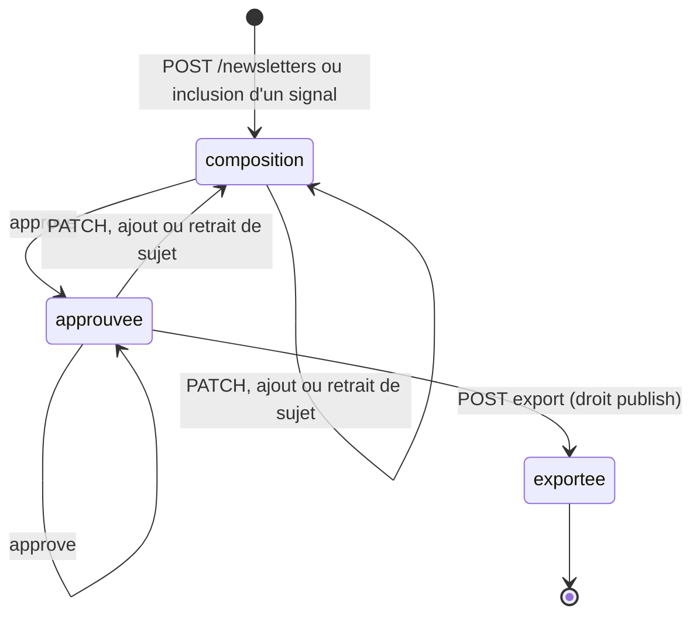

# Référence de l'API REST `/api`

**Objet.** Ce document décrit, endpoint par endpoint, l'API métier servie sous `/api` par KORA Newsroom IA : conventions d'échange, authentification, droits, validation, codes d'erreur, effets de bord (audit, notifications, budget, approbations) et correspondance avec le client front `api.*`. Il s'adresse aux ingénieurs qui consomment, modifient ou étendent l'API. Les règles métier détaillées (scoring, indicateur documentaire, regroupement) sont dans [Règles métier](05-regles-metier.md), le détail des champs stockés dans le [Dictionnaire des données](04-dictionnaire-des-donnees.md), et les mécanismes de sécurité (CSRF, SSRF, nettoyage HTML) dans [Sécurité et flux tiers](06-securite-et-flux-tiers.md).

Source de vérité : la table `ROUTES` de [`router.ts`](../src/server/router.ts) (82 routes), les handlers de [`src/server/handlers/`](../src/server/handlers/), les schémas de [`validation.ts`](../src/server/validation.ts) et le contrat [`types.ts`](../src/lib/api/types.ts). Les comportements cités sont couverts par les tests [`src/test/server/`](../src/test/server/).

> L'API lit et écrit dans le dépôt renvoyé par `getRepository()` ([`memory.ts`](../src/server/store/memory.ts)), qui dépend de l'environnement :
>
> - hors tests et si `SUPABASE_URL` est définie, c'est `DbRepository` ([`db.ts`](../src/server/store/db.ts)) : les données sont **persistantes** dans la base Supabase (PostgreSQL) de Lovable Cloud et survivent aux redémarrages. La production démarre **vide** : `ensureReady()` n'y installe que la grille de score, les règles éditoriales et les réglages du seed, sans aucun utilisateur ni donnée de démonstration ; le premier administrateur est créé à sa première connexion (voir [Authentification et utilisateur courant](#session-cookie)) ;
> - sinon (tests Vitest, ou poste local lancé avec `SUPABASE_URL` vide), c'est un **store en mémoire** réinitialisé à chaque redémarrage depuis le seed déterministe ([`seed.ts`](../src/server/store/seed.ts)).
>
> Les identifiants de démonstration cités dans ce document (`sig_pasqal`, `art_pasqal`, `li_pasqal`, `nl_current`, `co_pasqal`…) et les extraits de réponses réelles n'existent que dans le second mode, celui de l'instance locale interrogée pour cette référence. En local, `.env` fournit `SUPABASE_URL` sans la clé de service : lancé tel quel, le serveur répond `500 internal_error` sur toutes les routes, et il faut vider la variable (`SUPABASE_URL= bun run dev`) pour obtenir le store mémoire (voir [Démarrage](01-demarrage.md)). Dans ce mode, le collecteur reste le collecteur réel, OpenAI est actif si `AI_API_KEY` est définie, l'authentification est en mode `demo`, WordPress est simulé tant qu'aucune variable `WORDPRESS_*` n'est définie, et LinkedIn retombe toujours sur l'export (aucune connexion n'est lue hors base). Hors tests, la collecte est **réelle** (flux RSS/Atom et Google News, complétés par une recherche Perplexity, voir [Collecteur réel](#collecte-reelle)). WordPress est **réel** en production (brouillons créés par l'API REST du site, voir [`POST /api/articles/:id/publish`](#post-article-publish)) et simulé en démonstration et sous Vitest ; LinkedIn publie avec le compte relié de l'utilisateur, ou retombe sur un export (voir [LinkedIn](#linkedin) et [Sécurité et flux tiers](06-securite-et-flux-tiers.md)).

## Sommaire

- [Récapitulatif des endpoints](#recapitulatif)
- [1. Conventions générales](#conventions)
  - [Traitement d'une requête](#traitement) · [Routage, 404, 405, OPTIONS](#routage) · [Format des échanges et limites de taille](#format) · [En-tête anti-CSRF](#csrf) · [Authentification et utilisateur courant](#session-cookie) · [Droits](#droits) · [Validation des corps](#validation) · [Format des erreurs](#format-erreurs) · [Table des codes d'erreur](#erreurs) · [Verrous et demandes simultanées](#verrous) · [Listes, filtres et pagination](#listes) · [Dates et fuseau horaire](#dates) · [Budget API et quotas](#budget) · [Audit et notifications](#audit-notifications)
- [2. Authentification, session et utilisateurs](#session)
  - [Gestion des utilisateurs](#gestion-utilisateurs)
- [3. Dashboard, recherche, consommation, journal](#exploitation)
- [4. Exports et téléchargements](#exports)
- [5. Entreprises](#entreprises)
- [6. Sources et collecte](#sources)
  - [Collecteur réel](#collecte-reelle)
- [7. Signaux et grilles de score](#signaux)
- [8. Articles, dossier factuel et publication](#articles)
  - [Configuration WordPress](#wordpress-config)
- [9. Imports humains](#imports)
- [10. LinkedIn](#linkedin)
  - [Connexion LinkedIn de l'utilisateur](#connexion-linkedin)
- [11. Newsletters](#newsletters)
- [12. Editorial DNA](#editorial-dna)
- [13. Ajouter un endpoint](#ajouter-un-endpoint)
- [14. Limites connues de l'API](#limites)

<a id="recapitulatif"></a>

## Récapitulatif des endpoints

Tous les chemins sont préfixés par `/api`. La colonne « Rôles » indique les rôles autorisés ; « tous » inclut le lecteur. « public » désigne les trois routes `/auth/*`, servies sans utilisateur ; toutes les autres exigent un utilisateur identifié (voir [Authentification et utilisateur courant](#session-cookie)). Le détail des droits est donné dans [Droits](#droits).

| Méthode | Chemin | Rôles | Résumé |
|---|---|---|---|
| GET | [`/api/auth/config`](#get-auth-config) | public | Mode d'authentification (`supabase` ou `demo`) |
| POST | [`/api/auth/session`](#post-auth-session) | public (jeton) | Vérifier le jeton et poser le cookie de téléchargement |
| POST | [`/api/auth/logout`](#post-auth-logout) | public | Effacer le cookie de téléchargement |
| GET | [`/api/me`](#get-me) | tous | Utilisateur courant |
| POST | [`/api/me`](#post-me) | tous (démonstration seulement) | Changer d'utilisateur de démonstration (cookie) |
| GET | [`/api/users`](#get-users) | tous | Liste des utilisateurs |
| POST | [`/api/users`](#post-users) | admin | Créer un utilisateur et l'inviter |
| PATCH | [`/api/users/:id`](#patch-user) | admin | Modifier nom, équipe ou rôles |
| DELETE | [`/api/users/:id`](#delete-user) | admin | Supprimer un utilisateur |
| POST | [`/api/users/:id/invite`](#post-user-invite) | admin | Renvoyer l'invitation |
| GET | [`/api/notifications`](#get-notifications) | tous | 50 dernières notifications |
| POST | [`/api/notifications/read`](#post-notifications-read) | tous | Marquer toutes les notifications comme lues |
| GET | [`/api/me/linkedin`](#get-me-linkedin) | tous | État de la connexion LinkedIn de l'utilisateur |
| POST | [`/api/me/linkedin/connect`](#post-me-linkedin-connect) | tous | Démarrer la connexion LinkedIn (OAuth) |
| POST | [`/api/me/linkedin/complete`](#post-me-linkedin-complete) | tous | Finaliser la connexion LinkedIn |
| POST | [`/api/me/linkedin/disconnect`](#post-me-linkedin-disconnect) | tous | Retirer la connexion LinkedIn |
| GET | [`/api/dashboard`](#get-dashboard) | tous | Tableau de bord calculé sur une période |
| GET | [`/api/search`](#get-search) | tous | Recherche globale |
| GET | [`/api/usage`](#get-usage) | tous | Consommation et quotas du mois |
| GET | [`/api/audit`](#get-audit) | tous | Journal d'audit |
| GET | [`/api/export/manifest`](#get-export-manifest) | tous | Manifeste de réversibilité (fichier JSON) |
| GET | [`/api/export/:entity`](#get-export-entity) | tous | Export CSV ou JSON d'une entité |
| GET | [`/api/companies`](#get-companies) | tous | Liste des entreprises du registre |
| POST | [`/api/companies`](#post-companies) | admin, rédacteur | Ajouter une entreprise |
| GET | [`/api/companies/:id`](#get-company) | tous | Fiche entreprise et ses sources |
| PATCH | [`/api/companies/:id`](#patch-company) | admin, rédacteur | Modifier une entreprise |
| DELETE | [`/api/companies/:id`](#delete-company) | admin | Retirer une entreprise du registre |
| GET | [`/api/sources`](#get-sources) | tous | Liste des sources |
| POST | [`/api/sources`](#post-sources) | admin, rédacteur | Ajouter une source |
| PATCH | [`/api/sources/:id`](#patch-source) | admin, rédacteur | Modifier une source |
| DELETE | [`/api/sources/:id`](#delete-source) | admin, rédacteur | Supprimer une source |
| POST | [`/api/sources/:id/collect`](#post-source-collect) | admin, rédacteur | Collecter une source (réseau réel hors tests, payant) |
| POST | [`/api/collect`](#post-collect) | admin, rédacteur | Collecter les sources actives, par lots |
| GET | [`/api/collection-runs`](#get-collection-runs) | tous | Historique des exécutions de collecte |
| GET | [`/api/signals`](#get-signals) | tous | Liste filtrée et paginée des signaux |
| POST | [`/api/signals/rescore`](#post-signals-rescore) | admin | Recalculer les scores avec la grille active |
| GET | [`/api/signals/:id`](#get-signal) | tous | Détail d'un signal et de ses observations |
| PATCH | [`/api/signals/:id`](#patch-signal) | admin, rédacteur | Statut, rattachement, inclusion newsletter |
| POST | [`/api/signals/:id/merge`](#post-signal-merge) | admin, rédacteur | Fusionner des signaux |
| POST | [`/api/signals/:id/split`](#post-signal-split) | admin, rédacteur | Défusionner des observations |
| GET | [`/api/scoring-grids`](#get-scoring-grids) | tous | Historique des grilles de score |
| POST | [`/api/scoring-grids`](#post-scoring-grids) | admin | Créer et activer une grille |
| GET | [`/api/articles`](#get-articles) | tous | Liste des articles |
| POST | [`/api/articles`](#post-articles) | admin, rédacteur | Générer dossier et brouillon depuis un signal (payant) |
| GET | [`/api/articles/:id`](#get-article) | tous | Détail d'un article |
| POST | [`/api/articles/:id/versions`](#post-article-versions) | admin, rédacteur | Enregistrer une nouvelle version |
| POST | [`/api/articles/:id/restore`](#post-article-restore) | admin, rédacteur | Restaurer une version (nouvelle version) |
| POST | [`/api/articles/:id/submit`](#post-article-submit) | admin, rédacteur | Soumettre à validation |
| POST | [`/api/articles/:id/approve`](#post-article-approve) | admin, validateur | Approuver une version pour un canal |
| POST | [`/api/articles/:id/reject`](#post-article-reject) | admin, validateur | Rejeter avec motif |
| POST | [`/api/articles/:id/publish`](#post-article-publish) | admin, validateur | Envoyer vers un canal (idempotent) |
| POST | [`/api/articles/:id/wordpress/refresh`](#post-article-wordpress-refresh) | admin, validateur | Relire l'état du brouillon sur WordPress |
| PATCH | [`/api/articles/:id/fact-checks/:fid`](#patch-article-fact-check) | admin, rédacteur, validateur | Arbitrer un fait du dossier |
| GET | [`/api/publications`](#get-publications) | tous | Tentatives de publication |
| GET | [`/api/imports`](#get-imports) | tous | Liste des imports humains |
| POST | [`/api/imports`](#post-imports) | admin, rédacteur | Importer un fichier TXT ou DOCX (multipart) |
| PATCH | [`/api/imports/:id/proposals/:pid`](#patch-import-proposal) | admin, rédacteur | Décider d'une proposition de correction |
| POST | [`/api/imports/:id/convert`](#post-import-convert) | admin, rédacteur | Convertir l'import en article |
| GET | [`/api/wordpress`](#get-wordpress) | tous | Mode WordPress, site et correspondance des catégories |
| GET | [`/api/wordpress/check`](#get-wordpress-check) | admin | Tester la connexion au site |
| GET | [`/api/wordpress/categories`](#get-wordpress-categories) | admin | Catégories du site WordPress |
| PUT | [`/api/wordpress/settings`](#put-wordpress-settings) | admin | Enregistrer la correspondance des catégories |
| GET | [`/api/linkedin`](#get-linkedin) | tous | Liste des posts LinkedIn |
| POST | [`/api/linkedin`](#post-linkedin) | admin, rédacteur | Générer un post (variantes, payant) |
| PATCH | [`/api/linkedin/:id`](#patch-linkedin) | admin, rédacteur | Modifier variantes ou sélection |
| POST | [`/api/linkedin/:id/submit`](#post-linkedin-submit) | admin, rédacteur | Soumettre à validation |
| POST | [`/api/linkedin/:id/approve`](#post-linkedin-approve) | admin, validateur | Approuver la version relue |
| POST | [`/api/linkedin/:id/publish`](#post-linkedin-publish) | admin, validateur | Publier avec le compte relié, sinon exporter |
| GET | [`/api/linkedin/:id/export`](#get-linkedin-export) | tous | Télécharger le texte du post |
| GET | [`/api/newsletters`](#get-newsletters) | tous | Liste des éditions |
| POST | [`/api/newsletters`](#post-newsletters) | admin, rédacteur | Créer une édition |
| GET | [`/api/newsletters/:id`](#get-newsletter) | tous | Détail d'une édition |
| PATCH | [`/api/newsletters/:id`](#patch-newsletter) | admin, rédacteur | Titre, introduction, ordre et résumés |
| POST | [`/api/newsletters/:id/items`](#post-newsletter-items) | admin, rédacteur | Ajouter un sujet (résumé payant) |
| DELETE | [`/api/newsletters/:id/items/:itemId`](#delete-newsletter-item) | admin, rédacteur | Retirer un sujet |
| POST | [`/api/newsletters/:id/approve`](#post-newsletter-approve) | admin, validateur | Approuver la version relue |
| GET | [`/api/newsletters/:id/export`](#get-newsletter-export) | tous | Télécharger HTML ou texte (sans effet) |
| POST | [`/api/newsletters/:id/export`](#post-newsletter-export) | admin, validateur | Consigner l'export (édition exportée) |
| GET | [`/api/editorial-dna`](#get-editorial-dna) | tous | Règles, exemples et propositions |
| POST | [`/api/editorial-dna/rules`](#post-editorial-dna-rules) | admin | Créer une règle éditoriale |
| PATCH | [`/api/editorial-dna/rules/:id`](#patch-editorial-dna-rule) | admin | Modifier ou désactiver une règle |
| PATCH | [`/api/editorial-dna/proposals/:id`](#patch-editorial-dna-proposal) | admin | Accepter ou refuser une proposition |

<a id="conventions"></a>

## 1. Conventions générales

<a id="traitement"></a>

### Traitement d'une requête

Toutes les requêtes `/api/*` arrivent dans la route fichier [`src/routes/api/$.ts`](../src/routes/api/$.ts) (handler `ANY`), qui délègue à [`handleApiRequest`](../src/server/router.ts). Les contrôles transverses sont appliqués dans cet ordre :



Le handler reçoit un contexte [`Ctx`](../src/server/context.ts) : `request`, `url`, `params` (paramètres de chemin décodés), `query` (`URLSearchParams`), `repo` (le [`Repository`](../src/server/store/repository.ts) : `DbRepository` ou `MemoryRepository`), `user` (enregistrement interne de l'utilisateur courant, absent du contexte `PublicCtx` des routes publiques ; à passer par `toPublicUser` avant de le renvoyer), `now` (horloge de [`clock.ts`](../src/server/clock.ts), figeable dans les tests), `body` (JSON ou `undefined`) et `form` (`FormData` pour la route multipart, sinon `null`).

Le dépôt n'est obtenu qu'après la résolution de la route : les réponses `403 csrf_header_missing`, `404`, `405` et `204` (`OPTIONS`) ne touchent pas la base. Hors routes publiques, l'utilisateur est identifié **avant** la lecture du corps : une requête refusée en `401` ou `403 account_not_authorized` n'est jamais lue. Avec `DbRepository`, chaque appel `get`, `list`, `insert`, `update` ou `remove` est une requête Supabase distincte, sans transaction : un handler qui écrit plusieurs enregistrements peut laisser un état partiel si l'une des écritures échoue. Les opérations exposées aux doubles clics sont sérialisées par des verrous (voir [Verrous et demandes simultanées](#verrous)).

<a id="routage"></a>

### Routage, 404, 405, OPTIONS

- Un motif de `ROUTES` correspond si le nombre de segments est identique, si les segments littéraux sont égaux et si chaque segment `:param` peut être décodé par `decodeURIComponent` (un encodage invalide ne correspond à aucune route). Les barres obliques multiples ou finales sont ignorées (`/api/signals/` équivaut à `/api/signals`).
- La première route de même méthode qui correspond l'emporte : `GET /export/manifest` est déclarée avant `GET /export/:entity`. À l'inverse, `GET /api/signals/rescore` est servi par `GET /signals/:id` (identifiant « rescore », donc 404 « Signal introuvable. »), car `rescore` n'existe qu'en `POST`.
- Chemin inconnu : `404 not_found` (« Ressource inconnue : /chemin. »).
- Chemin connu avec une autre méthode : `405 method_not_allowed`, avec un en-tête `allow` listant les méthodes acceptées (ex. `PUT /api/me` avec l'en-tête anti-CSRF renvoie `allow: GET, POST` ; sans l'en-tête, `403`).
- `OPTIONS` sur un chemin connu : `204` sans corps, avec `allow`. Sur un chemin inconnu : `404`. Aucun en-tête CORS (`access-control-*`) n'est émis : l'API est prévue pour la même origine que le front.
- `HEAD` est traité exactement comme `GET`. Le téléchargement d'une newsletter n'a plus d'effet de bord : l'export se consigne par [`POST /api/newsletters/:id/export`](#post-newsletter-export).

Le contrôle anti-CSRF précède la résolution de la route : une écriture sans en-tête sur un chemin inconnu reçoit `403`, pas `404`.

```bash
# Méthodes acceptées sur un chemin (204 + allow: GET, PATCH)
curl -s -i -X OPTIONS http://localhost:8080/api/signals/sig_pasqal
```

<a id="format"></a>

### Format des échanges et limites de taille

- **Requêtes** : corps JSON pour `POST`, `PUT`, `PATCH` et `DELETE` (lu aussi pour `DELETE`, même vide). L'en-tête `content-type` n'est pas vérifié côté serveur (le client [`apiFetch`](../src/lib/api/client.ts) envoie `application/json`). Un corps vide vaut `undefined` et est validé comme `{}`. Un JSON illisible renvoie `400 invalid_json`.
- **Taille JSON** : 1 Mo maximum (`MAX_JSON_BYTES = 1024 * 1024` dans [`router.ts`](../src/server/router.ts)). Au-delà, `413 payload_too_large`, d'abord sur l'en-tête `content-length`, puis sur la longueur du texte lu.
- **Multipart** : seule la route `POST /api/imports` (drapeau `multipart: true` dans `ROUTES`) attend `multipart/form-data` avec les champs `file` et `author`. Une requête non multipart y reçoit `400 multipart_required`, un corps illisible `400 invalid_multipart`. Le fichier est limité à 10 Mio (`MAX_IMPORT_BYTES` de [`imports.ts`](../src/server/domain/imports.ts)) : refus `413 file_too_large` si `content-length` dépasse 10 Mio + 64 Kio, puis si la taille du fichier dépasse 10 Mio.
- **Réponses JSON** : produites par `json()` de [`http.ts`](../src/server/http.ts), avec `content-type: application/json` et `cache-control: no-store`. Statuts de succès : `200` (lecture, modification), `201` (création, nouvelle version, publication effective), `204` sans corps (suppressions, `POST /api/notifications/read`, `POST /api/auth/logout`).
- **Fichiers** (exports CSV/JSON, newsletter HTML/texte, post LinkedIn) : produits par `fileResponse()`, statut `200`, en-têtes `content-disposition: attachment; filename="…"; filename*=UTF-8''…`, `cache-control: no-store`, `x-content-type-options: nosniff`. Les CSV commencent par un BOM UTF-8.
- **Identifiants** : les enregistrements créés reçoivent un identifiant produit par `Repository.nextId(préfixe)`, dont la forme dépend du dépôt. En base, c'est `<préfixe>_<horodatage en base 36><6 premiers caractères d'un UUID>` (ex. `sig_mgo4k2x1a3f9c2`) ; en mémoire, `<préfixe>_n<compteur>` (ex. `sig_n1042`). Un client doit traiter les identifiants comme des chaînes opaques. Exceptions : entreprises (`co_<nom-normalisé>`, ou `nextId("co")` si cet identifiant existe déjà), grilles (`grid_v<version>`), faits du dossier (`fc_<articleId>_<i>`), propositions d'import (`<importId>_p<i>`), variantes LinkedIn (`<postId>_v<i>`).

<a id="csrf"></a>

### En-tête anti-CSRF

Toute requête dont la méthode n'est ni `GET` (ni `HEAD`) ni `OPTIONS` doit porter l'en-tête `x-kora-request: 1`. Sinon : `403 csrf_header_missing` (« En-tête x-kora-request manquant : requête d'écriture refusée. »), avant tout traitement. Le client `apiFetch` l'ajoute à toutes les requêtes. Les routes publiques `POST /auth/session` et `POST /auth/logout` y sont soumises aussi (tests « exige un Bearer valide et un compte autorisé » et « efface le cookie à la déconnexion » de [`auth.test.ts`](../src/test/server/auth.test.ts)). Le test « protection CSRF » de [`security.test.ts`](../src/test/server/security.test.ts) le vérifie sur `POST /me`, `POST /articles`, `PATCH /signals/:id` et `DELETE /companies/:id`. Le raisonnement de sécurité est détaillé dans [Sécurité et flux tiers](06-securite-et-flux-tiers.md).

```json
{ "error": { "code": "csrf_header_missing", "message": "En-tête x-kora-request manquant : requête d'écriture refusée." } }
```

<a id="session-cookie"></a>

### Authentification et utilisateur courant

L'identification dépend du mode renvoyé par `authMode()` ([`auth/mode.ts`](../src/server/auth/mode.ts)), calqué sur le dépôt : `supabase` quand les données sont en base (`usesDatabase()` de [`database.ts`](../src/server/database.ts) : hors Vitest et avec `SUPABASE_URL`), c'est-à-dire en production ; `demo` sinon (tests, poste local en mémoire). Le mode est consultable sans session par [`GET /api/auth/config`](#get-auth-config). L'utilisateur est résolu par `authenticate()` de [`auth/session.ts`](../src/server/auth/session.ts), pour toutes les routes sauf les trois routes publiques `/auth/*`.

**Mode `supabase` (production).** Les comptes sont ceux de Supabase Auth. Il n'existe pas d'inscription libre : un compte n'entre dans KORA que par l'invitation d'un administrateur (voir [Gestion des utilisateurs](#gestion-utilisateurs)) ou par l'amorçage du premier administrateur.

- Toute route non publique exige le jeton d'accès Supabase dans l'en-tête `Authorization: Bearer <jeton>`. Le jeton est vérifié côté serveur par `verifyAccessToken` ([`auth/token.ts`](../src/server/auth/token.ts), `auth.getClaims` avec `SUPABASE_URL` et `SUPABASE_PUBLISHABLE_KEY`) : il doit appartenir à un utilisateur connecté (rôle et audience `authenticated`, jamais un compte anonyme).
- Jeton absent, en-tête qui n'est pas de la forme `Bearer <jeton>`, jeton invalide ou expiré : `401 unauthenticated` (« Session absente ou expirée : reconnectez-vous. »), en lecture comme en écriture. Service d'authentification injoignable : `503 auth_unavailable`.
- Le compte est ensuite rapproché de l'utilisateur KORA dont `authUserId` est l'identifiant du compte (`resolveKoraUser` de [`auth/users.ts`](../src/server/auth/users.ts)). Compte valide rattaché à aucun utilisateur : `403 account_not_authorized` (« Votre compte n'est pas autorisé sur KORA. Demandez à un administrateur de vous inviter. »). La première connexion réussie renseigne `activatedAt` ; `hasAccount` passe alors à `true` dans les réponses `User`.
- **Premier administrateur.** La base de production ne contient aucun utilisateur au départ. Un compte dont l'adresse confirmée figure dans `KORA_ADMIN_EMAILS` (adresses séparées par des virgules) devient administrateur à sa première requête, tant qu'aucun administrateur actif (rôle `admin`, compte rattaché et activé) n'existe. Il est rattaché à l'utilisateur KORA de même adresse s'il existe, qui reçoit le rôle `admin` ; sinon un utilisateur est créé (identifiant `userIdForEmail`, équipe « Administration », rôle `admin`). Entrée d'audit `user.bootstrap`. Une adresse listée mais non confirmée, ou listée alors qu'un administrateur actif existe, reçoit `403 account_not_authorized` : un administrateur supprimé ou rétrogradé ne se rétablit pas avec son jeton.
- **Cookie de téléchargement `__Host-kora_session`** : copie du jeton posée par [`POST /api/auth/session`](#post-auth-session) (`Path=/; HttpOnly; Secure; SameSite=Strict`, `Max-Age` égal à la durée de vie restante du jeton, 3 600 s au plus). Il n'est lu que sur les routes de téléchargement (drapeau `download: true` de `ROUTES` : `GET /export/manifest`, `GET /export/:entity`, `GET /linkedin/:id/export`, `GET /newsletters/:id/export`), en `GET` ou `HEAD`, sans en-tête `Authorization`, et si `sec-fetch-site` est absent, `same-origin` ou `none`. Un lien de téléchargement fonctionne ainsi sans en-tête ; aucune autre route et aucune écriture n'acceptent ce cookie (`401`).
- Le cookie `kora_uid` est ignoré : on ne peut plus se faire passer pour un autre utilisateur, et [`POST /api/me`](#post-me) répond `403 demo_only`.

**Mode `demo` (tests, démonstration locale).** Aucun jeton n'est vérifié. L'utilisateur courant est lu dans le cookie `kora_uid` (`SESSION_COOKIE` de [`http.ts`](../src/server/http.ts)), posé par [`POST /api/me`](#post-me) : `kora_uid=<id>; Path=/; HttpOnly; SameSite=Lax; Max-Age=2592000` (30 jours). Cookie absent ou identifiant inconnu : l'utilisateur par défaut `DEFAULT_USER_ID` (`u_sophie`, [`seed.ts`](../src/server/store/seed.ts)) est utilisé, sans erreur. Ce mode n'est jamais retenu quand la base est utilisée.

| Identifiant | Nom | Équipe | Rôles |
|---|---|---|---|
| `u_sophie` | Sophie Martin | Équipe Communication | `admin`, `redacteur`, `validateur` (défaut) |
| `u_lucas` | Lucas Bernard | Équipe Communication | `redacteur` |
| `u_claire` | Claire Dubois | Direction | `validateur` |
| `u_marc` | Marc Lefèvre | Développement économique | `lecteur` |

Ces quatre utilisateurs n'existent que dans le store en mémoire : `ensureReady()` ne les installe pas en base. Les exemples `curl` de ce document visent le mode `demo` : l'utilisateur y est choisi avec `-b 'kora_uid=u_lucas'`. En production, ce cookie est remplacé par l'en-tête `-H 'authorization: Bearer <jeton>'` (jeton d'accès de la session Supabase).

Côté front, `apiFetch` ([`client.ts`](../src/lib/api/client.ts)) ajoute l'en-tête `Authorization` à chaque appel à partir de la session du client Supabase navigateur (`getAccessToken` de [`lib/auth/token.ts`](../src/lib/auth/token.ts), client [`integrations/supabase/client.ts`](../src/integrations/supabase/client.ts)). Une réponse `401`, ou `403 account_not_authorized`, sur une route autre que `/auth/*` ferme la session locale et renvoie vers `/connexion` (`handleUnauthenticated`). `auth-middleware.ts` ([`src/integrations/supabase/`](../src/integrations/supabase/)) n'est utilisé nulle part.

<a id="droits"></a>

### Droits

Les droits sont vérifiés côté serveur par `assertCan(ctx.user, action)` de [`permissions.ts`](../src/server/domain/permissions.ts), au début de chaque handler d'écriture. Un utilisateur est autorisé si l'un de ses rôles figure dans la matrice `MATRIX`. Les lectures (`GET`) ne vérifient aucun droit, sauf `GET /wordpress/check` et `GET /wordpress/categories` (`wordpress.manage`) : le lecteur voit et exporte tout le reste.

| Action | Rôles | Endpoints |
|---|---|---|
| `registry.write` | admin, rédacteur | `POST`/`PATCH /companies`, `POST`/`PATCH`/`DELETE /sources` |
| `registry.delete` | admin | `DELETE /companies/:id` |
| `collect` | admin, rédacteur | `POST /sources/:id/collect`, `POST /collect` |
| `signal.write` | admin, rédacteur | `PATCH /signals/:id` (statut, motif, rattachement), `merge`, `split` |
| `article.write` | admin, rédacteur | `POST /articles`, `versions`, `restore`, `submit` ; arbitrage `fact-checks` |
| `article.decide` | admin, validateur | `approve`, `reject` ; arbitrage `fact-checks` |
| `publish` | admin, validateur | `POST /articles/:id/publish`, `POST /articles/:id/wordpress/refresh`, `POST /linkedin/:id/publish`, `POST /newsletters/:id/export` |
| `import.write` | admin, rédacteur | `POST /imports`, `PATCH …/proposals/:pid`, `POST …/convert` |
| `linkedin.write` | admin, rédacteur | `POST /linkedin`, `PATCH /linkedin/:id`, `submit` |
| `linkedin.decide` | admin, validateur | `POST /linkedin/:id/approve` |
| `newsletter.write` | admin, rédacteur | `POST`/`PATCH /newsletters`, ajout et retrait de sujets ; `PATCH /signals/:id` avec `inNewsletter` |
| `newsletter.decide` | admin, validateur | `POST /newsletters/:id/approve` |
| `grid.write` | admin | `POST /scoring-grids`, `POST /signals/rescore` |
| `rule.write` | admin | `POST`/`PATCH /editorial-dna/rules`, `PATCH /editorial-dna/proposals/:id` |
| `users.manage` | admin | `POST /users`, `PATCH`/`DELETE /users/:id`, `POST /users/:id/invite` |
| `wordpress.manage` | admin | `GET /wordpress/check`, `GET /wordpress/categories`, `PUT /wordpress/settings` |

Un refus renvoie `403 forbidden` avec un message explicite composé du message de la matrice et du profil, par exemple : « La rédaction, la modification et la soumission d'articles sont réservées aux rédacteurs. Votre profil (Validateur) ne le permet pas. » `POST /api/me` (réservé au mode `demo`), `POST /api/notifications/read` et les quatre routes `/me/linkedin` ne vérifient aucun droit : chaque utilisateur, lecteur compris, gère sa propre connexion LinkedIn.

<a id="validation"></a>

### Validation des corps

Les corps JSON sont validés par les schémas zod `schemas.*` de [`validation.ts`](../src/server/validation.ts), via `parse(schema, ctx.body)`. En cas d'échec : `400 validation_error`, message « Requête invalide : `<champ>` — `<message>` » construit sur le premier problème, et la liste complète dans `details.issues`.

- Les chaînes déclarées avec l'aide `text(max)` sont rognées (`trim`) et doivent contenir au moins un caractère.
- Les champs inconnus sont ignorés (comportement par défaut de `z.object`).
- Les messages de zod sont en anglais, sauf les messages personnalisés (« Le motif de rejet est obligatoire », « articleId ou signalId est requis », « signalId ou articleId est requis », « Date ISO 8601 attendue », « Au moins un rôle est requis », « Adresse e-mail invalide », messages des slugs et catégories WordPress).
- Les énumérations partagées sont exportées par `validation.ts` : `THEMES`, `CATEGORIES`, `SIGNAL_STATUSES`, `CHANNELS`, `SOURCE_TYPES`, `RULE_KINDS`, `ROLES`.

Exemple (`POST /api/companies` avec `{"name":"X"}`, cas du test « répond au format ApiErrorBody ») :

```json
{
  "error": {
    "code": "validation_error",
    "message": "Requête invalide : name — String must contain at least 2 character(s)",
    "details": {
      "issues": [
        { "path": "name", "message": "String must contain at least 2 character(s)" },
        { "path": "domain", "message": "Required" },
        { "path": "sector", "message": "Required" }
      ]
    }
  }
}
```

<a id="format-erreurs"></a>

### Format des erreurs

Toute erreur suit le type [`ApiErrorBody`](../src/lib/api/types.ts) :

```ts
interface ApiErrorBody {
  error: { code: string; message: string; details?: unknown };
}
```

- `code` est stable et destiné au code client ; `message` est en français et destiné à l'affichage ; `details` est présent seulement pour certaines erreurs (champs fautifs, identifiant en conflit, tentative de publication bloquée…).
- Les erreurs métier sont levées sous forme de `HttpError` ([`http.ts`](../src/server/http.ts)) via les aides `badRequest`, `forbidden`, `notFound`, `conflict`, `unprocessable`. Aucune trace de pile n'est renvoyée (vérifié par le test « répond au format ApiErrorBody sans trace de pile »).
- Toute autre exception est journalisée côté serveur (`console.error("[api] erreur interne", …)`) et renvoie `500 internal_error` (« Erreur interne du serveur. »). C'est le cas des erreurs de la base : `DbRepository` relaie le message Supabase dans une `Error`. C'est aussi le cas d'une configuration incomplète : sans `SUPABASE_SERVICE_ROLE_KEY`, `supabaseAdmin` ([`client.server.ts`](../src/integrations/supabase/client.server.ts)) lève « Missing Supabase environment variable(s): SUPABASE_SERVICE_ROLE_KEY. … », et toute route résolue répond `500`.
- Côté front, `apiFetch` convertit la réponse en `ApiError(status, code, message, details)` ; si le corps n'est pas un `ApiErrorBody`, `code` vaut `http_error`.

Exemples réels (instance locale en mémoire ; les mêmes réponses sont produites en base) :

```bash
curl -s http://localhost:8080/api/inconnu
# {"error":{"code":"not_found","message":"Ressource inconnue : /inconnu."}}
curl -s 'http://localhost:8080/api/signals?status=inconnu'
# {"error":{"code":"invalid_filter","message":"Statut inconnu : inconnu"}}
curl -s 'http://localhost:8080/api/export/signals?format=xml'
# {"error":{"code":"invalid_format","message":"Format attendu : csv ou json."}}
```

<a id="erreurs"></a>

### Table des codes d'erreur

Liste exhaustive des codes émis par le serveur (recherche de tous les `HttpError` et aides associées, plus les codes dynamiques de `checkPublishable`, de `ImportFormatError` et de `WordPressError`). La colonne `details` indique le contenu de `error.details` quand il existe.

| HTTP | `code` | Cause | `details` |
|---|---|---|---|
| 400 | `invalid_json` | Corps JSON illisible | — |
| 400 | `validation_error` | Corps non conforme au schéma zod | `{ issues: [{ path, message }] }` |
| 400 | `multipart_required` | `POST /imports` sans `multipart/form-data` | — |
| 400 | `invalid_multipart` | Corps multipart illisible | — |
| 400 | `file_required` | Champ `file` absent | — |
| 400 | `author_required` | Champ `author` absent ou vide | — |
| 400 | `invalid_period` | `from`/`to` du dashboard invalides ou inversés | — |
| 400 | `invalid_format` | `format` d'export non pris en charge | — |
| 400 | `missing_code` | `POST /me/linkedin/complete` sans code OAuth | — |
| 400 | `connector_mismatch` | Retour OAuth d'un autre connecteur que LinkedIn | — |
| 401 | `unauthenticated` | Mode `supabase` : jeton absent, mal formé, invalide ou expiré | — |
| 402 | `budget_exhausted` | Plafond budgétaire API atteint ou réservation refusée | — |
| 403 | `csrf_header_missing` | Écriture sans `x-kora-request: 1` | — |
| 403 | `forbidden` | Rôle insuffisant | — |
| 403 | `account_not_authorized` | Compte Supabase valide mais rattaché à aucun utilisateur KORA | — |
| 403 | `demo_only` | `POST /me` hors mode `demo` | — |
| 403 | `resolution_forbidden` | Verdict sur une publication LinkedIn non confirmée par un autre que son auteur ou un admin | — |
| 404 | `not_found` | Route, enregistrement ou sous-élément inconnu | — |
| 405 | `method_not_allowed` | Méthode non déclarée pour ce chemin (en-tête `allow`) | — |
| 409 | `duplicate_company` | Nom ou domaine déjà utilisé | `{ companyId }` |
| 409 | `duplicate_source` | URL déjà suivie pour cette entreprise | `{ sourceId }` |
| 409 | `source_disabled` | Collecte d'une source désactivée | — |
| 409 | `article_exists` | Un article existe déjà pour ce signal | `{ articleId }` |
| 409 | `already_current` | Restauration de la version courante | — |
| 409 | `invalid_state` | Transition interdite depuis l'état courant (article, post, édition) | — |
| 409 | `version_mismatch` | Approbation d'une version qui n'est plus la courante | `{ currentVersion }` |
| 409 | `already_converted` | Import déjà converti en article | `{ articleId }` (conversion seulement) |
| 409 | `post_exists` | Post LinkedIn déjà en préparation pour ce contenu | `{ postId }` |
| 409 | `already_in_newsletter` | Sujet déjà présent dans l'édition | `{ itemId }` |
| 409 | `already_decided` | Proposition de règle déjà traitée, ou en cours de traitement (verrou) | — |
| 409 | `approval_missing` | `POST /newsletters/:id/export` sur une version non approuvée | — |
| 409 | `email_taken` | Adresse déjà utilisée par un utilisateur | — |
| 409 | `linkedin_connect_not_pending` | Aucune connexion LinkedIn en attente pour ce `state` (expirée, déjà utilisée ou remplacée) | — |
| 409 | `collection_in_progress` | Une collecte (unitaire ou globale) est déjà en cours | — |
| 409 | `generation_in_progress` | Même génération déjà en cours (article, post LinkedIn, sujet de newsletter) | — |
| 409 | `newsletter_busy` | Édition en cours de création ou de mise à jour au-delà de 5 s d'attente | — |
| 409 | `conversion_in_progress` | Conversion du même import déjà en cours | — |
| 409 | `budget_busy` | Verrou du budget API détenu au-delà de 5 s d'attente (une collecte consigne à la place une exécution `echec` de même code) | — |
| 409 | `users_busy` | Autre modification des utilisateurs en cours | — |
| 409 | `publication_in_progress` | Envoi WordPress ou publication LinkedIn déjà en cours pour cet article ou ce post | — |
| 409 | `publication_verification_required` | LinkedIn : publication précédente au résultat inconnu, vérification humaine attendue ; WordPress : plusieurs brouillons de l'article retrouvés après des envois interrompus | `{ attempt }` ; WordPress : aussi `candidates` |
| 409 | `verification_not_pending` | Verdict `resolution` alors qu'aucune publication n'attend de vérification | — |
| 409 | `article_changed` | Article modifié pendant l'envoi WordPress | — |
| 409 | `wordpress_remote_published` | Le contenu est déjà publié ou programmé sur WordPress | `{ attempt }` |
| 409 | `wordpress_remote_modified` | Brouillon retouché dans WordPress depuis le dernier envoi | `{ editUrl, remoteModifiedAt, attempt }` |
| 409 | `wordpress_no_draft` | Rafraîchissement d'un article sans brouillon sur le site configuré | — |
| 409 | `wordpress_settings_in_progress` | Autre enregistrement de la correspondance des catégories en cours | — |
| 413 | `payload_too_large` | Corps JSON supérieur à 1 Mo | — |
| 413 | `file_too_large` | Fichier importé supérieur à 10 Mio | `{ maxBytes }` |
| 415 | `unsupported_format` | Fichier autre que `.txt` ou `.docx` (extension et type MIME) | `{ filename, mime }` |
| 415 | `invalid_encoding` | Fichier texte non UTF-8 | — |
| 415 | `invalid_docx` | Archive DOCX invalide ou sans `word/document.xml` | — |
| 422 | `domain_invalid` | Domaine officiel mal formé | — |
| 422 | `url_refused` | URL ou domaine refusé par le filtrage SSRF | `{ url }` (sources seulement) |
| 422 | `invalid_access` | `access: "erreur"` demandé manuellement | — |
| 422 | `quota_exceeded` | Quota atteint (articles, posts, éditions, entreprises, sources, stockage) | `{ limit }` |
| 422 | `invalid_filter` | `status`, `category` ou `theme` inconnu dans `GET /signals` | — |
| 422 | `reason_required` | Rejet d'un signal sans motif | — |
| 422 | `invalid_merge` | Fusion d'un signal avec lui-même | — |
| 422 | `company_mismatch` | Fusion de signaux d'entreprises différentes | — |
| 422 | `invalid_split` | Observations étrangères au signal, ou aucune restante | `{ observationIds }` (observations étrangères) |
| 422 | `weights_sum_invalid` | Poids non entiers, hors 0–100, ou somme différente de 100 | `{ weights }` |
| 422 | `signal_rejected` | Rédaction lancée depuis un signal rejeté | — |
| 422 | `version_not_found` | Version à restaurer inexistante | — |
| 422 | `contradiction_unresolved` | Contradiction non arbitrée dans le dossier factuel | approbation : `{ factCheckIds }` ; publication : `{ attempt }` |
| 422 | `schedule_in_past` | `scheduledAt` dans le passé | — |
| 422 | `approval_missing` | Envoi sans approbation valide | `{ attempt }` |
| 422 | `approval_invalidated` | Approbation invalidée (modification, rejet) | `{ attempt }` |
| 422 | `approval_version_mismatch` | Approbation valide mais sur une autre version | `{ attempt }` |
| 422 | `approval_wrong_channel` | Version approuvée pour un autre canal | `{ attempt }` |
| 422 | `variant_not_found` | Variante LinkedIn sélectionnée inexistante | — |
| 422 | `duplicate_variant` | Identifiants de variantes non uniques | — |
| 422 | `item_not_found` | Sujet inconnu dans l'édition (modification groupée) | `{ itemIds }` |
| 422 | `newsletter_empty` | Approbation d'une édition sans sujet | — |
| 422 | `last_admin` | Retrait du rôle `admin` ou suppression du dernier administrateur (actif, en mode `supabase`) | — |
| 422 | `self_demotion` | Un administrateur retire son propre rôle `admin` | — |
| 422 | `self_delete` | Un administrateur supprime son propre utilisateur | — |
| 422 | `linkedin_reconnect_required` | Connexion LinkedIn de l'utilisateur expirée ou révoquée | `{ attempt }` |
| 422 | `linkedin_api_error` | Refus ou erreur de l'API LinkedIn | `{ attempt }` |
| 500 | `internal_error` | Exception non prévue, erreur de la base ou configuration Supabase incomplète | — |
| 502 | `wordpress_auth_failed`, `wordpress_forbidden`, `wordpress_blocked`, `wordpress_rate_limited`, `wordpress_invalid`, `wordpress_unavailable` | Échange avec le site WordPress en échec (identifiants, droits, blocage, limite de débit, réponse inattendue, site injoignable) | `{ attempt }` lors d'un envoi |
| 503 | `wordpress_not_configured`, `wordpress_role_too_high` | Variables `WORDPRESS_*` absentes ou invalides en production ; compte WordPress capable de publier | `{ attempt }` lors d'un envoi |
| 503 | `auth_unavailable` | Service d'authentification Supabase injoignable | — |
| 503 | `linkedin_unavailable` | Connexion LinkedIn de l'utilisateur illisible ou impossible à supprimer | `{ attempt }` lors d'une publication |

Le code `linkedin_api_unavailable` n'est pas une erreur : il figure dans le champ `code` d'une publication LinkedIn **réussie** en mode export, faute de compte relié (voir [`POST /api/linkedin/:id/publish`](#post-linkedin-publish)). De même, `budget_exhausted` apparaît comme `errorCode` d'une exécution de collecte `bloque_quota`, et une exécution **réussie** peut porter un avertissement dans `errorCode` et `errorMessage` (`NO_FEED`, ou échec de Google News compensé par Perplexity : voir [`POST /api/sources/:id/collect`](#post-source-collect)). `approval_missing` vaut `422` pour un envoi d'article ou de post, mais `409` pour la consignation d'un export de newsletter.

<a id="verrous"></a>

### Verrous et demandes simultanées

Faute de transaction en base, les opérations exposées aux doubles clics, aux onglets multiples ou à deux personnes simultanées sont sérialisées par des verrous à expiration : méthodes `acquireLock`, `replaceLock` et `releaseLock` du [`Repository`](../src/server/store/repository.ts), aide `withLock` de [`locks.ts`](../src/server/services/locks.ts). Le verrou est libéré à la fin de la requête, ou expire seul après sa durée si le processus s'interrompt. Une demande qui le trouve pris reçoit un `409` immédiatement, sauf quand une attente est indiquée (nouvel essai toutes les 50 ms). Le stockage des verrous est décrit dans le [Dictionnaire des données](04-dictionnaire-des-donnees.md).

| Clé du verrou | Durée | Opérations protégées | Code si déjà pris |
|---|---|---|---|
| `collecte` | 5 min | `POST /sources/:id/collect` et `POST /collect` (par lot) : une seule collecte à la fois, toutes sources confondues | `collection_in_progress` |
| `article-create:<signalId>` | 2 min | `POST /articles` | `generation_in_progress` |
| `linkedin-create:<articleId ou signalId>` | 2 min | `POST /linkedin` | `generation_in_progress` |
| `newsletter-current` | 30 s, attente 5 s | création implicite de l'édition en cours par `PATCH /signals/:id` (`inNewsletter: true`) | `newsletter_busy` |
| `newsletter-item:<éditionId>:<sujet>` | 2 min | ajout d'un sujet (`POST /newsletters/:id/items`, `PATCH /signals/:id`) | `generation_in_progress` |
| `newsletter-write:<éditionId>` | 30 s, attente 5 s | écriture de l'édition après la génération du résumé | `newsletter_busy` |
| `import-convert:<importId>` | 30 s | `POST /imports/:id/convert` | `conversion_in_progress` |
| `rule-proposal:<id>` | 30 s | `PATCH /editorial-dna/proposals/:id` | `already_decided` |
| `budget` | 10 s, attente 5 s | réservation, suspension, libération et alertes de tout appel payant | `budget_busy` |
| `users:admins` | 60 s | `POST /users`, `PATCH`/`DELETE /users/:id`, `POST /users/:id/invite` | `users_busy` |
| `wordpress-settings` | 30 s | `PUT /wordpress/settings` | `wordpress_settings_in_progress` |
| `wordpress-publish:<articleId>` | 2 min | envoi WordPress d'un article, `POST /articles/:id/wordpress/refresh` | `publication_in_progress` |
| `linkedin-publish:<postId>:v<version>` | 2 min | `POST /linkedin/:id/publish` | `publication_in_progress` |
| `linkedin-connect:<userId>` | 10 min | connexion LinkedIn en attente, remplacée à chaque `POST /me/linkedin/connect` (son jeton sert de `state`) | `linkedin_connect_not_pending` à la finalisation |

<a id="listes"></a>

### Listes, filtres et pagination

Seul `GET /api/signals` est paginé (`limit`, `offset`, réponse [`Paginated<T>`](../src/lib/api/types.ts) `{ items, total }`). Deux autres listes acceptent une limite ; les autres renvoient tout le contenu filtré. Une valeur numérique invalide de `limit` ou `offset` est remplacée par la valeur par défaut ; les valeurs hors bornes sont ramenées dans les bornes. La valeur `tous` désactive un filtre là où elle est indiquée.

| Endpoint | Filtres | Tri | Limite |
|---|---|---|---|
| `GET /signals` | `status` (ou `tous`), `category`, `theme`, `companyId`, `outlet`, `q` | `sort=recent` (défaut) ou `score` | `limit` 50 (1–200), `offset` 0 (0–100 000) |
| `GET /audit` | `entity` (ou `tous`), `entityId` | date décroissante | `limit` 100 (1–1000) |
| `GET /collection-runs` | `sourceId` | début décroissant | `limit` 50 (1–500) |
| `GET /notifications` | — | date décroissante | 50 fixes |
| `GET /search` | `q` (2 caractères normalisés minimum) | par type | 20 résultats maximum |
| `GET /companies` | `q`, `theme` (ou `tous`) | nom (ordre français) | aucune |
| `GET /sources` | `companyId`, `access` (ou `tous`) | dernière exécution (ou création) décroissante | aucune |
| `GET /articles` | `status` (ou `tous`), `origin` (ou `tous`) | mise à jour décroissante | aucune |
| `GET /publications` | `channel` (ou `tous`), `articleId` | date décroissante | aucune |
| `GET /imports`, `GET /newsletters` | — | création décroissante | aucune |
| `GET /linkedin` | — | mise à jour décroissante | aucune |
| `GET /scoring-grids` | — | version décroissante | aucune |

Seuls les filtres de `GET /signals` sont validés (`422 invalid_filter`) ; ailleurs, une valeur inconnue renvoie simplement une liste vide. La recherche textuelle (`q`) utilise `normalize()` de [`text.ts`](../src/server/domain/text.ts) : minuscules, accents retirés, ponctuation remplacée par des espaces, puis recherche de sous-chaîne.

<a id="dates"></a>

### Dates et fuseau horaire

- Toutes les dates renvoyées sont des chaînes ISO 8601 en UTC produites par `toISOString()` (ex. `2026-10-12T16:27:44.903Z`). Une date inconnue vaut `null`, jamais une date inventée (en-tête de [`types.ts`](../src/lib/api/types.ts)).
- En entrée (`from`, `to`, `weekOf`, `scheduledAt`), toute chaîne acceptée par `Date.parse` est admise (aide `isoDate` de `validation.ts`, `parseDate` de [`dates.ts`](../src/server/domain/dates.ts)). Une chaîne réduite à une date (`2026-10-01`) est interprétée par JavaScript comme minuit UTC.
- Les bornes de jour, de semaine et de mois (période du dashboard, mois des quotas `monthKey`, lundi d'une édition, envoi prévu à 9 h, nom des fichiers exportés `isoDay`) sont calculées dans le **fuseau horaire du processus serveur**.
- Dans les données de démonstration (store mémoire), les dates sont relatives à l'instant de démarrage du serveur. En base, les enregistrements installés par `ensureReady()` (grille, règles) sont datés relativement à l'instant de leur installation, puis ne changent plus.

<a id="budget"></a>

### Budget API et quotas

Les opérations « payantes » passent par `paidCall()` de [`usage.ts`](../src/server/services/usage.ts). Le coût estimé (`COSTS` de [`budget.ts`](../src/server/domain/budget.ts)) est **réservé avant l'appel** (`settings.reservedEur`) ; si consommé du mois + réservé + estimation dépasse le plafond `api_budget_eur`, rien n'est appelé, les appels payants sont suspendus pour le mois (`paidCallsSuspended`, `suspendedMonth`) et la requête échoue en `402 budget_exhausted`. La première suspension du mois produit une entrée d'audit `quota.suspension` (acteur « KORA ») et une notification « Budget API : appels payants suspendus ». Après l'appel, une ou plusieurs entrées de consommation sont enregistrées (coût plafonné au montant réservé), puis la réservation est libérée ; si l'appel lève une exception, la réservation est libérée sans rien consigner. Réservation, suspension, libération et alertes se font sous le verrou `budget` : une requête attend jusqu'à 5 s qu'il se libère, sinon `409 budget_busy` (voir [Verrous et demandes simultanées](#verrous)). Une collecte ne renvoie pas ce code : seule l'exécution de la source concernée est consignée en échec (voir [`POST /api/sources/:id/collect`](#post-source-collect)). Une libération qui ne peut prendre le verrou se fait hors verrou, et une vérification des alertes en échec est seulement journalisée sur la console : un appel déjà payé n'échoue jamais pour cette raison.

| Opération | Endpoints | `UsageKind` | Réservé | Consigné | Compteur d'unités |
|---|---|---|---|---|---|
| Dossier et brouillon | `POST /articles` | `generation_article` | 0,45 € | 0,45 € | `articles` |
| Variantes LinkedIn | `POST /linkedin` | `generation_linkedin` | 0,08 € | 0,08 € | `linkedin_posts` |
| Résumé de sujet newsletter | `POST /newsletters/:id/items`, `PATCH /signals/:id` (`inNewsletter: true`) | `generation_summary` | 0,02 € | 0,02 € | aucun |
| Lecture d'une publication par le modèle | `POST /sources/:id/collect`, `POST /collect` (dans la réservation du lot, si `AI_API_KEY` est définie) | `classification` | 0,005 € par publication (5 par source au plus) | 0,005 € par lecture obtenue | aucun |
| Collecte d'une source | `POST /sources/:id/collect`, `POST /collect` (réservation par lot, consommation par source) | `search_query`, `observation` | 0,117 € par source (0,142 € avec la lecture par le modèle) | 0,012 € + 0,021 € par nouvelle publication (5 au plus) | `search_queries`, `observations` |

Les coûts de collecte restent ces montants estimés alors que les flux RSS et Google News lus par le [collecteur réel](#collecte-reelle) sont gratuits, et la recherche Perplexity n'a pas de ligne de coût propre. Seules les publications nouvelles sont facturées (une publication dont l'URL canonique est déjà connue, ou refusée par le filtrage SSRF, ne compte pas) : une collecte complète de 150 sources consigne entre 1,80 € (aucune nouveauté) et 11,25 € (trois nouveautés par source), soit au moins une douzaine de collectes complètes par mois avec le plafond de 150 €.

La suspension se lève seulement au changement de mois : aucun endpoint ne permet de modifier les plafonds (`settings.quotaLimits`, initialisés à `DEFAULT_LIMITS`) ni de lever la suspension. La consultation, les exports et les décisions non payantes (approbation, publication, import, conversion) restent disponibles (test « budget épuisé » de [`budget.test.ts`](../src/test/server/budget.test.ts)).

Les quotas d'unités sont vérifiés par `assertQuota()` avant l'action : refus `422 quota_exceeded` (« Quota mensuel atteint : `<libellé>` (`<limite>` maximum). », `details.limit`) si `utilisé + incrément > limite`.

| Compteur (`QuotaMeter.key`) | Limite par défaut | Vérifié par | Mesure |
|---|---|---|---|
| `api_budget_eur` | 150 € HT | `paidCall` (402) | somme des coûts du mois |
| `search_queries` | 3 000 | non bloquant (alertes seulement) | unités `search_query` du mois |
| `observations` | 6 000 | non bloquant (alertes seulement) | unités `observation` du mois |
| `articles` | 25 | `POST /articles` | unités `generation_article` du mois |
| `linkedin_posts` | 25 | `POST /linkedin` | unités `generation_linkedin` du mois |
| `newsletters` | 5 | `POST /newsletters`, création implicite par `PATCH /signals/:id` | éditions créées dans le mois |
| `companies` | 150 | `POST /companies` | nombre d'entreprises (stock) |
| `sources` | 300 | `POST /sources` | nombre de sources (stock) |
| `storage_gb` | 10 Go | `POST /imports` (incrément : taille du fichier) | `storageBaseGb` + taille des imports |

Après chaque appel payant, `checkAlerts()` émet une notification `quota` par compteur (hors `companies` et `sources`) au passage de 80 % puis de 100 %, une seule fois par seuil et par mois.

En mémoire, le jeu de démonstration remplit le quota d'entreprises (150/150) : `POST /api/companies` y est refusé tant qu'aucune entreprise n'a été supprimée. En base, le registre démarre vide, mais les réglages copiés du seed gardent `storageBaseGb: 2.4` : le compteur `storage_gb` démarre à 2,4 Go sans aucun fichier. Chaque entreprise créée ajoute une source Google News, comptée dans le stock `sources` sans que ce quota soit vérifié (voir [`POST /api/companies`](#post-companies)).

<a id="audit-notifications"></a>

### Audit et notifications

Chaque décision écrit une entrée [`AuditEvent`](../src/lib/api/types.ts) via `audit()` de [`journal.ts`](../src/server/services/journal.ts) : `id`, `at`, `actor` (nom de l'utilisateur courant), `action`, `entity`, `entityId`, `details` (texte en français). Le journal se consulte avec [`GET /api/audit`](#get-audit) et s'exporte avec [`/api/export/audit`](#get-export-entity).

| `action` | `entity` | Émise par |
|---|---|---|
| `user.switch` | `user` | `POST /me`, mode `demo` (acteur : l'utilisateur cible) |
| `user.bootstrap` | `user` | première requête d'un administrateur de `KORA_ADMIN_EMAILS` (acteur : lui-même) |
| `user.create`, `user.update`, `user.delete`, `user.invite` | `user` | `POST /users`, `PATCH`/`DELETE /users/:id`, `POST /users/:id/invite` (`user.update` seulement si un champ change, `user.invite` sauf en mode `demo`) |
| `linkedin.connect`, `linkedin.disconnect` | `user` | `POST /me/linkedin/complete`, `POST /me/linkedin/disconnect` ; `linkedin.disconnect` aussi quand `POST /me/linkedin/connect` supprime une connexion illisible |
| `company.create`, `company.update`, `company.delete` | `company` | `POST`, `PATCH`, `DELETE /companies` |
| `source.create`, `source.update`, `source.delete` | `source` | `POST`, `PATCH`, `DELETE /sources` |
| `collect.all` | `source` (`entityId` `*`) | `POST /collect` |
| `signal.status`, `signal.attach`, `signal.detach` | `signal` | `PATCH /signals/:id` |
| `signal.merge`, `signal.split` | `signal` | `merge`, `split` |
| `grid.create`, `grid.rescore` | `grid` | `POST /scoring-grids`, `POST /signals/rescore` |
| `article.create`, `article.version`, `article.restore`, `article.submit`, `article.approve`, `article.reject`, `article.fact_check` | `article` | endpoints `/articles` correspondants |
| `publication.success`, `publication.blocked` | `publication` | publication article ou LinkedIn ; `publication.success` aussi pour `POST /newsletters/:id/export` |
| `publication.replay` | `publication` | publication article déjà effectuée (pas pour LinkedIn) |
| `publication.failed`, `publication.unconfirmed` | `publication` | envoi WordPress ou publication LinkedIn en échec, ou au résultat inconnu |
| `publication.recovered`, `publication.absence_confirmed`, `publication.confirmed` | `publication` | brouillon WordPress retrouvé ou constaté absent après une interruption ; verdict humain sur une publication LinkedIn non confirmée |
| `wordpress.settings` | `publication` (`entityId` `wordpress`) | `PUT /wordpress/settings` |
| `wordpress.sync` | `article` | `POST /articles/:id/wordpress/refresh` |
| `import.create`, `import.proposal`, `import.convert` | `import` | endpoints `/imports` |
| `linkedin.create`, `linkedin.update`, `linkedin.submit`, `linkedin.approve` | `linkedin` | endpoints `/linkedin` |
| `newsletter.create`, `newsletter.update`, `newsletter.item_add`, `newsletter.item_remove`, `newsletter.approve` | `newsletter` | endpoints `/newsletters`, `PATCH /signals/:id` |
| `rule.create`, `rule.update`, `rule.proposal` | `rule` | endpoints `/editorial-dna` |
| `quota.suspension` | `quota` (`entityId` `api_budget_eur`) | `paidCall` refusé (acteur « KORA ») |

Les notifications ([`Notification`](../src/lib/api/types.ts)) sont **globales** à l'espace, sans destinataire :

| `kind` | Titre | Déclencheur |
|---|---|---|
| `approbation` | « Article à valider » | `POST /articles/:id/submit` |
| `approbation` | « Article rejeté » | `POST /articles/:id/reject` |
| `approbation` | « Post LinkedIn à valider » | `POST /linkedin/:id/submit` |
| `publication` | « Brouillon WordPress prêt » ou « Export `<canal>` prêt » | `POST /articles/:id/publish` réussi |
| `erreur_source` | « Source en échec : `<entreprise>` » | première collecte en échec d'une source |
| `signal` | « Nouveau signal prioritaire : `<entreprise>` » | collecte créant un signal de score ≥ 80 |
| `quota` | « `<compteur>` : 80 % consommés » ou « quota atteint » | `checkAlerts` après un appel payant |
| `quota` | « Budget API : appels payants suspendus » | première réservation refusée du mois |

<a id="session"></a>

## 2. Authentification, session et utilisateurs

Handlers : [`session.ts`](../src/server/handlers/session.ts) (session, utilisateur courant, notifications) et [`users.ts`](../src/server/handlers/users.ts) (gestion des utilisateurs). Le fonctionnement des deux modes d'authentification est décrit dans [Authentification et utilisateur courant](#session-cookie). Les réponses `User` ne contiennent jamais `authUserId` ni `activatedAt` (`toPublicUser` de [`auth/users.ts`](../src/server/auth/users.ts)) ; elles portent `hasAccount`, vrai quand l'utilisateur est rattaché à un compte et s'est déjà connecté.

<a id="get-auth-config"></a>

### `GET /api/auth/config` — mode d'authentification

- **Client** : `getAuthMode()` de [`lib/auth/mode.ts`](../src/lib/auth/mode.ts), appel direct hors `api.*` ; en cas d'échec, le front se replie sur `demo`.
- **Droit** : route publique, sans session.
- **Réponse** : `200` [`AuthConfig`](../src/lib/api/types.ts) `{ mode: "supabase" | "demo" }`.

<a id="post-auth-session"></a>

### `POST /api/auth/session` — vérifier la session et poser le cookie de téléchargement

- **Client** : `api.openServerSession(accessToken)`, appelé par [`lib/auth/session.ts`](../src/lib/auth/session.ts) à chaque nouveau jeton (connexion, rafraîchissement).
- **Droit** : route publique ; le jeton est lu dans l'en-tête `Authorization: Bearer`, jamais dans le cookie. L'en-tête anti-CSRF est exigé.
- **Corps** : aucun.
- **Réponse** : `200` `User`. En mode `supabase`, avec l'en-tête `set-cookie: __Host-kora_session=<jeton>; Path=/; HttpOnly; Secure; SameSite=Strict; Max-Age=<durée restante du jeton, 3600 au plus>`. En mode `demo`, l'utilisateur courant est renvoyé sans cookie.

Erreurs spécifiques (mode `supabase`) : `401 unauthenticated` sans jeton, avec le cookie seul ou avec un jeton invalide ; `403 account_not_authorized` pour un compte non rattaché, sans cookie posé ; `503 auth_unavailable`. La première connexion d'un compte invité renseigne `activatedAt`, celle d'un administrateur de `KORA_ADMIN_EMAILS` peut l'amorcer (voir [Authentification et utilisateur courant](#session-cookie)).

<a id="post-auth-logout"></a>

### `POST /api/auth/logout` — effacer le cookie de téléchargement

- **Client** : `api.closeServerSession()`, appelé à la déconnexion et quand la session Supabase disparaît.
- **Droit** : route publique. L'en-tête anti-CSRF est exigé.
- **Corps** : aucun.
- **Réponse** : `204`, avec `set-cookie: __Host-kora_session=; Path=/; HttpOnly; Secure; SameSite=Strict; Max-Age=0`, dans les deux modes. La session Supabase elle-même est fermée par le client navigateur.

<a id="get-me"></a>

### `GET /api/me` — utilisateur courant

- **Client** : `api.me()` (hook `useMe`).
- **Droit** : aucun.
- **Réponse** : `200` [`User`](../src/lib/api/types.ts).

```bash
curl -s http://localhost:8080/api/me
```

Réponse de l'instance locale en mémoire (mode `demo`, sans cookie, donc utilisatrice par défaut). En production, la même forme est renvoyée pour l'utilisateur rattaché au jeton, avec `hasAccount: true` :

```json
{"id":"u_sophie","name":"Sophie Martin","email":"sophie.martin@inovallee.com","team":"Équipe Communication","roles":["admin","redacteur","validateur"],"avatarUrl":null,"hasAccount":false}
```

<a id="post-me"></a>

### `POST /api/me` — changer d'utilisateur (démonstration)

- **Client** : `api.switchUser(userId)` (menu utilisateur en haut à droite).
- **Droit** : aucun, mais réservé au mode `demo` : en mode `supabase`, `403 demo_only` (« Le changement de profil n'existe qu'en démonstration : connectez-vous avec votre propre compte. »), ou `401` sans jeton.
- **Réponse** : `200` `User` (le nouvel utilisateur), avec l'en-tête `set-cookie: kora_uid=<id>; Path=/; HttpOnly; SameSite=Lax; Max-Age=2592000`.

| Champ | Type | Requis | Contraintes |
|---|---|---|---|
| `userId` | chaîne | oui | 1 à 64 caractères après rognage ; utilisateur existant |

Effets : si l'utilisateur change, entrée d'audit `user.switch` (« Session de démonstration : Sophie Martin → Marc Lefèvre ») dont l'acteur est l'utilisateur **cible**. Erreurs spécifiques : `404 not_found` (« Utilisateur inconnu. »).

```bash
curl -s -i -X POST http://localhost:8080/api/me \
  -H 'x-kora-request: 1' -H 'content-type: application/json' \
  -d '{"userId":"u_marc"}'
```

<a id="get-users"></a>

### `GET /api/users` — utilisateurs

- **Client** : `api.users()` (hook `useUsers`).
- **Droit** : aucun.
- **Réponse** : `200` `User[]`, dans l'ordre du store (en démonstration, les quatre utilisateurs de [Authentification et utilisateur courant](#session-cookie)). `hasAccount` indique si l'invitation a abouti à une première connexion.

<a id="gestion-utilisateurs"></a>

### Gestion des utilisateurs

Les quatre routes suivantes exigent le droit `users.manage` (administrateurs) et s'exécutent sous le verrou `users:admins` (60 s) : une autre modification en cours renvoie `409 users_busy`, et les droits de l'auteur sont relus sous le verrou. En mode `supabase`, un utilisateur n'ouvre KORA qu'après avoir accepté son invitation : l'e-mail Supabase Auth contient un lien vers `<origine publique>/connexion/nouveau-mot-de-passe`, où l'origine publique est `KORA_PUBLIC_URL` si elle est définie, sinon l'origine de la requête (les en-têtes `x-forwarded-*` sont ignorés, [`publicUrl.ts`](../src/server/publicUrl.ts)).

Le résultat de l'invitation (`InvitationResult` de [`types.ts`](../src/lib/api/types.ts)) vaut :

| `invitation` | Signification |
|---|---|
| `sent` | E-mail d'invitation envoyé ; un compte non confirmé existant pour l'adresse est d'abord supprimé puis remplacé |
| `existing_account` | Compte déjà confirmé et issu d'une invitation : rattaché tel quel (`activatedAt` renseigné) |
| `not_applicable` | Mode `demo` : aucune invitation |
| `failed` | Échec expliqué dans `message` : compte confirmé hors invitation (jamais rattaché), compte déjà rattaché à un autre utilisateur, limite d'envoi, service indisponible, utilisateur supprimé entre-temps |

Le compte Supabase est rattaché en écrivant seulement `authUserId` et `activatedAt` sur l'utilisateur relu après l'appel réseau : une modification concurrente du nom, de l'équipe ou des rôles est conservée.

<a id="post-users"></a>

#### `POST /api/users` — créer un utilisateur et l'inviter

- **Client** : `api.createUser(input)` (Paramètres, onglet « Utilisateurs & rôles »).
- **Droit** : `users.manage`.
- **Réponse** : `201` [`CreatedUser`](../src/lib/api/types.ts) `{ user, invitation, message? }`. L'utilisateur est créé même si l'invitation échoue ; elle se renvoie par [`POST /api/users/:id/invite`](#post-user-invite).

| Champ | Type | Requis | Contraintes |
|---|---|---|---|
| `name` | chaîne | oui | 1 à 120 caractères après rognage |
| `email` | chaîne | oui | adresse valide, 254 caractères au plus, mise en minuscules ; unique sans tenir compte de la casse |
| `team` | chaîne | non | 120 caractères au plus ; défaut `""` |
| `roles` | `Role[]` | oui | 1 à 4 rôles parmi `ROLES`, doublons retirés |

Effets : l'identifiant est `userIdForEmail(email)` (`u_` suivi des 16 premiers caractères hexadécimaux du SHA-256 de l'adresse), `authUserId` et `activatedAt` valent `null` jusqu'à l'invitation ; entrée d'audit `user.create` avec le résultat de l'invitation. Erreurs spécifiques : `409 email_taken`, `409 users_busy`.

<a id="patch-user"></a>

#### `PATCH /api/users/:id` — modifier un utilisateur

- **Client** : `api.updateUser(id, input)`.
- **Droit** : `users.manage`.
- **Corps** : `name` (1 à 120 caractères), `team` (120 au plus), `roles` (mêmes règles qu'à la création), tous facultatifs. L'adresse e-mail n'est pas modifiable.
- **Réponse** : `200` `User`.

Retirer le rôle `admin` est refusé s'il ne reste aucun autre administrateur (`422 last_admin` ; en mode `supabase`, seuls comptent les administrateurs actifs, rattachés et déjà connectés) ou si l'administrateur se rétrograde lui-même (`422 self_demotion`). Entrée d'audit `user.update` seulement si un champ change. Erreurs spécifiques : `404 not_found` (« Utilisateur introuvable. »), `409 users_busy`.

<a id="delete-user"></a>

#### `DELETE /api/users/:id` — supprimer un utilisateur

- **Client** : `api.deleteUser(id)`.
- **Droit** : `users.manage`.
- **Réponse** : `204`.

Effets : la connexion LinkedIn de l'utilisateur est révoquée (au mieux) puis supprimée, sa connexion en attente est abandonnée, l'utilisateur est retiré, entrée d'audit `user.delete`. Le compte Supabase n'est pas supprimé : sans utilisateur KORA rattaché, il reçoit `403 account_not_authorized`. Erreurs spécifiques : `422 last_admin`, `422 self_delete`, `404 not_found`, `409 users_busy`, `503 linkedin_unavailable` (connexion LinkedIn impossible à supprimer).

<a id="post-user-invite"></a>

#### `POST /api/users/:id/invite` — renvoyer l'invitation

- **Client** : `api.resendInvitation(id)`.
- **Droit** : `users.manage`.
- **Corps** : aucun.
- **Réponse** : `200` `InvitationResult` `{ invitation, message? }`.

Effets : nouvelle invitation selon les règles ci-dessus (une invitation en attente, non confirmée, est remplacée) ; entrée d'audit `user.invite`, sauf en mode `demo` (`not_applicable`). Erreurs spécifiques : `404 not_found`, `409 users_busy`.

<a id="get-notifications"></a>

### `GET /api/notifications` — notifications

- **Client** : `api.notifications()` (hook `useNotifications`).
- **Droit** : aucun.
- **Réponse** : `200` [`Notification[]`](../src/lib/api/types.ts), les 50 plus récentes, par date décroissante. Les notifications sont communes à tous les utilisateurs.

<a id="post-notifications-read"></a>

### `POST /api/notifications/read` — tout marquer comme lu

- **Client** : `api.markNotificationsRead()`.
- **Droit** : aucun (le lecteur peut l'appeler).
- **Corps** : aucun.
- **Réponse** : `204`.

Effets : passe `read: true` sur **toutes** les notifications de l'espace, pour tous les utilisateurs. Aucun audit.

<a id="exploitation"></a>

## 3. Dashboard, recherche, consommation, journal

Handlers : [`ops.ts`](../src/server/handlers/ops.ts). Les exports, servis par le même fichier, sont décrits dans [Exports et téléchargements](#exports).

<a id="get-dashboard"></a>

### `GET /api/dashboard` — tableau de bord

- **Client** : `api.dashboard({ from, to })` (hook `useDashboard`).
- **Droit** : aucun.
- **Réponse** : `200` [`Dashboard`](../src/lib/api/types.ts), calculé par [`computeDashboard`](../src/server/domain/dashboard.ts) à partir des données (aucune valeur codée en dur).

| Paramètre de requête | Type | Défaut | Effet |
|---|---|---|---|
| `from` | date ISO 8601 | minuit (heure du serveur) il y a 29 jours | début de période, ramené à minuit |
| `to` | date ISO 8601 | fin de la journée courante | fin de période, ramenée à 23:59:59,999 du jour indiqué |

Contenu : `period` (bornes effectives), `kpis` (cinq cartes `companies`, `signals`, `priority_topics`, `wordpress_drafts`, `linkedin_to_validate`, avec tendance et mini-histogramme de 8 semaines), `groups` (`prioritaires`, `a_surveiller`, `traites`, quatre rubriques maximum chacun), `activity` (un point par jour de la période), `latestWordpressDraft`, `latestLinkedInPost`, `newsletter` (édition courante non exportée et interrupteur `includeNext` pour le signal prioritaire le plus récent) et `engine` (`active` vaut `false` quand les appels payants sont suspendus). Les règles de calcul sont décrites dans [Règles métier](05-regles-metier.md).

Le premier élément de `engine.features` arrondit le nombre de sources actives à la cinquantaine inférieure, avec un minimum de 50 : une base sans source affiche « Veille multi-sources (50+ sources) ».

Erreurs spécifiques : `400 invalid_period` (date illisible, ou `from` postérieur à `to`).

```bash
curl -s 'http://localhost:8080/api/dashboard?from=2026-10-01T00:00:00.000Z&to=2026-10-12T21:59:59.999Z'
```

Extrait réel de `GET /api/dashboard` sur l'instance locale en mémoire (données de démonstration, période par défaut ; les « … » marquent les coupes). En production, les valeurs reflètent le registre réel et les collectes, à partir d'une base vide :

```json
{
  "period": { "from": "2026-09-12T22:00:00.000Z", "to": "2026-10-12T21:59:59.999Z" },
  "kpis": [
    {
      "key": "companies", "value": 150, "label": "entreprises suivies",
      "trend": "+12%", "trendDirection": "up",
      "spark": [132, 132, 134, 135, 138, 141, 145, 150]
    },
    { "key": "signals", "value": 24, "label": "signaux détectés", "trend": "+33%", "…": "…" },
    "…"
  ],
  "groups": [
    {
      "key": "prioritaires", "label": "Sujets prioritaires", "total": 8,
      "items": [
        { "key": "deeptech_quantique", "label": "Deeptech & quantique", "count": 3, "icon": "atom", "tone": "rose" },
        "…"
      ]
    },
    "…"
  ],
  "activity": {
    "points": [{ "date": "2026-09-12T22:00:00.000Z", "signals": 7, "articles": 4 }, "…"],
    "totalSignals": 128, "totalArticles": 86, "trend": "+42%"
  },
  "latestWordpressDraft": {
    "articleId": "art_pasqal",
    "title": "Pasqal : 100 M€ pour faire rayonner le quantique européen",
    "updatedAt": "2026-10-12T17:52:44.903Z",
    "ready": true
  },
  "latestLinkedInPost": { "postId": "li_pasqal", "status": "a_valider", "…": "…" },
  "newsletter": {
    "editionId": "nl_current",
    "title": "L'actualité innovation en Auvergne-Rhône-Alpes",
    "selectedCount": 12,
    "scheduledFor": "2026-10-15T07:00:00.000Z",
    "includeNext": true,
    "signalId": "sig_pasqal"
  },
  "engine": {
    "active": true,
    "sourcesCount": 259,
    "features": ["Veille multi-sources (250+ sources)", "Analyse sémantique et scoring", "Détection de signaux faibles"]
  }
}
```

<a id="get-search"></a>

### `GET /api/search` — recherche globale

- **Client** : `api.search(q)`.
- **Droit** : aucun.
- **Paramètre** : `q` (texte libre). Moins de 2 caractères après normalisation : réponse `[]`.
- **Réponse** : `200` [`SearchResult[]`](../src/lib/api/types.ts), 20 résultats au maximum.

| `kind` | Champs recherchés | Maximum | Tri | `link` |
|---|---|---|---|---|
| `company` | nom, alias, domaine, secteur | 6 | ordre du store | `/entreprises?id=<id>` |
| `signal` | titre, nom de l'entreprise | 6 | création décroissante | `/signaux?id=<id>` |
| `article` | titre, auteur | 6 | mise à jour décroissante | `/articles?id=<id>` |
| `source` | libellé, URL | 4 | ordre du store | `/veille?source=<id>` |

`subtitle` est un texte d'affichage (ex. « Pasqal · score 9.2/10 » pour un signal, « Article humain · Camille Roux · brouillon » pour un article importé).

```bash
curl -s 'http://localhost:8080/api/search?q=pasqal'
```

<a id="get-usage"></a>

### `GET /api/usage` — consommation et quotas

- **Client** : `api.usage()` (hook `useUsage`).
- **Droit** : aucun.
- **Réponse** : `200` [`UsageSnapshot`](../src/lib/api/types.ts) calculé par `usageSnapshot()` : `month` (`AAAA-MM`, heure du serveur), `meters` (neuf compteurs `QuotaMeter` : `used`, `limit`, `unit`, `ratio` borné à 1 et arrondi au millième, `alert` `ok` / `seuil_80` / `atteint`) et `paidCallsSuspended`. La signification des compteurs est donnée dans [Budget API et quotas](#budget).

```bash
curl -s http://localhost:8080/api/usage
```

Extrait réel (instance locale en mémoire, données de démonstration) :

```json
{
  "month": "2026-10",
  "meters": [
    { "key": "api_budget_eur", "label": "Budget API", "used": 112.4, "limit": 150, "unit": "€ HT", "ratio": 0.749, "alert": "ok" },
    { "key": "search_queries", "label": "Recherches web", "used": 1840, "limit": 3000, "unit": "requêtes", "ratio": 0.613, "alert": "ok" },
    "…",
    { "key": "companies", "label": "Entreprises suivies", "used": 150, "limit": 150, "unit": "entreprises", "ratio": 1, "alert": "atteint" },
    { "key": "sources", "label": "Sources configurées", "used": 260, "limit": 300, "unit": "sources", "ratio": 0.867, "alert": "seuil_80" },
    "…"
  ],
  "paidCallsSuspended": false
}
```

<a id="get-audit"></a>

### `GET /api/audit` — journal d'audit

- **Client** : `api.audit({ entity, entityId, limit })` (hook `useAudit`).
- **Droit** : aucun.
- **Paramètres** : `entity` (une valeur de `AuditEvent["entity"]` ou `tous`), `entityId`, `limit` (défaut 100, borné à 1–1000).
- **Réponse** : `200` [`AuditEvent[]`](../src/lib/api/types.ts), par date décroissante puis identifiant décroissant.

```bash
curl -s 'http://localhost:8080/api/audit?entity=signal&entityId=sig_araymond&limit=20'
```

<a id="exports"></a>

## 4. Exports et téléchargements

Les exports répondent à l'exigence de réversibilité du cahier des charges (§10 et §13 : « export client, schéma des formats, inventaire »). Ils sont accessibles à tous les rôles, y compris quand le budget API est épuisé. Le front ne les appelle pas via `api.*` mais construit des URL de téléchargement avec `downloadUrl` de [`client.ts`](../src/lib/api/client.ts) :

| `downloadUrl` | URL produite | Section |
|---|---|---|
| `downloadUrl.exportManifest()` | `/api/export/manifest` | [Manifeste](#get-export-manifest) |
| `downloadUrl.export(entity, format)` | `/api/export/<entity>?format=csv\|json` | [Export d'entité](#get-export-entity) |
| `downloadUrl.newsletter(id, format)` | `/api/newsletters/<id>/export?format=html\|txt` | [Export newsletter](#get-newsletter-export) |
| `downloadUrl.linkedin(id)` | `/api/linkedin/<id>/export` | [Export LinkedIn](#get-linkedin-export) |

<a id="get-export-manifest"></a>

### `GET /api/export/manifest` — manifeste de réversibilité

- **Client** : `downloadUrl.exportManifest()`.
- **Droit** : aucun.
- **Réponse** : `200`, fichier `kora-manifest-<AAAA-MM-JJ>.json` (`application/json; charset=utf-8`, pièce jointe).

Le manifeste est construit par `exportManifest` en générant chaque table d'export (les compteurs sont donc exacts à l'instant de la demande) :

| Champ | Contenu |
|---|---|
| `workspaceId` | `ws_inovallee` (constante `WORKSPACE_ID` de `seed.ts`, dans les deux modes) |
| `generatedAt` | instant de génération (ISO 8601) |
| `generatedBy` | nom de l'utilisateur courant |
| `encoding` | « UTF-8 (CSV avec BOM, séparateur virgule, fins de ligne CRLF) » |
| `dates` | « ISO 8601 ; une date inconnue est laissée vide (null en JSON) » |
| `entities[]` | pour chaque entité : `entity`, `label`, `count`, `columns`, `csv`, `json` (URL relatives) |

La clé des réglages en base (`DbRepository.workspaceId`, valeur `kora`) n'est pas exposée par le manifeste. Extrait réel (instance locale en mémoire) :

```json
{
  "workspaceId": "ws_inovallee",
  "generatedAt": "2026-10-12T20:05:47.097Z",
  "generatedBy": "Sophie Martin",
  "encoding": "UTF-8 (CSV avec BOM, séparateur virgule, fins de ligne CRLF)",
  "dates": "ISO 8601 ; une date inconnue est laissée vide (null en JSON)",
  "entities": [
    {
      "entity": "companies",
      "label": "Entreprises du registre",
      "count": 150,
      "columns": ["id", "name", "aliases", "domain", "sector", "territory", "priority", "themes", "createdAt", "sourceCount", "failingSourceCount", "signalCount"],
      "csv": "/api/export/companies?format=csv",
      "json": "/api/export/companies?format=json"
    },
    "…"
  ]
}
```

<a id="get-export-entity"></a>

### `GET /api/export/:entity` — export CSV ou JSON

- **Client** : `downloadUrl.export(entity, format)`.
- **Droit** : aucun.
- **Paramètres** : `entity` (chemin), parmi les valeurs de [`ExportEntity`](../src/lib/api/types.ts) ; `format` (requête) `csv` (défaut) ou `json`.
- **Réponse** : `200`, fichier `kora-<entity>-<AAAA-MM-JJ>.csv` (`text/csv; charset=utf-8`) ou `.json` (`application/json; charset=utf-8`).

Erreurs spécifiques : `404 not_found` (« Export inconnu : `<entity>`. »), `400 invalid_format`.

| `entity` | Libellé | Une ligne par | Colonnes |
|---|---|---|---|
| `companies` | Entreprises du registre | entreprise | `id`, `name`, `aliases`, `domain`, `sector`, `territory`, `priority`, `themes`, `createdAt`, `sourceCount`, `failingSourceCount`, `signalCount` |
| `sources` | Sources configurées | source | `id`, `companyId`, `type`, `label`, `url`, `frequency`, `access`, `lastRunAt`, `lastSuccessAt`, `failureCode`, `failureReason`, `attempts` |
| `signals` | Signaux | signal | `id`, `companyId`, `title`, `category`, `themes`, `status`, `statusReason`, `score`, `gridVersion`, `evidence`, `matchConfidence`, `observations`, `primaryOutlet`, `primaryUrl`, `publishedAt`, `eventDate`, `collectedAt`, `review`, `inNewsletter`, `articleId`, `createdAt`, `updatedAt` |
| `observations` | Observations collectées | observation | `id`, `signalId`, `sourceId`, `companyId`, `outlet`, `outletDomain`, `url`, `title`, `excerpt`, `collectedAt`, `publishedAt`, `eventDate`, `matchConfidence`, `isSyndicated`, `via` |
| `scores` | Scores et motifs | signal | `signalId`, `status`, `gridVersion`, `total`, `importance`, `nouveaute`, `territoire`, `lecteurs`, `diffusion`, `reasonImportance`, `reasonNouveaute`, `reasonTerritoire`, `reasonLecteurs`, `reasonDiffusion` |
| `rules` | Référentiel éditorial | règle (version courante) | `id`, `kind`, `text`, `active`, `version`, `updatedAt`, `updatedBy` |
| `decisions` | Décisions (approbations et envois) | approbation ou tentative de publication | `type`, `id`, `content`, `contentId`, `channel`, `version`, `by`, `at`, `status`, `detail`, `idempotencyKey` |
| `articles` | Articles | article | `id`, `signalId`, `companyId`, `origin`, `author`, `status`, `currentVersion`, `versions`, `title`, `wordpressRemoteId`, `wordpressStatus`, `createdAt`, `updatedAt`, `publishedAt` |
| `audit` | Journal d'audit | événement | `id`, `at`, `actor`, `action`, `entity`, `entityId`, `details` |

Précisions par entité :

- `signals` : `score` est le total 0–100, `evidence` le niveau de l'indicateur documentaire, `observations` le nombre d'observations, `primaryOutlet` le nom du média principal, `review` le type de revue (`homonymie`, `fusion_incertaine`) ou `null`.
- `decisions` : les approbations (articles, posts LinkedIn, éditions) ont `type: "approbation"`, `status` `valide` ou `invalidee`, `detail` = motif d'invalidation ou « Programmée le … », `idempotencyKey` vide ; les tentatives de publication ont `type: "envoi"`, le `status` de la publication (`succes`, `bloque`…), `detail` = message et la clé d'idempotence. Tri chronologique croissant.
- `articles` : métadonnées seulement ; `versions` est le **nombre** de versions. Le titre courant est exporté, pas le chapô ni le corps.
- `audit` : tri chronologique croissant.

Format CSV ([`toCsv`](../src/server/domain/csv.ts), RFC 4180) : BOM UTF-8, séparateur virgule, fins de ligne CRLF, champs contenant `,`, `"` ou un saut de ligne entre guillemets (guillemets doublés), `null` exporté vide, tableaux joints par « ` | ` », objets sérialisés en JSON. Pour neutraliser l'injection de formules dans les tableurs, une chaîne commençant par `=`, `+`, `-`, `@`, une tabulation ou un retour chariot est préfixée par `'` (test « échappe les champs CSV » de [`exports.test.ts`](../src/test/server/exports.test.ts)).

Format JSON : tableau des lignes (mêmes clés que les colonnes), indenté sur deux espaces, sans BOM ; les tableaux restent des tableaux et les dates inconnues valent `null`.

```bash
curl -s -OJ 'http://localhost:8080/api/export/signals?format=csv'
curl -s 'http://localhost:8080/api/export/decisions?format=json'
```

Non exportés par l'API (non implémenté) : contenu des versions d'articles, posts LinkedIn (hors téléchargement unitaire), éditions de newsletter (hors téléchargement unitaire), imports humains et fichiers originaux (conservés dans `ImportRecord.bytes` mais non téléchargeables), grilles de score, historique des règles, propositions de règles, exemples éditoriaux, exécutions de collecte, consommation, notifications et utilisateurs.

<a id="entreprises"></a>

## 5. Entreprises

Handlers : [`registry.ts`](../src/server/handlers/registry.ts). DTO : [`Company`](../src/lib/api/types.ts) (les compteurs `sourceCount`, `failingSourceCount` et `signalCount` sont calculés à chaque lecture ; le champ interne `fictional` n'est jamais exposé).

<a id="get-companies"></a>

### `GET /api/companies` — liste

- **Client** : `api.companies({ q, theme })` (hook `useCompanies`).
- **Droit** : aucun.
- **Paramètres** : `q` (recherche normalisée sur nom, alias, domaine, secteur, territoire), `theme` (un [`Theme`](../src/lib/api/types.ts) ou `tous`).
- **Réponse** : `200` `Company[]`, triées par nom (ordre alphabétique français).

<a id="post-companies"></a>

### `POST /api/companies` — ajouter une entreprise

- **Client** : `api.createCompany(input)`.
- **Droit** : `registry.write` (admin, rédacteur).
- **Réponse** : `201` `Company`, avec `sourceCount: 1` (source Google News créée automatiquement).

| Champ | Type | Requis | Contraintes |
|---|---|---|---|
| `name` | chaîne | oui | 2 à 120 caractères ; unique (comparaison normalisée) |
| `domain` | chaîne | oui | 3 à 253 caractères ; normalisé puis contrôlé (voir ci-dessous) ; unique |
| `sector` | chaîne | oui | 2 à 120 caractères |
| `aliases` | chaîne[] | non | 20 au plus, 1 à 120 caractères chacun ; dédoublonnés |
| `territory` | chaîne | non | 120 au plus ; vide ou absent : « Grenoble » |
| `priority` | `"haute"` \| `"normale"` \| `"basse"` | non | défaut `normale` |
| `themes` | `Theme[]` | non | 7 au plus, valeurs de `THEMES` ; dédoublonnés |

Le domaine est mis en minuscules ; le schéma (`https://`), le chemin, le préfixe `www.` et le point final sont retirés ; le résultat doit correspondre à `^[a-z0-9-]+(\.[a-z0-9-]+)+$` puis passer `checkHost()` de [`security.ts`](../src/server/domain/security.ts) (refus des adresses IP privées, `localhost`, `.local`, `.internal`…).

Ordre des contrôles : droit, schéma, domaine, quota `companies`, unicité. L'identifiant vaut `co_<nom normalisé, espaces remplacés par des tirets, 40 caractères>` (ex. `co_chartreuse-instruments`), ou un identifiant généré par `nextId("co")` si celui-ci existe déjà. Les couleurs du monogramme (`brand`) sont choisies dans `BRAND_COLORS` par hachage du nom.

Effets : l'entreprise est enregistrée, puis une source de veille est créée automatiquement dans une seconde écriture, non atomique avec la première :

| Champ de la source | Valeur |
|---|---|
| `type` | `recherche_web` |
| `label` | « Google News — `<nom>` » |
| `url` | `googleNewsUrl(nom)` de [`collector.ts`](../src/server/adapters/collector.ts) : `https://news.google.com/rss/search?q="<nom>"&hl=fr&gl=FR&ceid=FR:fr` (requête encodée) |
| `frequency` | `quotidienne` |
| `access` | `en_attente` |
| `simulation` (interne) | `{ mode: "auto" }` |

Le champ interne `simulation` n'est lu que par le collecteur simulé des tests. Cette source n'est pas soumise aux contrôles de [`POST /api/sources`](#post-sources) : ni quota `sources` (le stock peut donc dépasser 300), ni filtrage `validateSourceUrl`, ni contrôle de doublon, ni audit `source.create`. Sa fréquence est `quotidienne`, alors que `POST /api/sources` attribue `hebdomadaire` par défaut au type `recherche_web`. Seul l'audit `company.create` est écrit (« Ajout au registre : `<nom>` (`<domaine>`) »).

Erreurs spécifiques : `422 domain_invalid`, `422 url_refused`, `422 quota_exceeded` (150 entreprises ; systématique sur le jeu de démonstration en mémoire, déjà à 150/150), `409 duplicate_company` (`details.companyId`).

```bash
# 201 : Company avec "sourceCount": 1
curl -s -X POST http://localhost:8080/api/companies \
  -H 'x-kora-request: 1' -H 'content-type: application/json' \
  -d '{"name":"Chartreuse Instruments","domain":"chartreuse-instruments.fr","sector":"Instrumentation","themes":["numerique"]}'
```

<a id="get-company"></a>

### `GET /api/companies/:id` — fiche entreprise

- **Client** : `api.company(id)`.
- **Droit** : aucun.
- **Réponse** : `200` `Company & { sources: Source[] }` (sources de l'entreprise, dans l'ordre du store).

Erreurs spécifiques : `404 not_found` (« Entreprise introuvable. »).

<a id="patch-company"></a>

### `PATCH /api/companies/:id` — modifier une entreprise

- **Client** : `api.updateCompany(id, input)`.
- **Droit** : `registry.write` (admin, rédacteur).
- **Réponse** : `200` `Company`.
- **Corps** : les champs de `POST /api/companies`, tous facultatifs, avec les mêmes contraintes (`schemas.company.partial()`).

Effets : un `territory` vide conserve l'ancienne valeur ; un changement de nom recalcule les initiales du monogramme ; l'unicité nom/domaine est revérifiée en excluant l'entreprise elle-même ; audit `company.update` (« Champs modifiés : … »). Les signaux existants ne sont pas recalculés. Les sources ne sont pas modifiées : après un changement de nom, la source Google News créée avec l'entreprise garde son libellé et son URL, et interroge donc toujours l'ancien nom.

Erreurs spécifiques : `404 not_found`, `422 domain_invalid`, `422 url_refused` (ex. domaine `router.local`, test « refuse un domaine officiel privé »), `409 duplicate_company`.

<a id="delete-company"></a>

### `DELETE /api/companies/:id` — retirer une entreprise

- **Client** : `api.deleteCompany(id)`.
- **Droit** : `registry.delete` (admin).
- **Réponse** : `204`.

Effets : les sources de l'entreprise, y compris sa source Google News, sont supprimées ; l'historique est conservé mais détaché : les signaux passent à `companyId: null` avec une revue `homonymie` (« Entreprise « … » retirée du registre : à rattacher »), sans recalcul de score ni effacement des thématiques ; les observations, articles et posts LinkedIn passent à `companyId: null`. Contrairement à [`DELETE /api/sources/:id`](#delete-source), les observations conservent leur `sourceId`, qui désigne alors une source supprimée. Audit `company.delete`.

Erreurs spécifiques : `404 not_found`.

<a id="sources"></a>

## 6. Sources et collecte

Handlers : [`registry.ts`](../src/server/handlers/registry.ts) (CRUD) et [`signals.ts`](../src/server/handlers/signals.ts) (collecte), service [`collection.ts`](../src/server/services/collection.ts). DTO : [`Source`](../src/lib/api/types.ts) (sans les champs internes `createdAt`, `runCount`, `simulation`) et [`CollectionRun`](../src/lib/api/types.ts). Le collecteur est choisi par [`adapters/index.ts`](../src/server/adapters/index.ts) : `RealCollector` dès que `VITEST` n'est pas défini (production et poste local), `SimulatedCollector` sous Vitest seulement. La collecte est déclenchée manuellement (« Lancer la collecte », « Réessayer ») : aucun planificateur n'existe. Une seule collecte s'exécute à la fois, toutes sources confondues (verrou `collecte`, voir [`POST /api/sources/:id/collect`](#post-source-collect)).

<a id="collecte-reelle"></a>

### Collecteur réel (`RealCollector`)

`RealCollector` (nom `collecteur-rss-google-v1`, [`collector.ts`](../src/server/adapters/collector.ts)) émet de vraies requêtes HTTP vers Google News, vers les sites des sources et, pour les sources Google News, vers la recherche Perplexity ; ces flux sortants sont inventoriés dans [Sécurité et flux tiers](06-securite-et-flux-tiers.md). L'URL interrogée dépend du type de la source :

| Type de source | URL interrogée |
|---|---|
| `recherche_web` | Google News RSS sur le nom de l'entreprise |
| `actualites` dont l'URL ne contient ni « rss », « feed », « atom » ni « xml » | Google News RSS sur le nom de l'entreprise |
| `actualites` avec une URL de flux, `site_officiel`, `communiques`, `rss`, `newsletter_import` | URL de la source |

Pour les deux premières lignes, l'URL enregistrée sur la source n'est pas lue dès que la source est rattachée à une entreprise : la requête Google News est reconstruite à chaque collecte à partir du nom courant et des alias de l'entreprise (`googleNewsUrl(companyNames(company))`, soit `"Bertin Alpao" OR "Alpao"`), ce qui suit les renommages et les alias ajoutés depuis la création. Sans entreprise, l'URL est lue telle quelle si elle contient déjà `news.google.com`, sinon la requête porte sur le libellé de la source. La requête Google News est construite par `googleNewsUrl` avec le nom de l'entreprise entre guillemets (à défaut d'entreprise, le libellé de la source), en français (`hl=fr`, `gl=FR`).

Déroulement d'une tentative :

1. La réponse est lue en entier. Si elle n'est pas un flux (aucune balise `<rss`, `<feed` ou `<rdf:RDF`), le collecteur cherche dans la page un `<link type="application/rss+xml">` ou `application/atom+xml` et lit le flux désigné (adresse résolue par rapport à la page). Sans lien de flux, le collecteur essaie les adresses habituelles du site (`FEED_PROBES` : `/feed/`, `/rss`, `/feed.xml`, `/rss.xml`, chacune avec le délai de 15 s) et lit la première qui est un flux. Si aucune ne l'est, la tentative échoue définitivement (`ok: false`, code `NO_FEED`, `transient: false`, motif « Aucun flux RSS annoncé sur cette page, ni aux adresses habituelles (/feed/, /rss, /feed.xml, /rss.xml) : rien à collecter. Indiquez l'adresse du flux ou d'une page d'actualités. ») : la source passe en `erreur` avec ce code et ce motif, visible dans l'encadré des sources en échec, sans réessai.
2. `parseFeed` analyse le RSS 2.0 (`<item>`) ou l'Atom (`<entry>`) par expressions régulières : titre, lien (texte de `<link>` ou attribut `href`), date (`pubDate`, `published` ou `updated`), description (`description`, `summary` ou `content`). Le média vient de la balise `<source>` de Google News (le suffixe « - `<média>` » est retiré du titre) ; à défaut, c'est l'entreprise, ou le nom d'hôte sans entreprise. `eventDate` vaut toujours `null`. Le lien de l'entrée est conservé par le collecteur ; pour Google News, c'est une redirection `news.google.com/rss/articles/<id>`, que le service de collecte résout ensuite en adresse d'article (`resolveLinks`, adaptateur `links` : [`GoogleNewsLinkResolver`](../src/server/adapters/google-news.ts)) pour les publications encore inconnues qui seront ingérées, au plus `MAX_ITEMS` par source. La résolution lit d'abord l'adresse embarquée dans l'identifiant (anciens liens, sans réseau), sinon la page de l'article puis l'appel interne de Google (`batchexecute`, deux requêtes de 8 s au plus) ; elle est gardée en mémoire par identifiant. Si elle échoue (refus, délai, réponse inattendue), l'observation garde la redirection ; si l'adresse résolue est déjà connue (flux direct du média), la publication est écartée comme un doublon. Chaque entrée reçoit sa provenance `via` : `google_news` pour les deux premières lignes du tableau, `flux` pour la troisième.
3. Pour les deux premières lignes, les résultats Perplexity retenus (voir ci-dessous) sont ajoutés, sauf ceux déjà présents dans Google News : même URL, ou titres normalisés dont l'un commence par l'autre sur au moins 25 caractères (`mergeEnrichment`).
4. Hors Google News (troisième ligne du tableau), si l'URL de la source n'est pas hébergée sur le domaine de l'entreprise (domaine exact ou sous-domaine, `isCompanyHost`), seules les entrées dont le titre ou la description contient le nom ou un alias (sous-chaîne, sans tenir compte de la casse) sont gardées.
5. Ne sont gardées que les entrées datées des 30 derniers jours (`FRESHNESS_DAYS`), au plus un jour dans le futur ; les entrées sans date sont écartées. Le reste est trié par date décroissante. `settle` parcourt ensuite cette liste et s'arrête à 5 nouvelles observations (`MAX_ITEMS`) : une publication déjà connue n'occupe pas de place, et celles qui dépassent la limite peuvent être ingérées à la collecte suivante tant qu'elles ont moins de 30 jours.

**Recherche Perplexity.** Pour les deux premières lignes du tableau, et seulement si la source est rattachée à une entreprise, `perplexitySearch` interroge Perplexity en parallèle de Google News, une seule fois par exécution (un réessai de Google News réutilise le résultat, `RealCollector.search`) : requête `perplexityRequest` avec le nom et les alias en expressions exactes (`"Bertin Alpao" OR "Alpao" actualité`), `max_results: 10`, `country: "FR"`, `search_language_filter: ["fr", "en"]`, `search_recency_filter: "month"`, et le domaine de l'entreprise exclu (`search_domain_filter: ["-<domaine>"]`), délai de 20 s. L'appel passe par la passerelle de connexion de la plateforme d'hébergement, avec les secrets `LOVABLE_API_KEY` et `PERPLEXITY_API_KEY`. Un résultat n'est retenu (`mapPerplexityResults`) que s'il a une URL et un titre, n'est pas hébergé sur le domaine de l'entreprise ou l'un de ses sous-domaines, porte une date valide (`date`, sinon `last_updated`), cite le nom ou un alias dans son titre ou son extrait (comparaison sans accents ni casse) et n'est pas une page de rubrique, de liste ou de pagination (`looksLikeIndexPage` : titre réduit à un nom de rubrique comme « Innovation - Le Dauphiné Libéré », pagination « page 970 of 1107 », titre commençant par « Thématique », « Dossier », « Rubrique », adresse de catégorie, d'étiquette, de recherche ou de pagination) ; il reçoit `via: "perplexity"` et le nom d'hôte comme média. Perplexity ne fait jamais échouer une tentative : son bilan est renvoyé dans `CollectionRun.enrichment` (voir [`POST /api/sources/:id/collect`](#post-source-collect)), avec le statut `non_configure` (« Secret manquant : … ») si un secret manque, `erreur` (statut HTTP et début de la réponse, ou « Délai de réponse dépassé ») si l'appel échoue. À l'inverse, si Google News échoue alors que Perplexity a répondu (`status: "ok"`), la tentative réussit avec les seuls résultats Perplexity, et l'échec de Google News devient un avertissement : `errorCode` reprend son code, `errorMessage` vaut « Google News : `<motif>` ». Si Perplexity n'a pas répondu, l'échec de Google News reste un échec de la tentative.

Chaque lecture HTTP du collecteur passe par [`safeFetchText`](../src/server/domain/safeHttp.ts) (`fetchText` dans [`collector.ts`](../src/server/adapters/collector.ts)) : délai unique de **15 s** par appel (`AbortSignal.timeout`, lecture du corps incluse), en-têtes `user-agent: Mozilla/5.0 (compatible; KORA-Newsroom/1.0)` et `accept` orienté RSS, Atom et HTML. Les redirections ne sont **pas** suivies implicitement par `fetch` : elles sont traitées manuellement (au plus **5** sauts), chaque URL (initiale, `Location` et URL de flux découverte dans la page) repasse par `validateSourceUrl`, et l'hôte de la requête en cours doit correspondre à l'hôte de l'URL passée à `safeFetchText` (refus `HOST_MISMATCH` si une redirection mène vers un autre site). Le corps est lu en flux avec un plafond de **2 Mio** (`BODY_TOO_LARGE` si dépassement). Les codes d'échec issus de `safeFetchText` sont normalisés (dont `TIMEOUT` après un délai de lecture).

Une tentative en échec renvoie un code repris tel quel dans `failureCode` (source) et `errorCode` (exécution), avec un motif dans `failureReason` et `errorMessage`. Le collecteur indique si l'échec est **transitoire** (`transient: true`) ; [`fetchOutcome`](../src/server/services/collection.ts) ne réessaie que dans ce cas, jusqu'à **3** fois (`MAX_ATTEMPTS`).

| Code | Cause | Motif (habituel) | Réessayé |
|---|---|---|---|
| `TIMEOUT` | Délai dépassé (requête ou lecture du corps) | « Délai de réponse dépassé » | oui |
| `HTTP_<statut>` (ex. `HTTP_404`, `HTTP_403`, `HTTP_503`) | Réponse HTTP hors 2xx | « Réponse HTTP `<statut>` » | non pour 403/404 ; oui pour 5xx et 408/425/429 |
| `NETWORK` | Exception sans `code` métier (DNS, TLS…) | message de l'exception ou « Erreur réseau » | oui |
| `URL_REFUSED` | URL refusée par `validateSourceUrl` | motif du refus SSRF | non |
| `HOST_MISMATCH` | Hôte différent de l'URL de l'appel (ex. redirection externe) | « Hôte différent de la source » | non |
| `BODY_TOO_LARGE` | Corps au-delà de 2 Mio | « Réponse trop volumineuse » | non |
| `TOO_MANY_REDIRECTS` | Plus de 5 redirections | « Trop de redirections » | non |
| `REDIRECT_NO_LOCATION` | Redirection sans en-tête `Location` | « Redirection sans en-tête Location » | non |
| `NO_FEED` | Page sans flux ni adresse habituelle valide | texte `NO_FEED_REASON` | non |
| autre `code` | Exception portant son propre `code` | message de l'exception | selon `isTransientCollectError` |

Une tentative peut enchaîner plusieurs appels `safeFetchText` (page, lien `<link type="application/…+xml">`, ou essais `FEED_PROBES`), chacun avec son proche de 15 s ; la recherche Perplexity (20 s au plus) court en parallèle pour Google News. Le refus budgétaire n'est pas un échec du collecteur : l'exécution est alors `bloque_quota` avec `errorCode: "budget_exhausted"`, et la source n'est pas modifiée.

<a id="get-sources"></a>

### `GET /api/sources` — liste

- **Client** : `api.sources({ companyId, access })` (hook `useSources`).
- **Droit** : aucun.
- **Paramètres** : `companyId`, `access` (`ok`, `erreur`, `en_attente`, `desactivee` ou `tous`).
- **Réponse** : `200` `Source[]`, par dernière exécution (à défaut, date de création) décroissante.

<a id="post-sources"></a>

### `POST /api/sources` — ajouter une source

- **Client** : `api.createSource(input)`.
- **Droit** : `registry.write` (admin, rédacteur).
- **Réponse** : `201` `Source`, avec `access: "en_attente"`, `attempts: 0`, dates d'exécution `null`.

| Champ | Type | Requis | Contraintes |
|---|---|---|---|
| `companyId` | chaîne | oui | 1 à 64 caractères ; entreprise existante |
| `type` | `SourceType` | oui | `site_officiel`, `actualites`, `communiques`, `rss`, `recherche_web`, `newsletter_import` |
| `label` | chaîne | oui | 1 à 120 caractères |
| `url` | chaîne | oui | 1 à 2048 caractères ; `http` ou `https` ; filtrée par `validateSourceUrl()` |
| `frequency` | `"quotidienne"` \| `"hebdomadaire"` | non | défaut `hebdomadaire` pour `recherche_web`, `quotidienne` sinon |

L'URL est stockée sous sa forme normalisée (`URL.toString()`). Le filtrage SSRF refuse notamment `localhost`, les réseaux privés et lien-local IPv4/IPv6, les adresses IP en notation non standard, les suffixes internes, les protocoles autres que `http`/`https` et les identifiants intégrés à l'URL (liste testée dans [`security.test.ts`](../src/test/server/security.test.ts), détail dans [Sécurité et flux tiers](06-securite-et-flux-tiers.md)). Effets : audit `source.create`.

Le type détermine ce que la collecte lit réellement (voir [Collecteur réel](#collecte-reelle)) : pour `recherche_web`, et pour `actualites` sans URL de flux, l'URL saisie n'est jamais interrogée, sauf s'il s'agit déjà d'une URL `news.google.com` ; la collecte interroge Google News sur le nom de l'entreprise.

Erreurs spécifiques : `404 not_found` (entreprise), `422 url_refused` (`details.url`), `422 quota_exceeded` (300 sources), `409 duplicate_source` (même URL pour la même entreprise, `details.sourceId`).

```bash
curl -s -X POST http://localhost:8080/api/sources \
  -H 'x-kora-request: 1' -H 'content-type: application/json' -b 'kora_uid=u_lucas' \
  -d '{"companyId":"co_pasqal","type":"rss","label":"Flux RSS","url":"https://www.pasqal.com/fr/feed.xml"}'
```

<a id="patch-source"></a>

### `PATCH /api/sources/:id` — modifier une source

- **Client** : `api.updateSource(id, input)`.
- **Droit** : `registry.write` (admin, rédacteur).
- **Réponse** : `200` `Source`.

| Champ | Type | Requis | Contraintes |
|---|---|---|---|
| `companyId` | chaîne | non | entreprise existante |
| `type` | `SourceType` | non | comme à la création |
| `label` | chaîne | non | 1 à 120 caractères |
| `url` | chaîne | non | comme à la création |
| `frequency` | `"quotidienne"` \| `"hebdomadaire"` | non | — |
| `access` | `"ok"` \| `"en_attente"` \| `"desactivee"` | non | `"erreur"` est refusé (réservé au résultat d'une collecte) |

Effets : `access` à `ok` ou `en_attente` remet à zéro `failureCode`, `failureReason` et `attempts` ; une URL différente remet la source `en_attente` (sauf si elle est désactivée) et efface l'état d'échec ; audit `source.update`. L'unicité de l'URL n'est pas revérifiée en modification.

Erreurs spécifiques : `404 not_found` (source ou entreprise), `422 url_refused`, `422 invalid_access`.

<a id="delete-source"></a>

### `DELETE /api/sources/:id` — supprimer une source

- **Client** : `api.deleteSource(id)`.
- **Droit** : `registry.write` (admin, rédacteur).
- **Réponse** : `204`.

Effets : les observations issues de la source passent à `sourceId: null` (elles sont conservées) ; audit `source.delete`. Erreurs spécifiques : `404 not_found`.

<a id="post-source-collect"></a>

### `POST /api/sources/:id/collect` — collecter une source (WF1)

- **Client** : `api.collectSource(id)`.
- **Droit** : `collect` (admin, rédacteur).
- **Corps** : aucun.
- **Réponse** : `200` `CollectionRun`. Un échec de collecte n'est **pas** une erreur HTTP : il est renvoyé avec `status: "echec"`.

Déroulement (`collectOne` puis `runSource`) :

1. Une source `desactivee` est refusée (`409 source_disabled`), avant toute prise de verrou.
2. La collecte prend le verrou exclusif `collecte` (15 min), partagé avec [`POST /api/collect`](#post-collect) : si une autre collecte est en cours, `409 collection_in_progress` (« Une collecte est déjà en cours : réessayez dans quelques minutes. »).
3. Appel payant `search_query` : 0,117 € réservés (une requête et 5 observations), puis 0,012 € consignés pour la requête et 0,021 € par nouvelle publication renvoyée (5 au plus ; une publication dont l'URL canonique est déjà connue, ou refusée par le filtrage SSRF, n'est pas facturée), même si les flux interrogés sont gratuits. Budget épuisé : exécution consignée `bloque_quota` (`errorCode: "budget_exhausted"`) puis `402 budget_exhausted`. Verrou `budget` occupé au-delà de 5 s : exécution consignée et renvoyée en `200` avec `status: "echec"`, `errorCode: "budget_busy"` et `errorMessage` « Le budget API est en cours de mise à jour : réessayez dans quelques secondes. », sans appel au collecteur ; la source garde son état, seule sa date de dernière collecte est posée.
4. Le collecteur ([`RealCollector`](#collecte-reelle) hors tests) est appelé jusqu'à 3 fois (`MAX_ATTEMPTS`) tant qu'il échoue sur une erreur **transitoire** (`transient: true` : délai dépassé, erreur réseau, HTTP 5xx). Un échec définitif (HTTP 403, 404) n'est pas réessayé : `attempts` vaut alors 1.
5. Échec : la source passe `access: "erreur"` avec `failureCode`, `failureReason` (codes `TIMEOUT`, `HTTP_<statut>`, `NETWORK`… décrits dans [Collecteur réel](#collecte-reelle)) et `attempts` ; notification `erreur_source` si elle n'était pas déjà en échec ; exécution `echec` avec les mêmes `errorCode` et `errorMessage`.
6. Succès : les publications renvoyées par le collecteur, des plus récentes aux plus anciennes, sont traitées jusqu'à 5 nouvelles observations (`MAX_ITEMS`). Une publication est ignorée, sans compter dans la limite, si son URL est refusée par le filtrage SSRF, si son URL canonique est déjà connue ou si son titre ou son extrait est vide après nettoyage (`sanitizeText`). Les autres deviennent des observations, avec leur provenance `via`, rattachées à une entreprise (seuil `MATCH_THRESHOLD = 60`, sinon « à rattacher ») puis, selon `decideCluster` (fenêtre `CLUSTER_WINDOW_DAYS` de 7 jours), sont ajoutées à un signal de la même entreprise portant sur le même événement (fenêtre de 7 jours autour de la date de l'événement ou de la publication la plus ancienne, titres proches ou marqueurs communs : partenaire, sigle, montant, voir [Règles métier](05-regles-metier.md#chaîne-dingestion)), ou créent un nouveau signal scoré avec la grille active (avec une revue `fusion_incertaine` si un signal proche existe), classé et noté d'après la lecture du modèle quand elle existe (`assessment`, voir [Règles métier](05-regles-metier.md#lecture-du-contenu-par-le-modèle)), résumé par gabarit ; quand une clé IA est configurée, le résumé est amélioré après le lot, en parallèle, sans retarder l'ingestion. Notification `signal` si un nouveau signal atteint 80. La source repasse `ok` ; exécution `succes` (au moins une nouvelle observation) ou `succes_sans_actualite`.

Sur une exécution réussie, `errorCode` et `errorMessage` valent `null` ou portent un **avertissement** : le code d'un échec de Google News compensé par Perplexity (`errorMessage` « Google News : `<motif>` »). Une page sans flux n'est plus un avertissement mais un échec définitif `NO_FEED` (source en `erreur`, non réessayé). Le champ `enrichment` ([`CollectionEnrichment`](../src/lib/api/types.ts)) est présent dès que le collecteur réel a tenté la recherche Perplexity, c'est-à-dire pour une source Google News rattachée à une entreprise ; il est absent des autres exécutions, de celles du collecteur simulé et des exécutions antérieures à cet enrichissement.

| Champ de `enrichment` | Contenu |
|---|---|
| `provider` | `"perplexity"` |
| `status` | `ok`, `non_configure` (secret manquant) ou `erreur` (appel en échec) |
| `received` | résultats renvoyés par Perplexity (10 au plus, `PERPLEXITY_MAX_RESULTS`) |
| `matched` | résultats retenus par `mapPerplexityResults` (datés par `date` ou `last_updated`, hors site de l'entreprise, citant le nom ou un alias, hors pages de rubrique ou de pagination), avant dédoublonnage avec Google News et filtre de fraîcheur |
| `added` | nouvelles observations créées à partir de ces résultats (`via: "perplexity"`) |
| `message` | motif de `non_configure` ou `erreur`, sinon `null` |

Aucune entrée d'audit n'est écrite pour une collecte unitaire. Le détail du regroupement et du rattachement est dans [Règles métier](05-regles-metier.md).

Erreurs spécifiques : `404 not_found`, `409 source_disabled`, `409 collection_in_progress`, `402 budget_exhausted`.

```bash
curl -s -X POST http://localhost:8080/api/sources/<sourceId>/collect \
  -H 'x-kora-request: 1' -H 'content-type: application/json' -b 'kora_uid=u_lucas'
```

<a id="post-collect"></a>

### `POST /api/collect` — collecter les sources actives, par lots

- **Client** : `api.collectAll({ since?, limit? })` ; `useCollectAll` enchaîne les lots (`collectAllInBatches`) et affiche l'avancement.
- **Droit** : `collect` (admin, rédacteur).
- **Corps** : `{ since?: string, limit?: number }`, facultatif. `since` : début de la collecte globale, tel que renvoyé par le premier lot (ISO 8601, sinon `400 validation_error`) ; absent, une nouvelle collecte démarre à l'instant de la requête. `limit` : sources traitées dans ce lot, 8 par défaut (`BATCH_SIZE`), 25 au plus (`MAX_BATCH_SIZE`, sinon `400`).
- **Réponse** : `200` [`CollectionBatch`](../src/lib/api/types.ts) : `since` (à renvoyer pour le lot suivant), `total` (sources actives), `runs` (exécutions du lot) et `remaining` (sources actives non encore collectées depuis `since` ; `0` : collecte terminée).

Chaque appel traite les sources actives dont la dernière collecte (`lastRunAt`) est antérieure à `since` ou absente, les jamais collectées d'abord puis de la plus ancienne à la plus récente, `limit` au plus. Le client rappelle l'endpoint avec le même `since` jusqu'à `remaining: 0` ; un lot vide (`runs: []`) l'arrête aussi. Deux clients qui enchaînent des lots en même temps se partagent les sources sans en traiter une deux fois.

Dans un lot : le coût estimé de toutes les sources est réservé en une fois (`paidCall`, une seule relecture du budget et une seule vérification des alertes par lot), les lectures réseau se font en parallèle (3 sources à la fois, chacune pouvant ouvrir deux connexions : flux et Perplexity), puis les publications sont ingérées en série, source par source, pour que le dédoublonnage reste sûr ; les résumés IA des nouveaux signaux sont améliorés en parallèle à la fin du lot. Les exécutions ont le même `startedAt` (instant de la requête) et un `finishedAt` réel.

Budget épuisé au moment de la réservation : toutes les exécutions du lot sont consignées `bloque_quota`, les sources restantes aussi, et `remaining` vaut `0` : la collecte s'arrête. Cet endpoint ne renvoie jamais `402`. Verrou `budget` occupé au-delà de 5 s : les exécutions du lot sont consignées `echec` (`errorCode: "budget_busy"`), sans appel au collecteur ; les sources gardent leur état mais reçoivent la date de collecte, et le client passe au lot suivant.

Le lot s'exécute sous le verrou `collecte` (5 min) : pendant ce temps, toute autre collecte, unitaire ou globale, reçoit `409 collection_in_progress` ; entre deux lots, le verrou est libre. Audit `collect.all` à chaque lot (« Lot de `n` source(s) sur `total` : `m` nouvelles observations, `k` échec(s) ; `r` source(s) restante(s) » ou « ; collecte terminée »).

Erreurs spécifiques : `400 validation_error`, `409 collection_in_progress`.

```bash
curl -s -X POST http://localhost:8080/api/collect \
  -H 'x-kora-request: 1' -H 'content-type: application/json' -b 'kora_uid=u_lucas' \
  -d '{"limit": 8}'
# puis, avec le `since` renvoyé, jusqu'à "remaining": 0
curl -s -X POST http://localhost:8080/api/collect \
  -H 'x-kora-request: 1' -H 'content-type: application/json' -b 'kora_uid=u_lucas' \
  -d '{"since": "2026-10-26T08:30:00.000Z"}'
```

<a id="get-collection-runs"></a>

### `GET /api/collection-runs` — historique des exécutions

- **Client** : `api.collectionRuns({ sourceId, limit })` (hook `useCollectionRuns`).
- **Droit** : aucun.
- **Paramètres** : `sourceId`, `limit` (défaut 50, borné à 1–500).
- **Réponse** : `200` `CollectionRun[]`, par début décroissant. Les champs `errorCode`, `errorMessage` (erreur d'un `echec`, avertissement d'un succès) et `enrichment` sont décrits dans [`POST /api/sources/:id/collect`](#post-source-collect).

<a id="signaux"></a>

## 7. Signaux et grilles de score

Handlers : [`signals.ts`](../src/server/handlers/signals.ts), services [`signals.ts`](../src/server/services/signals.ts) et [`view.ts`](../src/server/services/view.ts). DTO : [`Signal`](../src/lib/api/types.ts) (`evidence` et `inNewsletter` sont calculés à chaque lecture), [`SignalDetail`](../src/lib/api/types.ts), [`ScoringGrid`](../src/lib/api/types.ts). Le score (`score.total`, 0–100, affiché sur 10 par le front) et l'indicateur documentaire (`evidence`) sont décrits dans [Règles métier](05-regles-metier.md).

<a id="get-signals"></a>

### `GET /api/signals` — liste filtrée et paginée

- **Client** : `api.signals(query)` (hook `useSignals`, type [`SignalListQuery`](../src/lib/api/types.ts)).
- **Droit** : aucun.
- **Réponse** : `200` `Paginated<Signal>` (`items`, `total` = nombre de signaux après filtrage).

| Paramètre | Valeurs | Effet |
|---|---|---|
| `status` | `SignalStatus` ou `tous` | absent ou `tous` : tous les statuts |
| `category` | `Category` | `tous` n'est pas accepté |
| `theme` | `Theme` | `tous` n'est pas accepté |
| `companyId` | identifiant | signaux de l'entreprise |
| `outlet` | nom ou domaine de média | correspond au média principal ou d'une observation (nom normalisé, ou domaine sans `www.`) |
| `q` | texte | recherche normalisée dans titre, résumé, nom de l'entreprise et tags |
| `sort` | `recent` (défaut) ou `score` | `recent` : date de l'actualité décroissante (`publishedAt`, sinon `eventDate`, sinon `collectedAt`), puis création décroissante ; `score` : total décroissant puis récence |
| `limit` | entier | défaut 50, borné à 1–200 |
| `offset` | entier | défaut 0, borné à 0–100 000 |

Erreurs spécifiques : `422 invalid_filter` (statut, catégorie ou thématique inconnus).

```bash
curl -s 'http://localhost:8080/api/signals?limit=2'
curl -s 'http://localhost:8080/api/signals?status=tous&sort=score&limit=3'
```

Extrait réel de `GET /api/signals?limit=2` sur l'instance locale en mémoire (premier élément, tronqué) :

```json
{
  "items": [
    {
      "id": "sig_pasqal",
      "companyId": "co_pasqal",
      "title": "Pasqal lève 100 M€ pour accélérer l'informatique quantique",
      "category": "financement",
      "themes": ["deeptech_quantique"],
      "status": "nouveau",
      "statusReason": null,
      "observationIds": ["obs_0001", "obs_0002", "obs_0003", "obs_0004"],
      "primaryOutlet": { "name": "Les Echos", "domain": "lesechos.fr", "brand": { "initials": "E", "bg": "#111111", "fg": "#ffffff" } },
      "publishedAt": "2026-10-12T16:27:44.903Z",
      "eventDate": "2026-10-12T16:27:44.903Z",
      "matchConfidence": 92,
      "score": {
        "total": 92,
        "gridVersion": 1,
        "subScores": { "importance": 95, "nouveaute": 90, "territoire": 95, "lecteurs": 90, "diffusion": 85 },
        "reasons": { "importance": "Catégorie « financement », montant élevé (100 M€), entreprise prioritaire du registre", "…": "…" }
      },
      "evidence": {
        "level": "solide",
        "directSource": true,
        "independentCorroborations": 2,
        "freshnessDays": 0,
        "contradictions": [],
        "explanation": ["Source directe disponible (Pasqal)", "…"]
      },
      "review": null,
      "articleId": null,
      "inNewsletter": true,
      "…": "…"
    },
    "…"
  ],
  "total": 248
}
```

<a id="post-signals-rescore"></a>

### `POST /api/signals/rescore` — recalculer avec la grille active

- **Client** : `api.rescoreSignals()`.
- **Droit** : `grid.write` (admin).
- **Corps** : aucun.
- **Réponse** : `200` `{ rescored: number }` (nombre de signaux dont le total ou la version de grille a changé).

Effets : applique la grille active (`applyGrid`) aux sous-notes existantes de chaque signal **non décidé** ; les signaux `traite` et `rejete` conservent le score et la grille de leur décision (`isDecided`). Audit `grid.rescore`. Aucun recalcul n'est fait automatiquement à la création d'une grille.

<a id="get-signal"></a>

### `GET /api/signals/:id` — détail

- **Client** : `api.signal(id)` (hook `useSignal`).
- **Droit** : aucun.
- **Réponse** : `200` `SignalDetail` : le `Signal`, l'entreprise (`company`, `Company` ou `null`) et les `observations` triées par date de publication (à défaut, de collecte) décroissante, avec leur marqueur de reprise `isSyndicated`.

Erreurs spécifiques : `404 not_found` (« Signal introuvable. »).

<a id="patch-signal"></a>

### `PATCH /api/signals/:id` — qualifier, rattacher, inclure en newsletter

- **Client** : `api.updateSignal(id, patch)` et `api.setNewsletterIncludeNext(signalId, include)`.
- **Droit** : `signal.write` (admin, rédacteur) si `status`, `statusReason` ou `companyId` est présent ou si le corps est vide ; `newsletter.write` (admin, rédacteur) si `inNewsletter` est présent.
- **Réponse** : `200` `Signal`.

| Champ | Type | Requis | Contraintes |
|---|---|---|---|
| `status` | `SignalStatus` | non | `nouveau`, `a_traiter`, `en_revue`, `surveille`, `traite`, `rejete` |
| `statusReason` | chaîne ou `null` | non | 500 caractères au plus ; non vide obligatoire si `status` vaut `rejete` |
| `companyId` | chaîne ou `null` | non | 64 caractères au plus ; `null` ou chaîne vide : détachement ; sinon entreprise existante |
| `inNewsletter` | booléen | non | — |

Effets, dans l'ordre d'application :

- **Statut** : toute transition est permise, sauf le rejet sans motif. Un changement de statut enregistre le motif et écrit un audit `signal.status` (« À traiter → Rejeté — motif : … »). `statusReason` seul (sans `status`) met à jour le motif sans audit ; s'il accompagne un `status` identique au statut courant, il est ignoré.
- **Rattachement** (`companyId` différent) : les observations du signal sont rattachées avec `matchConfidence: 100`, la revue est levée, les thématiques sont reprises de l'entreprise, le signal est reconstruit et rescoré avec la grille active (sauf signal décidé) ; audit `signal.attach`. Le détachement remet `companyId` et `themes` à vide, pose une revue `homonymie` (« Détaché manuellement : entreprise à rattacher ») et reconstruit le signal ; audit `signal.detach`.
- **Newsletter** : `true` ajoute le signal à l'édition courante (la plus récente non exportée, créée si elle n'existe pas, avec contrôle du quota `newsletters`) via un appel payant de résumé (0,02 €) ; `false` le retire de l'édition courante. La création implicite de l'édition et l'ajout du sujet passent par les verrous décrits dans [`POST /api/newsletters/:id/items`](#post-newsletter-items). Voir [Newsletters](#newsletters) pour les effets sur l'édition (nouvelle version, approbation invalidée).

Erreurs spécifiques : `404 not_found` (signal ou entreprise), `422 reason_required`, `402 budget_exhausted`, `422 quota_exceeded`, `409 newsletter_busy` et `409 generation_in_progress` (inclusion newsletter).

```bash
curl -s -X PATCH http://localhost:8080/api/signals/sig_araymond \
  -H 'x-kora-request: 1' -H 'content-type: application/json' -b 'kora_uid=u_lucas' \
  -d '{"status":"rejete","statusReason":"Hors ligne éditoriale"}'
```

<a id="post-signal-merge"></a>

### `POST /api/signals/:id/merge` — fusionner

- **Client** : `api.mergeSignals(id, otherIds)`.
- **Droit** : `signal.write` (admin, rédacteur).
- **Réponse** : `200` `Signal` (le signal cible fusionné).

| Champ | Type | Requis | Contraintes |
|---|---|---|---|
| `otherIds` | chaîne[] | oui | 1 à 50 identifiants de signaux existants ; dédoublonnés ; ne doit pas contenir `:id` |

Effets : les observations des autres signaux rejoignent la cible ; les articles, posts LinkedIn et sujets de newsletter qui pointaient vers les signaux absorbés pointent vers la cible (un seul sujet par édition est conservé) ; les signaux absorbés sont **supprimés** ; la cible est reconstruite (confiance de rattachement maximale, tags fusionnés et limités à 6, revue levée si elle était `fusion_incertaine` ou si une entreprise est rattachée) et rescorée sauf si elle est décidée. Audit `signal.merge`.

Erreurs spécifiques : `404 not_found`, `422 invalid_merge`, `422 company_mismatch` (signaux rattachés à des entreprises différentes ; les signaux sans entreprise sont compatibles).

<a id="post-signal-split"></a>

### `POST /api/signals/:id/split` — défusionner

- **Client** : `api.splitSignal(id, observationIds)`.
- **Droit** : `signal.write` (admin, rédacteur).
- **Réponse** : `201` `{ original: Signal, created: Signal }`.

| Champ | Type | Requis | Contraintes |
|---|---|---|---|
| `observationIds` | chaîne[] | oui | 1 à 200 observations appartenant au signal ; au moins une doit rester dans l'original |

Effets : un nouveau signal (`status: "nouveau"`, sans article ni revue) reçoit les observations détachées ; son titre est celui de la plus ancienne d'entre elles et son résumé est généré (gabarit, éventuellement réécrit par OpenAI) ; les deux signaux sont reconstruits avec la grille active. Audit `signal.split`.

Erreurs spécifiques : `404 not_found`, `422 invalid_split` (observations étrangères, `details.observationIds` ; ou aucune observation restante).

<a id="get-scoring-grids"></a>

### `GET /api/scoring-grids` — grilles de score

- **Client** : `api.scoringGrids()` (hook `useScoringGrids`).
- **Droit** : aucun.
- **Réponse** : `200` `ScoringGrid[]` (sans identifiant interne), par version décroissante ; une seule a `active: true`.

<a id="post-scoring-grids"></a>

### `POST /api/scoring-grids` — créer et activer une grille

- **Client** : `api.createScoringGrid(input)`.
- **Droit** : `grid.write` (admin).
- **Réponse** : `201` [`CreatedScoringGrid`](../src/lib/api/types.ts) : la grille (`version` = maximum + 1, `active: true`, `createdBy` = nom de l'utilisateur) et `rescored`, le nombre de signaux en cours recalculés avec elle.

| Champ | Type | Requis | Contraintes |
|---|---|---|---|
| `weights.importance`, `weights.nouveaute`, `weights.territoire`, `weights.lecteurs`, `weights.diffusion` | nombre | oui | entiers de 0 à 100 dont la somme vaut 100 (`validateWeights`) |
| `note` | chaîne ou `null` | non | 500 caractères au plus |

Effets : les autres grilles sont désactivées ; la nouvelle grille est aussitôt appliquée aux signaux en cours (`applyGridToSignals` : les signaux `traite` et `rejete` gardent le score et la version de leur décision), comme le ferait [`POST /api/signals/rescore`](#post-signals-rescore), qui reste disponible pour réappliquer la grille active ; audit `grid.create` (poids et nombre de signaux recalculés).

Erreurs spécifiques : `422 weights_sum_invalid` (`details.weights`), y compris pour des poids non entiers.

```bash
curl -s -X POST http://localhost:8080/api/scoring-grids \
  -H 'x-kora-request: 1' -H 'content-type: application/json' \
  -d '{"weights":{"importance":10,"nouveaute":10,"territoire":50,"lecteurs":20,"diffusion":10},"note":"Priorité territoire"}'
```

<a id="articles"></a>

## 8. Articles, dossier factuel et publication

Handlers : [`articles.ts`](../src/server/handlers/articles.ts), règles d'approbation dans [`workflow.ts`](../src/server/domain/workflow.ts). DTO : [`Article`](../src/lib/api/types.ts) (liste, sans versions), [`ArticleDetail`](../src/lib/api/types.ts) (avec `versions` triées, `signal`, `observations` du dossier et du signal, `publications` de l'article), [`PublicationAttempt`](../src/lib/api/types.ts).

Transitions d'état déclenchées par les endpoints (les règles d'approbation sont détaillées dans [Règles métier](05-regles-metier.md)) :



Une nouvelle version laisse inchangé un article `brouillon` ou `en_revue`. L'envoi ne change pas le statut de l'article : l'envoi WordPress crée ou met à jour un brouillon distant, et la mise en ligne se fait dans WordPress. L'article passe `publie` (avec `publishedAt`), quel que soit son statut, quand KORA relit sur le site un contenu publié : par [`POST /api/articles/:id/wordpress/refresh`](#post-article-wordpress-refresh), ou lors d'un envoi refusé parce que le contenu est déjà en ligne.

<a id="get-articles"></a>

### `GET /api/articles` — liste

- **Client** : `api.articles({ status, origin })` (hook `useArticles`).
- **Droit** : aucun.
- **Paramètres** : `status` (`ArticleStatus` ou `tous`), `origin` (`kora`, `import_humain` ou `tous`).
- **Réponse** : `200` `Article[]`, par mise à jour décroissante.

<a id="post-articles"></a>

### `POST /api/articles` — dossier factuel et brouillon depuis un signal (WF2)

- **Client** : `api.createArticleFromSignal(signalId, angle)`.
- **Droit** : `article.write` (admin, rédacteur).
- **Réponse** : `201` `ArticleDetail`.

| Champ | Type | Requis | Contraintes |
|---|---|---|---|
| `signalId` | chaîne | oui | 1 à 64 caractères ; signal existant, non rejeté, sans article |
| `angle` | chaîne ou `null` | non | 200 caractères au plus ; angle transmis au générateur |

Ordre des contrôles : droit, schéma, verrou `article-create:<signalId>` (409 `generation_in_progress` si la même génération est en cours), signal (404), article existant (409), signal rejeté (422), quota `articles` (422), budget (402).

Effets :

- Appel payant `generation_article` (0,45 €) : le dossier (`angles`, `plan`, `factChecks`) et le brouillon v1 sont produits par `TemplateTextModel.generateDossier` à partir du signal, de l'entreprise, des observations et des règles éditoriales actives, puis éventuellement réécrits par `OpenAiEnhancer` si `AI_API_KEY` est définie.
- Article `origin: "kora"`, `author: null`, `status: "brouillon"`, `currentVersion: 1` ; la version 1 a `createdBy: "KORA"` et la note « Brouillon généré par KORA à partir du dossier » ; chaque fait du dossier reçoit l'identifiant `fc_<articleId>_<i>`.
- Le signal reçoit `articleId` et passe `en_revue` (sauf s'il est déjà `traite`).
- Audit `article.create` (mentionne les contradictions à arbitrer).

Erreurs spécifiques : `404 not_found`, `409 generation_in_progress`, `409 article_exists` (`details.articleId`), `422 signal_rejected`, `422 quota_exceeded`, `402 budget_exhausted`.

```bash
curl -s -X POST http://localhost:8080/api/articles \
  -H 'x-kora-request: 1' -H 'content-type: application/json' -b 'kora_uid=u_lucas' \
  -d '{"signalId":"sig_verkor"}'
```

<a id="get-article"></a>

### `GET /api/articles/:id` — détail

- **Client** : `api.article(id)` (hook `useArticle`).
- **Droit** : aucun.
- **Réponse** : `200` `ArticleDetail`. `publications` contient toutes les tentatives dont `articleId` est l'article, y compris les exports des posts LinkedIn générés depuis cet article. `signal` vaut `null` pour un article importé.

Erreurs spécifiques : `404 not_found` (« Article introuvable. »).

<a id="post-article-versions"></a>

### `POST /api/articles/:id/versions` — nouvelle version

- **Client** : `api.saveArticleVersion(id, input)` (type [`ArticleVersionInput`](../src/lib/api/types.ts)).
- **Droit** : `article.write` (admin, rédacteur).
- **Réponse** : `201` `ArticleDetail`.

| Champ | Type | Requis | Contraintes |
|---|---|---|---|
| `title` | chaîne | oui | 1 à 300 caractères après rognage |
| `chapo` | chaîne | oui | 2 000 caractères au plus (peut être vide) |
| `body` | chaîne | oui | 100 000 caractères au plus |
| `excerpt` | chaîne | non | 1 000 au plus ; défaut : 200 premiers caractères du chapô (ou du corps) |
| `seoTitle` | chaîne | non | 200 au plus ; défaut : titre tronqué à 60 caractères |
| `categories` | chaîne[] | non | 20 au plus, 1 à 80 caractères ; défaut : celles de la version courante |
| `tags` | chaîne[] | non | 30 au plus, 1 à 80 caractères ; défaut : ceux de la version courante |
| `note` | chaîne ou `null` | non | 500 caractères au plus |

Effets (`pushVersion`) : version `n + 1` signée par l'utilisateur courant, devenue courante ; **toutes les approbations valides sont invalidées** (« Contenu modifié après approbation ») ; statut selon le diagramme ci-dessus ; audit `article.version`. Si la version précédente avait été écrite par KORA, l'analyse des corrections (WF6, `refreshProposals`) est relancée et peut créer ou mettre à jour des propositions de règles.

Erreurs spécifiques : `404 not_found`.

```bash
curl -s -X POST http://localhost:8080/api/articles/art_pasqal/versions \
  -H 'x-kora-request: 1' -H 'content-type: application/json' -b 'kora_uid=u_lucas' \
  -d '{"title":"Verkor accélère sa gigafactory","chapo":"Chapô relu.","body":"Corps relu par la rédaction."}'
```

<a id="post-article-restore"></a>

### `POST /api/articles/:id/restore` — restaurer une version

- **Client** : `api.restoreArticleVersion(id, version)`.
- **Droit** : `article.write` (admin, rédacteur).
- **Réponse** : `201` `ArticleDetail`.

| Champ | Type | Requis | Contraintes |
|---|---|---|---|
| `version` | entier | oui | ≥ 1 ; version existante, différente de la version courante |

Effets : le contenu de la version restaurée est recopié dans une **nouvelle** version (l'historique est conservé) signée par l'utilisateur courant, avec la note « Restauration de la version `n` » ; mêmes effets que [`versions`](#post-article-versions) (approbations invalidées) ; audit `article.restore`.

Erreurs spécifiques : `404 not_found`, `422 version_not_found`, `409 already_current`.

<a id="post-article-submit"></a>

### `POST /api/articles/:id/submit` — soumettre à validation

- **Client** : `api.submitArticle(id)`.
- **Droit** : `article.write` (admin, rédacteur).
- **Corps** : aucun.
- **Réponse** : `200` `ArticleDetail`.

Effets : depuis `brouillon` ou `rejete`, passage à `en_revue`, audit `article.submit` et notification « Article à valider ». Un article déjà `en_revue` est renvoyé tel quel, sans effet. Erreurs spécifiques : `404 not_found`, `409 invalid_state` (depuis `approuve`, `programme` ou `publie`).

<a id="post-article-approve"></a>

### `POST /api/articles/:id/approve` — approuver une version

- **Client** : `api.approveArticle(id, input)` (type [`ApproveInput`](../src/lib/api/types.ts)).
- **Droit** : `article.decide` (admin, validateur).
- **Réponse** : `200` `ArticleDetail`.

| Champ | Type | Requis | Contraintes |
|---|---|---|---|
| `channel` | `"wordpress"` \| `"linkedin"` \| `"newsletter"` | oui | — |
| `version` | entier | oui | ≥ 1 ; doit être la version courante (version relue) |
| `scheduledAt` | date ISO 8601 ou `null` | non | dans le futur |

Ordre des contrôles : droit, article (404), schéma, version (409), état `en_revue` / `approuve` / `programme` (409), contradictions non résolues (422), date (422).

Effets : nouvelle [`Approval`](../src/lib/api/types.ts) valide (validateur, date, version, canal, programmation) ; l'approbation valide précédente **du même canal** est invalidée (« Remplacée par une nouvelle approbation ») ; statut `programme` si `scheduledAt` est fourni, sinon `approuve` ; audit `article.approve`. La programmation est informative : aucun traitement ne publie à la date prévue et `publish` ne la vérifie pas.

Erreurs spécifiques : `404 not_found`, `409 version_mismatch` (`details.currentVersion`), `409 invalid_state`, `422 contradiction_unresolved` (`details.factCheckIds`), `422 schedule_in_past`.

```bash
curl -s -X POST http://localhost:8080/api/articles/art_pasqal/approve \
  -H 'x-kora-request: 1' -H 'content-type: application/json' -b 'kora_uid=u_claire' \
  -d '{"channel":"wordpress","version":2}'
```

<a id="post-article-reject"></a>

### `POST /api/articles/:id/reject` — rejeter

- **Client** : `api.rejectArticle(id, reason)`.
- **Droit** : `article.decide` (admin, validateur).
- **Réponse** : `200` `ArticleDetail`.

| Champ | Type | Requis | Contraintes |
|---|---|---|---|
| `reason` | chaîne | oui | 3 à 1 000 caractères après rognage (« Le motif de rejet est obligatoire ») |

Effets : statut `rejete`, toutes les approbations valides invalidées avec le motif « Rejet : … », audit `article.reject`, notification « Article rejeté ». Erreurs spécifiques : `404 not_found`, `400 validation_error` (motif absent ou trop court), `409 invalid_state` (hors `en_revue`, `approuve`, `programme`).

<a id="post-article-publish"></a>

### `POST /api/articles/:id/publish` — envoyer vers un canal

- **Client** : `api.publishArticle(id, { channel, overwriteRemoteChanges })`.
- **Droit** : `publish` (admin, validateur).
- **Réponse** : `201` `PublicationAttempt` pour un nouvel envoi ; `200` avec la tentative existante si l'envoi a déjà réussi (pour WordPress, seulement si le brouillon de cet envoi est toujours celui de l'article).

| Champ | Type | Requis | Contraintes |
|---|---|---|---|
| `channel` | `"wordpress"` \| `"linkedin"` \| `"newsletter"` | oui | — |
| `overwriteRemoteChanges` | booléen | non | WordPress : confirme l'écrasement des retouches faites dans WordPress depuis le dernier envoi |

La version envoyée est toujours la version courante. La clé d'idempotence vaut `sha256("<articleId>:<version>:<canal>")` en hexadécimal (`idempotencyKey` de `workflow.ts`).



Codes de blocage, dans l'ordre d'évaluation de `checkPublishable` : `contradiction_unresolved`, `approval_version_mismatch` (approbation valide du canal sur une autre version), `approval_wrong_channel` (version approuvée pour un autre canal), `approval_invalidated` (dernière approbation du canal invalidée), `approval_missing`. Une tentative bloquée est **persistée** même si la réponse est une erreur : `details.attempt` porte la tentative (`status: "bloque"`, `attempts` incrémenté à chaque nouvel essai bloqué pour le même motif).

Canal `wordpress` : `publishWordPress` ([`wordpress/publish.ts`](../src/server/wordpress/publish.ts)) utilise le client choisi par `readWordPressConfig()` ([`wordpress/config.ts`](../src/server/wordpress/config.ts)) :

| Mode (`WordPressMode`) | Condition | Comportement |
|---|---|---|
| `reel` | `WORDPRESS_URL` (en `https`, `http` seulement pour `localhost` ou `127.0.0.1`), `WORDPRESS_USERNAME` et `WORDPRESS_APP_PASSWORD` définies : cas de la production | brouillon créé ou mis à jour sur le site par l'API REST de WordPress, avec un compte de rôle Contributeur |
| `simule` | aucune de ces variables définie, sous Vitest ou sans base (démonstration locale) | brouillon simulé en mémoire, identifié `wp-<chiffres>` ; le message ajoute « Mode démonstration : brouillon simulé, aucun site contacté. » |
| `non_configure` | tout autre cas, par exemple une production où il manque une variable | tentative `echec` et `503 wordpress_not_configured` (noms des variables manquantes dans le message) |

Le statut distant reste `draft` (un contenu `pending` reste en attente de relecture) : la mise en ligne se fait dans WordPress. Un compte WordPress capable de publier est refusé avant toute écriture (`503 wordpress_role_too_high`). L'envoi s'exécute sous le verrou `wordpress-publish:<articleId>` (2 min ; `409 publication_in_progress`) et relit l'article sous ce verrou (`409 article_changed` s'il a changé entre-temps). Une tentative `verification_requise` est enregistrée avant l'écriture : si la création échoue au résultat incertain (délai, coupure, erreur 5xx), elle le reste et le prochain envoi recherche le brouillon sur le site avant d'en créer un autre. Un contenu déjà publié ou programmé sur WordPress est refusé (`409 wordpress_remote_published` ; l'article passe `publie` si le contenu est en ligne) ; un brouillon retouché dans WordPress depuis le dernier envoi aussi (`409 wordpress_remote_modified`, avec `details.editUrl`), sauf avec `overwriteRemoteChanges: true`. Les erreurs du site sont traduites en `502` ou `503` (codes `wordpress_*`, tentative dans `details.attempt`, audit `publication.failed` ou `publication.unconfirmed`). Succès : `201`, l'article mémorise `wordpress.remoteId`, `wordpress.status` et `lastSyncAt`, notification « Brouillon WordPress prêt ». La correspondance des catégories est réglée par [`PUT /api/wordpress/settings`](#put-wordpress-settings).

Canaux `linkedin` et `newsletter` : la tentative est consignée en `mode: "export"` (« Export `<canal>` prêt (version `n`) : diffusion manuelle. »), sans lien avec les workflows [LinkedIn](#linkedin) et [Newsletters](#newsletters). Dans tous les cas de succès, le signal d'origine passe `traite` (sauf s'il est rejeté), l'audit `publication.success` est écrit et une notification `publication` est émise.

Erreurs spécifiques : `404 not_found`, `422` avec l'un des codes de blocage ; pour WordPress, `409 publication_in_progress`, `409 article_changed`, `409 publication_verification_required`, `409 wordpress_remote_published`, `409 wordpress_remote_modified`, `502` et `503 wordpress_*`.

```bash
curl -s -X POST http://localhost:8080/api/articles/art_pasqal/publish \
  -H 'x-kora-request: 1' -H 'content-type: application/json' -b 'kora_uid=u_claire' \
  -d '{"channel":"wordpress"}'
```

Réponse attendue sur le jeu de démonstration, en mode `simule` (test « met à jour le brouillon distant existant de Pasqal ») :

```json
{
  "id": "pub_n…",
  "idempotencyKey": "<64 caractères hexadécimaux>",
  "articleId": "art_pasqal",
  "linkedinPostId": null,
  "newsletterId": null,
  "channel": "wordpress",
  "version": 2,
  "status": "succes",
  "code": null,
  "message": "Brouillon WordPress n° wp-4821 mis à jour (version 2). Aucune publication : la mise en ligne se fait dans WordPress. Mode démonstration : brouillon simulé, aucun site contacté.",
  "attempts": 1,
  "remoteId": "wp-4821",
  "mode": "brouillon_distant",
  "at": "…",
  "by": "Claire Dubois",
  "byUserId": "u_claire"
}
```

Envoi bloqué (article sans approbation) :

```json
{
  "error": {
    "code": "approval_missing",
    "message": "Envoi bloqué : aucune approbation valide pour WordPress sur la version 1.",
    "details": { "attempt": { "status": "bloque", "attempts": 1, "version": 1, "channel": "wordpress", "…": "…" } }
  }
}
```

<a id="post-article-wordpress-refresh"></a>

### `POST /api/articles/:id/wordpress/refresh` — relire le brouillon sur WordPress

- **Client** : `api.refreshArticleWordPress(id)`.
- **Droit** : `publish` (admin, validateur).
- **Corps** : aucun.
- **Réponse** : `200` `ArticleDetail`.

Effets ([`handlers/wordpress.ts`](../src/server/handlers/wordpress.ts)) : sous le verrou `wordpress-publish:<articleId>`, relit sur le site le brouillon lié à l'article, règle une éventuelle création restée non confirmée, puis met à jour `wordpress.status` et `lastSyncAt`. Si le contenu est publié sur WordPress, l'article passe `publie` et reçoit `publishedAt`. Audit `wordpress.sync` (« Brouillon WordPress n° … : brouillon → publié (article publié) »). Erreurs spécifiques : `404 not_found`, `409 wordpress_no_draft` (aucun brouillon sur le site configuré), `409 publication_in_progress`, `503 wordpress_not_configured`, `502 wordpress_*`.

<a id="patch-article-fact-check"></a>

### `PATCH /api/articles/:id/fact-checks/:fid` — arbitrer un fait du dossier

- **Client** : `api.resolveFactCheck(id, factCheckId, input)`.
- **Droit** : `article.write` **ou** `article.decide` (admin, rédacteur, validateur).
- **Réponse** : `200` `ArticleDetail`.

| Champ | Type | Requis | Contraintes |
|---|---|---|---|
| `status` | `"etaye"` \| `"non_corrobore"` | oui | `contradictoire` ne peut pas être reposé |
| `note` | chaîne ou `null` | non | 1 000 caractères au plus |

Effets : le fait reçoit le nouveau statut et `resolution: { by, at, note }` ; une contradiction ainsi arbitrée ne bloque plus l'approbation ni l'envoi ; audit `article.fact_check`. L'arbitrage ne crée pas de version et n'invalide pas les approbations.

Erreurs spécifiques : `403 forbidden` (lecteur), `404 not_found` (article ou fait).

```bash
curl -s -X PATCH http://localhost:8080/api/articles/art_contra/fact-checks/<factCheckId> \
  -H 'x-kora-request: 1' -H 'content-type: application/json' -b 'kora_uid=u_claire' \
  -d '{"status":"etaye","note":"Montant confirmé par le communiqué officiel"}'
```

<a id="get-publications"></a>

### `GET /api/publications` — tentatives de publication

- **Client** : `api.publications({ channel, articleId })` (hook `usePublications`).
- **Droit** : aucun.
- **Paramètres** : `channel` (`Channel` ou `tous`), `articleId`.
- **Réponse** : `200` `PublicationAttempt[]` (articles, posts LinkedIn et exports de newsletter), par date décroissante. Il n'existe pas de filtre par `linkedinPostId` ou `newsletterId`.

<a id="wordpress-config"></a>

### Configuration WordPress

Handlers : [`handlers/wordpress.ts`](../src/server/handlers/wordpress.ts). Les identifiants du site sont des secrets de l'hébergement (`WORDPRESS_URL`, `WORDPRESS_USERNAME`, `WORDPRESS_APP_PASSWORD`) : aucune route ne les lit ni ne les modifie, et aucune réponse ne contient leurs valeurs.

<a id="get-wordpress"></a>

#### `GET /api/wordpress` — état de la configuration

- **Client** : `api.wordpressStatus()`.
- **Droit** : aucun.
- **Réponse** : `200` [`WordPressStatus`](../src/lib/api/types.ts) : `mode` (`reel`, `simule` ou `non_configure`), `site` (origine du site en mode `reel`, sinon `null`), `missing` (noms des variables manquantes en mode `non_configure`), `settings` (correspondance des catégories) et `koraCategories` (libellés des catégories KORA). Aucun appel au site.

<a id="get-wordpress-check"></a>

#### `GET /api/wordpress/check` — tester la connexion

- **Client** : `api.wordpressCheck()`.
- **Droit** : `wordpress.manage` (admin).
- **Réponse** : toujours `200` [`WordPressCheck`](../src/lib/api/types.ts) `{ ok, account, canPublish, error }` : compte utilisé et ses rôles, `canPublish: true` si le compte peut publier (rôle trop élevé), ou l'erreur `{ code, message }` du site.

<a id="get-wordpress-categories"></a>

#### `GET /api/wordpress/categories` — catégories du site

- **Client** : `api.wordpressCategories()`.
- **Droit** : `wordpress.manage` (admin).
- **Réponse** : `200` `WordPressCategory[]` (`id`, `slug`, `name`, `parent`). Erreurs : `503 wordpress_not_configured`, `502 wordpress_*`.

<a id="put-wordpress-settings"></a>

#### `PUT /api/wordpress/settings` — correspondance des catégories

- **Client** : `api.saveWordPressSettings(input)`.
- **Droit** : `wordpress.manage` (admin).
- **Réponse** : `200` `WordPressStatus` relu après l'enregistrement.

| Champ | Type | Requis | Contraintes |
|---|---|---|---|
| `categoryMap` | objet | oui | clés : libellés de catégories KORA (casse indifférente, sinon « Catégorie KORA inconnue ») ; valeurs : slug WordPress (minuscules, chiffres, tirets, tirets bas, caractères accentués encodés `%xx`, 200 caractères au plus) ; une valeur vide retire la correspondance |
| `defaultCategory` | chaîne ou `null` | non | slug utilisé quand aucune catégorie de la version n'a de correspondance |

Effets : remplace la correspondance entière, sous le verrou `wordpress-settings` (`409 wordpress_settings_in_progress`) ; audit `wordpress.settings` (entité `publication`, identifiant `wordpress`).

<a id="imports"></a>

## 9. Imports humains

Handlers : [`imports.ts`](../src/server/handlers/imports.ts), domaine [`imports.ts`](../src/server/domain/imports.ts). DTO : [`HumanImport`](../src/lib/api/types.ts) (sans les octets du fichier ni les positions des propositions). L'original, le texte extrait et les propositions restent distincts ; aucune proposition n'est appliquée sans acceptation (WF3, cahier des charges §4.2).

<a id="get-imports"></a>

### `GET /api/imports` — liste

- **Client** : `api.imports()` (hook `useImports`).
- **Droit** : aucun.
- **Réponse** : `200` `HumanImport[]`, par création décroissante.

<a id="post-imports"></a>

### `POST /api/imports` — importer un fichier

- **Client** : `api.importFile(file, author)` (construit un `FormData`).
- **Droit** : `import.write` (admin, rédacteur).
- **Corps** : `multipart/form-data`.
- **Réponse** : `201` `HumanImport`.

| Champ multipart | Type | Requis | Contraintes |
|---|---|---|---|
| `file` | fichier | oui | `.txt` (type vide, `text/plain…` ou `application/octet-stream`) ou `.docx` (type vide, DOCX, `application/octet-stream` ou `application/zip`) ; 10 Mio au plus |
| `author` | texte | oui | non vide ; rogné et tronqué à 120 caractères |

Le nom de fichier est réduit à son dernier segment, débarrassé des caractères de contrôle et tronqué à 200 caractères. Un TXT doit être en UTF-8 strict (BOM retiré) ; l'original est le contenu du fichier, le texte extrait normalise les fins de ligne. Un DOCX est décompressé (`fflate`, `word/document.xml` de 50 Mo au plus) ; l'original est la suite des paragraphes, l'extrait celle des paragraphes non vides séparés par une ligne vide. Les propositions (`enrichissement` : liens vers les fiches entreprises ; `correction` : espaces insécables et doubles espaces ; `mise_en_forme` : guillemets français) portent chacune sur un passage exact, sans chevauchement, 60 au plus ; elles sont créées `en_attente` avec l'identifiant `<importId>_p<i>`.

Ordre des contrôles : en-tête CSRF, type multipart et taille annoncée (routeur), droit, champs, taille du fichier, format, quota `storage_gb`, décodage. Effets : audit `import.create`. Aucun appel payant.

Erreurs spécifiques : `400 multipart_required`, `400 invalid_multipart`, `400 file_required`, `400 author_required`, `413 file_too_large` (`details.maxBytes`), `415 unsupported_format` (`details.filename`, `details.mime`), `415 invalid_encoding`, `415 invalid_docx`, `422 quota_exceeded`.

Pour cet endpoint, l'en-tête `content-type` est posé par `curl` avec la frontière multipart ; il ne faut pas le forcer à `application/json` :

```bash
curl -s -X POST http://localhost:8080/api/imports \
  -H 'x-kora-request: 1' -b 'kora_uid=u_lucas' \
  -F 'file=@article.txt;type=text/plain' -F 'author=Camille Roux'
```

<a id="patch-import-proposal"></a>

### `PATCH /api/imports/:id/proposals/:pid` — décider d'une proposition

- **Client** : `api.decideImportProposal(importId, proposalId, decision)`.
- **Droit** : `import.write` (admin, rédacteur).
- **Réponse** : `200` `HumanImport`.

| Champ | Type | Requis | Contraintes |
|---|---|---|---|
| `decision` | `"en_attente"` \| `"acceptee"` \| `"refusee"` | oui | — |

Effets : la décision est enregistrée (réversible tant que l'import n'est pas converti) ; audit `import.proposal`. Erreurs spécifiques : `404 not_found` (import ou proposition), `409 already_converted`.

<a id="post-import-convert"></a>

### `POST /api/imports/:id/convert` — convertir en article

- **Client** : `api.convertImport(importId)`.
- **Droit** : `import.write` (admin, rédacteur).
- **Corps** : aucun.
- **Réponse** : `201` `ArticleDetail`.

Effets : le texte extrait reçoit les seules propositions **acceptées** (`applyAccepted`), puis est découpé en titre, chapô et corps (`splitArticle`, titre de secours : nom du fichier sans extension) ; un article `origin: "import_humain"`, `status: "brouillon"`, `author` = auteur nommé est créé, dont la version 1 est signée par cet auteur (« Import de `<fichier>` — `a`/`n` proposition(s) acceptée(s) ») ; l'entreprise est rattachée si la confiance de rattachement atteint 60 ; l'import mémorise `articleId` ; audit `import.convert`. Aucun quota ni budget n'est consommé. La conversion s'exécute sous le verrou `import-convert:<importId>` (30 s).

Erreurs spécifiques : `404 not_found`, `409 already_converted` (`details.articleId`), `409 conversion_in_progress`.

<a id="linkedin"></a>

## 10. LinkedIn

Handlers : [`distribution.ts`](../src/server/handlers/distribution.ts) (posts) et [`connectors.ts`](../src/server/handlers/connectors.ts) (connexion du compte). DTO : [`LinkedInPost`](../src/lib/api/types.ts). La publication passe par le compte LinkedIn **de l'utilisateur qui publie**, relié au préalable (voir [Connexion LinkedIn de l'utilisateur](#connexion-linkedin)) : identité lue par `/v2/userinfo`, puis post créé par `POST /v2/ugcPosts` via la passerelle de connexion de la plateforme ([`linkedin/publish.ts`](../src/server/linkedin/publish.ts)). Sans compte relié, ce qui est toujours le cas hors base (démonstration, Vitest), la diffusion retombe sur un **export** manuel (adaptateur `ExportOnlyLinkedIn`, `apiAvailable = false`).



Un `PATCH` sur un post `brouillon` ou `a_valider` crée une version sans changer le statut. Un post `publie` n'est plus modifiable (`409 invalid_state`).

<a id="connexion-linkedin"></a>

### Connexion LinkedIn de l'utilisateur

Chaque utilisateur, lecteur compris, relie son propre compte LinkedIn (connecteur « App User » de la passerelle de connexion de la plateforme). Aucune de ces routes ne vérifie de rôle. La clé de connexion obtenue reste côté serveur : elle est stockée chiffrée dans la table `app_user_connections` ([`appUserConnections.server.ts`](../src/server/appUserConnections.server.ts)), hors de `kora_records`, et n'est jamais renvoyée au navigateur. Hors base, aucune connexion n'est jamais lue ni enregistrée.

<a id="get-me-linkedin"></a>

#### `GET /api/me/linkedin` — état de la connexion

- **Client** : `api.linkedinConnection()`.
- **Droit** : aucun.
- **Réponse** : `200` [`LinkedInConnection`](../src/lib/api/types.ts) : `{ connected: false }` sans connexion ; `{ connected: false, reconnectRequired: true }` si LinkedIn exige une reconnexion ; `{ connected: false, error: "linkedin_unavailable" }` si LinkedIn ne répond pas ; `{ connected: true, name, memberId }` sinon (lecture de `/v2/userinfo`).

Erreurs spécifiques : `503 linkedin_unavailable` si la connexion stockée est illisible.

<a id="post-me-linkedin-connect"></a>

#### `POST /api/me/linkedin/connect` — démarrer la connexion

- **Client** : `api.startLinkedInConnect()` (fenêtre de consentement LinkedIn).
- **Droit** : aucun.
- **Corps** : aucun.
- **Réponse** : `200` [`LinkedInConnectStart`](../src/lib/api/types.ts) `{ authorizationUrl, state }`.

Effets : demande l'URL d'autorisation à la passerelle (portées `openid`, `profile`, `w_member_social` ; secret `LINKEDIN_APP_USER_CONNECTOR_CLIENT_API_KEY`), avec l'adresse de retour `<origine publique>/api/oauth/linkedin/return` (même règle que les invitations : `KORA_PUBLIC_URL`, sinon l'origine de la requête). Ouvre une connexion en attente de 10 min (verrou `linkedin-connect:<userId>`, dont le jeton est le `state`), qui remplace la précédente. Une connexion stockée illisible est supprimée sans révocation, avec audit `linkedin.disconnect`. La page de retour [`src/routes/api/oauth/linkedin/return.ts`](../src/routes/api/oauth/linkedin/return.ts) est une route fichier publique, hors `ROUTES` : elle transmet le code à usage unique à la fenêtre de KORA, qui appelle ensuite `complete`. En cas d'échec, elle transmet un motif à la place du code : celui de la passerelle (par exemple `access_denied`), ou `offline_access_disabled` quand la passerelle indique `offline_access_allowed=false`. Dans ce cas, aucune clé de connexion n'est délivrée et KORA ne pourrait pas publier ; il faut activer l'accès hors ligne dans les réglages avancés du client OAuth LinkedIn de la plateforme.

<a id="post-me-linkedin-complete"></a>

#### `POST /api/me/linkedin/complete` — finaliser la connexion

- **Client** : `api.completeLinkedInConnection({ code, state })`.
- **Droit** : aucun.
- **Réponse** : `200` `{ ok: true }`.

| Champ | Type | Requis | Contraintes |
|---|---|---|---|
| `code` | chaîne | oui | code OAuth à usage unique |
| `state` | chaîne | oui | valeur renvoyée par `connect` pour ce même utilisateur |

Effets : consomme la connexion en attente (une seule fois), échange le code contre la clé de connexion, l'enregistre chiffrée, audit `linkedin.connect`. Erreurs spécifiques : `400 missing_code`, `409 linkedin_connect_not_pending` (attente absente, expirée, remplacée ou ouverte par un autre utilisateur), `400 connector_mismatch`.

<a id="post-me-linkedin-disconnect"></a>

#### `POST /api/me/linkedin/disconnect` — retirer la connexion

- **Client** : `api.disconnectLinkedIn()`.
- **Droit** : aucun.
- **Corps** : aucun.
- **Réponse** : `200` `{ ok: true }`.

Effets : révoque l'accès auprès de la passerelle (impossible si la connexion est illisible), supprime la clé stockée, audit `linkedin.disconnect`. Erreurs spécifiques : `503 linkedin_unavailable` si la suppression échoue (la connexion est conservée et l'opération peut être relancée).

<a id="get-linkedin"></a>

### `GET /api/linkedin` — liste

- **Client** : `api.linkedinPosts()` (hook `useLinkedInPosts`).
- **Droit** : aucun.
- **Réponse** : `200` `LinkedInPost[]`, par mise à jour décroissante.

<a id="post-linkedin"></a>

### `POST /api/linkedin` — générer un post (WF4)

- **Client** : `api.createLinkedInPost({ articleId, signalId })`.
- **Droit** : `linkedin.write` (admin, rédacteur).
- **Réponse** : `201` `LinkedInPost` (`status: "brouillon"`, `version: 1`, `selectedVariantId` = première variante).

| Champ | Type | Requis | Contraintes |
|---|---|---|---|
| `articleId` | chaîne | l'un des deux | 1 à 64 caractères ; article existant |
| `signalId` | chaîne | l'un des deux | 1 à 64 caractères ; signal existant ; défaut : signal de l'article |

Effets : sous le verrou `linkedin-create:<articleId ou signalId>` (2 min) ; refus si un post ni exporté ni publié existe déjà pour cet article (ou pour ce signal sans article) ; contrôle du quota `linkedin_posts` ; appel payant `generation_linkedin` (0,08 €) produisant les variantes par gabarit (`linkedinVariants`), éventuellement réécrites par OpenAI ; identifiants de variantes `<postId>_v<i>` ; audit `linkedin.create`. L'article n'a pas besoin d'être approuvé.

Erreurs spécifiques : `400 validation_error` (aucun des deux champs : « articleId ou signalId est requis »), `404 not_found`, `409 generation_in_progress`, `409 post_exists` (`details.postId`), `422 quota_exceeded`, `402 budget_exhausted`.

```bash
curl -s -X POST http://localhost:8080/api/linkedin \
  -H 'x-kora-request: 1' -H 'content-type: application/json' -b 'kora_uid=u_lucas' \
  -d '{"signalId":"sig_verkor"}'
```

<a id="patch-linkedin"></a>

### `PATCH /api/linkedin/:id` — modifier variantes ou sélection

- **Client** : `api.updateLinkedInPost(id, input)`.
- **Droit** : `linkedin.write` (admin, rédacteur).
- **Réponse** : `200` `LinkedInPost`.

| Champ | Type | Requis | Contraintes |
|---|---|---|---|
| `selectedVariantId` | chaîne | non | 1 à 64 caractères ; variante existante |
| `variants` | `{ id, text, hashtags }[]` | non | 1 à 4 éléments, remplace la liste complète ; `id` 1 à 64 caractères et unique ; `text` 1 à 3 000 caractères ; `hashtags` 15 au plus, 1 à 60 caractères |

Sans `selectedVariantId`, la sélection courante est conservée si elle existe encore, sinon la première variante est sélectionnée. Sans changement effectif, le post est renvoyé tel quel. Sinon : `version + 1`, approbation invalidée (« Contenu modifié après approbation »), statut `a_valider` si le post était `approuve` ou `exporte` ; audit `linkedin.update`.

Erreurs spécifiques : `404 not_found`, `409 invalid_state` (post `publie`), `422 variant_not_found`, `422 duplicate_variant`.

<a id="post-linkedin-submit"></a>

### `POST /api/linkedin/:id/submit` — soumettre à validation

- **Client** : `api.submitLinkedInPost(id)`.
- **Droit** : `linkedin.write` (admin, rédacteur).
- **Corps** : aucun.
- **Réponse** : `200` `LinkedInPost`.

Effets : `brouillon` passe `a_valider`, audit `linkedin.submit`, notification « Post LinkedIn à valider ». Un post déjà `a_valider` est renvoyé sans effet. Erreurs spécifiques : `404 not_found`, `409 invalid_state` (« Seul un brouillon peut être soumis à validation. »).

<a id="post-linkedin-approve"></a>

### `POST /api/linkedin/:id/approve` — approuver la version relue

- **Client** : `api.approveLinkedInPost(id, version)`.
- **Droit** : `linkedin.decide` (admin, validateur).
- **Réponse** : `200` `LinkedInPost`.

| Champ | Type | Requis | Contraintes |
|---|---|---|---|
| `version` | entier | oui | ≥ 1 ; doit être la version courante |

Effets : nouvelle approbation unique (`approval`, canal `linkedin`) remplaçant la précédente, statut `approuve`, audit `linkedin.approve`. Erreurs spécifiques : `404 not_found`, `409 version_mismatch` (`details.currentVersion`), `409 invalid_state` (post ni `a_valider` ni `approuve`).

<a id="post-linkedin-publish"></a>

### `POST /api/linkedin/:id/publish` — publier ou exporter le post

- **Client** : `api.publishLinkedInPost(id, input)`.
- **Droit** : `publish` (admin, validateur) ; le verdict `resolution` est réservé à l'auteur de la tentative en attente ou à un admin (`403 resolution_forbidden`).
- **Corps** : facultatif, `{ resolution?: "published" | "not_published" }` : verdict humain sur une publication précédente restée sans confirmation.
- **Réponse** : `201` `PublicationAttempt` pour une nouvelle publication ou un export ; `200` avec la tentative existante si la version a déjà été publiée (sans audit), si elle a déjà été exportée et que l'utilisateur n'a toujours pas de compte relié (sans nouvelle tentative), ou après un verdict `published`. Un export ne clôt pas la version : une fois son compte relié, l'utilisateur la publie (`201`, `mode: "publication"`), et l'export reste dans l'historique.

Déroulement : clé d'idempotence `sha256("<postId>:<version>:linkedin")` ; contrôle `checkPublishable` sur l'approbation du post (codes `approval_missing`, `approval_invalidated`, `approval_version_mismatch`), tentative bloquée persistée et audit `publication.blocked` en cas de refus. La suite s'exécute sous le verrou `linkedin-publish:<postId>:v<version>` (2 min ; `409 publication_in_progress`). Avant l'appel à LinkedIn, une tentative `verification_requise` (`code: "linkedin_confirmation_pending"`, `mode: "publication"`) est enregistrée : si le processus s'interrompt, elle bloque toute republication (`409 publication_verification_required`, `details.attempt`) jusqu'au verdict `resolution`. Le verdict `published` passe la tentative en `succes` (`linkedin_confirmed_by_user`) et le post en `publie` (audit `publication.confirmed`) ; `not_published` la passe en `echec` (`linkedin_absence_confirmed`, audit `publication.absence_confirmed`) puis republie. Un verdict sans publication en attente renvoie `409 verification_not_pending`.

Issue de l'appel :

| Situation | Tentative | Post | Réponse |
|---|---|---|---|
| Compte relié, post créé | `succes`, `mode: "publication"`, `remoteId` = identifiant du post, `message` avec son adresse | `publie` | `201`, audit `publication.success` |
| Compte relié, reconnexion nécessaire | `echec`, `linkedin_reconnect_required` | inchangé | `422 linkedin_reconnect_required`, audit `publication.failed` |
| Compte relié, erreur de l'API | `echec`, ou `verification_requise` si le post a pu être créé, `linkedin_api_error` | inchangé | `422 linkedin_api_error`, audit `publication.failed` ou `publication.unconfirmed` |
| Connexion stockée illisible | `echec`, `linkedin_unavailable` | inchangé | `503 linkedin_unavailable`, audit `publication.failed` |
| Aucun compte relié | `succes`, `mode: "export"`, `code: "linkedin_api_unavailable"`, `message` = « API LinkedIn non disponible au pilote (accès non accordés) : contenu exporté pour publication manuelle. » | `exporte` | `201`, audit `publication.success` |
| Aucun compte relié, version déjà exportée | tentative provisoire supprimée ; l'export existant est renvoyé | inchangé | `200`, sans audit |

Chaque nouvelle tentative porte `articleId` (article d'origine) et `byUserId` (utilisateur qui publie). Aucune notification.

Erreurs spécifiques : `404 not_found`, `422` avec un code de blocage (`details.attempt`), `403 resolution_forbidden`, `409 publication_in_progress`, `409 publication_verification_required`, `409 verification_not_pending`, `422 linkedin_reconnect_required`, `422 linkedin_api_error`, `503 linkedin_unavailable`.

```bash
curl -s -X POST http://localhost:8080/api/linkedin/li_pasqal/approve \
  -H 'x-kora-request: 1' -H 'content-type: application/json' -b 'kora_uid=u_claire' \
  -d '{"version":1}'
curl -s -X POST http://localhost:8080/api/linkedin/li_pasqal/publish \
  -H 'x-kora-request: 1' -H 'content-type: application/json' -b 'kora_uid=u_claire'
```

<a id="get-linkedin-export"></a>

### `GET /api/linkedin/:id/export` — télécharger le texte du post

- **Client** : `downloadUrl.linkedin(id)`.
- **Droit** : aucun.
- **Réponse** : `200`, fichier `linkedin-<id>-v<version>.txt` (`text/plain; charset=utf-8`).

Contenu : texte de la variante sélectionnée, ligne vide, hashtags préfixés par `#` et séparés par des espaces. Si la version courante n'est pas couverte par une approbation valide, le fichier commence par « [APERÇU — version non approuvée, ne pas publier] ». Aucun effet de bord. Erreurs spécifiques : `404 not_found`.

<a id="newsletters"></a>

## 11. Newsletters

Handlers : [`distribution.ts`](../src/server/handlers/distribution.ts), service [`newsletters.ts`](../src/server/services/newsletters.ts), rendu [`newsletter.ts`](../src/server/domain/newsletter.ts). DTO : [`NewsletterEdition`](../src/lib/api/types.ts) (sujets triés par `order`). KORA n'envoie jamais la newsletter : l'édition approuvée est exportée en HTML et en texte pour un envoi manuel.



Toute modification (titre, introduction, sujets) crée une nouvelle version (`touchEdition`), invalide l'approbation et repasse l'édition en `composition`. Une édition `exportee` n'est plus modifiable (`409 invalid_state`). L'« édition courante » utilisée par le dashboard et par `PATCH /signals/:id` est la plus récente non exportée (`currentEdition`).

<a id="get-newsletters"></a>

### `GET /api/newsletters` — liste

- **Client** : `api.newsletters()` (hook `useNewsletters`).
- **Droit** : aucun.
- **Réponse** : `200` `NewsletterEdition[]`, par création décroissante.

<a id="post-newsletters"></a>

### `POST /api/newsletters` — créer une édition

- **Client** : `api.createNewsletter({ title, weekOf })`.
- **Droit** : `newsletter.write` (admin, rédacteur).
- **Réponse** : `201` `NewsletterEdition` (`status: "composition"`, `version: 1`, aucun sujet, introduction par défaut).

| Champ | Type | Requis | Contraintes |
|---|---|---|---|
| `title` | chaîne | non | 1 à 200 caractères ; défaut « Newsletter Inovallée — semaine du `<date>` » |
| `weekOf` | date ISO 8601 | non | ramenée au lundi 00:00 de sa semaine ; défaut : lundi de la semaine suivante |

`scheduledFor` vaut le lundi de `weekOf` à 9 h (information éditoriale, aucun envoi). Effets : contrôle du quota `newsletters` (5 éditions créées par mois), audit `newsletter.create`. Erreurs spécifiques : `422 quota_exceeded`.

<a id="get-newsletter"></a>

### `GET /api/newsletters/:id` — détail

- **Client** : `api.newsletter(id)`.
- **Droit** : aucun.
- **Réponse** : `200` `NewsletterEdition`. Erreurs spécifiques : `404 not_found` (« Édition introuvable. »).

<a id="patch-newsletter"></a>

### `PATCH /api/newsletters/:id` — titre, introduction, ordre et résumés

- **Client** : `api.updateNewsletter(id, input)`.
- **Droit** : `newsletter.write` (admin, rédacteur).
- **Réponse** : `200` `NewsletterEdition`.

| Champ | Type | Requis | Contraintes |
|---|---|---|---|
| `title` | chaîne | non | 1 à 200 caractères |
| `intro` | chaîne | non | 3 000 caractères au plus |
| `items` | `{ id, summary, order }[]` | non | 100 au plus ; `id` d'un sujet de l'édition ; `summary` 1 à 1 500 caractères ; `order` entier ≥ 0 |

`items` peut ne contenir qu'une partie des sujets : seuls ceux listés reçoivent le nouveau résumé et le nouvel ordre, puis tous les sujets sont renumérotés de 1 à `n` selon `order` (un sujet passé à `order: 20` part en dernière position). Sans changement effectif, l'édition est renvoyée telle quelle ; sinon nouvelle version, approbation invalidée, statut `composition`, audit `newsletter.update`.

Erreurs spécifiques : `404 not_found`, `409 invalid_state` (édition exportée, vérifié avant la validation du corps), `422 item_not_found` (`details.itemIds`).

<a id="post-newsletter-items"></a>

### `POST /api/newsletters/:id/items` — ajouter un sujet

- **Client** : `api.addNewsletterItem(id, { signalId, articleId })`.
- **Droit** : `newsletter.write` (admin, rédacteur).
- **Réponse** : `201` `NewsletterEdition`.

| Champ | Type | Requis | Contraintes |
|---|---|---|---|
| `signalId` | chaîne | l'un des deux | signal existant |
| `articleId` | chaîne | l'un des deux | article existant ; son signal est repris s'il en a un |

Effets : appel payant `generation_summary` (0,02 €) produisant le résumé (gabarit `summarize`, éventuellement réécrit par OpenAI) à partir de l'extrait de l'article ou du résumé du signal ; sujet ajouté en dernière position ; nouvelle version, approbation invalidée ; audit `newsletter.item_add`.

L'ajout s'exécute sous le verrou `newsletter-item:<éditionId>:<sujet>` (2 min ; un double ajout du même sujet reçoit `409 generation_in_progress`). Après la génération du résumé, l'édition est relue et réécrite sous le verrou `newsletter-write:<éditionId>` (attente de 5 s au plus, sinon `409 newsletter_busy`) : une modification faite pendant la génération n'est pas écrasée. Par `PATCH /signals/:id`, la création implicite de l'édition en cours passe en plus par le verrou `newsletter-current` (attente de 5 s, `409 newsletter_busy`), si bien que deux inclusions simultanées ne créent qu'une édition.

Erreurs spécifiques : `400 validation_error` (« signalId ou articleId est requis »), `404 not_found`, `409 invalid_state`, `409 already_in_newsletter` (`details.itemId`), `409 generation_in_progress`, `409 newsletter_busy`, `402 budget_exhausted`.

```bash
curl -s -X POST http://localhost:8080/api/newsletters/nl_current/items \
  -H 'x-kora-request: 1' -H 'content-type: application/json' -b 'kora_uid=u_lucas' \
  -d '{"signalId":"sig_verkor"}'
```

<a id="delete-newsletter-item"></a>

### `DELETE /api/newsletters/:id/items/:itemId` — retirer un sujet

- **Client** : `api.removeNewsletterItem(id, itemId)`.
- **Droit** : `newsletter.write` (admin, rédacteur).
- **Réponse** : `200` `NewsletterEdition` (et non `204`).

Effets : sujet retiré, renumérotation, nouvelle version, approbation invalidée, audit `newsletter.item_remove`. Erreurs spécifiques : `404 not_found` (édition, ou sujet absent de l'édition, vérifié avant l'état), `409 invalid_state`.

<a id="post-newsletter-approve"></a>

### `POST /api/newsletters/:id/approve` — approuver la version relue

- **Client** : `api.approveNewsletter(id, version)`.
- **Droit** : `newsletter.decide` (admin, validateur).
- **Réponse** : `200` `NewsletterEdition`.

| Champ | Type | Requis | Contraintes |
|---|---|---|---|
| `version` | entier | oui | ≥ 1 ; doit être la version courante |

Il n'y a pas d'étape de soumission : une édition `composition` s'approuve directement. Effets : approbation unique (canal `newsletter`), statut `approuvee`, audit `newsletter.approve`. Erreurs spécifiques : `404 not_found`, `409 invalid_state` (édition exportée), `409 version_mismatch` (`details.currentVersion`), `422 newsletter_empty`.

```bash
curl -s -X POST http://localhost:8080/api/newsletters/nl_current/approve \
  -H 'x-kora-request: 1' -H 'content-type: application/json' -b 'kora_uid=u_claire' \
  -d '{"version":6}'
```

<a id="get-newsletter-export"></a>

### `GET /api/newsletters/:id/export` — télécharger HTML ou texte

- **Client** : `downloadUrl.newsletter(id, format)` (lien de téléchargement direct ; en mode `supabase`, authentifié par le cookie `__Host-kora_session`).
- **Droit** : aucun.
- **Paramètre** : `format` = `html` (défaut) ou `txt`.
- **Réponse** : `200`, fichier `newsletter-<AAAA-MM-JJ de weekOf>-v<version>.html` (`text/html; charset=utf-8`) ou `.txt` (`text/plain; charset=utf-8`).

Le fichier est rendu par `renderNewsletterHtml` ou `renderNewsletterText`. Si la version courante n'est pas couverte par une approbation valide, le rendu porte la mention « Aperçu — version `n` non approuvée. » (HTML) ou « [APERÇU — version `n` non approuvée] » (texte).

Le téléchargement est **sans effet de bord** : il ne crée aucune tentative et ne change pas le statut de l'édition, même approuvée (test « export de newsletter : téléchargement par lien sans effet, consignation par requête authentifiée » de [`auth.test.ts`](../src/test/server/auth.test.ts)). L'export se consigne par [`POST /api/newsletters/:id/export`](#post-newsletter-export).

Erreurs spécifiques : `404 not_found`, `400 invalid_format`.

```bash
curl -s -OJ -b 'kora_uid=u_claire' 'http://localhost:8080/api/newsletters/nl_current/export?format=txt'
```

<a id="post-newsletter-export"></a>

### `POST /api/newsletters/:id/export` — consigner l'export

- **Client** : `api.recordNewsletterExport(id)`, appelé par l'atelier d'édition après le téléchargement d'une édition approuvée, si l'utilisateur peut valider.
- **Droit** : `publish` (admin, validateur).
- **Corps** : aucun.
- **Réponse** : `200` `NewsletterEdition`.

Effets : si aucune tentative réussie n'existe pour la clé `sha256("<editionId>:<version>:newsletter")`, crée une tentative de publication `succes` (`mode: "export"`, `newsletterId`, message « Édition exportée (HTML et texte) : l'envoi reste manuel, KORA n'envoie jamais la newsletter. »), passe l'édition à `exportee` (elle n'est plus modifiable) et écrit l'audit `publication.success`. Un second appel renvoie l'édition sans doublon. Aucune notification.

Erreurs spécifiques : `404 not_found`, `409 approval_missing` (« La version `n` doit être approuvée avant d'être exportée. ») si la version courante n'est pas approuvée ; aucune tentative n'est alors enregistrée.

```bash
curl -s -X POST http://localhost:8080/api/newsletters/nl_current/export \
  -H 'x-kora-request: 1' -b 'kora_uid=u_claire'
```

<a id="editorial-dna"></a>

## 12. Editorial DNA

Handlers : [`distribution.ts`](../src/server/handlers/distribution.ts), service [`dna.ts`](../src/server/services/dna.ts), domaine [`dna.ts`](../src/server/domain/dna.ts). DTO : [`EditorialDna`](../src/lib/api/types.ts), [`EditorialRule`](../src/lib/api/types.ts) (sans historique), [`RuleProposal`](../src/lib/api/types.ts) (sans signature interne). Les corrections humaines alimentent des propositions de règles ; rien n'est appliqué sans décision explicite (WF6).

<a id="get-editorial-dna"></a>

### `GET /api/editorial-dna` — référentiel éditorial

- **Client** : `api.editorialDna()` (hook `useEditorialDna`).
- **Droit** : aucun.
- **Réponse** : `200` `EditorialDna` : `rules` (triées par identifiant), `examples` (ordre du store), `proposals` (par création décroissante). En base, seules les règles du seed sont installées par `ensureReady()` : `examples` et `proposals` démarrent vides.

Les propositions sont recalculées par `refreshProposals` lorsqu'une version humaine succède à une version KORA ([`POST /api/articles/:id/versions`](#post-article-versions)) ; une proposition décidée n'est jamais reproposée.

<a id="post-editorial-dna-rules"></a>

### `POST /api/editorial-dna/rules` — créer une règle

- **Client** : `api.createRule({ kind, text })`.
- **Droit** : `rule.write` (admin).
- **Réponse** : `201` `EditorialRule` (`active: true`, `version: 1`).

| Champ | Type | Requis | Contraintes |
|---|---|---|---|
| `kind` | `RuleKind` | oui | `ton`, `longueur`, `structure`, `vocabulaire`, `interdit` |
| `text` | chaîne | oui | 1 à 500 caractères |

Effets : historique initialisé, audit `rule.create`. Les règles actives sont transmises au générateur de dossiers ([`POST /api/articles`](#post-articles)).

<a id="patch-editorial-dna-rule"></a>

### `PATCH /api/editorial-dna/rules/:id` — modifier ou désactiver une règle

- **Client** : `api.updateRule(id, { text, active })`.
- **Droit** : `rule.write` (admin).
- **Réponse** : `200` `EditorialRule`.

| Champ | Type | Requis | Contraintes |
|---|---|---|---|
| `text` | chaîne | non | 1 à 500 caractères |
| `active` | booléen | non | — |

Effets : sans changement effectif, la règle est renvoyée telle quelle ; sinon `version + 1`, révision ajoutée à l'historique (non exposé), audit `rule.update` (mentionne « réactivée » ou « désactivée »). Erreurs spécifiques : `404 not_found`.

<a id="patch-editorial-dna-proposal"></a>

### `PATCH /api/editorial-dna/proposals/:id` — décider d'une proposition

- **Client** : `api.decideRuleProposal(id, decision)`.
- **Droit** : `rule.write` (admin).
- **Réponse** : `200` `RuleProposal` (`status` = décision, `decidedBy` = nom de l'utilisateur).

| Champ | Type | Requis | Contraintes |
|---|---|---|---|
| `decision` | `"acceptee"` \| `"refusee"` | oui | — |

Effets : une proposition acceptée remplace le texte de la règle visée (`ruleId`, nouvelle version, règle réactivée) ou crée une nouvelle règle si `ruleId` est vide ou introuvable ; audit `rule.proposal` (`entityId` = `ruleId`, à défaut l'identifiant de la proposition). La décision s'exécute sous le verrou `rule-proposal:<id>` (30 s) : une seconde décision simultanée reçoit `409 already_decided` (« Cette proposition est déjà en cours de traitement. »). Erreurs spécifiques : `404 not_found`, `409 already_decided`.

```bash
curl -s -X PATCH http://localhost:8080/api/editorial-dna/proposals/<proposalId> \
  -H 'x-kora-request: 1' -H 'content-type: application/json' \
  -d '{"decision":"acceptee"}'
```

<a id="ajouter-un-endpoint"></a>

## 13. Ajouter un endpoint

Fichiers à toucher, dans l'ordre :

| Étape | Fichier | À faire |
|---|---|---|
| 1 | [`types.ts`](../src/lib/api/types.ts) | DTO de réponse et type d'entrée ; nouvelle valeur de `AuditEvent["entity"]` si besoin |
| 2 | [`records.ts`](../src/server/store/records.ts), [`repository.ts`](../src/server/store/repository.ts), [`memory.ts`](../src/server/store/memory.ts), [`db.ts`](../src/server/store/db.ts), [`seed.ts`](../src/server/store/seed.ts) | seulement pour une nouvelle collection : enregistrement, `Collection`, store mémoire, `DbCollection` de `DbRepository`, seed ; conversion DTO dans [`view.ts`](../src/server/services/view.ts) |
| 3 | [`validation.ts`](../src/server/validation.ts) | schéma zod dans `schemas` |
| 4 | [`permissions.ts`](../src/server/domain/permissions.ts) | nouvelle `Action` et entrée de `MATRIX` si aucune action existante ne convient |
| 5 | `src/server/handlers/<domaine>.ts` | handler `Handler` : droit, validation, règle, persistance, audit, réponse |
| 6 | [`router.ts`](../src/server/router.ts) | ligne dans `ROUTES` (un motif littéral doit précéder un motif `:param` de même méthode et de même longueur) ; `public: true` seulement pour une route accessible sans session (handler `PublicHandler`), `download: true` pour un fichier ouvert par lien direct, `multipart: true` pour un import |
| 7 | [`client.ts`](../src/lib/api/client.ts) | méthode `api.xxx` (ou entrée `downloadUrl` pour un fichier) |
| 8 | [`hooks.ts`](../src/lib/api/hooks.ts) | clé `qk` et hook `useXxx` pour une lecture ; `useKoraMutation` dans le composant pour une écriture |
| 9 | `src/test/server/*.test.ts` | test via `setup`, `teardown`, `call` et `USERS` de [`helpers.ts`](../src/test/server/helpers.ts) |
| 10 | ce document | ligne du récapitulatif et section de l'endpoint |

Règles à respecter : contrôler le droit en premier (`assertCan`), valider tout corps avec `parse` (jamais de lecture directe de `ctx.body`), lever des `HttpError` via les aides de `http.ts` avec un `code` stable, journaliser toute décision avec `audit`, invalider les approbations sur toute modification d'un contenu approuvé (`invalidateApprovals` / `invalidateApproval`), passer tout appel à un modèle ou à un fournisseur facturé par `assertQuota` puis `paidCall`, et ne renvoyer que des DTO (jamais d'enregistrement brut contenant des champs internes).

Le dépôt est obtenu une fois par requête par `await getRepository()` dans `handleApiRequest` : la fonction est **asynchrone** depuis l'arrivée de `DbRepository`, car elle attend `ensureReady()`, qui installe la configuration à la première requête. Un handler ne l'appelle pas lui-même et passe par `ctx.repo`. Les deux implémentations de `Repository` doivent rester équivalentes :

- une nouvelle collection s'ajoute à `MemoryRepository` (et au seed si besoin) et à `DbRepository` (`new DbCollection("<nom>")`). Elle ne demande pas de migration SQL, car `kora_records` stocke toutes les collections (colonne `collection`) ;
- un changement de forme d'un enregistrement existant n'est pas migré en base. `STORE_VERSION` ne réinitialise que le store mémoire, et les lignes JSON déjà stockées gardent l'ancienne forme : le code doit tolérer les champs absents, ou une migration des données JSONB doit être écrite ;
- avec `DbRepository`, chaque appel est une requête réseau sans transaction. Il faut éviter les `list()` répétés dans une boucle et ordonner les écritures pour qu'un échec intermédiaire laisse un état cohérent. Une lecture suivie d'une réécriture qui ne doit pas être doublée ou écrasée par une requête simultanée passe par `withLock` de [`locks.ts`](../src/server/services/locks.ts) (voir [Verrous et demandes simultanées](#verrous)).

Squelette, sur un exemple **fictif** (cet endpoint n'existe pas) : modifier la note d'une grille de score.

```ts
// src/server/validation.ts — dans `schemas`
gridNote: z.object({ note: z.string().trim().max(500).nullable() }),
```

```ts
// src/server/handlers/signals.ts
export const updateGridNote: Handler = async (ctx) => {
  assertCan(ctx.user, "grid.write");
  const rec = await ctx.repo.grids.get(`grid_v${ctx.params["version"]}`);
  if (!rec) throw notFound("Grille introuvable.");
  const { note } = parse(schemas.gridNote, ctx.body);
  const next: GridRecord = { ...rec, note: note || null };
  await ctx.repo.grids.update(next);
  await audit(ctx, "grid.note", "grid", rec.id, `Note de la grille v${rec.version} modifiée`);
  return json(toGrid(next));
};
```

```ts
// src/server/router.ts — dans ROUTES, avec les grilles
{ method: "PATCH", pattern: "/scoring-grids/:version", handler: signals.updateGridNote },
```

```ts
// src/lib/api/client.ts — dans `api`
updateScoringGridNote: (version: number, note: string | null) =>
  apiFetch<ScoringGrid>(`/scoring-grids/${version}`, json("PATCH", { note })),
```

```ts
// Composant : la mutation invalide le cache ["kora"] et affiche un toast
const saveNote = useKoraMutation(
  (v: { version: number; note: string | null }) => api.updateScoringGridNote(v.version, v.note),
  { success: "Note enregistrée" },
);
```

```ts
// src/test/server/signals.test.ts
import { getRepository } from "@/server/store/memory";

it("modifie la note d'une grille (administration uniquement)", async () => {
  const ok = await call<ScoringGrid>("PATCH", "/scoring-grids/1", { body: { note: "Grille initiale" } });
  expect(ok.status).toBe(200);
  expect(ok.body.note).toBe("Grille initiale");
  const repo = await getRepository();
  expect((await repo.grids.get("grid_v1"))?.note).toBe("Grille initiale");
  const denied = await call("PATCH", "/scoring-grids/1", {
    body: { note: "x" },
    user: USERS.redacteur,
  });
  expect(denied.status).toBe(403);
});
```

Les tests appellent directement `handleApiRequest` (pas de serveur HTTP) avec un store réinitialisé depuis le seed et une horloge figée (`NOW` = 12 octobre 2026, 10 h 30) ; `call` ajoute l'en-tête anti-CSRF sauf avec `csrf: false`, et `multipart()` construit un corps `multipart/form-data`. Pour lire ou préparer le dépôt dans un test, `await getRepository()` (comme dans [`budget.test.ts`](../src/test/server/budget.test.ts) et [`signals.test.ts`](../src/test/server/signals.test.ts)). Sous Vitest (`VITEST` défini), `getRepository()` renvoie toujours le `MemoryRepository`, l'authentification est en mode `demo` (cookie `kora_uid`, option `user` de `call`), le collecteur est `SimulatedCollector`, WordPress est simulé tant qu'aucune variable `WORDPRESS_*` n'est définie, LinkedIn passe par l'export (aucune connexion stockée) et OpenAI est désactivé, même si `SUPABASE_URL` ou `AI_API_KEY` sont définies : les tests ne touchent ni la base ni le réseau. Lancer `bun run test`.

<a id="limites"></a>

## 14. Limites connues de l'API

Comportements actuels à connaître, d'autant que l'application hébergée travaille désormais sur une base persistante. Les aspects de sécurité sont développés dans [Sécurité et flux tiers](06-securite-et-flux-tiers.md).

- **Authentification liée au mode** : le mode se déduit de la seule présence de `SUPABASE_URL` (hors tests). En mode `supabase`, toute route non publique exige un jeton de session valide rattaché à un utilisateur KORA. En mode `demo`, il n'y a pas d'authentification : sans cookie, toute requête agit en tant qu'administratrice `u_sophie`, et `POST /api/me` permet de prendre n'importe quelle identité ; les données restent alors en mémoire (voir [Authentification et utilisateur courant](#session-cookie)).
- **Persistance sans transaction** : hors tests et si `SUPABASE_URL` est définie, les données sont stockées dans la base Supabase de Lovable Cloud (`DbRepository`, une ligne JSON par enregistrement dans `kora_records`, réglages dans `kora_settings`, accès serveur seulement par la clé de service) et survivent aux redémarrages. Il n'y a pas de transaction : une requête qui écrit plusieurs enregistrements peut laisser un état partiel. Les opérations sensibles (collecte, générations payantes, publications, budget, utilisateurs, réglages WordPress) sont sérialisées par des [verrous](#verrous) ; les autres lectures suivies d'une réécriture (modification d'un article, d'une édition, d'une source ou d'une règle, approbations) ne le sont pas, et deux requêtes simultanées peuvent s'y écraser. Chaque `list()` relit toute la collection par pages de 1 000 lignes. Les sauvegardes dépendent de l'offre Supabase de Lovable Cloud ; elles ne sont ni configurées ni documentées par le projet, et aucune restauration n'a été testée. Le schéma relationnel [`schema.sql`](../db/postgres/schema.sql) n'est toujours pas utilisé. Le stockage est détaillé dans le [Dictionnaire des données](04-dictionnaire-des-donnees.md).
- **Pagination** : seule la liste des signaux est paginée ; les autres listes renvoient tout.
- **Pas de planification** : la collecte n'est déclenchée que par `POST /collect` ou `POST /sources/:id/collect`, et la programmation d'un article (`scheduledAt`) ne déclenche rien.
- **Collecte réelle — limites résiduelles** : les sorties HTTP passent par `safeFetchText` (`validateSourceUrl` à chaque URL, ports 80/443, plages IP réservées sur les littéraux, redirections manuelles, plafond corps, délai) ; il n'y a pas de contrôle de l'adresse après résolution DNS (*rebinding*) ; une exécution ne retient que 5 nouvelles publications au plus (celles de plus de 30 jours et les entrées non datées sont ignorées), et chaque exécution est facturée sur le budget API (la recherche, puis chaque nouvelle publication) alors que les flux lus sont gratuits (voir [Collecteur réel](#collecte-reelle)).
- **Diffusion encadrée** : WordPress ne reçoit que des brouillons (la mise en ligne se fait dans WordPress), simulés en démonstration et sous Vitest ; LinkedIn publie avec le compte relié de l'utilisateur et se rabat sinon sur un export ; la newsletter n'est jamais envoyée.
- **Plafonds non administrables** : aucun endpoint ne modifie `quotaLimits` ni ne lève une suspension budgétaire ; les quotas `search_queries` et `observations` ne sont pas bloquants.
- **Réversibilité partielle** : les contenus (corps des versions d'articles, posts, éditions) et les fichiers importés ne font pas partie des exports d'entités (voir [Exports et téléchargements](#exports)).
