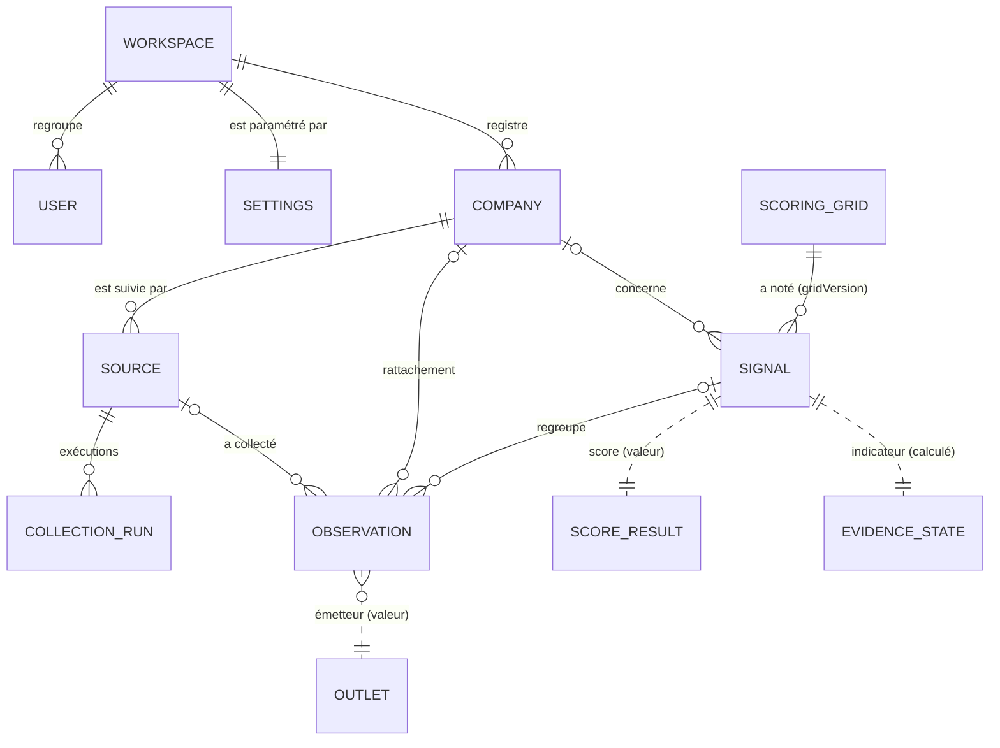
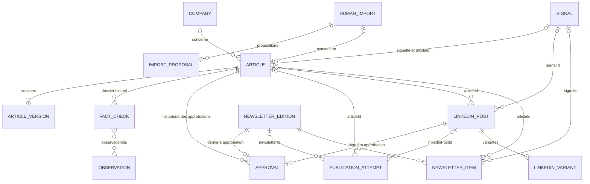
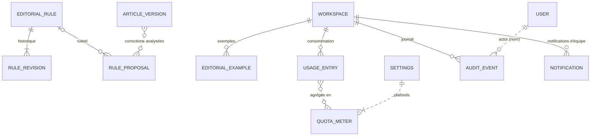

# Dictionnaire des données

**Objet.** Décrire toutes les données manipulées par KORA : entités, champs, relations, énumérations, stockage réel, identifiants, correspondance avec le schéma PostgreSQL cible, jeu de démonstration et formats d'export. Ce document répond à deux exigences du cahier des charges : le dictionnaire des données de la documentation (§10) et le « manifeste et dictionnaire [qui] décrivent les relations » de la réversibilité (§13). Public : ingénieurs back-end et data.

Les endpoints, paramètres et corps de requête sont dans la [Référence API](03-reference-api.md) ; les règles qui font évoluer les données (scoring, workflows, droits, budget) sont dans les [Règles métier](05-regles-metier.md).

## Sommaire

1. [Conventions](#conventions)
2. [Vue d'ensemble](#vue-densemble)
3. [Stockage réel](#stockage-réel)
4. [Identifiants](#identifiants)
5. [Fiches des entités](#fiches-des-entités)
6. [Énumérations](#énumérations)
7. [Correspondance avec PostgreSQL](#correspondance-avec-postgresql)
8. [Données de démonstration](#données-de-démonstration)
9. [Formats d'export](#formats-dexport)
10. [Incohérences du modèle relevées](#incohérences-du-modèle-relevées)

## Conventions

### Deux niveaux de types

| Niveau | Fichier | Rôle |
|---|---|---|
| DTO | [`src/lib/api/types.ts`](../src/lib/api/types.ts) | Ce que l'API renvoie, partagé par le serveur et le front. |
| Enregistrement | [`src/server/store/records.ts`](../src/server/store/records.ts) | Ce que le `Repository` stocke. Un enregistrement est le DTO **moins** les champs calculés, **plus** des champs internes jamais exposés. En production, chaque enregistrement est une ligne JSONB de `kora_records` (voir [Stockage réel](#stockage-réel)). |
| Table | [`db/postgres/schema.sql`](../db/postgres/schema.sql) | Schéma relationnel cible, non branché : aucun code ne l'utilise. Les lignes « SQL » des fiches renvoient à ce schéma, pas au stockage réel. |

Le passage d'un enregistrement au DTO se fait dans [`services/view.ts`](../src/server/services/view.ts) (`toCompany`, `toSource`, `toSignal`, `toArticle`, `articleDetail`, `toImport`, `toLinkedIn`, `toNewsletter`, `toRule`, `toProposal`, `toPublication`) et, pour les grilles, dans `toGrid` de [`handlers/signals.ts`](../src/server/handlers/signals.ts). Les entités sans conversion (utilisateurs, exécutions de collecte, observations, exemples, journal, notifications) ont le même type des deux côtés.

### Colonne « Présence » des fiches

| Valeur | Signification |
|---|---|
| oui | Toujours présent, jamais `null`. |
| nullable | Toujours présent ; `null` quand la valeur est inconnue ou sans objet (`T \| null`). |
| optionnel | Propriété qui peut être absente (`?:` en TypeScript). Le projet active `exactOptionalPropertyTypes`. |
| calculé | Présent dans le DTO seulement, recalculé à chaque lecture. |
| interne | Présent dans l'enregistrement seulement, jamais renvoyé par l'API. |

### Dates

- Toutes les dates sont des chaînes ISO 8601 produites par `Date.prototype.toISOString()` (UTC, suffixe `Z`), par exemple `2026-10-12T08:05:00.000Z`.
- Une date inconnue vaut `null`. Elle n'est jamais remplacée par la date de collecte ; l'interface affiche « Date inconnue » (`formatDate` dans [`labels.ts`](../src/components/kora/labels.ts)).
- Trois dates distinctes décrivent une publication : `collectedAt` (vue par KORA), `publishedAt` (publiée par l'émetteur), `eventDate` (date de l'événement relaté).
- Les découpages par jour, semaine et mois (`dayStart`, `mondayOf`, `monthKey`, `isoDay` dans [`domain/dates.ts`](../src/server/domain/dates.ts)) utilisent **le fuseau local du serveur**. Le mois de consommation est une chaîne `AAAA-MM`.

### Personnes : des noms, pas des identifiants

Les champs qui désignent une personne contiennent son **nom affiché** (`User.name`, par exemple « Claire Dubois »), pas son identifiant : `createdBy`, `updatedBy`, `approvedBy`, `decidedBy`, `by`, `actor`, `resolution.by`. Deux valeurs particulières :

- `"KORA"` (constante `KORA_AUTHOR` de [`handlers/articles.ts`](../src/server/handlers/articles.ts)) : version générée automatiquement, ou événement du journal sans auteur humain (collecte, alerte de quota).
- `HumanImport.author` et `Article.author` : auteur d'un texte importé, en texte libre. Ce n'est pas forcément un utilisateur de l'outil.

### Agrégats

Plusieurs entités sont stockées **imbriquées** dans leur parent et enregistrées d'un bloc à chaque `update` :

| Parent | Enfants imbriqués |
|---|---|
| `ArticleRecord` | `versions`, `factChecks`, `approvals`, `wordpress` |
| `LinkedInPostRecord` | `variants`, `approval` |
| `NewsletterRecord` | `items`, `approval` |
| `ImportRecord` | `proposals`, `bytes` |
| `RuleRecord` | `history` |
| `SignalRecord` | `score`, `primaryOutlet`, `suggestedAngle`, `review` |

Le schéma SQL normalise ces enfants en tables séparées (voir [Correspondance avec PostgreSQL](#correspondance-avec-postgresql)).

### Montants

Les montants sont en euros hors taxes, stockés comme `number` JavaScript, arrondis à quatre décimales pour la consommation (`Math.round(x * 10000) / 10000`).

## Vue d'ensemble

Trois diagrammes couvrent le modèle. Un trait plein est une référence par identifiant ; un trait pointillé est une relation calculée, une valeur embarquée ou une référence par nom.

### Registre et Signal Engine



### Editorial Studio et diffusion



### Référentiel éditorial et exploitation



Aucune contrainte d'intégrité n'est vérifiée par le dépôt, ni en mémoire ni en base (voir [Stockage réel](#stockage-réel)) : ce sont les handlers qui maintiennent les références (détachement à la suppression d'une entreprise, déplacement à la fusion de signaux, etc.). Le schéma SQL cible, lui, pose de vraies clés étrangères ; les cas où le code et ce schéma divergent sont listés dans [Écarts entre le code et le schéma](#écarts-entre-le-code-et-le-schéma).

## Stockage réel

Le code n'accède aux données que par l'interface `Repository` de [`store/repository.ts`](../src/server/store/repository.ts) : 18 collections (`get`, `list`, `insert`, `update`, `remove`), `getSettings`, `saveSettings`, `getWordPressSettings`, `saveWordPressSettings`, `nextId` et les verrous `acquireLock`, `replaceLock`, `releaseLock` (voir [Verrous](#verrous)). Deux implémentations existent, et `getRepository()` choisit à chaque requête API ; `usesDatabase()` de [`database.ts`](../src/server/database.ts) vaut `!VITEST && !!SUPABASE_URL` et décide aussi du mode d'authentification :

```149:159:src/server/store/memory.ts
export async function getRepository(): Promise<Repository> {
  if (usesDatabase()) {
    const g = globalThis as Record<string, unknown>;
    const db = (g["__koraDb__"] ??= new DbRepository()) as DbRepository;
    await db.ensureReady();
    return db;
  }
  const h = holder();
  if (h && h.version === STORE_VERSION) return h.repo;
  return resetStore();
}
```

| Implémentation | Fichier | Retenue quand | Contenu au départ | Durée de vie |
|---|---|---|---|---|
| `DbRepository` | [`store/db.ts`](../src/server/store/db.ts) | `VITEST` absent et `SUPABASE_URL` défini : application hébergée sur Lovable Cloud | Grille, règles et réglages du seed, sans utilisateur (voir [Installation initiale](#installation-initiale)) | Persistante : un redémarrage ne remet rien à zéro |
| `MemoryRepository` | [`store/memory.ts`](../src/server/store/memory.ts) | Sinon : tests, ou poste local lancé avec `SUPABASE_URL` vide | Jeu de démonstration complet (voir [Données de démonstration](#données-de-démonstration)) | Jusqu'à l'arrêt du processus ou au changement de `STORE_VERSION` |

En local, le fichier `.env` commité définit `SUPABASE_URL` mais pas la clé de service : `DbRepository` est retenu, le client Supabase lève « Missing Supabase environment variable(s): SUPABASE_SERVICE_ROLE_KEY » et toutes les routes `/api` répondent 500 `internal_error`. `SUPABASE_URL= bun run dev` force le dépôt en mémoire (voir [Démarrage](01-demarrage.md)).

Le schéma relationnel [`db/postgres/schema.sql`](../db/postgres/schema.sql) n'est pas ce stockage : il reste la cible, non branchée, décrite dans [Correspondance avec PostgreSQL](#correspondance-avec-postgresql).

### Tables `kora_records` et `kora_settings`

Les deux tables sont créées dans le schéma `public` de la base PostgreSQL (Supabase) de Lovable Cloud par la migration [`drizzle/migrations/0000_kora_records.sql`](../drizzle/migrations/0000_kora_records.sql). [`drizzle.config.ts`](../drizzle.config.ts) lit l'URL de migration dans `LOVABLE_DB_MIGRATION_URL` ; [`drizzle/schema.ts`](../drizzle/schema.ts) est vide (fichier généré) ; les types TypeScript des deux tables sont générés dans [`integrations/supabase/types.ts`](../src/integrations/supabase/types.ts).

**`kora_records`** : une ligne par enregistrement, toutes collections confondues.

| Colonne | Type SQL | Contraintes | Contenu |
|---|---|---|---|
| `collection` | `text` | `NOT NULL` ; clé primaire avec `id` | Nom de la collection (liste ci-dessous) |
| `id` | `text` | `NOT NULL` | Identifiant de l'enregistrement, égal à `data->>'id'` |
| `data` | `jsonb` | `NOT NULL` | Enregistrement complet, au format de [`records.ts`](../src/server/store/records.ts) |
| `created_at` | `timestamptz` | `NOT NULL DEFAULT now()` | Instant d'insertion ; ordre de lecture de `list()` |
| `updated_at` | `timestamptz` | `NOT NULL DEFAULT now()` | Écrit par `update()` côté application ; aucun déclencheur |

La clé primaire est `(collection, id)`. L'index `kora_records_collection_idx` sur `collection` double celui de la clé primaire, qui commence par la même colonne.

Les valeurs de `collection` sont les noms des propriétés du `Repository` : `users`, `companies`, `sources`, `runs`, `observations`, `signals`, `grids`, `articles`, `publications`, `imports`, `linkedin`, `newsletters`, `rules`, `examples`, `ruleProposals`, `usage`, `audit`, `notifications`. Deux valeurs internes s'y ajoutent, qui ne sont ni des collections du `Repository`, ni listées, ni exportées :

| `collection` | `id` | Contenu de `data` |
|---|---|---|
| `locks` | clé du verrou (par exemple `collecte`) | `{ id, token, expiresAt }` : clé, jeton de détention (UUID), échéance ISO 8601 (voir [Verrous](#verrous)) |
| `config` | `wordpress` | `WordPressSettings` : `{ categoryMap, defaultCategory }`, correspondance des catégories WordPress (`WORDPRESS_SETTINGS` de [`store/settings.ts`](../src/server/store/settings.ts)) |

La correspondance WordPress est rangée hors de `kora_settings` pour qu'aucune réécriture des réglages par le budget ou les alertes ne l'écrase. Un ancien champ `wordpress` de `kora_settings.data` est encore lu en secours tant que la ligne `config`/`wordpress` n'existe pas ; `saveSettings` le recopie alors dans cette ligne (par insertion seulement, jamais par-dessus une correspondance déjà enregistrée) et le retire des réglages.

**`kora_settings`** : les réglages (`Settings`) de l'espace, une seule ligne.

| Colonne | Type SQL | Contraintes | Contenu |
|---|---|---|---|
| `workspace_id` | `text` | Clé primaire | Toujours `kora` |
| `data` | `jsonb` | `NOT NULL` | Objet `Settings` complet |
| `updated_at` | `timestamptz` | `NOT NULL DEFAULT now()` | Écrit par `saveSettings()` |

Exemple de ligne `kora_records` d'un utilisateur invité qui s'est déjà connecté (valeurs fictives, `created_at` et `updated_at` omis) :

```json
{
  "collection": "users",
  "id": "u_3f9a1c27b84e0d55",
  "data": {
    "id": "u_3f9a1c27b84e0d55",
    "name": "Claire Dubois",
    "email": "claire.dubois@inovallee.com",
    "team": "Direction",
    "roles": ["validateur"],
    "avatarUrl": null,
    "authUserId": "6b1e2d4c-0a7f-4e2b-9c3d-5f8a1b2c3d4e",
    "activatedAt": "2026-10-13T08:12:40.000Z"
  }
}
```

### Contenu de la colonne `data`

- `data` contient l'enregistrement entier : champs internes compris (`fictional`, `runCount`, `simulation`, `signature` des propositions de règle, `bytes` des imports) et enfants imbriqués non normalisés (versions, dossier factuel, approbations, variantes, sujets, historique des règles).
- Le client Supabase sérialise en JSON : une propriété optionnelle absente ou `undefined` n'apparaît pas. À la lecture, rien n'est validé (`data` est simplement typé `T`) : un enregistrement écrit avec une ancienne forme la conserve.
- `ImportRecord.bytes` est un `Uint8Array`. Sérialisé en JSON, il devient un objet `{"0": 37, "1": 80, …}` environ douze fois plus gros que le fichier (près de 125 Mo de JSON pour un import de 10 Mo), relu à chaque `imports.list()` et rendu comme objet ordinaire, plus comme `Uint8Array`.

### Espace de travail

- `kora_records` n'a pas de colonne d'espace : une base correspond à un seul espace.
- `DbRepository.workspaceId` vaut `kora`, la clé de `kora_settings`. `MemoryRepository.workspaceId` reprend `Settings.workspaceId` du seed, `ws_inovallee`.
- Le JSON des réglages installés en base contient toujours `workspaceId: "ws_inovallee"`, et le manifeste d'export écrit la constante `WORKSPACE_ID` (`ws_inovallee`) quel que soit le dépôt. Aucun handler ne lit `Repository.workspaceId`.

### Accès et sécurité

- Seul le serveur accède aux tables, par `supabaseAdmin` ([`integrations/supabase/client.server.ts`](../src/integrations/supabase/client.server.ts)), qui exige `SUPABASE_URL` et `SUPABASE_SERVICE_ROLE_KEY`. La migration accorde `GRANT ALL` au rôle `service_role`, qui n'est pas soumis à la RLS.
- La RLS est activée sur les deux tables **sans aucune policy** : les rôles `anon` et `authenticated`, ceux de la clé publiable présente dans `.env` et dans les variables `VITE_*`, n'y voient ni n'y écrivent aucune ligne.
- Le client navigateur [`integrations/supabase/client.ts`](../src/integrations/supabase/client.ts) ne sert qu'à l'authentification (Supabase Auth, par [`lib/auth/session.ts`](../src/lib/auth/session.ts) et [`lib/auth/token.ts`](../src/lib/auth/token.ts)) : il ne lit aucune table. `auth-middleware.ts`, généré par la plateforme, n'est utilisé nulle part.
- Les comptes de connexion sont ceux de Supabase Auth (schéma `auth`, hors de `kora_records`) ; un utilisateur KORA s'y rattache par `authUserId` (voir [Utilisateur](#utilisateur-user)).
- Une troisième table, `app_user_connections` (migration [`0001_app_user_connections.sql`](../drizzle/migrations/0001_app_user_connections.sql)), conserve la connexion LinkedIn de chaque utilisateur : colonnes `id` (`uuid`), `user_id` (identifiant KORA), `connector_id`, `connection_key_ciphertext` (clé de connexion chiffrée en AES-256-GCM avec le secret `APP_USER_CONNECTION_KEY_SECRET`), `created_at`, `updated_at`, et `UNIQUE (user_id, connector_id)`. Comme les deux autres, elle n'est accessible qu'au rôle `service_role` (RLS activée sans policy), par [`appUserConnections.server.ts`](../src/server/appUserConnections.server.ts) ; hors base (démonstration, tests), la lecture répond toujours « aucune connexion » et la suppression ne fait rien.
- Chaque opération est une requête HTTPS vers l'API REST de Supabase : `get` lit une ligne ; `list` lit toute la collection par pages de 1 000 lignes triées par `created_at` ; `insert`, `update` et `remove` font une requête chacune.

### Cohérence : aucune transaction

- Aucune transaction. Un handler qui écrit plusieurs enregistrements (collecte, fusion de signaux, approbation, suppression d'une entreprise…) laisse un état partiel s'il échoue en route. Les opérations sensibles sont sérialisées par des [verrous](#verrous) ; ailleurs, deux requêtes simultanées qui lisent puis réécrivent le même enregistrement perdent l'une des deux écritures.
- `saveSettings` réécrit tout le JSON des réglages. Réservation du budget (`reservedEur`), suspension et alertes notifiées sont lues et réécrites sous le verrou `budget` ; si ce verrou ne peut être pris pour libérer une réservation, elle est libérée hors verrou. La base étant persistante, une réservation restée en suspens (processus interrompu pendant un appel) n'est pas effacée par un redémarrage.
- Aucune clé étrangère, contrainte `CHECK` ni unicité autre que la clé primaire : l'intégrité repose sur les handlers, comme en mémoire. Le journal d'audit n'est pas protégé contre la modification (le déclencheur `audit_events_no_update` n'existe que dans `schema.sql`).
- Différences avec `MemoryRepository` :
  - `update` d'un identifiant absent réussit sans rien écrire, alors que le dépôt mémoire lève « Enregistrement absent » ;
  - une insertion en double échoue sur la clé primaire avec le message de PostgreSQL, au lieu de « Doublon d'identifiant » ;
  - `list()` suit `created_at`, et non l'ordre d'insertion ; les lignes installées ensemble ont le même `created_at` et leur ordre n'est pas garanti ;
  - `STORE_VERSION` est sans effet : un changement de forme des enregistrements suppose de migrer les JSON existants.

<a id="verrous"></a>

### Verrous

Faute de transaction, les opérations qui ne doivent pas être doublées ou s'écraser prennent un verrou exclusif à expiration ([`Repository`](../src/server/store/repository.ts), service [`services/locks.ts`](../src/server/services/locks.ts)). Un verrou n'est pas une entité métier : il n'a ni DTO, ni export, ni entrée d'audit.

| Champ | Type | Description |
|---|---|---|
| `id` | `string` | Clé du verrou, par exemple `collecte`, `budget`, `users`, `wordpress-publish:<articleId>` |
| `token` | `string` | Jeton du détenteur : UUID en base ; en mémoire, `lock_n<k>` pour `acquireLock` (pris sur le compteur de `nextId`) et UUID pour `replaceLock` |
| `expiresAt` | `string` | Échéance ISO 8601 (en mémoire, nombre de millisecondes) ; au-delà, le verrou est considéré comme libre |

- **En base**, un verrou est une ligne `collection = 'locks'` de `kora_records` (`LockRow` de [`store/db.ts`](../src/server/store/db.ts)). `acquireLock` l'insère sans upsert : la clé primaire `(collection, id)` garantit un seul détenteur. Si la ligne existe et a expiré, elle n'est supprimée que si son jeton et son échéance sont inchangés, puis l'insertion est retentée une fois. `replaceLock` écrase la ligne (upsert) en évinçant tout détenteur ; `releaseLock` ne supprime la ligne que si le jeton correspond.
- **En mémoire**, les verrous sont une `Map` privée du `MemoryRepository`, perdue avec lui.
- `withLock` prend le verrou, exécute l'opération puis le libère, même en cas d'erreur ; s'il est déjà pris, il renvoie aussitôt une erreur 409 propre à l'opération, ou réessaie toutes les 50 ms pendant une attente bornée (5 s pour `budget` et les écritures de newsletter). Un détenteur interrompu ne libère rien : le verrou tombe à son échéance, qui doit donc couvrir toute l'opération.
- Les clés, durées et codes d'erreur sont listés dans [Verrous et demandes simultanées](03-reference-api.md#verrous) de la référence API. Une ligne `locks` peut rester en base après l'échéance ; elle est remplacée à la prise suivante de la même clé.

### Installation initiale

`ensureReady()` s'exécute à la première requête de chaque processus serveur ; son résultat est mémorisé, et une installation en échec est retentée à la requête suivante. Si `kora_settings` n'a pas de ligne `kora` :

1. le seed est construit avec l'heure courante (`buildSeed(new Date())`), mais seules la grille `grid_v1` et les règles `rule_01` à `rule_08` sont écrites dans `kora_records` (upsert) ;
2. les réglages du seed sont écrits dans `kora_settings` avec `reservedEur: 0` et `notifiedAlerts: []` : plafonds `DEFAULT_LIMITS`, `storageBaseGb` de 2,4 Go, aucune suspension.

Aucune autre collection n'est remplie : la production démarre sans utilisateur, entreprise, source, signal, article, post, newsletter, exemple éditorial, proposition de règle, consommation ni événement de journal. Le premier administrateur est créé à sa première connexion, si son adresse figure dans `KORA_ADMIN_EMAILS` (voir [Utilisateur](#utilisateur-user)) ; il invite ensuite les autres. Les dates de la grille et des règles sont relatives à l'instant d'installation (grille « créée » 120 jours plus tôt, `rule_02` en version 2 avec une version 1 datée de 110 jours plus tôt, tout signé Sophie Martin).

Les installations faites avant l'authentification écrivaient aussi les quatre utilisateurs du seed. Le script [`db/data/2026-10-13_securite_purge_heritage.sql`](../db/data/2026-10-13_securite_purge_heritage.sql), à exécuter une fois après la mise en production de l'authentification, les supprime s'ils n'ont jamais été rattachés à un compte, ainsi que les connexions LinkedIn qui n'appartiennent pas à un utilisateur rattaché et activé, et les anciens verrous `linkedin-connect:<utilisateur>:<demande>`.

Supprimer la ligne `kora` de `kora_settings` provoque une nouvelle installation au démarrage suivant du processus. L'upsert remplace alors `grid_v1` et `rule_01` à `rule_08` par leur version d'origine : les règles modifiées perdent leurs modifications, et `grid_v1` redevient active même si une grille plus récente l'est aussi. Les autres enregistrements, utilisateurs compris, restent en place.

## Identifiants

Les identifiants sont des chaînes. Le préfixe indique l'entité.

### Mécanisme `nextId`

`Repository.nextId(prefix)` est **synchrone** dans les deux implémentations, mais le suffixe diffère.

En base ([`store/db.ts`](../src/server/store/db.ts)), le suffixe juxtapose l'horodatage en millisecondes écrit en base 36 et les six premiers caractères hexadécimaux d'un UUID aléatoire :

```230:232:src/server/store/db.ts
  nextId(prefix: string) {
    return `${prefix}_${Date.now().toString(36)}${crypto.randomUUID().slice(0, 6)}`;
  }
```

Un signal créé le 12 octobre 2026 à 23 h (heure de Paris) reçoit par exemple `sig_mv5qk2o03f9a1c`. L'horodatage occupe 8 caractères jusqu'en 2059 : les identifiants se trient donc à peu près par date de création. Ils restent uniques d'un redémarrage ou d'un processus à l'autre, avec 24 bits d'aléa par milliseconde.

En mémoire ([`store/memory.ts`](../src/server/store/memory.ts)), un compteur unique, partagé par tous les préfixes, démarre à 1000 et s'incrémente à chaque appel :

```109:112:src/server/store/memory.ts
  nextId(prefix: string) {
    this.counter += 1;
    return `${prefix}_n${this.counter}`;
  }
```

Le premier identifiant créé est donc `<préfixe>_n1001`, le suivant `<autre préfixe>_n1002`, etc. Les jetons de verrou pris par `acquireLock` (`lock_n<k>`) consomment aussi ce compteur : une opération sous verrou laisse donc un trou dans la numérotation des enregistrements. Le compteur n'est pas persisté, ce qui reste sans conséquence puisque le dépôt mémoire ne l'est pas non plus : il repart à 1000 à chaque reconstruction. La lettre `n` évite toute collision avec les identifiants du seed, qui sont numérotés sans lettre (`art_0001`) ou nommés (`art_pasqal`).

Dans le tableau ci-dessous, `<s>` désigne ce suffixe : `<horodatage><aléa>` en base, `n<k>` en mémoire.

### Préfixes

| Entité | Créée par l'API | Créée par le seed | Remarque |
|---|---|---|---|
| Espace de travail | — | `ws_inovallee` | Unique dans le pilote ; `kora` dans `kora_settings` (voir [Espace de travail](#espace-de-travail)). |
| Utilisateur | `u_<16 caractères hexadécimaux>` | `u_sophie`, `u_lucas`, `u_claire`, `u_marc` | Pas de `nextId` : `userIdForEmail(email)`, début du SHA-256 de l'adresse en minuscules, pour la création par l'API comme pour l'amorçage du premier administrateur. Les utilisateurs du seed n'existent qu'en mémoire. |
| Entreprise | `co_<slug du nom>` ; à défaut `co_<s>` | `co_pasqal`… et `co_<slug>` | Slug : `normalize(name)` (minuscules, sans accents, ponctuation en espaces), espaces en tirets, 40 caractères au plus. Si l'identifiant existe déjà, `nextId("co")`. |
| Source | `src_<s>` | `src_0001`… | |
| Exécution de collecte | `run_<s>` | `run_0001`… | |
| Observation | `obs_<s>` | `obs_0001`… | |
| Signal | `sig_<s>` | `sig_pasqal`…, `sig_0006` à `sig_0248` | Les signaux créés par défusion utilisent aussi `nextId("sig")`. |
| Grille de score | `grid_v<version>` | `grid_v1` | Pas de `nextId` ; `grid_v1` est installée aussi en production. |
| Article | `art_<s>` | `art_0001`…, `art_pasqal`, `art_draft2`, `art_draft3`, `art_review`, `art_contra`, `art_rejected`, `art_import` | |
| Élément du dossier factuel | `fc_<articleId>_<i>` | `fc_<articleId>_<i>` | `i` commence à 1. |
| Approbation | `apv_<s>` | `appr_0001`… | Préfixes différents (voir [Incohérences](#incohérences-du-modèle-relevées)). |
| Tentative de diffusion | `pub_<s>` | `pub_0001`… | |
| Import humain | `imp_<s>` | `imp_0001`, `imp_0002` | |
| Proposition d'import | `<importId>_p<i>` | `prop_<importId>_<i>` | |
| Post LinkedIn | `li_<s>` | `li_pasqal`, `li_0002`… | |
| Variante LinkedIn | `<postId>_v<i>` | `<postId>_v<i>` | En modification, l'identifiant d'une variante est fourni par le client. |
| Édition de newsletter | `nl_<s>` | `nl_current`, `nl_0001`… | |
| Sujet de newsletter | `nli_<s>` | `<editionId>_i<n>` | |
| Règle éditoriale | `rule_<s>` | `rule_01`… | `rule_01` à `rule_08` sont installées aussi en production. |
| Exemple éditorial | — | `ex_01`… | Pas de création par l'API. |
| Proposition de règle | `rp_<s>` | `rp_01`… | |
| Ligne de consommation | `use_<s>` | `use_00001`… | |
| Événement d'audit | `aud_<s>` | `aud_0001`… | |
| Notification | `notif_<s>` | `notif_0001`… | |
| Brouillon WordPress distant | identifiant numérique de l'article WordPress (en texte) ; `wp-<n>` en simulation | `wp-4821`, `wp-3001`… | Attribué par le site au premier envoi ; en simulation, `SimulatedWordPress` numérote à partir de `wp-5001` dans l'ordre de création. Les versions suivantes mettent à jour le même brouillon. Un identifiant `wp-<n>` n'est jamais envoyé au site réel. |

En production, les seuls identifiants issus du seed sont ceux de `grid_v1` et de `rule_01` à `rule_08` ; tous les autres enregistrements portent un identifiant créé par l'API.

### Clé d'idempotence

`idempotencyKey` (tentatives de diffusion) vaut `sha256Hex("<contentId>:<version>:<canal>")` en hexadécimal minuscule sur 64 caractères (`idempotencyKey` dans [`domain/workflow.ts`](../src/server/domain/workflow.ts)). `contentId` est l'identifiant de l'article, du post ou de l'édition.

## Fiches des entités

### Espace, utilisateurs et consommation

#### Espace de travail (`Workspace`)

**Rôle.** Périmètre d'isolation des données d'un client : dans le pilote, l'espace unique d'Inovallée.

Il n'existe pas d'entité `Workspace` en TypeScript : seuls `Repository.workspaceId` et `Settings.workspaceId` le portent. Ils valent `ws_inovallee` en mémoire ; en base, `Repository.workspaceId` vaut `kora` alors que `Settings.workspaceId` reste `ws_inovallee` (voir [Espace de travail](#espace-de-travail)). Dans le schéma cible, la table `workspaces (id, name, created_at)` est la racine de toutes les clés composites `(workspace_id, id)`.

#### Utilisateur (`User`)

**Rôle.** Membre de l'équipe éditoriale, avec un ou plusieurs rôles.

| Champ | Type TS | Présence | Description | Contraintes et valeurs |
|---|---|---|---|---|
| `id` | `string` | oui | Identifiant | `u_<16 caractères hexadécimaux>` (`userIdForEmail`) ; `u_<prénom>` dans le seed |
| `name` | `string` | oui | Nom affiché | 1 à 120 caractères ; recopié dans tous les champs « auteur » des autres entités ; nom tiré de l'adresse pour un administrateur amorcé |
| `email` | `string` | oui | Adresse électronique | Valide, 254 caractères au plus, en minuscules ; unique sans tenir compte de la casse ; non modifiable |
| `team` | `string` | oui | Équipe ou fonction | Texte libre, 120 caractères au plus ; `""` par défaut, « Administration » pour un administrateur amorcé |
| `roles` | `Role[]` | oui | Rôles cumulés | 1 à 4 parmi `admin`, `redacteur`, `validateur`, `lecteur` |
| `avatarUrl` | `string \| null` | nullable | Photo | Toujours `null` (aucun endpoint ne la renseigne) |
| `hasAccount` | `boolean` | calculé, facultatif | Compte de connexion activé | `true` si `authUserId` et `activatedAt` sont renseignés ; sinon invitation en attente |
| `authUserId` | `string \| null` | interne, facultatif | Compte Supabase Auth rattaché | Identifiant (`sub`) du compte ; posé à l'invitation ou à l'amorçage ; absent ou `null` dans le seed et avant invitation |
| `activatedAt` | `string \| null` | interne, facultatif | Activation du compte | Première connexion réussie, ou rattachement d'un compte déjà confirmé ; posé une seule fois |

- **Enregistrement.** `UserRecord` de [`records.ts`](../src/server/store/records.ts) : le DTO sans `hasAccount`, plus `authUserId` et `activatedAt`. L'API ne renvoie jamais l'enregistrement brut : `toPublicUser` de [`auth/users.ts`](../src/server/auth/users.ts) retire les deux champs internes et calcule `hasAccount`.
- **Intégrité.**
  - Création, modification, suppression et renvoi d'invitation par `POST`, `PATCH`, `DELETE /api/users…` (droit `users.manage`), sous le verrou `users:admins` ; audit `user.create`, `user.update`, `user.delete`, `user.invite`. Il reste toujours au moins un administrateur (actif en mode `supabase`) : `422 last_admin`, `self_demotion`, `self_delete`.
  - En mode `supabase`, une requête est rattachée à l'utilisateur dont `authUserId` est le `sub` du jeton (`resolveKoraUser`). Sans utilisateur rattaché, l'adresse confirmée d'un compte listé dans `KORA_ADMIN_EMAILS` crée (ou complète, rôle `admin` ajouté) un administrateur, tant qu'aucun administrateur actif (rattaché et activé) n'existe ; audit `user.bootstrap`. Sinon : `403 account_not_authorized`.
  - Supprimer un utilisateur efface sa connexion LinkedIn (`app_user_connections`) et sa connexion en attente, mais pas son compte Supabase Auth. Seuls `byUserId` des tentatives de diffusion et `entityId` des entrées d'audit `user.*` reprennent l'identifiant ; ailleurs, auteurs et décideurs sont recopiés par nom.
  - En mode `demo`, l'utilisateur courant est choisi par le cookie `kora_uid` (`POST /api/me`) parmi les quatre utilisateurs du seed, qui n'existent qu'en mémoire.
- **SQL.** `users` (plus `created_at`) et `user_roles (user_id, role)` avec PK `(workspace_id, user_id, role)`. Le schéma cible n'a pas de colonne pour `authUserId` ni `activatedAt`.

#### Paramètres de l'espace (`Settings`)

**Rôle.** Plafonds mensuels et état du budget d'appels payants ; un seul objet par espace.

| Champ | Type TS | Présence | Description | Contraintes et valeurs |
|---|---|---|---|---|
| `workspaceId` | `string` | oui | Espace | `ws_inovallee`, y compris en base où la ligne est rangée sous `kora` |
| `quotaLimits` | `Record<QuotaKey, number>` | oui | Plafond de chaque compteur | Valeurs de `DEFAULT_LIMITS`, voir tableau ci-dessous |
| `paidCallsSuspended` | `boolean` | oui | Appels payants suspendus | Passe à `true` quand une réservation dépasserait le budget |
| `suspendedMonth` | `string \| null` | nullable | Mois de la suspension | `AAAA-MM` ; la suspension ne vaut que pour ce mois |
| `reservedEur` | `number` | oui | Montant réservé par les appels en cours | ≥ 0 ; revient à 0 hors appel, sauf écriture concurrente perdue (voir [Cohérence](#cohérence--aucune-transaction)) |
| `notifiedAlerts` | `string[]` | oui | Seuils déjà signalés | Clés `<AAAA-MM>:<compteur>:<seuil_80 \| atteint>` |
| `storageBaseGb` | `number` | oui | Volume client hors imports | 2,4 Go dans le seed, valeur installée telle quelle en production |

- **Enregistrement uniquement** : pas de DTO, l'API expose `UsageSnapshot`. Stocké dans `kora_settings.data` en production. Il n'existe aucun endpoint pour modifier les plafonds. En mémoire, ils sont recopiés de `DEFAULT_LIMITS` ([`domain/budget.ts`](../src/server/domain/budget.ts)) à chaque reconstruction ; en base, ils sont figés à l'installation, et modifier `DEFAULT_LIMITS` n'a plus d'effet : il faut modifier `quotaLimits` dans `kora_settings.data`.
- **SQL.** `workspace_settings` aplatit `quotaLimits` en colonnes `limit_*` dont les valeurs par défaut reprennent `DEFAULT_LIMITS` ; `notifiedAlerts` devient la table `quota_alerts (month, meter, level)`.

Plafonds et compteurs (`METERS` et `DEFAULT_LIMITS` de [`domain/budget.ts`](../src/server/domain/budget.ts), calcul dans `usageSnapshot` de [`services/usage.ts`](../src/server/services/usage.ts)) :

| Clé | Libellé | Unité | Plafond | Valeur `used` | Alerte notifiée |
|---|---|---|---|---|---|
| `api_budget_eur` | Budget API | € HT | 150 | Somme des `costEur` du mois | oui |
| `search_queries` | Recherches web | requêtes | 3 000 | Unités `search_query` du mois | oui |
| `observations` | Nouvelles observations | observations | 6 000 | Unités `observation` du mois | oui |
| `articles` | Dossiers et articles | articles | 25 | Unités `generation_article` du mois | oui |
| `linkedin_posts` | Posts LinkedIn | posts | 25 | Unités `generation_linkedin` du mois | oui |
| `newsletters` | Éditions newsletter | éditions | 5 | Éditions créées dans le mois | oui |
| `companies` | Entreprises suivies | entreprises | 150 | Nombre d'entreprises du registre | non |
| `sources` | Sources configurées | sources | 300 | Nombre de sources | non |
| `storage_gb` | Stockage | Go | 10 | `storageBaseGb` + taille des fichiers importés | oui |

#### Ligne de consommation (`UsageEntry`)

**Rôle.** Trace d'un appel payant (génération, recherche, observation) avec son coût estimé.

| Champ | Type TS | Présence | Description | Contraintes et valeurs |
|---|---|---|---|---|
| `id` | `string` | oui | Identifiant | `use_…` |
| `at` | `string` | oui | Horodatage | ISO 8601 ; détermine le mois de rattachement |
| `kind` | `UsageKind` | oui | Nature de l'appel | `generation_article`, `generation_linkedin`, `generation_summary`, `classification`, `search_query`, `observation` |
| `units` | `number` | oui | Unités consommées | Entier ≥ 0 |
| `costEur` | `number` | oui | Coût estimé | € HT, quatre décimales ; plafonné au montant réservé pour l'appel |
| `label` | `string` | oui | Libellé lisible | Par exemple « Collecte <libellé de la source> » |

- **Enregistrement uniquement.** Exposé de façon agrégée par `GET /api/usage`.
- **Coûts unitaires** (`COSTS` de [`domain/budget.ts`](../src/server/domain/budget.ts)) : article 0,45 €, post LinkedIn 0,08 €, résumé 0,02 €, recherche web 0,012 €, observation 0,021 €. Ce sont des estimations, pas le coût facturé par le fournisseur.
- **Intégrité.** `paidCall` réserve l'estimation dans `Settings.reservedEur` avant l'appel, sous le verrou `budget`. Après l'appel, il insère les lignes, puis libère la réservation dans un `finally` et vérifie les seuils d'alerte ; si l'appel lève une exception, la réservation est libérée sans aucune ligne. Une ligne sans unité ni coût n'est pas insérée. Une collecte réserve 0,075 € (une recherche et trois observations), puis enregistre une ligne `search_query` et, si la source a renvoyé des publications nouvelles, une ligne `observation` dont `units` compte ces publications (trois au plus) : une publication dont l'URL canonique est déjà connue, ou refusée par le filtrage SSRF, n'est pas comptée.
- **Collecte réelle.** Le collecteur réel lit des flux RSS et Google News gratuits (la recherche Perplexity n'a pas de ligne propre), mais chaque exécution reste comptée comme un appel payant estimé. Une collecte complète de 150 sources consomme entre 1,80 € (aucune nouveauté) et 11,25 € (trois nouveautés par source) : le budget de 150 € couvre au moins 13 collectes complètes par mois.
- **SQL.** `usage_ledger`, avec `cost_eur numeric(10,4)`.

#### Compteurs de quotas (`QuotaMeter`, `UsageSnapshot`)

**Rôle.** Vue calculée de la consommation du mois, renvoyée par `GET /api/usage`.

| Champ | Type TS | Présence | Description | Contraintes et valeurs |
|---|---|---|---|---|
| `UsageSnapshot.month` | `string` | oui | Mois courant | `AAAA-MM` |
| `UsageSnapshot.meters` | `QuotaMeter[]` | oui | Les neuf compteurs | Ordre du tableau `METERS` |
| `UsageSnapshot.paidCallsSuspended` | `boolean` | oui | Suspension en cours | `true` si le budget du mois est atteint, ou si `Settings.paidCallsSuspended` vaut `true` avec `suspendedMonth` égal au mois courant |
| `key` | union de 9 clés (`QuotaKey`) | oui | Compteur | Voir tableau des plafonds |
| `label`, `unit` | `string` | oui | Libellé et unité | Issus de `METERS` |
| `used` | `number` | oui | Consommé | Euros arrondis au centime ; stockage arrondi à 0,01 Go (1 Go = 10⁹ octets) |
| `limit` | `number` | oui | Plafond | `Settings.quotaLimits[key]` |
| `ratio` | `number` | oui | `min(1, used / limit)` | Trois décimales ; 1 si le plafond vaut 0 |
| `alert` | `"ok" \| "seuil_80" \| "atteint"` | oui | Niveau d'alerte | `seuil_80` à partir de 0,8 ; `atteint` à 1 |

Aucun stockage : tout est recalculé à partir de `usage`, des collections et de `Settings`.

### Registre : entreprises, sources, collectes

#### Entreprise (`Company`)

**Rôle.** Entreprise suivie du registre de veille.

| Champ | Type TS | Présence | Description | Contraintes et valeurs |
|---|---|---|---|---|
| `id` | `string` | oui | Identifiant | `co_<slug>` (voir [Identifiants](#identifiants)) |
| `name` | `string` | oui | Raison sociale | 2 à 120 caractères ; unique après `normalize` |
| `aliases` | `string[]` | oui | Autres noms | 20 au plus, 120 caractères chacun, sans doublon |
| `domain` | `string` | oui | Domaine officiel | Normalisé (minuscules, sans schéma, sans `www.`, sans chemin) ; regex `^[a-z0-9-]+(\.[a-z0-9-]+)+$` ; adresses internes refusées ; unique |
| `sector` | `string` | oui | Secteur d'activité | 2 à 120 caractères |
| `territory` | `string` | oui | Commune ou zone | 120 caractères au plus ; « Grenoble » par défaut |
| `priority` | `CompanyPriority` | oui | Priorité de veille | `haute`, `normale` (défaut), `basse` |
| `themes` | `Theme[]` | oui | Thématiques Inovallée | 7 au plus, sans doublon |
| `brand` | `{ initials: string; bg: string; fg: string }` | oui | Monogramme affiché | Initiales recalculées à chaque renommage ; couleurs `BRAND_COLORS[hash32(name) % 8]` ([`catalog.ts`](../src/server/store/catalog.ts)) |
| `createdAt` | `string` | oui | Entrée au registre | ISO 8601 |
| `sourceCount` | `number` | calculé | Nombre de sources | |
| `failingSourceCount` | `number` | calculé | Sources dont `access = "erreur"` | |
| `signalCount` | `number` | calculé | Signaux rattachés | |
| `fictional` | `boolean` | interne | Entreprise inventée pour la démonstration | `false` pour toute entreprise créée par l'API ; lu seulement par le collecteur simulé des tests |

- **Clés étrangères.** Aucune.
- **Intégrité.**
  - Création refusée si le nom normalisé ou le domaine existe déjà (409 `duplicate_company`) ou si le quota `companies` est atteint (422 `quota_exceeded`).
  - La création (`createCompany` dans [`handlers/registry.ts`](../src/server/handlers/registry.ts)) insère aussi une source `recherche_web` « Google News — <nom> » : URL `googleNewsUrl(nom)`, fréquence `quotidienne`, accès `en_attente`, `simulation: { mode: "auto" }`. La réponse 201 porte donc `sourceCount: 1`. Cette source ne passe pas par le contrôle du quota `sources` ni par l'audit `source.create`, et son URL garde l'ancien nom si l'entreprise est renommée.
  - La suppression (`deleteCompany`) supprime les sources de l'entreprise ; détache ses signaux (`companyId = null`, revue `homonymie` « Entreprise « X » retirée du registre : à rattacher »), ses observations, ses articles et ses posts LinkedIn. Les exécutions de collecte sont conservées.
- **DTO et enregistrement.** `toCompany` retire `fictional` et ajoute les trois compteurs.
- **SQL.** `companies`, avec `brand_initials`, `brand_bg`, `brand_fg` (couleurs hexadécimales vérifiées), `UNIQUE (workspace_id, domain)` et un index unique sur `lower(name)`. Il n'y a pas de colonne `fictional`.

#### Source (`Source`)

**Rôle.** Point d'accès surveillé pour une entreprise (site, page d'actualités, flux RSS, recherche web…).

| Champ | Type TS | Présence | Description | Contraintes et valeurs |
|---|---|---|---|---|
| `id` | `string` | oui | Identifiant | `src_…` |
| `companyId` | `string` | oui | Entreprise suivie | Référence `Company.id` |
| `type` | `SourceType` | oui | Nature de la source | 6 valeurs, voir [Énumérations](#registre-et-collecte) |
| `label` | `string` | oui | Libellé | 1 à 120 caractères |
| `url` | `string` | oui | Adresse surveillée | 2 048 caractères au plus ; `http` ou `https` ; adresses internes refusées (`validateSourceUrl`) ; unique par entreprise |
| `frequency` | `SourceFrequency` | oui | Fréquence prévue | Par défaut `hebdomadaire` pour `recherche_web`, `quotidienne` sinon ; `quotidienne` pour la source Google News créée avec l'entreprise |
| `access` | `SourceAccess` | oui | État d'accès | `en_attente` à la création ; `erreur` posé seulement par la collecte |
| `lastRunAt` | `string \| null` | nullable | Dernière exécution | |
| `lastSuccessAt` | `string \| null` | nullable | Dernière réussite | |
| `failureCode` | `string \| null` | nullable | Code d'échec | Collecteur réel : `TIMEOUT` (15 s), `HTTP_<statut>` ou `NETWORK` ; le seed contient aussi `TLS_ERROR` |
| `failureReason` | `string \| null` | nullable | Motif lisible | Message de l'erreur réseau, par exemple « Réponse HTTP 404 » |
| `attempts` | `number` | oui | Essais de la dernière exécution en échec | 0 à 3 (`MAX_ATTEMPTS`) ; 0 après un succès |
| `createdAt` | `string` | interne | Création | |
| `runCount` | `number` | interne | Nombre d'exécutions | Lu seulement par le collecteur simulé des tests |
| `simulation` | `SourceSimulation` | interne | Comportement simulé | `{ mode }` parmi `auto`, `news`, `empty`, `transient`, `fail` (ce dernier avec `code` et `reason`) ; ignoré par le collecteur réel |

- **Clés étrangères.** `companyId` → `Company`.
- **Intégrité.**
  - 409 `duplicate_source` si l'URL existe déjà pour l'entreprise ; 422 `quota_exceeded` au-delà de 300 sources.
  - Une exécution réussie remet `access` à `ok` ; trois essais infructueux dans la même exécution le passent à `erreur` (avec notification à la première bascule).
  - En modification, `access: "erreur"` est refusé (422 `invalid_access`). Repasser à `ok` ou `en_attente` efface `failureCode`, `failureReason` et `attempts`. Changer l'URL remet la source `en_attente` (sauf si elle est désactivée).
  - La suppression d'une source met `sourceId` à `null` sur ses observations et conserve ses exécutions.
- **DTO et enregistrement.** `toSource` retire `createdAt`, `runCount` et `simulation`.
- **SQL.** `sources`, avec `UNIQUE (workspace_id, company_id, url)`, `attempts` entre 0 et 3, `CHECK (access <> 'erreur' OR failure_code IS NOT NULL)` et une FK vers `companies` en `ON DELETE CASCADE`.

#### Exécution de collecte (`CollectionRun`)

**Rôle.** Historique d'une exécution de collecte sur une source.

| Champ | Type TS | Présence | Description | Contraintes et valeurs |
|---|---|---|---|---|
| `id` | `string` | oui | Identifiant | `run_…` |
| `sourceId` | `string` | oui | Source exécutée | Référence `Source.id` |
| `companyId` | `string` | oui | Entreprise de la source | Copie de `Source.companyId` |
| `startedAt` | `string` | oui | Début | |
| `finishedAt` | `string \| null` | nullable | Fin | Toujours renseigné aujourd'hui |
| `status` | `CollectionRunStatus` | oui | Résultat | `succes`, `succes_sans_actualite`, `echec`, `bloque_quota` |
| `newObservations` | `number` | oui | Observations nouvelles | Après dédoublonnage ; 5 au plus (`MAX_ITEMS`), toutes provenances confondues |
| `errorCode` | `string \| null` | nullable | Code d'erreur ou d'avertissement | Échec : code du collecteur (`TIMEOUT`, `HTTP_<statut>`, `NETWORK`, `NO_FEED` pour le collecteur réel) ou `budget_busy` ; `bloque_quota` : `budget_exhausted` ; succès : `null` ou avertissement (code de l'échec de Google News compensé par Perplexity, `DATE_REJECTED` quand des articles Google News ont été écartés par la vérification de la date, ou `DATE_UNCHECKED` quand cette vérification s'est arrêtée trop tôt sans rien écarter). L'interface distingue l'erreur de l'avertissement par le statut de l'exécution (`runNotice`, [`runs.ts`](../src/components/veille/runs.ts)) |
| `errorMessage` | `string \| null` | nullable | Message | « Budget API atteint : collecte suspendue » en cas de blocage ; « Google News : `<motif>` » pour l'avertissement Google News ; « Google News : N publications écartées par la vérification de la date (…) », avec le nombre par motif, pour `DATE_REJECTED` ; « Google News : N publications non examinées (…) » pour `DATE_UNCHECKED` |
| `enrichment` | `CollectionEnrichment \| null` | facultatif | Bilan de la recherche complémentaire Perplexity | Présent dès que le collecteur réel a tenté cette recherche (source Google News rattachée à une entreprise) ; absent sinon, pour le collecteur simulé et sur les exécutions antérieures |

Champs de `CollectionEnrichment` ([`types.ts`](../src/lib/api/types.ts)), embarqué par valeur :

| Champ | Type TS | Description | Contraintes et valeurs |
|---|---|---|---|
| `provider` | `"perplexity"` | Fournisseur | Seule valeur |
| `status` | `"ok" \| "non_configure" \| "erreur"` | Issue de l'appel | `non_configure` si un secret manque, `erreur` si l'appel échoue |
| `received` | `number` | Résultats renvoyés par Perplexity | 5 au plus |
| `matched` | `number` | Résultats retenus | Datés, hors site de l'entreprise, qui la citent ; avant dédoublonnage avec Google News et filtre de fraîcheur |
| `added` | `number` | Nouvelles observations issues de Perplexity | Recalculé par la collecte : observations créées avec `via: "perplexity"` |
| `message` | `string \| null` | Motif | « Secret manquant : … » ou statut HTTP et début de réponse, « Délai de réponse dépassé » ; `null` si `ok` |

- **Clés étrangères.** `sourceId` → `Source` ; `companyId` → `Company` (non vérifiée).
- **Intégrité.**
  - Insertion seule. Une exécution créée par l'API a `startedAt === finishedAt`, car l'horloge est lue une fois par requête (`ctx.now`) : la durée réelle des appels réseau (jusqu'à trois essais de 15 s) n'est pas enregistrée.
  - La collecte d'une source désactivée est refusée (409 `source_disabled`). Une seule collecte, unitaire ou globale, s'exécute à la fois, sous le verrou `collecte` (15 min ; sinon 409 `collection_in_progress`).
  - Une exécution `bloque_quota`, ou `echec` avec `budget_busy` (verrou du budget occupé plus de 5 s), ne modifie pas la source.
  - Le statut d'une exécution réussie ne dépend que de `newObservations` : un avertissement dans `errorCode` ne la fait pas passer en échec.
  - Seule la collecte globale (`POST /api/collect`) laisse un événement d'audit (`collect.all`).
- **SQL.** `collection_runs`, avec `CHECK (finished_at >= started_at)` et `CHECK (status NOT IN ('echec','bloque_quota') OR error_code IS NOT NULL)`. La FK vers `sources` est en `ON DELETE CASCADE`.

### Signal Engine : observations, signaux, scores

#### Média émetteur (`Outlet`)

**Rôle.** Émetteur d'une publication (média ou entreprise elle-même), embarqué par valeur.

| Champ | Type TS | Présence | Description | Contraintes et valeurs |
|---|---|---|---|---|
| `name` | `string` | oui | Nom | « Les Echos », « Pasqal »… |
| `domain` | `string` | oui | Domaine | Sert à compter les corroborations indépendantes |
| `brand` | `{ initials; bg; fg }` | oui | Monogramme | Même forme que `Company.brand` |

Pas de collection : l'émetteur est recopié dans chaque observation. Le seed et le collecteur simulé puisent dans `OUTLETS` ([`catalog.ts`](../src/server/store/catalog.ts)). Le collecteur réel (`parseFeed` dans [`adapters/collector.ts`](../src/server/adapters/collector.ts)) prend la balise `<source>` de Google News : nom du média, domaine de son attribut `url`, monogramme gris calculé. À défaut, il prend l'entreprise de la source, avec son domaine et son monogramme, même pour un flux généraliste filtré sur son nom ; si la source n'a pas d'entreprise, il prend le nom d'hôte du flux. Pour un résultat de la recherche Perplexity (`mapPerplexityResults`), le nom et le domaine sont le nom d'hôte de la publication (sans `www.`), avec un monogramme gris calculé.

#### Observation (`Observation`)

**Rôle.** Une publication collectée, rattachée à une entreprise et regroupée dans un signal.

| Champ | Type TS | Présence | Description | Contraintes et valeurs |
|---|---|---|---|---|
| `id` | `string` | oui | Identifiant | `obs_…` |
| `signalId` | `string \| null` | nullable | Signal de regroupement | Renseigné dès l'ingestion |
| `sourceId` | `string \| null` | nullable | Source qui l'a collectée | `null` pour une reprise média sans source configurée, ou après suppression de la source |
| `companyId` | `string \| null` | nullable | Entreprise rattachée | `null` = à rattacher (confiance inférieure à 60) |
| `outlet` | `Outlet` | oui | Émetteur | |
| `url` | `string` | oui | Adresse de la publication | Filtrée par `validateSourceUrl` (publication ignorée sinon) ; dédoublonnée par URL canonique (hôte sans `www.`, chemin sans `/` final, paramètres `utm_*` et ancre retirés, minuscules) |
| `title` | `string` | oui | Titre | Texte nettoyé, 300 caractères au plus |
| `excerpt` | `string` | oui | Extrait | HTML retiré, instructions neutralisées, 1 200 caractères au plus |
| `collectedAt` | `string` | oui | Date de collecte | |
| `publishedAt` | `string \| null` | nullable | Date de publication | Jamais inventée |
| `eventDate` | `string \| null` | nullable | Date de l'événement | Jamais inventée ; toujours `null` avec le collecteur réel |
| `matchConfidence` | `number` | oui | Confiance du rattachement | 0 à 100 ; ce n'est pas une probabilité de véracité |
| `isSyndicated` | `boolean` | oui | Reprise d'un même communiqué | Recalculé à chaque ingestion (similarité ≥ 0,8 avec une publication antérieure d'un autre domaine) |
| `via` | `ObservationVia` | facultatif | Canal de découverte | `flux` (flux de la source), `google_news`, `perplexity` ; posé par le collecteur réel, absent des observations du seed, du collecteur simulé et de celles collectées avant ce suivi |

- **Collecte réelle.** Pour une entrée Google News, `url` est l'adresse de l'article chez le média, obtenue en résolvant le lien de redirection `https://news.google.com/rss/articles/…` (une observation antérieure au 13 novembre 2026 peut encore porter la redirection) ; le suffixe « - <média> » est retiré du titre. `excerpt` vient de `<description>`, `<summary>` ou `<content>` ; `publishedAt` de `<pubDate>`, `<published>` ou `<updated>`, sauf pour une entrée Google News ingérée depuis le 13 novembre 2026, où c'est la date originale lue sur la page de l'éditeur (voir [Date originale des articles Google News](03-reference-api.md#date-originale-google-news)) ; `eventDate` vaut toujours `null`. Pour un résultat Perplexity, `url` est l'adresse chez le média, `excerpt` l'extrait renvoyé, `publishedAt` la date du résultat. Seules les entrées datées des 30 derniers jours (au plus un jour dans le futur) sont gardées, les entrées sans date sont écartées ; une exécution crée au plus cinq nouvelles observations (`MAX_ITEMS`), les plus récentes d'abord, sans compter les publications déjà connues.
- **Valeurs de `matchConfidence` à la collecte** (`matchCompany` de [`domain/clustering.ts`](../src/server/domain/clustering.ts)) : 97 si l'URL est sur le domaine officiel (jamais le cas d'un lien Google News) ; 92 ou 84 si l'entreprise de la source est nommée par sa raison sociale ou par un alias ; 82 ou 66 pour une autre entreprise du registre ; 70 si plusieurs candidates mais l'entreprise de la source en fait partie ; 52, 45 ou 20 sans rattachement. Un rattachement manuel la fixe à 100.
- **Clés étrangères.** `signalId` → `Signal`, `sourceId` → `Source`, `companyId` → `Company`.
- **Intégrité.** Rattachement, détachement, fusion et défusion de signaux modifient `signalId`, `companyId` et `matchConfidence`.
- **SQL.** `observations`, avec l'émetteur aplati en `outlet_name`, `outlet_domain`, `outlet_brand jsonb`, une colonne supplémentaire `url_canonical` et `UNIQUE (workspace_id, url_canonical)`.

#### Signal (`Signal`)

**Rôle.** Un événement d'entreprise, regroupant une ou plusieurs observations, noté et suivi jusqu'à la décision éditoriale.

| Champ | Type TS | Présence | Description | Contraintes et valeurs |
|---|---|---|---|---|
| `id` | `string` | oui | Identifiant | `sig_…` |
| `companyId` | `string \| null` | nullable | Entreprise concernée | `null` = à rattacher, accompagné d'une revue |
| `title` | `string` | oui | Titre | Titre de la première observation |
| `summary` | `string` | oui | Résumé | Généré à la création (gabarit, réécrit par OpenAI si configuré) |
| `category` | `Category` | oui | Catégorie | 12 valeurs, classement par mots-clés |
| `themes` | `Theme[]` | oui | Thématiques | Celles de l'entreprise |
| `tags` | `string[]` | oui | Mots-clés affichés | Libellé de catégorie et thèmes, 4 au plus à la création, 6 après fusion |
| `status` | `SignalStatus` | oui | Statut éditorial | 6 valeurs |
| `statusReason` | `string \| null` | nullable | Motif de la décision | 500 caractères au plus ; obligatoire pour passer à `rejete` (422 `reason_required`) ; remis à `null` à chaque changement de statut sans motif |
| `observationIds` | `string[]` | oui | Observations regroupées | Recalculé dans le DTO à partir de `Observation.signalId` |
| `primaryOutlet` | `Outlet` | oui | Émetteur principal | |
| `primaryUrl` | `string` | oui | Lien principal | URL de l'observation principale ; lien `news.google.com` si elle vient de Google News |
| `collectedAt` | `string` | oui | Première collecte | |
| `publishedAt` | `string \| null` | nullable | Date de publication | |
| `eventDate` | `string \| null` | nullable | Date de l'événement | Toujours `null` pour un signal issu du collecteur réel |
| `matchConfidence` | `number` | oui | Confiance du rattachement | 0 à 100 |
| `score` | `ScoreResult` | oui | Score éditorial | Voir fiche dédiée |
| `evidence` | `EvidenceState` | calculé | Indicateur documentaire | `computeEvidence` à chaque lecture |
| `whyInteresting` | `string[]` | oui | Raisons d'intérêt | |
| `suggestedAngle` | `{ text: string; tags: string[] }` | oui | Angle proposé | |
| `readingMinutes` | `number` | oui | Temps de lecture estimé | Minutes |
| `review` | `{ kind: "homonymie" \| "fusion_incertaine"; note: string } \| null` | nullable | Point à vérifier | Voir [Énumérations](#signaux-et-scoring) |
| `inNewsletter` | `boolean` | calculé | Présent dans l'édition en cours | Édition non exportée la plus récente par `createdAt` |
| `articleId` | `string \| null` | nullable | Article issu du signal | Un seul article par signal à la création |
| `createdAt` | `string` | oui | Création | |
| `updatedAt` | `string` | oui | Dernière modification | |

`SignalDetail` (`GET /api/signals/:id`) ajoute `company: Company | null` et `observations: Observation[]`.

- **Clés étrangères.** `companyId` → `Company` ; `articleId` → `Article` ; `score.gridVersion` → `ScoringGrid.version`.
- **Intégrité.**
  - Création par la collecte au statut `nouveau` ; passage à `en_revue` à la création d'un article (sauf s'il est déjà `traite`) ; passage à `traite` au dépôt d'un brouillon WordPress.
  - Un signal sans entreprise porte une revue `homonymie` ; une fusion incertaine porte une revue `fusion_incertaine`.
  - La fusion déplace observations, articles, posts LinkedIn et sujets de newsletter vers le signal cible, puis supprime les autres signaux. Elle est refusée entre deux entreprises différentes.
  - La re-notation (`POST /api/signals/rescore`) ignore les signaux décidés (`traite`, `rejete`).
- **DTO et enregistrement.** `SignalRecord = Omit<Signal, "evidence" | "inNewsletter">`. `toSignal` recalcule `observationIds` dans l'ordre de l'enregistrement, en ne gardant que les observations dont `signalId` correspond.
- **SQL.** `signals` aplatit le score (`score_total`, `grid_version`, `sub_importance` … `sub_diffusion`, `score_reasons jsonb`), l'émetteur principal (`primary_outlet_name`, `primary_outlet_domain`, sans monogramme) et la revue (`review_kind`, `review_note`). `observationIds` n'a pas de colonne : il se déduit de `observations.signal_id`.

Exemple : extrait du DTO `sig_pasqal` du seed (champs textuels, dates et lien principal omis) :

```json
{
  "id": "sig_pasqal",
  "companyId": "co_pasqal",
  "title": "Pasqal lève 100 M€ pour accélérer l'informatique quantique",
  "category": "financement",
  "themes": ["deeptech_quantique"],
  "tags": ["Deeptech", "Quantique", "Levée de fonds"],
  "status": "nouveau",
  "statusReason": null,
  "observationIds": ["obs_0001", "obs_0002", "obs_0003", "obs_0004"],
  "primaryOutlet": { "name": "Les Echos", "domain": "lesechos.fr", "brand": { "initials": "E", "bg": "#111111", "fg": "#ffffff" } },
  "matchConfidence": 92,
  "score": {
    "total": 92,
    "gridVersion": 1,
    "subScores": { "importance": 95, "nouveaute": 90, "territoire": 95, "lecteurs": 90, "diffusion": 85 },
    "reasons": {
      "importance": "Catégorie « financement », montant élevé (100 M€), entreprise prioritaire du registre",
      "nouveaute": "Premier sujet de cette nature sur 90 jours",
      "territoire": "Entreprise de l'agglomération grenobloise (Grenoble)",
      "lecteurs": "Thématique prioritaire de la ligne éditoriale",
      "diffusion": "2 média(s) indépendant(s), dont un média national"
    }
  },
  "evidence": {
    "level": "solide",
    "directSource": true,
    "independentCorroborations": 2,
    "freshnessDays": 0,
    "contradictions": [],
    "explanation": [
      "Source directe disponible (Pasqal)",
      "2 corroboration(s) indépendante(s) : Les Echos, La Tribune",
      "1 reprise(s) du même communiqué non comptée(s) : Le Dauphiné Libéré",
      "Publication du jour",
      "Indicateur documentaire explicable, pas une probabilité de véracité"
    ]
  },
  "review": null,
  "inNewsletter": true,
  "articleId": null
}
```

#### Grille de score (`ScoringGrid`)

**Rôle.** Pondération versionnée des cinq critères du score éditorial.

| Champ | Type TS | Présence | Description | Contraintes et valeurs |
|---|---|---|---|---|
| `version` | `number` | oui | Numéro de version | 1, 2, 3… ; max + 1 à chaque création |
| `weights` | `Record<Criterion, number>` | oui | Poids des critères | Entiers de 0 à 100, somme égale à 100 (422 `weights_sum_invalid`) |
| `createdAt` | `string` | oui | Création | |
| `createdBy` | `string` | oui | Auteur | Nom |
| `active` | `boolean` | oui | Grille en vigueur | Une seule active |
| `note` | `string \| null` | nullable | Motif du changement | |
| `id` | `string` | interne | Identifiant | `grid_v<version>` |

- **Intégrité.** Créer une grille désactive les précédentes ; les grilles ne sont jamais modifiées ni supprimées par l'API. Les poids par défaut sont 30 / 20 / 20 / 20 / 10 (`DEFAULT_WEIGHTS` de [`domain/scoring.ts`](../src/server/domain/scoring.ts)). `grid_v1` est installée en production ; une réinstallation la remet active (voir [Installation initiale](#installation-initiale)).
- **SQL.** `scoring_grids`, clé `(workspace_id, version)`, poids en colonnes `w_importance` … `w_diffusion` avec `CHECK` de somme à 100, index unique partiel `scoring_grids_one_active`. La colonne `id` n'existe pas.

#### Résultat de score (`ScoreResult`)

**Rôle.** Note d'un signal sur 100, avec le détail par critère et la grille utilisée ; embarquée dans `Signal.score`.

| Champ | Type TS | Présence | Description | Contraintes et valeurs |
|---|---|---|---|---|
| `total` | `number` | oui | Score 0 à 100 | `round(Σ sous-score × poids / 100)` ; affiché sur 10 par `scoreOn10` |
| `gridVersion` | `number` | oui | Grille appliquée | |
| `subScores` | `Record<Criterion, number>` | oui | Sous-scores | 0 à 100 |
| `reasons` | `Record<Criterion, string>` | oui | Justification par critère | Texte |

#### Indicateur documentaire (`EvidenceState`)

**Rôle.** Solidité du dossier de sources d'un signal, distincte du score ; jamais stockée.

| Champ | Type TS | Présence | Description | Contraintes et valeurs |
|---|---|---|---|---|
| `level` | `EvidenceLevel` | oui | Niveau | `solide`, `a_consolider`, `fragile` |
| `directSource` | `boolean` | oui | Publication de l'entreprise elle-même | Domaine de l'émetteur ou de l'URL égal au domaine officiel |
| `independentCorroborations` | `number` | oui | Médias indépendants | Domaines distincts hors source directe et hors reprises ; sans source directe, le premier domaine sert de source et n'est pas compté |
| `freshnessDays` | `number \| null` | nullable | Ancienneté en jours | D'après la date de publication (ou d'événement) la plus récente ; `null` si aucune n'est connue |
| `contradictions` | `string[]` | oui | Contradictions détectées | Par exemple des montants divergents |
| `explanation` | `string[]` | oui | Explication lisible | |

Calcul dans `computeEvidence` de [`domain/evidence.ts`](../src/server/domain/evidence.ts) ; les règles sont décrites dans les [Règles métier](05-regles-metier.md).

### Editorial Studio : articles, approbations, envois

#### Article (`Article`)

**Rôle.** Contenu éditorial versionné, issu d'un signal (dossier KORA) ou d'un texte importé.

| Champ | Type TS | Présence | Description | Contraintes et valeurs |
|---|---|---|---|---|
| `id` | `string` | oui | Identifiant | `art_…` |
| `signalId` | `string \| null` | nullable | Signal d'origine | `null` pour un import ou après détachement |
| `companyId` | `string \| null` | nullable | Entreprise concernée | |
| `origin` | `ArticleOrigin` | oui | Provenance | `kora` ou `import_humain` |
| `author` | `string \| null` | nullable | Auteur du texte importé | Obligatoire si `origin = "import_humain"` ; jamais remplacé |
| `status` | `ArticleStatus` | oui | Statut | 6 valeurs |
| `currentVersion` | `number` | oui | Version courante | Numéro `n` de la dernière version |
| `title` | `string` | oui | Titre | Copie du titre de la version courante |
| `excerpt` | `string` | oui | Extrait | Copie de l'extrait de la version courante |
| `angles` | `string[]` | oui | Angles éditoriaux proposés | Vides pour un import |
| `plan` | `string[]` | oui | Plan proposé | Vide pour un import |
| `factChecks` | `FactCheck[]` | oui | Dossier factuel | Voir fiche |
| `approvals` | `Approval[]` | oui | Historique des approbations | Une seule valide par canal |
| `wordpress` | `{ remoteId: string \| null; status: WordPressRemoteStatus; lastSyncAt: string \| null; editUrl?: string \| null }` | oui | État côté WordPress | `remoteId` : identifiant numérique de l'article sur le site, ou `wp-<n>` en simulation ; `editUrl` (lien d'édition dans l'administration WordPress) calculé à la lecture, jamais stocké, `null` en simulation |
| `createdAt` | `string` | oui | Création | |
| `updatedAt` | `string` | oui | Dernière modification | |
| `versions` | `ArticleVersion[]` | interne | Toutes les versions | Exposées par `ArticleDetail` |
| `publishedAt` | `string \| null` | interne | Date de publication publique | Renseignée quand le contenu est constaté en ligne sur WordPress (date de l'article distant, à défaut l'instant du constat) |
| `createdBy` | `string` | interne | Créateur | Nom |
| `wordpress.site` | `string \| null` | interne, facultatif | Site qui a produit `remoteId` | `null` ou absent pour un identifiant simulé ou antérieur à l'intégration réelle ; jamais exposé |
| `wordpress.sentModifiedGmt` | `string \| null` | interne, facultatif | Date de modification renvoyée par WordPress après le dernier envoi de KORA | Sert à détecter une retouche faite dans WordPress (`409 wordpress_remote_modified`) ; inchangée par une actualisation ; jamais exposée |

`ArticleDetail` (`GET /api/articles/:id`) ajoute `versions` (triées par `n`), `signal: Signal | null`, `observations` (celles du dossier factuel et du signal) et `publications` (tentatives dont `articleId` est l'article).

- **Clés étrangères.** `signalId` → `Signal` ; `companyId` → `Company`.
- **Intégrité.**
  - Un seul article par signal à la création (409 `article_exists`) ; création impossible depuis un signal rejeté (422 `signal_rejected`) ; quota `articles` vérifié et appel payant réservé.
  - Toute nouvelle version invalide les approbations valides (motif « Contenu modifié après approbation ») ; un article `approuve`, `programme` ou `publie` repasse `en_revue`, un article `rejete` repasse `brouillon`.
  - Le dépôt d'un brouillon WordPress met `wordpress.status` à `brouillon` (ou `en_attente`) mais ne change pas `status`. KORA ne publie jamais : quand l'actualisation (`POST /api/articles/:id/wordpress/refresh`) ou un envoi constate que le contenu est en ligne sur WordPress, `wordpress.status` et `status` passent à `publie`, avec `publishedAt`.
- **DTO et enregistrement.** `toArticle` retire `versions`, `publishedAt`, `createdBy`, `wordpress.site` et `wordpress.sentModifiedGmt`, et calcule `wordpress.editUrl`.
- **SQL.** `articles` aplatit `wordpress` (`wordpress_remote_id`, `wordpress_status`, `wordpress_last_sync_at`) et contient `published_at` et `created_by` ; `CHECK (origin <> 'import_humain' OR author IS NOT NULL)`, `CHECK (wordpress_status = 'aucun' OR wordpress_remote_id IS NOT NULL)` ; index unique partiel `articles_signal_uq` sur `signal_id`. Versions, éléments du dossier factuel et approbations sont dans des tables séparées.

#### Version d'article (`ArticleVersion`)

**Rôle.** État complet d'un article à un instant ; les versions ne sont jamais modifiées.

| Champ | Type TS | Présence | Description | Contraintes et valeurs |
|---|---|---|---|---|
| `n` | `number` | oui | Numéro | 1, puis max + 1 |
| `title` | `string` | oui | Titre | 1 à 300 caractères |
| `chapo` | `string` | oui | Chapô | 2 000 caractères au plus |
| `body` | `string` | oui | Corps | 100 000 caractères au plus ; paragraphes séparés par des lignes vides ; marqueurs « [À vérifier] » posés par KORA sur les éléments non corroborés |
| `excerpt` | `string` | oui | Extrait | 1 000 caractères au plus |
| `seoTitle` | `string` | oui | Titre SEO | 200 caractères au plus |
| `categories` | `string[]` | oui | Catégories WordPress | 20 au plus, 80 caractères chacune |
| `tags` | `string[]` | oui | Étiquettes WordPress | 30 au plus, 80 caractères chacune |
| `createdAt` | `string` | oui | Création | |
| `createdBy` | `string` | oui | Auteur de la version | Nom ; `"KORA"` pour une génération ; auteur importé pour la v1 d'un import |
| `note` | `string \| null` | nullable | Commentaire de version | 500 caractères au plus ; « Restauration de la version N » lors d'un retour arrière |

- **Intégrité.** Insertion seule. Restaurer une version en crée une nouvelle, copie de l'ancienne signée par l'utilisateur qui restaure. Les écarts entre une version KORA et la version humaine suivante alimentent les propositions de règles.
- **SQL.** `article_versions` (`seoTitle` devient `seo_title`), clé `(workspace_id, article_id, n)`.

#### Élément du dossier factuel (`FactCheck`)

**Rôle.** Une affirmation de l'article et les observations qui l'étayent.

| Champ | Type TS | Présence | Description | Contraintes et valeurs |
|---|---|---|---|---|
| `id` | `string` | oui | Identifiant | `fc_<articleId>_<i>` |
| `claim` | `string` | oui | Affirmation | |
| `observationIds` | `string[]` | oui | Observations citées | Références `Observation.id` |
| `status` | `"etaye" \| "non_corrobore" \| "contradictoire"` | oui | Statut | À la génération : `etaye` si une source directe ou au moins deux domaines indépendants (reprises exclues), `non_corrobore` sinon ; `contradictoire` pour chaque contradiction détectée |
| `resolution` | `{ by: string; at: string; note: string \| null } \| null` | optionnel, nullable | Résolution humaine | Absente à la génération ; `note` 1 000 caractères au plus |

- **Intégrité.** Une contradiction non résolue bloque l'approbation et l'envoi. La résolution (`PATCH /api/articles/:id/fact-checks/:fid`) passe le statut à `etaye` ou `non_corrobore` et renseigne `resolution`.
- **SQL.** `fact_checks`, avec `observation_ids text[]`, `resolved_by`, `resolved_at`, `resolution_note` et un `CHECK` qui impose `resolved_by` et `resolved_at` ensemble.

#### Approbation (`Approval`)

**Rôle.** Décision d'un validateur autorisant la diffusion d'une version précise sur un canal.

| Champ | Type TS | Présence | Description | Contraintes et valeurs |
|---|---|---|---|---|
| `id` | `string` | oui | Identifiant | `apv_…` (API), `appr_…` (seed) |
| `version` | `number` | oui | Version approuvée | Égale à la version courante au moment de l'approbation (409 `version_mismatch` sinon) |
| `channel` | `Channel` | oui | Canal | `wordpress`, `linkedin`, `newsletter` |
| `approvedBy` | `string` | oui | Validateur | Nom |
| `approvedAt` | `string` | oui | Date | |
| `scheduledAt` | `string \| null` | nullable | Programmation | Dans le futur ; article seulement ; statut `programme` |
| `valid` | `boolean` | oui | Toujours valable | |
| `invalidatedAt` | `string \| null` | nullable | Date d'invalidation | |
| `invalidatedReason` | `string \| null` | nullable | Motif | « Contenu modifié après approbation », « Remplacée par une nouvelle approbation » ou « Rejet : <motif> » |

- **Où.** `Article.approvals` (liste complète), `LinkedInPost.approval` et `NewsletterEdition.approval` (dernière approbation seulement).
- **Intégrité.** Sur un article, une nouvelle approbation invalide l'approbation valide du même canal ; un rejet les invalide toutes ; une nouvelle version aussi. Sur un post LinkedIn ou une édition, une modification passe l'approbation à `valid: false`, et une nouvelle approbation remplace l'objet précédent, qui n'est pas conservé. Les approbations de post et d'édition n'ont jamais de `scheduledAt`.
- **SQL.** Une seule table `approvals` avec `article_id`, `linkedin_post_id` ou `newsletter_id` (`num_nonnulls(...) = 1`), un `CHECK` qui impose date et motif d'invalidation quand `valid` est faux, et l'index unique partiel `approvals_one_valid` (un seul `valid` par contenu et canal).

#### Tentative de diffusion (`PublicationAttempt`)

**Rôle.** Trace de chaque envoi vers un canal (brouillon WordPress, publication ou export LinkedIn, export de newsletter), réussi, bloqué, en échec ou à vérifier.

| Champ | Type TS | Présence | Description | Contraintes et valeurs |
|---|---|---|---|---|
| `id` | `string` | oui | Identifiant | `pub_…` |
| `idempotencyKey` | `string` | oui | Clé d'idempotence | SHA-256 hexadécimal de `contentId:version:canal` |
| `articleId` | `string \| null` | nullable | Article envoyé | Renseigné aussi pour un export LinkedIn d'un post issu d'un article |
| `linkedinPostId` | `string \| null` | nullable | Post envoyé | |
| `newsletterId` | `string \| null` | optionnel, nullable | Édition envoyée | Toujours présent (`null` si absent) dans le DTO |
| `channel` | `Channel` | oui | Canal | |
| `version` | `number` | oui | Version envoyée | |
| `status` | `PublicationStatus` | oui | Résultat | `succes`, `echec`, `bloque`, `verification_requise` |
| `code` | `string \| null` | nullable | Code machine | Blocages (`checkPublishable` de [`domain/workflow.ts`](../src/server/domain/workflow.ts)) : `contradiction_unresolved`, `approval_version_mismatch`, `approval_wrong_channel`, `approval_invalidated`, `approval_missing` ; échecs et vérifications WordPress (`wordpress_*`) et LinkedIn (`linkedin_*`, dont `linkedin_confirmation_pending`) ; export LinkedIn sans compte relié : `linkedin_api_unavailable` |
| `message` | `string` | oui | Message lisible | |
| `attempts` | `number` | oui | Nombre de tentatives | ≥ 1 ; incrémenté quand le même blocage se répète pour la même clé |
| `remoteId` | `string \| null` | nullable | Identifiant distant | Identifiant de l'article WordPress (`wp-<n>` en simulation) ou du post LinkedIn publié |
| `mode` | `"brouillon_distant" \| "export" \| "publication"` | oui | Mode d'envoi | `publication` pour un post publié avec le compte LinkedIn relié |
| `at` | `string` | oui | Date | |
| `by` | `string` | oui | Auteur | Nom |
| `byUserId` | `string \| null` | facultatif | Utilisateur qui a lancé la tentative | `User.id` ; absent sur les tentatives antérieures à ce suivi ; pour LinkedIn, seul cet utilisateur (ou un administrateur) peut dire si une publication restée sans confirmation est en ligne |
| `site` | `string \| null` | interne, facultatif | Site WordPress visé | Une reprise après interruption n'a lieu que sur ce site ; jamais exposé |

- **Intégrité.** Un envoi réussi n'est jamais refait pour la même clé : la tentative existante est renvoyée (événement `publication.replay` pour un article). Une tentative `verification_requise` est écrite avant l'appel au canal et complétée après : si le processus s'interrompt, elle reste en place. Pour WordPress, l'envoi suivant recherche parmi les brouillons récents du compte celui de la tentative avant d'en créer un (`409 publication_verification_required` si plusieurs candidats) ; pour LinkedIn, un nouvel envoi exige le verdict `resolution` d'un humain. Le brouillon distant de l'article est sinon mis à jour s'il existe. Un envoi refusé par les droits (403) ne laisse pas de tentative.
- **DTO et enregistrement.** `toPublication` retire `site` et normalise `newsletterId` absent en `null`.
- **SQL.** `publication_attempts`, avec `idempotency_key char(64)` vérifié en hexadécimal, `by_user` pour `by`, `CHECK (num_nonnulls(article_id, linkedin_post_id, newsletter_id) >= 1)`, `CHECK (status <> 'bloque' OR code IS NOT NULL)` et un index unique partiel sur la clé quand `status IN ('succes','verification_requise')`.

#### Import humain (`HumanImport`, `ImportProposal`)

**Rôle.** Texte rédigé par un humain (TXT ou DOCX), conservé à l'identique, avec les propositions de KORA soumises à décision.

| Champ | Type TS | Présence | Description | Contraintes et valeurs |
|---|---|---|---|---|
| `id` | `string` | oui | Identifiant | `imp_…` |
| `filename` | `string` | oui | Nom du fichier | 200 caractères au plus |
| `mime` | `string` | oui | Type de contenu | `text/plain` ou `application/vnd.openxmlformats-officedocument.wordprocessingml.document` |
| `sizeBytes` | `number` | oui | Taille | 10 Mio au plus (`MAX_IMPORT_BYTES`, 413 au-delà) |
| `author` | `string` | oui | Auteur du texte | Obligatoire, 120 caractères au plus |
| `originalText` | `string` | oui | Texte d'origine | TXT décodé (UTF-8 exigé) ou paragraphes du DOCX |
| `extractedText` | `string` | oui | Texte de travail | Fins de ligne normalisées, paragraphes non vides séparés par une ligne vide ; support des propositions |
| `proposals` | `ImportProposal[]` | oui | Propositions | |
| `articleId` | `string \| null` | nullable | Article issu de la conversion | 409 `already_converted` si on reconvertit |
| `createdAt` | `string` | oui | Import | |
| `createdBy` | `string` | oui | Utilisateur qui a importé | Nom |
| `bytes` | `Uint8Array` | interne | Fichier original | Jamais exposé ni exporté |

| Champ de `ImportProposal` | Type TS | Présence | Description | Contraintes et valeurs |
|---|---|---|---|---|
| `id` | `string` | oui | Identifiant | `<importId>_p<i>` |
| `kind` | `"enrichissement" \| "correction" \| "mise_en_forme"` | oui | Nature | |
| `before` | `string` | oui | Passage d'origine | |
| `after` | `string` | oui | Passage proposé | |
| `rationale` | `string` | oui | Justification | |
| `decision` | `"en_attente" \| "acceptee" \| "refusee"` | oui | Décision | `en_attente` à la création |
| `start`, `end` | `number` | interne | Position du passage dans `extractedText` | Décalages en caractères |

- **Intégrité.** L'import est refusé au-delà du quota de stockage (422) ou de 10 Mio (413), et pour un format ou un encodage non pris en charge (415). Seules les propositions acceptées sont appliquées à la conversion ; l'article créé a `origin = "import_humain"`, `author` = auteur importé, des `angles` et un `plan` vides, et sa v1 est signée par cet auteur.
- **DTO et enregistrement.** `toImport` retire `bytes`, `start` et `end`.
- **SQL.** `imports` (fichier en `original_file bytea`, `CHECK` sur l'extension `.txt` ou `.docx`, le type MIME et la taille) et `import_proposals` (`start_offset`, `end_offset`).

### Diffusion : LinkedIn et newsletter

#### Post LinkedIn (`LinkedInPost`, `LinkedInVariant`)

**Rôle.** Post LinkedIn avec plusieurs variantes, approuvé puis publié avec le compte LinkedIn relié de l'utilisateur qui publie, ou exporté à défaut.

| Champ | Type TS | Présence | Description | Contraintes et valeurs |
|---|---|---|---|---|
| `id` | `string` | oui | Identifiant | `li_…` |
| `articleId` | `string \| null` | nullable | Article d'origine | Un article ou un signal est requis |
| `signalId` | `string \| null` | nullable | Signal d'origine | |
| `companyId` | `string \| null` | nullable | Entreprise | |
| `title` | `string` | oui | Titre interne | Titre de l'article ou du signal à la création |
| `variants` | `LinkedInVariant[]` | oui | Variantes | 1 à 4 |
| `selectedVariantId` | `string` | oui | Variante retenue | Doit exister dans `variants` |
| `version` | `number` | oui | Version | +1 à chaque modification |
| `status` | `LinkedInStatus` | oui | Statut | `brouillon` à la création, puis `a_valider`, `approuve`, et `publie` (compte relié) ou `exporte` (sans compte relié) |
| `approval` | `Approval \| null` | nullable | Dernière approbation | Canal `linkedin` |
| `createdAt`, `updatedAt` | `string` | oui | Dates | |
| `createdBy` | `string` | interne | Créateur | Nom |

| Champ de `LinkedInVariant` | Type TS | Présence | Description | Contraintes et valeurs |
|---|---|---|---|---|
| `id` | `string` | oui | Identifiant | `<postId>_v<i>` à la génération ; fourni par le client en modification (unique dans le post) |
| `text` | `string` | oui | Texte | 1 à 3 000 caractères |
| `hashtags` | `string[]` | oui | Mots-dièse | 15 au plus, 60 caractères chacun |

- **Intégrité.**
  - Un seul post en préparation (ni exporté ni publié) par article, ou par signal sans article (409 `post_exists`) ; quota `linkedin_posts` vérifié.
  - Soumission (`brouillon` → `a_valider`), puis approbation de la version courante (`a_valider` ou `approuve` → `approuve`).
  - Une modification incrémente `version`, invalide l'approbation et ramène `approuve` ou `exporte` à `a_valider`. Un post `publie` n'est plus modifiable.
  - L'envoi (`POST /api/linkedin/:id/publish`) publie le post avec le compte relié de l'utilisateur (tentative `succes` en mode `publication`, post `publie`). Sans compte relié, il crée une tentative `succes` en mode `export` avec le code `linkedin_api_unavailable` et passe le post à `exporte`. La connexion elle-même n'est pas un champ du post : elle est rangée par utilisateur dans `app_user_connections` (voir [Accès et sécurité](#accès-et-sécurité)).
- **DTO et enregistrement.** `toLinkedIn` retire `createdBy`.
- **SQL.** `linkedin_posts` (`CHECK` article ou signal présent) et `linkedin_variants` (`position`, texte de 3 000 caractères au plus, clé `(workspace_id, id)`). L'approbation est dans `approvals`.

#### Édition de newsletter (`NewsletterEdition`, `NewsletterItem`)

**Rôle.** Sélection hebdomadaire ordonnée de sujets, approuvée puis exportée en HTML ou texte.

| Champ | Type TS | Présence | Description | Contraintes et valeurs |
|---|---|---|---|---|
| `id` | `string` | oui | Identifiant | `nl_…` |
| `title` | `string` | oui | Titre | Par défaut « Newsletter Inovallée — semaine du … » |
| `weekOf` | `string` | oui | Semaine couverte | Instant ISO du lundi 0 h en heure locale (donc la veille à 22 h ou 23 h en UTC pour Paris) ; par défaut, le lundi suivant |
| `intro` | `string` | oui | Introduction | |
| `items` | `NewsletterItem[]` | oui | Sujets | Triés par `order` dans le DTO |
| `status` | `NewsletterStatus` | oui | Statut | `composition`, `approuvee`, `exportee` |
| `version` | `number` | oui | Version | +1 à chaque modification |
| `approval` | `Approval \| null` | nullable | Dernière approbation | Canal `newsletter` |
| `scheduledFor` | `string \| null` | optionnel, nullable | Date d'envoi prévue (information éditoriale, KORA n'envoie rien) | Lundi de `weekOf` à 9 h, heure locale, pour une édition créée par l'API ; obligatoire dans l'enregistrement |
| `createdAt`, `updatedAt` | `string` | oui | Dates | |
| `createdBy` | `string` | interne | Créateur | Nom |

| Champ de `NewsletterItem` | Type TS | Présence | Description | Contraintes et valeurs |
|---|---|---|---|---|
| `id` | `string` | oui | Identifiant | `nli_…` (API), `<editionId>_i<n>` (seed) |
| `signalId` | `string \| null` | nullable | Signal présenté | Unique dans l'édition (409 `already_in_newsletter`) |
| `articleId` | `string \| null` | nullable | Article lié | |
| `title` | `string` | oui | Titre | Copié à l'ajout |
| `summary` | `string` | oui | Résumé | Généré (payant) à l'ajout, modifiable |
| `order` | `number` | oui | Position | 1 à n, renumérotée après chaque changement |

- **Intégrité.** La création vérifie le quota `newsletters`. Une édition passe `exportee` par la consignation de l'export (`POST /api/newsletters/:id/export`, version courante approuvée), jamais par le simple téléchargement ; elle est alors en lecture seule. Toute modification (sujets, ordre, textes) incrémente `version`, invalide l'approbation et repasse l'édition en `composition`. L'approbation exige la version courante et au moins un sujet (422 `newsletter_empty`). L'« édition en cours » est l'édition non exportée la plus récente.
- **DTO et enregistrement.** `toNewsletter` retire `createdBy` et trie les sujets.
- **SQL.** `newsletters` (`week_of date`, `scheduled_for` nullable) et `newsletter_items` (`position ≥ 1`, unicité de position différable, signal unique par édition, `CHECK` signal ou article présent).

### Référentiel éditorial (Editorial DNA)

#### Règle éditoriale (`EditorialRule`, `RuleRevision`)

**Rôle.** Règle de la ligne éditoriale, versionnée, appliquée aux générations.

| Champ | Type TS | Présence | Description | Contraintes et valeurs |
|---|---|---|---|---|
| `id` | `string` | oui | Identifiant | `rule_…` |
| `kind` | `RuleKind` | oui | Famille | `ton`, `longueur`, `structure`, `vocabulaire`, `interdit` |
| `text` | `string` | oui | Énoncé | |
| `active` | `boolean` | oui | En vigueur | |
| `version` | `number` | oui | Version | +1 à chaque modification |
| `updatedAt` | `string` | oui | Dernière modification | |
| `updatedBy` | `string` | oui | Auteur | Nom |
| `history` | `RuleRevision[]` | interne | Versions précédentes | `{ version, text, active, updatedAt, updatedBy }` |

- **DTO et enregistrement.** `toRule` retire `history`.
- **Production.** Les huit règles du seed (`rule_01` à `rule_08`) sont installées avec leur historique ; `GET /api/editorial-dna` les trie par identifiant.
- **SQL.** `editorial_rules` et `editorial_rule_revisions`.

#### Exemple éditorial (`EditorialExample`)

**Rôle.** Article de référence d'Inovallée illustrant le style attendu.

| Champ | Type TS | Présence | Description | Contraintes et valeurs |
|---|---|---|---|---|
| `id` | `string` | oui | Identifiant | `ex_…` |
| `title` | `string` | oui | Titre | |
| `excerpt` | `string` | oui | Extrait | |
| `url` | `string \| null` | nullable | Lien | |
| `publishedAt` | `string \| null` | nullable | Date de publication | |

Lecture seule (seed uniquement). Les exemples ne sont pas installés en production et aucun endpoint ne permet d'en créer : la collection y reste vide. SQL : `editorial_examples`.

#### Proposition de règle (`RuleProposal`)

**Rôle.** Évolution de règle déduite des corrections humaines, appliquée seulement après décision explicite.

| Champ | Type TS | Présence | Description | Contraintes et valeurs |
|---|---|---|---|---|
| `id` | `string` | oui | Identifiant | `rp_…` |
| `kind` | `RuleKind` | oui | Famille | |
| `proposedText` | `string` | oui | Énoncé proposé | |
| `ruleId` | `string \| null` | nullable | Règle à modifier | `null` = nouvelle règle |
| `basedOnCorrections` | `number` | oui | Corrections concordantes | 3 au moins (`MIN_CORRECTIONS`) |
| `rationale` | `string` | oui | Justification | |
| `status` | `"proposee" \| "acceptee" \| "refusee"` | oui | Décision | |
| `createdAt` | `string` | oui | Création | |
| `decidedBy` | `string \| null` | nullable | Décideur | Nom ; `null` tant que `proposee` |
| `signature` | `string` | interne | Motif détecté | `longueur:titre`, `vocabulaire:<terme>`, `interdit:<terme>` ; évite les doublons |

- **Intégrité.** Accepter modifie la règle ciblée (version + 1) ou crée une règle.
- **DTO et enregistrement.** `toProposal` retire `signature`.
- **SQL.** `rule_proposals`, avec `UNIQUE (workspace_id, signature)` et `CHECK ((status = 'proposee') = (decided_by IS NULL))`.

`EditorialDna` (`GET /api/editorial-dna`) regroupe `rules`, `examples` et `proposals`.

### Journal et notifications

#### Événement d'audit (`AuditEvent`)

**Rôle.** Trace horodatée de chaque action significative ; le journal n'est jamais modifié.

| Champ | Type TS | Présence | Description | Contraintes et valeurs |
|---|---|---|---|---|
| `id` | `string` | oui | Identifiant | `aud_…` |
| `at` | `string` | oui | Date | |
| `actor` | `string` | oui | Auteur | Nom, ou `"KORA"` |
| `action` | `string` | oui | Action | Forme `<domaine>.<verbe>`, voir ci-dessous |
| `entity` | union de 12 valeurs | oui | Type d'objet | `company`, `source`, `signal`, `article`, `linkedin`, `newsletter`, `rule`, `grid`, `import`, `publication`, `user`, `quota` |
| `entityId` | `string` | oui | Objet concerné | |
| `details` | `string` | oui | Détail lisible | |

Actions émises par l'API (appels à `audit()` de [`services/journal.ts`](../src/server/services/journal.ts) dans les handlers et services) :

| Entité | Actions | `entityId` |
|---|---|---|
| `company` | `company.create`, `company.update`, `company.delete` | Entreprise |
| `source` | `source.create`, `source.update`, `source.delete` ; `collect.all` | Source ; `*` pour la collecte globale |
| `signal` | `signal.status`, `signal.attach`, `signal.detach`, `signal.merge`, `signal.split` | Signal (cible pour une fusion) |
| `grid` | `grid.create`, `grid.rescore` | Grille |
| `article` | `article.create`, `article.version`, `article.restore`, `article.submit`, `article.approve`, `article.reject`, `article.fact_check` | Article |
| `publication` | `publication.success`, `publication.replay`, `publication.blocked` | Tentative de diffusion |
| `linkedin` | `linkedin.create`, `linkedin.update`, `linkedin.submit`, `linkedin.approve` | Post |
| `newsletter` | `newsletter.create`, `newsletter.update`, `newsletter.item_add`, `newsletter.item_remove`, `newsletter.approve` | Édition |
| `import` | `import.create`, `import.proposal`, `import.convert` | Import |
| `rule` | `rule.create`, `rule.update`, `rule.proposal` | Règle ; pour `rule.proposal`, la règle ciblée ou à défaut la proposition |
| `quota` | `quota.suspension` (acteur `"KORA"`) | `api_budget_eur` |
| `user` | `user.switch` | Utilisateur choisi |

Les exports LinkedIn et newsletter sont journalisés en `publication.success`. Les alertes de quota à 80 % et 100 % produisent une notification mais pas d'événement d'audit. Le seed contient en plus des actions qui ne sont pas émises par l'API : `signal.reject`, `collect.echec`, `publication.bloque`, `publication.brouillon_distant` (entité `publication` mais `entityId` = article, et non tentative) et `publication.export` (entité `linkedin` ou `newsletter`).

- **Intégrité.** Insertion seule (aucun `update` ni `remove` dans le code). `GET /api/audit` renvoie les événements du plus récent au plus ancien.
- **SQL.** `audit_events`, protégée par le déclencheur `audit_events_append_only` qui refuse `UPDATE` et `DELETE`.

#### Notification (`Notification`)

**Rôle.** Message d'équipe affiché dans le centre de notifications.

| Champ | Type TS | Présence | Description | Contraintes et valeurs |
|---|---|---|---|---|
| `id` | `string` | oui | Identifiant | `notif_…` |
| `at` | `string` | oui | Date | |
| `kind` | union de 5 valeurs | oui | Nature | `signal`, `approbation`, `erreur_source`, `quota`, `publication` |
| `title` | `string` | oui | Titre | |
| `body` | `string` | oui | Texte | |
| `read` | `boolean` | oui | Lue | Partagée par toute l'équipe |
| `link` | `string \| null` | nullable | Lien interne | Par exemple `/signaux?id=sig_pasqal` |

- **Intégrité.** Créées par la collecte (nouveau signal de score ≥ 80, source qui passe en échec), la soumission ou le rejet d'un article, la soumission d'un post LinkedIn, le dépôt d'un brouillon ou d'un export depuis un article, les seuils de quota et la suspension budgétaire. `GET /api/notifications` renvoie les 50 plus récentes ; `POST /api/notifications/read` les marque toutes lues.
- **SQL.** `notifications`, avec une colonne `user_id` nullable (notification d'équipe) qui n'existe pas en TypeScript.

### Vues calculées

Ces DTO ne sont pas stockés ; ils sont recalculés à chaque requête.

| DTO | Endpoint | Construction |
|---|---|---|
| `Dashboard` (`period`, `kpis: KpiCard[]`, `groups: DashboardGroup[]`, `activity`) | `GET /api/dashboard` | `computeDashboard` ([`domain/dashboard.ts`](../src/server/domain/dashboard.ts)) : période, indicateurs, regroupements de signaux et courbe d'activité. |
| `SearchResult` (`kind`, `id`, `title`, `subtitle`, `link`) | `GET /api/search` | Recherche sur entreprises, signaux, articles et sources. |
| `UsageSnapshot` | `GET /api/usage` | Voir [Compteurs de quotas](#compteurs-de-quotas-quotameter-usagesnapshot). |
| `Paginated<T>` (`items`, `total`) | Listes paginées (signaux notamment) | Enveloppe de pagination. |
| `ApiErrorBody` (`error.code`, `error.message`, `error.details?`) | Toute erreur | Format d'erreur unique, sans pile d'appels. |

## Énumérations

Toutes les énumérations sont des unions de chaînes définies dans [`types.ts`](../src/lib/api/types.ts) (ou [`records.ts`](../src/server/store/records.ts) pour les types internes). Les libellés viennent de [`components/kora/labels.ts`](../src/components/kora/labels.ts) sauf mention contraire.

### Utilisateurs et rôles

**`Role`**

| Valeur | Libellé | Signification |
|---|---|---|
| `admin` | Administrateur | Tous les droits des rédacteurs et validateurs, plus la suppression dans le registre, les grilles de score, le référentiel éditorial, la gestion des utilisateurs (`users.manage`) et la configuration WordPress (`wordpress.manage`). |
| `redacteur` | Rédacteur | Registre (création, modification), collecte, qualification des signaux, articles, imports, posts LinkedIn, composition de la newsletter. |
| `validateur` | Validateur | Approbation, rejet, envoi et export des contenus. |
| `lecteur` | Lecteur | Consultation et exports, aucune écriture. |

Le détail des droits par action est dans la matrice `MATRIX` de [`domain/permissions.ts`](../src/server/domain/permissions.ts) et dans les [Règles métier](05-regles-metier.md).

### Registre et collecte

**`CompanyPriority`** (libellés de [`entreprises/labels.ts`](../src/components/entreprises/labels.ts))

| Valeur | Libellé | Signification |
|---|---|---|
| `haute` | Haute | Entreprise prioritaire ; relève le critère d'importance du score. |
| `normale` | Normale | Valeur par défaut. |
| `basse` | Basse | Abaisse le critère d'importance. |

**`Theme`** (le mot-clé est celui ajouté aux `tags` d'un signal, `THEME_TAGS` de [`catalog.ts`](../src/server/store/catalog.ts))

| Valeur | Libellé | Mot-clé de signal |
|---|---|---|
| `deeptech_quantique` | Deeptech & quantique | Deeptech |
| `ia_industrie` | IA & industrie | IA & industrie |
| `transition_energetique` | Transition énergétique | Énergie |
| `talents_rh` | Talents & RH | Talents |
| `sante_biotech` | Santé & biotech | Santé |
| `mobilite` | Mobilité | Mobilité |
| `numerique` | Numérique | Numérique |

**`SourceType`**

| Valeur | Libellé | Signification | Lecture par le collecteur réel |
|---|---|---|---|
| `site_officiel` | Site officiel | Site de l'entreprise. | URL lue ; flux découvert dans la page si ce n'en est pas un. |
| `actualites` | Page actualités | Rubrique d'actualités du site. | Google News si l'URL ne contient ni `rss`, ni `feed`, ni `atom`, ni `xml` ; sinon lue comme un flux. |
| `communiques` | Communiqués | Salle de presse. | Comme `site_officiel`. |
| `rss` | Flux RSS | Flux de syndication. | Comme `site_officiel`. |
| `recherche_web` | Recherche web | Requête Google News sur le nom de l'entreprise. | Google News, nom entre guillemets (`googleNewsUrl`, `hl=fr&gl=FR`) ; une URL `news.google.com` déjà enregistrée est lue telle quelle. |
| `newsletter_import` | Newsletter importée | Lettre d'information importée (pas de connexion à une boîte mail). | Comme `site_officiel`. |

Le collecteur réel (`RealCollector`, nom `collecteur-rss-google-v1`, dans [`adapters/collector.ts`](../src/server/adapters/collector.ts)) sert hors des tests. Une page qui n'est pas un flux RSS ou Atom et ne déclare aucun `<link type="application/rss+xml">` (ou `atom+xml`) donne une exécution réussie sans publication, avec l'avertissement `NO_FEED`. Quand la lecture passe par Google News et que la source est rattachée à une entreprise, une recherche Perplexity complète les résultats (bilan dans `CollectionRun.enrichment`). Sauf pour Google News et pour le flux du domaine de l'entreprise, seules les entrées qui citent le nom ou un alias de l'entreprise sont gardées.

**`SourceFrequency`** (libellés de [`veille/labels.ts`](../src/components/veille/labels.ts))

| Valeur | Libellé | Signification |
|---|---|---|
| `quotidienne` | Quotidienne | Collecte prévue chaque jour. |
| `hebdomadaire` | Hebdomadaire | Collecte prévue chaque semaine. |

La collecte planifiée n'est pas implémentée : la fréquence est informative, et toute collecte est déclenchée à la main (`POST /api/collect` ou `POST /api/sources/:id/collect`).

**`SourceAccess`**

| Valeur | Libellé | Signification |
|---|---|---|
| `ok` | Opérationnelle | Dernière exécution réussie. |
| `erreur` | En échec | Trois essais infructueux lors de la dernière exécution ; `failureCode` renseigné. Valeur posée par la collecte seulement. |
| `en_attente` | En attente | Jamais exécutée (y compris la source Google News créée avec l'entreprise), ou URL modifiée. |
| `desactivee` | Désactivée | Exclue de la collecte. |

**`CollectionRunStatus`**

| Valeur | Libellé | Signification |
|---|---|---|
| `succes` | Succès | Au moins une observation nouvelle. |
| `succes_sans_actualite` | Succès · aucune actualité | Accès réussi, rien de nouveau ; aussi une page sans flux (`errorCode: "NO_FEED"`). |
| `echec` | Échec | Accès impossible après trois essais, quelle que soit l'erreur (le champ `transient` du collecteur est ignoré) ; ou verrou du budget occupé plus de 5 s (`budget_busy`, collecte non tentée, source inchangée). |
| `bloque_quota` | Bloquée (quota) | Budget API atteint, collecte non tentée. |

Les deux statuts de succès peuvent porter un avertissement dans `errorCode` et `errorMessage` (`NO_FEED`, échec de Google News compensé par Perplexity, `DATE_REJECTED` ou `DATE_UNCHECKED` : articles Google News écartés, ou non examinés, par la vérification de la date) : ce n'est pas une erreur.

**`ObservationVia`** (sans libellé)

| Valeur | Signification |
|---|---|
| `flux` | Entrée du flux de la source (types lus par leur URL). |
| `google_news` | Entrée du flux Google News sur le nom de l'entreprise. |
| `perplexity` | Résultat de la recherche complémentaire Perplexity. |

Valeur absente : observation du seed, du collecteur simulé, ou collectée avant ce suivi.

**`CollectionEnrichment.status`** (sans libellé)

| Valeur | Signification |
|---|---|
| `ok` | Perplexity a répondu ; `received`, `matched` et `added` sont renseignés. |
| `non_configure` | Secret `LOVABLE_API_KEY` ou `PERPLEXITY_API_KEY` absent ; aucun appel. |
| `erreur` | Appel en échec (statut HTTP, réponse illisible ou délai de 20 s dépassé) ; la collecte continue avec Google News. |

**`SourceSimulation.mode`** (interne, [`records.ts`](../src/server/store/records.ts) ; comportement de `SimulatedCollector` dans [`collector.ts`](../src/server/adapters/collector.ts) ; sans libellé). Le collecteur simulé ne sert que sous Vitest : hors des tests, ce champ est écrit mais jamais lu.

| Valeur | Signification |
|---|---|
| `auto` | Selon un hachage de la source et du numéro d'exécution : publications dans 22 % des cas, délai dépassé au premier essai dans 4 %, rien sinon. |
| `news` | Renvoie des publications à chaque exécution. |
| `empty` | Ne renvoie jamais rien. |
| `transient` | Échoue au premier essai (`TIMEOUT`) puis réussit. |
| `fail` | Échoue toujours avec `code` et `reason`. |

Dans les tests, une entreprise réelle (`fictional: false`) ne reçoit jamais d'événement inventé : le collecteur simulé ne lui renvoie que des reprises d'événements déjà connus.

### Signaux et scoring

**`SignalStatus`**

| Valeur | Libellé | Signification |
|---|---|---|
| `nouveau` | Nouveau | Créé par la collecte, pas encore vu. |
| `a_traiter` | À traiter | Retenu pour décision. |
| `en_revue` | En revue | Article en cours de rédaction ou de validation. |
| `surveille` | Surveillé | À suivre, sans contenu pour l'instant. |
| `traite` | Traité | Contenu produit ou envoyé. |
| `rejete` | Rejeté | Écarté, avec motif obligatoire. |

**`Category`**

| Valeur | Libellé | Signification |
|---|---|---|
| `financement` | Levée de fonds | Levée, tour de table, investisseurs. |
| `acquisition` | Acquisition | Rachat, reprise. |
| `contrat` | Contrat | Commande, appel d'offres remporté. |
| `partenariat` | Partenariat | Alliance, collaboration. |
| `innovation` | Innovation | Technologie présentée ; catégorie par défaut. |
| `produit` | Nouveau produit | Lancement, gamme. |
| `brevet` | Brevet | Dépôt ou obtention de brevet. |
| `recrutement` | Recrutement | Embauches, emplois. |
| `croissance` | Croissance | Chiffre d'affaires, usine, agrandissement. |
| `international` | International | Filiale, implantation à l'étranger. |
| `distinction` | Distinction & prix | Prix, trophée, lauréat. |
| `recherche` | Recherche | Résultats scientifiques, laboratoire. |

**`Criterion`**

| Valeur | Libellé | Poids par défaut |
|---|---|---|
| `importance` | Importance | 30 |
| `nouveaute` | Nouveauté | 20 |
| `territoire` | Adéquation territoriale | 20 |
| `lecteurs` | Intérêt lecteurs | 20 |
| `diffusion` | Potentiel de diffusion | 10 |

**`EvidenceLevel`**

| Valeur | Libellé | Signification |
|---|---|---|
| `solide` | Dossier solide | Source directe et au moins une corroboration indépendante, sans contradiction. |
| `a_consolider` | À consolider | Source directe seule, ou corroboration indépendante sans source directe. |
| `fragile` | Fragile | Contradiction détectée, ou ni source directe ni corroboration. |

**`Signal.review.kind`** (libellés de [`signals/ReviewPanel.tsx`](../src/components/signals/ReviewPanel.tsx))

| Valeur | Libellé | Signification |
|---|---|---|
| `homonymie` | Homonymie à vérifier | Rattachement à une entreprise incertain ou absent. |
| `fusion_incertaine` | Fusion incertaine | Signal proche d'un autre (similarité entre 0,3 et 0,5) ; fusion à décider. |

### Articles, imports et diffusion

**`ArticleStatus`**

| Valeur | Libellé | Signification |
|---|---|---|
| `brouillon` | Brouillon | En rédaction. |
| `en_revue` | En revue | Soumis à validation. |
| `approuve` | Prêt à publier | Version courante approuvée (le serveur emploie « Approuvé » dans ses messages). |
| `programme` | Programmé | Approuvé avec date de programmation. |
| `publie` | Publié | Contenu constaté en ligne sur WordPress (la mise en ligne se fait dans WordPress, jamais par KORA). |
| `rejete` | Rejeté | Refusé par un validateur. |

**`ArticleOrigin`** (libellés de [`articles/ArticleList.tsx`](../src/components/articles/ArticleList.tsx))

| Valeur | Libellé | Signification |
|---|---|---|
| `kora` | KORA | Dossier et brouillon générés depuis un signal. |
| `import_humain` | Import humain · <auteur> | Texte importé ; l'auteur n'est jamais remplacé. |

**`Article.wordpress.status`** (`WordPressRemoteStatus` ; correspondance avec le statut WordPress dans `remoteToLocal` de [`wordpress/publish.ts`](../src/server/wordpress/publish.ts))

| Valeur | Statut WordPress | Signification |
|---|---|---|
| `aucun` | — | Rien d'envoyé. |
| `brouillon` | `draft` | Brouillon créé ou mis à jour sur WordPress. |
| `en_attente` | `pending` | Soumis à relecture sur WordPress. |
| `programme` | `future` | Programmé côté WordPress. |
| `publie` | `publish` ou `private` | En ligne. |
| `supprime` | autre, ou article introuvable | Mis à la corbeille ou supprimé sur le site ; un nouvel envoi recrée un brouillon. |

**`Channel`**

| Valeur | Libellé | Signification |
|---|---|---|
| `wordpress` | WordPress | Site d'Inovallée ; brouillon distant envoyé par l'API REST (simulé en démonstration et sous Vitest), mise en ligne dans WordPress. |
| `linkedin` | LinkedIn | Compte LinkedIn relié de l'utilisateur qui publie ; export manuel à défaut. |
| `newsletter` | Newsletter | Lettre hebdomadaire ; export HTML et texte. |

**`FactCheck.status`** (libellés de [`articles/EvidencePack.tsx`](../src/components/articles/EvidencePack.tsx))

| Valeur | Libellé | Signification |
|---|---|---|
| `etaye` | Étayé | Source directe ou au moins deux domaines indépendants, ou validé par un humain. |
| `non_corrobore` | Non corroboré | Ni source directe ni deux domaines indépendants. |
| `contradictoire` | Contradictoire | Sources divergentes (montants différents, par exemple) ; bloque l'approbation et l'envoi tant qu'il n'est pas résolu. |

**`PublicationStatus`** (libellés de [`articles/format.ts`](../src/components/articles/format.ts))

| Valeur | Libellé | Signification |
|---|---|---|
| `succes` | Succès | Envoi effectué (brouillon créé ou mis à jour, post publié, export produit). |
| `echec` | Échec | Erreur du canal ou envoi refusé par KORA après contrôle du site (compte trop puissant, contenu modifié ou publié dans WordPress, WordPress non configuré…). |
| `bloque` | Bloqué | Refusé avant envoi : approbation absente ou invalide, version différente, contradiction non résolue. |
| `verification_requise` | Vérification requise | Résultat inconnu : posé avant l'appel au canal, ou après une réponse ambiguë ; à vérifier avant tout nouvel envoi. |

**`PublicationAttempt.mode`** (libellés de [`articles/publication.tsx`](../src/components/articles/publication.tsx))

| Valeur | Libellé | Signification |
|---|---|---|
| `brouillon_distant` | Brouillon distant | Brouillon WordPress. |
| `export` | Export | Export manuel (LinkedIn sans compte relié, newsletter). |
| `publication` | Publication | Post publié avec le compte LinkedIn relié de l'utilisateur. |

**`ImportProposal.kind`** et **`ImportProposal.decision`** (libellés de [`imports/labels.ts`](../src/components/articles/imports/labels.ts))

| Valeur | Libellé | Signification |
|---|---|---|
| `enrichissement` | Enrichissement | Ajout d'information sourcée. |
| `correction` | Correction | Correction de forme ou de fait. |
| `mise_en_forme` | Mise en forme | Structure, intertitres, ponctuation. |
| `en_attente` | En attente | Non décidée. |
| `acceptee` | Acceptée | Appliquée à la conversion. |
| `refusee` | Refusée | Ignorée. |

**`LinkedInStatus`**

| Valeur | Libellé | Signification |
|---|---|---|
| `brouillon` | Brouillon | Créé, pas encore soumis. |
| `a_valider` | À valider | Soumis, en attente d'approbation. |
| `approuve` | Approuvé | Version courante approuvée. |
| `exporte` | Exporté | Texte exporté pour publication manuelle, faute de compte LinkedIn relié par l'utilisateur qui publie. |
| `publie` | Publié | Publié avec le compte LinkedIn relié de l'utilisateur qui publie, ou confirmé publié après une publication restée sans confirmation ; plus modifiable. |

**`NewsletterStatus`**

| Valeur | Libellé | Signification |
|---|---|---|
| `composition` | En composition | Modifiable. |
| `approuvee` | Approuvée | Version courante approuvée. |
| `exportee` | Exportée | Export consigné par `POST /api/newsletters/:id/export` (le téléchargement seul ne change pas le statut) ; lecture seule. |

### Règles éditoriales et propositions

**`RuleKind`** (libellés de [`parametres/labels.ts`](../src/components/parametres/labels.ts))

| Valeur | Libellé | Signification |
|---|---|---|
| `ton` | Ton | Registre et posture. |
| `longueur` | Longueur | Longueurs de titre, chapô, corps. |
| `structure` | Structure | Organisation du texte. |
| `vocabulaire` | Vocabulaire | Termes à privilégier. |
| `interdit` | Interdits | Termes ou pratiques à proscrire. |

**`RuleProposal.status`** (libellés de [`dna/ProposalsCard.tsx`](../src/components/parametres/dna/ProposalsCard.tsx))

| Valeur | Libellé | Signification |
|---|---|---|
| `proposee` | À décider | En attente d'un administrateur. |
| `acceptee` | Acceptée | Règle créée ou modifiée. |
| `refusee` | Refusée | Sans effet. |

### Quotas, journal et notifications

**`UsageKind`** (interne, sans libellé)

| Valeur | Compteur alimenté | Coût unitaire |
|---|---|---|
| `generation_article` | `articles` | 0,45 € |
| `generation_linkedin` | `linkedin_posts` | 0,08 € |
| `generation_summary` | — (budget seulement) | 0,02 € |
| `classification` | — (budget seulement) | 0,005 € |
| `search_query` | `search_queries` | 0,012 € |
| `observation` | `observations` | 0,021 € |

**`QuotaMeter.alert`** (libellés de [`parametres/QuotasTab.tsx`](../src/components/parametres/QuotasTab.tsx))

| Valeur | Libellé | Signification |
|---|---|---|
| `ok` | Sous le seuil | Moins de 80 %. |
| `seuil_80` | Alerte 80 % | Entre 80 % et 100 %. |
| `atteint` | Plafond atteint | 100 % ou plus. |

**`AuditEvent.entity`** (libellés de [`parametres/labels.ts`](../src/components/parametres/labels.ts))

| Valeur | Libellé |
|---|---|
| `company` | Entreprise |
| `source` | Source |
| `signal` | Signal |
| `article` | Article |
| `linkedin` | LinkedIn |
| `newsletter` | Newsletter |
| `rule` | Règle éditoriale |
| `grid` | Grille de score |
| `import` | Import humain |
| `publication` | Publication |
| `user` | Utilisateur |
| `quota` | Quota |

**`Notification.kind`** (pas de libellé dans l'interface, qui affiche le titre)

| Valeur | Signification |
|---|---|
| `signal` | Nouveau signal de score ≥ 80. |
| `approbation` | Contenu soumis à validation, ou article rejeté. |
| `erreur_source` | Source passée en échec. |
| `quota` | Seuil de quota franchi ou budget suspendu. |
| `publication` | Brouillon WordPress déposé ou export produit depuis un article. |

### Exports et vues

**`ExportEntity`** (libellés du manifeste, `ENTITY_LABEL` de [`handlers/ops.ts`](../src/server/handlers/ops.ts))

| Valeur | Libellé | Contenu |
|---|---|---|
| `companies` | Entreprises du registre | Registre, avec compteurs. |
| `sources` | Sources configurées | Sources et état d'accès. |
| `signals` | Signaux | Signaux, statuts et motifs. |
| `observations` | Observations collectées | Publications collectées. |
| `scores` | Scores et motifs | Sous-scores et justifications par signal. |
| `rules` | Référentiel éditorial | Règles éditoriales (sans historique). |
| `decisions` | Décisions (approbations et envois) | Approbations et tentatives de diffusion. |
| `articles` | Articles | En-têtes d'articles (sans le texte). |
| `audit` | Journal d'audit | Journal complet. |

**`SearchResult.kind`** (libellés de [`layout/AppHeader.tsx`](../src/components/layout/AppHeader.tsx))

| Valeur | Libellé |
|---|---|
| `company` | Entreprises |
| `signal` | Sujets |
| `article` | Articles |
| `source` | Sources |

## Correspondance avec PostgreSQL

Le schéma [`db/postgres/schema.sql`](../db/postgres/schema.sql) cible PostgreSQL 14 ou plus, dans le schéma `kora`, et s'exécute en une transaction. Il reste la **cible relationnelle**, branchée sur aucun code : la production stocke chaque enregistrement en JSONB dans `public.kora_records` (voir [Stockage réel](#stockage-réel)), sans les clés, contraintes, index ni politiques décrits ici. Cette section sert à passer un jour de ce stockage au schéma relationnel.

### Principes du schéma

- **Isolation par espace.** Chaque table (sauf `workspaces`) porte `workspace_id` ; les clés primaires et étrangères sont composites `(workspace_id, id)`. Une politique RLS `<table>_workspace_isolation` filtre en lecture et en écriture sur `current_setting('kora.workspace_id', true)`. La RLS est activée sans `FORCE ROW LEVEL SECURITY` : le propriétaire des tables n'y est pas soumis, l'application doit donc se connecter avec un autre rôle.
- **Énumérations.** Contraintes `CHECK (... IN (...))` reprenant les unions TypeScript ; `companies.themes` est vérifié, `signals.themes` ne l'est pas.
- **Objets imbriqués** aplatis en colonnes, en `jsonb` ou en tables enfants.
- **Tableaux de chaînes** en `text[]` (alias, thèmes, tags, catégories, identifiants d'observations).
- **Contraintes différables** pour les références croisées (`signals.article_id` ↔ `articles.signal_id`) et l'ordre des sujets de newsletter.

### Collections, enregistrements et tables

La première colonne est aussi la valeur de `kora_records.collection` dans le stockage réel ; les réglages sont la ligne `kora` de `kora_settings`.

| Collection du `Repository` | Enregistrement | Tables | Notes de correspondance |
|---|---|---|---|
| `users` | `User` | `users`, `user_roles` | `roles` devient une ligne par rôle. |
| `getSettings` / `saveSettings` | `Settings` | `workspace_settings`, `quota_alerts` | `quotaLimits` en colonnes `limit_*` ; `notifiedAlerts` en lignes `(month, meter, level)`. |
| `companies` | `CompanyRecord` | `companies` | `brand` en trois colonnes. |
| `sources` | `SourceRecord` | `sources` | |
| `runs` | `CollectionRun` | `collection_runs` | |
| `observations` | `ObservationRecord` | `observations` | `outlet` en `outlet_name`, `outlet_domain`, `outlet_brand jsonb` ; `url_canonical` en plus. |
| `signals` | `SignalRecord` | `signals` | Score, émetteur principal et revue aplatis ; `suggested_angle jsonb`, `score_reasons jsonb`, `why_interesting text[]`. |
| `grids` | `GridRecord` | `scoring_grids` | Clé `version` ; poids en colonnes `w_*`. |
| `articles` | `ArticleRecord` | `articles`, `article_versions`, `fact_checks`, `approvals` | `wordpress` aplati en `wordpress_*`. |
| `publications` | `PublicationAttempt` | `publication_attempts` | `by` devient `by_user`. |
| `imports` | `ImportRecord` | `imports`, `import_proposals` | `bytes` en `original_file bytea`. |
| `linkedin` | `LinkedInPostRecord` | `linkedin_posts`, `linkedin_variants`, `approvals` | L'ordre des variantes devient `position` (à partir de 0). |
| `newsletters` | `NewsletterRecord` | `newsletters`, `newsletter_items`, `approvals` | `items[].order` devient `position`. |
| `rules` | `RuleRecord` | `editorial_rules`, `editorial_rule_revisions` | |
| `examples` | `EditorialExample` | `editorial_examples` | |
| `ruleProposals` | `RuleProposalRecord` | `rule_proposals` | |
| `usage` | `UsageEntry` | `usage_ledger` | |
| `audit` | `AuditEvent` | `audit_events` | Insertion seule. |
| `notifications` | `Notification` | `notifications` | `user_id` en plus. |

### Écarts entre le code et le schéma

| Élément | Code | `schema.sql` | Conséquence pour une implémentation SQL |
|---|---|---|---|
| `CompanyRecord.fictional` | Présent | Absent | Ajouter une colonne ou accepter de perdre l'information (sans effet fonctionnel). |
| `SourceRecord.runCount`, `simulation` | Présents | Absents | Lus seulement par le collecteur simulé des tests, ignorés par le collecteur réel : peuvent être abandonnés. |
| `SignalRecord.observationIds` | Stocké, ordonné | Absent | Le reconstruire par `observations.signal_id` ; l'ordre d'origine est perdu (trier par `collected_at`). |
| `Signal.primaryOutlet.brand` | Présent | Absent | Reprendre `outlet_brand` de l'observation correspondante, ou ajouter une colonne. |
| `GridRecord.id` | `grid_v<n>` | Absent (clé `version`) | Le recalculer à la lecture. |
| `Observation` URL canonique | Calculée à la volée | `url_canonical` unique | Le seed contient deux paires d'observations de même URL canonique : il ne se charge pas tel quel. |
| `Signal.statusReason` sur un signal rejeté | Peut être remis à `null` par `PATCH` | `CHECK (status <> 'rejete' OR status_reason IS NOT NULL)` | L'écriture échouerait. |
| Un article par signal | La fusion de signaux rattache plusieurs articles au signal cible | Index unique `articles_signal_uq` | La fusion échouerait si plusieurs signaux fusionnés ont un article. |
| Suppression d'une entreprise | Sources supprimées, `observations.sourceId` laissé tel quel, exécutions conservées | FK `sources` en cascade, FK `observations → sources` sans action, `collection_runs` en cascade | Mettre `source_id` à `null` avant de supprimer les sources ; les exécutions seront supprimées. |
| Approbation LinkedIn et newsletter | L'objet `approval` est remplacé | Historique dans `approvals`, une seule valide (`approvals_one_valid`) | Invalider l'ancienne ligne avant d'insérer la nouvelle. |
| `NewsletterRecord.scheduledFor` | Obligatoire | Nullable | Sans effet. |
| `NewsletterEdition.weekOf` | Instant ISO du lundi 0 h local | `week_of date` | Convertir en date **locale**, sinon le lundi devient le dimanche. |
| `Notification` | Sans destinataire | `user_id` nullable | Laisser `NULL` (notification d'équipe). |
| `users.created_at`, `workspaces.name` | Absents | Présents | Valeurs par défaut. |
| `UserRecord.authUserId`, `activatedAt` | Présents (rattachement au compte Supabase Auth) | Absents | Ajouter deux colonnes, avec une unicité sur `authUserId` (aujourd'hui vérifiée par les handlers). |
| `Observation.via`, `CollectionRun.enrichment` | Présents, facultatifs | Absents | Ajouter une colonne `via` et une colonne `enrichment jsonb`, ou perdre la provenance et le bilan Perplexity. |
| `PublicationAttempt.byUserId`, `site` ; `WordPressLink.site`, `sentModifiedGmt` | Présents, facultatifs | Absents | Ajouter les colonnes : sans elles, la reprise WordPress après interruption, la détection des retouches faites dans WordPress et le verdict LinkedIn ne fonctionnent plus. |
| Verrous (`locks`), correspondance WordPress (`config`/`wordpress`) | Lignes internes de `kora_records` | Absents | Remplacer les verrous par des transactions ou des verrous consultatifs PostgreSQL ; ranger la correspondance dans une table de réglages. |
| `linkedin_variants` | Identifiant fourni par le client en modification, unique dans le post seulement | Clé `(workspace_id, id)` sur tout l'espace | Un client peut provoquer un conflit de clé avec une variante d'un autre post ; préfixer ou régénérer les identifiants. |
| `Settings.notifiedAlerts` | Chaînes `AAAA-MM:<compteur>:<niveau>` | `quota_alerts (month, meter, level, notified_at)` | Découper la chaîne ; `notified_at` n'a pas d'équivalent. |
| `quota_alerts.meter` | Alertes émises sur 7 compteurs (`ALERT_METERS`) | `CHECK` sur les 9 | Sans effet. |
| Identifiant d'espace | `kora` en clé de `kora_settings` ; `ws_inovallee` dans `Settings.workspaceId` et le manifeste d'export | `workspace_id` sur chaque ligne | Choisir une seule valeur à la migration. |
| `ImportRecord.bytes` | `Uint8Array`, devenu un objet JSON à clés numériques dans `kora_records` | `original_file bytea` | Reconstruire les octets à partir des clés `"0"`, `"1"`… |

### Implémenter un `Repository` PostgreSQL

`DbRepository` implémente déjà l'interface sur PostgreSQL, mais en stockage clé-valeur JSONB ; ce qui suit décrit une implémentation sur le schéma relationnel.

**Interface.** Une implémentation fournit `workspaceId`, les 18 collections, `getSettings`, `saveSettings`, `getWordPressSettings`, `saveWordPressSettings`, `nextId` et les trois méthodes de verrou (`acquireLock`, `replaceLock`, `releaseLock`, voir [Verrous](#verrous)). Chaque `Collection<T>` expose `get(id)`, `list()`, `insert(record)` (erreur « Doublon d'identifiant » si l'identifiant existe), `update(record)` (erreur « Enregistrement absent » sinon, ce que `DbRepository` ne fait pas) et `remove(id)`. Le code actuel n'appelle `remove` que sur `companies`, `sources` et `signals`, et n'appelle jamais `update` sur `audit`, `usage`, `runs` ni `users`.

**Accès depuis Supabase.** Le client `supabase-js` passe par l'API REST de Supabase : chaque requête HTTP est une transaction distincte, et seuls les schémas exposés (par défaut `public`) sont accessibles. Les transactions décrites ci-dessous demandent donc des fonctions SQL appelées par `rpc()`, ou une connexion PostgreSQL directe ; le schéma `kora` doit être exposé ou rester réservé à cette connexion.

**Agrégats.** `insert` et `update` reçoivent l'enregistrement complet. Pour les agrégats, l'`update` doit synchroniser les tables enfants dans la même transaction :

- `article_versions` : insérer les nouvelles versions, ne jamais modifier les anciennes ;
- `fact_checks`, `approvals`, `import_proposals`, `linkedin_variants`, `newsletter_items` : insérer, mettre à jour ou supprimer selon les identifiants ;
- `editorial_rule_revisions` : insérer les nouvelles révisions.

Comme le store en mémoire, renvoyer des copies : un objet lu puis modifié ne doit rien changer en base tant que `update` n'est pas appelé.

**Contexte.** Exécuter `SET LOCAL kora.workspace_id = '<espace>'` (ou `set_config('kora.workspace_id', $1, true)`) au début de chaque transaction pour activer la RLS.

**Transactions nécessaires.** Les opérations suivantes modifient plusieurs agrégats et doivent être atomiques :

| Opération | Handler | Écritures |
|---|---|---|
| Suppression d'entreprise | `deleteCompany` ([`registry.ts`](../src/server/handlers/registry.ts)) | Entreprise, sources, signaux, observations, articles, posts LinkedIn. |
| Fusion et défusion de signaux | `mergeSignals`, `splitSignal` ([`signals.ts`](../src/server/handlers/signals.ts)) | Signaux, observations, articles, posts, sujets de newsletter. |
| Nouvelle grille | `createGrid` | Désactiver l'ancienne avant d'insérer la nouvelle (index `scoring_grids_one_active`). |
| Création d'article | `createArticle` ([`articles.ts`](../src/server/handlers/articles.ts)) | Article et signal (`articleId`, statut) ; contraintes différées. |
| Envoi WordPress | `publishArticle` | Tentative, article, signal. |
| Conversion d'import | `convertImport` ([`imports.ts`](../src/server/handlers/imports.ts)) | Import et article. |
| Décision sur une proposition de règle | `decideRuleProposal` ([`distribution.ts`](../src/server/handlers/distribution.ts)) | Proposition et règle. |
| Approbation | `approve`, `approveLinkedIn`, `approveNewsletter` | Invalidation de l'ancienne approbation puis insertion. |

Les contrôles de version (`version_mismatch`) doivent être protégés contre les écritures concurrentes : `SELECT … FOR UPDATE` sur le contenu, ou mise à jour conditionnelle `WHERE current_version = $version`.

**Réservation de budget.** `paidCall` ([`services/usage.ts`](../src/server/services/usage.ts)) réserve, appelle le fournisseur (jusqu'à 30 s pour OpenAI, jusqu'à 3 × 15 s pour une collecte), puis libère et enregistre. Avec `DbRepository`, la réservation est une lecture suivie d'une réécriture complète de `kora_settings.data`, sérialisée par le verrou applicatif `budget` (10 s, attente de 5 s) : seule une libération faite hors verrou, faute d'avoir pu le prendre, peut encore laisser un `reservedEur` faux en base. Ne pas garder une transaction ouverte pendant l'appel. Proposition :

```sql
-- 1. Réservation (transaction courte)
BEGIN;
SELECT reserved_eur, limit_api_budget_eur, paid_calls_suspended, suspended_month
FROM kora.workspace_settings WHERE workspace_id = $1 FOR UPDATE;
SELECT coalesce(sum(cost_eur), 0) FROM kora.usage_ledger
WHERE workspace_id = $1 AND at >= $2;  -- début du mois local
-- si dépensé + réservé + estimation > plafond : suspendre (paid_calls_suspended, suspended_month) et refuser (402)
UPDATE kora.workspace_settings SET reserved_eur = reserved_eur + $3 WHERE workspace_id = $1;
COMMIT;

-- 2. Appel au fournisseur, hors transaction

-- 3. Libération et consommation (transaction courte, aussi en cas d'erreur)
BEGIN;
UPDATE kora.workspace_settings SET reserved_eur = greatest(0, reserved_eur - $3) WHERE workspace_id = $1;
INSERT INTO kora.usage_ledger (workspace_id, id, at, kind, units, cost_eur, label) VALUES (...);
COMMIT;
```

Un processus interrompu entre les étapes 1 et 3 laisse une réservation orpheline : prévoir une purge des réservations anciennes, ou une table de réservations horodatées plutôt qu'un total.

**Idempotence des envois.** L'index unique partiel sur `idempotency_key` (statuts `succes` et `verification_requise`) garantit qu'un même contenu, à la même version et sur le même canal, n'est envoyé qu'une fois. Pour WordPress, insérer d'abord une tentative `verification_requise` (ce qui réserve la clé), appeler le canal, puis passer la tentative à `succes`. En cas de conflit (`INSERT … ON CONFLICT (workspace_id, idempotency_key) WHERE status IN ('succes','verification_requise') DO NOTHING`), relire la tentative existante et la rejouer ; une tentative restée `verification_requise` se réconcilie avec `findDraftByKey`. L'incrément de `attempts` pour un blocage répété doit être un `UPDATE … SET attempts = attempts + 1`.

**Identifiants.** `nextId` est synchrone : il ne peut pas interroger une séquence. Le compteur du dépôt mémoire produirait des doublons après un redémarrage ; le format de `DbRepository` (horodatage en base 36 et aléa, voir [Mécanisme `nextId`](#mécanisme-nextid)) convient et se reprend tel quel. Les identifiants déjà en base se migrent sans changement.

**Lectures.** `list()` charge toute la collection et les handlers filtrent en mémoire ; avec `DbRepository`, cela représente une requête HTTP par tranche de 1 000 lignes. Pour l'épreuve de charge R13 (100 000 signaux), ajouter à l'interface des méthodes de requête (filtre, tri, pagination) qui s'appuient sur les index `signals_status_idx`, `signals_company_idx`, `signals_score_idx` et `signals_created_idx`.

**Types.** Le pilote `pg` renvoie les `numeric` en chaînes (à convertir pour `costEur`, `reservedEur`, plafonds), `bytea` en `Buffer` (à convertir en `Uint8Array`), `timestamptz` en `Date` (à reconvertir en ISO). Fixer `TZ=Europe/Paris` côté serveur pour que les mois et semaines restent ceux d'Inovallée.

**Branchement.** `getRepository()` ([`store/memory.ts`](../src/server/store/memory.ts)) choisit déjà entre le dépôt mémoire et `DbRepository` selon `VITEST` et `SUPABASE_URL`. Brancher le schéma relationnel suppose de remplacer `DbRepository` (ou d'ajouter une troisième implémentation), et d'écrire une migration des données de `kora_records` vers les tables `kora.*`. Par exemple, pour les entreprises :

```sql
INSERT INTO kora.companies (workspace_id, id, name, aliases, domain, sector, territory, priority, themes,
                            brand_initials, brand_bg, brand_fg, created_at)
SELECT 'ws_inovallee', data->>'id', data->>'name',
       ARRAY(SELECT jsonb_array_elements_text(data->'aliases')),
       data->>'domain', data->>'sector', data->>'territory', data->>'priority',
       ARRAY(SELECT jsonb_array_elements_text(data->'themes')),
       data->'brand'->>'initials', data->'brand'->>'bg', data->'brand'->>'fg',
       (data->>'createdAt')::timestamptz
FROM public.kora_records
WHERE collection = 'companies';
```

Les agrégats (articles, posts, éditions, règles, imports) se répartissent de la même façon entre la table parente et les tables enfants, avec `jsonb_array_elements`. Les écarts listés plus haut (signal rejeté sans motif, plusieurs articles par signal, sources orphelines) doivent être corrigés avant l'insertion. Le seed n'est plus chargé en production ; pour une base de démonstration, corriger d'abord ses URL en double.

## Données de démonstration

Le jeu de démonstration est construit par `buildSeed(now)` ([`store/seed.ts`](../src/server/store/seed.ts)). Il ne sert plus qu'au dépôt en mémoire, c'est-à-dire :

- aux tests (`bun run test`), toujours en mémoire, avec le collecteur simulé et sans OpenAI ;
- au mode local lancé sans `SUPABASE_URL` (`SUPABASE_URL= bun run dev`). Dans ce mode, le collecteur est quand même le collecteur réel : une collecte interroge les vrais sites et Google News, les domaines des entreprises fictives échouent, et OpenAI est actif si `AI_API_KEY` est définie.

**En production, aucune donnée de démonstration n'est installée.** Seuls les 4 utilisateurs, la grille `grid_v1`, les règles `rule_01` à `rule_08` et les réglages sont repris du seed (voir [Installation initiale](#installation-initiale)) ; le registre, les sources, les signaux, les contenus, le journal et la consommation partent de zéro et se remplissent avec le registre réel et les collectes. Les captures d'écran de la documentation montrent le jeu de démonstration.

### Déterminisme et dates relatives

- Le générateur pseudo-aléatoire est `createRng(20261012)` (mulberry32) ; les choix stables par nom utilisent `hash32` (FNV-1a) ([`store/prng.ts`](../src/server/store/prng.ts)). Le contenu est donc identique d'un démarrage à l'autre.
- Toutes les dates sont **relatives à `now`**, l'instant de construction du store, c'est-à-dire le premier appel à `getRepository()` (première requête API après le démarrage). En production, les dates de la grille et des règles sont relatives à l'instant d'installation. Les jours sont calculés en heure locale ; un événement passé n'est jamais daté de moins de 3 h avant `now`.
- Quelques volumes dépendent du jour du mois (lignes de consommation, historique de collecte, journal) ; les autres sont fixes.

### Volumes

Mesurés dans le dépôt mémoire à l'instant de référence des tests (12 octobre 2026, 10 h 30). La dernière colonne donne le contenu installé en production.

| Collection | Volume | Détail | Production au départ |
|---|---|---|---|
| `users` | 4 | Voir ci-dessous. | 4 |
| `companies` | 150 | 5 réelles et 145 fictives ; priorité 24 haute, 100 normale, 26 basse ; 16 ajoutées dans les 30 derniers jours. | 0 |
| `sources` | 260 | 82 `site_officiel`, 69 `actualites`, 45 `communiques`, 36 `rss`, 28 `recherche_web` ; 250 `ok`, 5 `en_attente`, 4 `erreur`, 1 `desactivee`. | 0 |
| `runs` | 254 | 244 `succes_sans_actualite`, 6 `succes`, 4 `echec`. | 0 |
| `observations` | 476 | 134 reprises (`isSyndicated`) ; 260 sans source (reprises média) ; 4 non rattachées. | 0 |
| `signals` | 248 | 12 `nouveau`, 14 `a_traiter`, 6 `en_revue`, 22 `surveille`, 68 `traite`, 126 `rejete` ; 2 homonymies et 1 fusion incertaine. | 0 |
| `grids` | 1 | `grid_v1`, poids 30 / 20 / 20 / 20 / 10, créée 120 jours plus tôt par Sophie Martin. | 1 |
| `articles` | 155 | 148 publiés (`art_0001` à `art_0148`) et 7 articles nommés ; 111 `kora`, 44 `import_humain` ; 167 versions ; 79 éléments de dossier factuel (74 étayés, 4 non corroborés, 1 contradictoire) ; 152 approbations dont 149 valides. | 0 |
| `publications` | 11 | 3 brouillons WordPress, 1 envoi WordPress bloqué, 4 exports LinkedIn, 3 exports newsletter. | 0 |
| `imports` | 2 | `imp_0001` (7 propositions décidées, converti en `art_import`) et `imp_0002` (5 propositions en attente). | 0 |
| `linkedin` | 10 | 5 `a_valider`, 1 `approuve`, 4 `exporte`. | 0 |
| `newsletters` | 4 | `nl_current` (`composition`, version 6, 12 sujets) et `nl_0001` à `nl_0003` (`exportee`, 8 sujets chacune). | 0 |
| `rules` | 8 | `rule_01` à `rule_08` ; `rule_02` en version 2 avec historique. | 8 |
| `examples` | 8 | `ex_01` à `ex_08`. | 0 |
| `ruleProposals` | 3 | `rp_01` (longueur des titres, sur `rule_02`), `rp_02` (vocabulaire « start-up »), `rp_03` (terme interdit « révolutionnaire »). | 0 |
| `usage` | 57 | Le 12 du mois ; 5 lignes le 1er, 116 le 31. Coût total fixe : 112,40 €. | 0 |
| `audit` | 38 | Entre 36 et 38 selon l'heure. | 0 |
| `notifications` | 5 | `notif_0001` à `notif_0005`, dont 4 non lues. | 0 |

### Utilisateurs

| Identifiant | Nom | Rôles | Remarque |
|---|---|---|---|
| `u_sophie` | Sophie Martin | `admin`, `redacteur`, `validateur` | Session par défaut. |
| `u_lucas` | Lucas Bernard | `redacteur` | Ne peut pas approuver. |
| `u_claire` | Claire Dubois | `validateur` | Approuve et envoie. |
| `u_marc` | Marc Lefèvre | `lecteur` | Lecture et exports. |

Ces quatre comptes de démonstration existent aussi en production, avec les mêmes rôles. Faute d'authentification, tout visiteur agit par défaut en tant que Sophie Martin, administratrice, et peut passer sur un autre compte par `POST /api/me`.

### Entreprises réelles et signaux de la maquette

Cette partie ne concerne que le dépôt en mémoire. Les cinq entreprises réelles sont en priorité haute, sur le territoire de Grenoble, et entrées au registre entre 360 et 420 jours avant `now`. Les 145 autres sont fictives (`fictional: true`), générées en combinant `NAME_PREFIXES` et `NAME_SUFFIXES` de [`catalog.ts`](../src/server/store/catalog.ts).

| Signal | Entreprise | Créé | Statut | Score |
|---|---|---|---|---|
| `sig_pasqal` | Pasqal (`co_pasqal`) | il y a 25 min | `nouveau` | 92 |
| `sig_verkor` | Verkor (`co_verkor`) | il y a 60 min | `a_traiter` | 87 |
| `sig_wattpark` | Wattpark (`co_wattpark`) | il y a 95 min | `a_traiter` | 81 |
| `sig_sinano` | SiNANO Institute (`co_sinano`) | il y a 130 min | `en_revue` | 79 |
| `sig_araymond` | ARaymond (`co_araymond`) | il y a 165 min | `a_traiter` | 76 |

Les 243 autres signaux sont numérotés de `sig_0006` à `sig_0248`. Articles nommés :

| Article | Statut | Situation illustrée |
|---|---|---|
| `art_pasqal` | `approuve` | Version 1 approuvée puis déposée sur WordPress (`wp-4821`), version 2 rédigée par Lucas Bernard (approbation v1 invalidée) puis approuvée. Volontairement non rattaché au signal (`signalId: null`), qui reste « Nouveau ». |
| `art_draft2`, `art_draft3` | `en_revue` | Brouillon WordPress déposé, puis article révisé : approbation invalidée. |
| `art_review` | `en_revue` | Envoi WordPress bloqué (`approval_missing`). |
| `art_contra` | `brouillon` | Dossier factuel avec une contradiction : approbation impossible. |
| `art_rejected` | `rejete` | Rejeté avec motif. |
| `art_import` | `brouillon` | Import humain, auteur Camille Roux. |

### Quotas au démarrage

Dans les deux dépôts, `Settings` reprend `DEFAULT_LIMITS`, `storageBaseGb` vaut 2,4 Go, sans suspension ni alerte notifiée.

- **En mémoire**, la consommation du mois vaut 112,40 € sur 150 € (75 %), avec 1 840 recherches, 3 920 observations, 14 articles et 9 posts LinkedIn. Le quota **entreprises est plein (150 sur 150)** : la création d'une entreprise renvoie 422 `quota_exceeded` tant qu'aucune n'est supprimée.
- **En production**, tous les compteurs partent de zéro, sauf le stockage, qui affiche d'emblée les 2,4 Go fictifs de `storageBaseGb`. Chaque entreprise créée consomme une place du quota `companies` et ajoute une source Google News.

### Réinitialiser les données

Dépôt en mémoire :

- Redémarrer le serveur de développement : le store est reconstruit à la première requête.
- Incrémenter `STORE_VERSION` dans [`store/memory.ts`](../src/server/store/memory.ts) : le store est reconstruit au prochain appel, sans redémarrage. C'est nécessaire dès que la forme d'un enregistrement change, car le singleton sur `globalThis` survit au rechargement à chaud.
- Dans le code (tests, scripts) : `resetStore({ now })`.

Production : les données persistent, un redémarrage ou un changement de `STORE_VERSION` ne remet rien à zéro. Aucun endpoint ne vide la base ; il faut supprimer les lignes de `kora_records` dans Supabase. Supprimer aussi la ligne `kora` de `kora_settings` provoque la réinstallation des utilisateurs, de la grille et des règles (voir [Installation initiale](#installation-initiale)).

### Tests

[`src/test/server/helpers.ts`](../src/test/server/helpers.ts) fige l'horloge : `setup()` appelle `setClock(NOW)` avec `NOW = new Date(2026, 9, 12, 10, 30, 0)` (12 octobre 2026, 10 h 30, heure locale), réinitialise les adaptateurs et reconstruit le store avec `resetStore({ now: NOW })`. Sous Vitest, `getRepository()` renvoie toujours le dépôt mémoire et les adaptateurs utilisent le collecteur simulé, sans OpenAI : les volumes ci-dessus sont donc stables dans les tests. `USERS` associe chaque rôle à l'identifiant d'un utilisateur du seed.

## Formats d'export

Les endpoints (`GET /api/export/:entity`, `GET /api/export/manifest`, exports de newsletter et de post LinkedIn) sont décrits dans la [Référence API](03-reference-api.md#exports). Cette section décrit le contenu des fichiers ; le code est dans `exportEntity` et `exportManifest` de [`handlers/ops.ts`](../src/server/handlers/ops.ts) et dans `toCsv` de [`domain/csv.ts`](../src/server/domain/csv.ts).

### Règles communes

| Aspect | CSV (`format=csv`, par défaut) | JSON (`format=json`) |
|---|---|---|
| Nom du fichier | `kora-<entité>-<AAAA-MM-JJ>.csv` | `kora-<entité>-<AAAA-MM-JJ>.json` |
| Type de contenu | `text/csv; charset=utf-8`, pièce jointe | `application/json; charset=utf-8`, pièce jointe |
| Encodage | UTF-8 avec BOM (`EF BB BF`) | UTF-8 |
| Structure | RFC 4180 : virgule, fins de ligne CRLF (y compris après la dernière ligne), première ligne d'en-têtes | Tableau d'objets, indenté de 2 espaces |
| Valeur inconnue | Cellule vide | `null` |
| Tableau | Valeurs jointes par ` \| ` | Tableau JSON |
| Objet | Sérialisé en JSON dans la cellule | Objet |
| Guillemets | Cellule entre guillemets si elle contient `"`, `,`, CR ou LF ; `"` doublé | — |
| Formules | Une chaîne qui commence par `=`, `+`, `-`, `@`, tabulation ou CR est préfixée par `'` | Aucune transformation |

Les booléens s'écrivent `true` et `false`. Un autre format renvoie 400 `invalid_format`, une entité inconnue 404. L'export n'exige aucun rôle particulier : un lecteur peut exporter, y compris quand le budget est épuisé. La date du nom de fichier est le jour local du serveur ; les en-têtes HTTP incluent `content-disposition: attachment` et `cache-control: no-store`.

### Colonnes par entité

Les colonnes sont aplaties : certains objets du modèle sont réduits à une valeur, indiquée entre parenthèses.

| Entité | Colonnes | Tri |
|---|---|---|
| `companies` | `id`, `name`, `aliases`, `domain`, `sector`, `territory`, `priority`, `themes`, `createdAt`, `sourceCount`, `failingSourceCount`, `signalCount` | Ordre du registre |
| `sources` | `id`, `companyId`, `type`, `label`, `url`, `frequency`, `access`, `lastRunAt`, `lastSuccessAt`, `failureCode`, `failureReason`, `attempts` | Ordre du registre |
| `signals` | `id`, `companyId`, `title`, `category`, `themes`, `status`, `statusReason`, `score` (total), `gridVersion`, `evidence` (niveau), `matchConfidence`, `observations` (nombre), `primaryOutlet` (nom), `primaryUrl`, `publishedAt`, `eventDate`, `collectedAt`, `review` (type), `inNewsletter`, `articleId`, `createdAt`, `updatedAt` | Ordre de stockage |
| `observations` | `id`, `signalId`, `sourceId`, `companyId`, `outlet` (nom), `outletDomain`, `url`, `title`, `excerpt`, `collectedAt`, `publishedAt`, `eventDate`, `matchConfidence`, `isSyndicated`, `via` (vide si absent) | Ordre de stockage |
| `scores` | `signalId`, `status`, `gridVersion`, `total`, `importance`, `nouveaute`, `territoire`, `lecteurs`, `diffusion`, `reasonImportance`, `reasonNouveaute`, `reasonTerritoire`, `reasonLecteurs`, `reasonDiffusion` | Ordre de stockage |
| `rules` | `id`, `kind`, `text`, `active`, `version`, `updatedAt`, `updatedBy` | Ordre de stockage |
| `decisions` | `type`, `id`, `content`, `contentId`, `channel`, `version`, `by`, `at`, `status`, `detail`, `idempotencyKey` | `at` croissant |
| `articles` | `id`, `signalId`, `companyId`, `origin`, `author`, `status`, `currentVersion`, `versions` (nombre), `title`, `wordpressRemoteId`, `wordpressStatus`, `createdAt`, `updatedAt`, `publishedAt` | Ordre de stockage |
| `audit` | `id`, `at`, `actor`, `action`, `entity`, `entityId`, `details` | `at` croissant |

« Ordre du registre » et « Ordre de stockage » désignent l'ordre de `list()`, sans tri : ordre d'insertion en mémoire, ordre de `created_at` en base. Les colonnes sont fixes, sauf pour `signals` où elles reprennent les clés de la première ligne : sans aucun signal, ce qui est le cas d'une production qui démarre, l'en-tête se réduit à `id`. En JSON, chaque objet porte les mêmes clés que les colonnes CSV, avec les valeurs non aplaties (tableaux, `null`).

L'export `decisions` réunit deux types de lignes :

| Colonne | Ligne `approbation` | Ligne `envoi` |
|---|---|---|
| `type` | `approbation` | `envoi` |
| `id` | Identifiant de l'approbation | Identifiant de la tentative |
| `content` | `article`, `linkedin` ou `newsletter` | Déduit de la tentative : `article` si `articleId` est renseigné, sinon `linkedin` ou `newsletter` |
| `contentId` | Identifiant du contenu | Identifiant du contenu |
| `channel`, `version` | De l'approbation | De la tentative |
| `by`, `at` | `approvedBy`, `approvedAt` | `by`, `at` |
| `status` | `valide` ou `invalidee` | `PublicationStatus` |
| `detail` | Motif d'invalidation ; sinon « Programmée le <date> » ou vide | Message de la tentative |
| `idempotencyKey` | Vide | Clé d'idempotence |

Les approbations LinkedIn et newsletter remplacées ne sont plus stockées et n'apparaissent donc pas. Exemples de lignes JSON tirées du jeu de démonstration, en mémoire (les dates dépendent de l'instant de construction du store) :

```json
[
  { "type": "approbation", "id": "appr_0087", "content": "article", "contentId": "art_0087", "channel": "wordpress", "version": 1, "by": "Claire Dubois", "at": "2026-08-16T11:19:05.323Z", "status": "valide", "detail": "", "idempotencyKey": "" },
  { "type": "envoi", "id": "pub_0008", "content": "linkedin", "contentId": "li_0010", "channel": "linkedin", "version": 1, "by": "Claire Dubois", "at": "2026-09-18T11:48:00.000Z", "status": "succes", "detail": "API LinkedIn non disponible au pilote : contenu exporté pour publication manuelle.", "idempotencyKey": "028e2ef6bbb7f77be174a2882872fb9ba7f2b6f0a8630410e5d2e95fdb7fb0c1" }
]
```

Début du fichier `companies` en CSV, après le BOM, sur le même jeu :

```text
id,name,aliases,domain,sector,territory,priority,themes,createdAt,sourceCount,failingSourceCount,signalCount
co_pasqal,Pasqal,Pasqal SAS,pasqal.com,Informatique quantique,Grenoble,haute,deeptech_quantique,2025-08-18T19:52:44.903Z,3,0,1
co_verkor,Verkor,Verkor SAS,verkor.com,Batteries bas carbone,Grenoble,haute,transition_energetique | mobilite,2025-08-28T19:52:44.903Z,2,0,1
```

### Manifeste

`GET /api/export/manifest` renvoie `kora-manifest-<AAAA-MM-JJ>.json` :

| Champ | Contenu |
|---|---|
| `workspaceId` | `ws_inovallee` (constante `WORKSPACE_ID`, y compris en production où l'espace est rangé sous `kora`) |
| `generatedAt` | Date de génération |
| `generatedBy` | Nom de l'utilisateur |
| `encoding` | « UTF-8 (CSV avec BOM, séparateur virgule, fins de ligne CRLF) » |
| `dates` | « ISO 8601 ; une date inconnue est laissée vide (null en JSON) » |
| `entities[]` | Pour chacune des neuf entités, dans l'ordre de `ENTITIES` : `entity`, `label`, `count` (nombre de lignes), `columns`, `csv` et `json` (chemins des endpoints) |

```json
{
  "workspaceId": "ws_inovallee",
  "generatedAt": "2026-10-12T08:30:00.000Z",
  "generatedBy": "Sophie Martin",
  "encoding": "UTF-8 (CSV avec BOM, séparateur virgule, fins de ligne CRLF)",
  "dates": "ISO 8601 ; une date inconnue est laissée vide (null en JSON)",
  "entities": [
    {
      "entity": "companies",
      "label": "Entreprises du registre",
      "count": 150,
      "columns": ["id", "name", "aliases", "domain", "sector", "territory", "priority", "themes", "createdAt", "sourceCount", "failingSourceCount", "signalCount"],
      "csv": "/api/export/companies?format=csv",
      "json": "/api/export/companies?format=json"
    }
  ]
}
```

Le manifeste ne décrit pas les relations entre fichiers : c'est le rôle du tableau suivant.

### Relations entre fichiers exportés

| Colonne | Fichier | Référence |
|---|---|---|
| `companyId` | `sources`, `signals`, `observations`, `articles` | `companies.id` (vide si non rattaché) |
| `sourceId` | `observations` | `sources.id` |
| `signalId` | `observations`, `scores`, `articles` | `signals.id` |
| `articleId` | `signals` | `articles.id` |
| `gridVersion` | `signals`, `scores` | Version de grille (les poids ne sont pas exportés) |
| `contentId` + `content` | `decisions` | `articles.id` si `content = article` ; sinon post LinkedIn ou édition de newsletter (non exportés en CSV/JSON) |
| `version` | `decisions` | `articles.currentVersion` ou version du post / de l'édition au moment de la décision |
| `entity` + `entityId` | `audit` | Fichier correspondant à `entity` |
| `by`, `actor`, `updatedBy` | `decisions`, `audit`, `rules` | Nom d'utilisateur (pas d'export des utilisateurs) |

### Ce qui n'est pas exporté

Le §13 du cahier des charges demande les entreprises, sources, signaux, scores, règles et décisions en CSV/JSON (fait), les contenus en HTML/TXT et les fichiers client dans leur format disponible. Restent hors des exports actuels :

- le contenu des articles (titre, chapô, corps de chaque version), les éléments du dossier factuel, les posts LinkedIn et les éditions de newsletter en tant que données (seuls les exports unitaires TXT et HTML existent) ;
- les imports, leurs propositions et les fichiers originaux (`bytes`) ;
- les utilisateurs, les exécutions de collecte, les poids des grilles, l'historique des règles, les propositions de règles, les exemples éditoriaux, la consommation, les notifications et les paramètres ;
- l'historique des approbations LinkedIn et newsletter remplacées (non conservé).

Les extraits de publications tierces (`observations.excerpt`) sont exportés sans filtrage, alors que le §13 limite leur export aux droits de conservation et de redistribution.

## Incohérences du modèle relevées

Liste établie à la lecture du code. Les numéros de ligne sont approximatifs. Les entrées corrigées depuis, en tout ou en partie, sont signalées comme telles et gardent leur numéro.

1. **URL en double dans le seed** ([`seed.ts`](../src/server/store/seed.ts), vers les lignes 558 à 566) : `obs_0022` et `obs_0033`, `obs_0269` et `obs_0428` ont la même URL canonique, car l'URL directe est dérivée du titre. Contraire à `UNIQUE (workspace_id, url_canonical)`.
2. **Motif de rejet effaçable** ([`handlers/signals.ts`](../src/server/handlers/signals.ts), vers les lignes 186 à 189) : `PATCH` accepte `statusReason: null` sur un signal rejeté.
3. **Plusieurs articles par signal après fusion** ([`handlers/signals.ts`](../src/server/handlers/signals.ts), vers les lignes 272 à 276), contraire à `articles_signal_uq`.
4. **Références orphelines à la suppression d'une entreprise** ([`handlers/registry.ts`](../src/server/handlers/registry.ts), vers les lignes 173 et 174) : les sources sont supprimées sans remettre `observations.sourceId` à `null`, contrairement à `deleteSource`.
5. **Historique d'approbation perdu** pour LinkedIn et newsletter ([`handlers/distribution.ts`](../src/server/handlers/distribution.ts), vers les lignes 218 à 223 et 450 à 455) : la nouvelle approbation écrase l'objet précédent, valide ou invalidé, dont il ne reste trace que dans le journal d'audit.
6. **Exports LinkedIn classés comme décisions d'article** : `publishLinkedIn` ([`handlers/distribution.ts`](../src/server/handlers/distribution.ts), vers la ligne 253) renseigne `articleId`, alors que le seed le laisse à `null` ; l'export `decisions` ([`handlers/ops.ts`](../src/server/handlers/ops.ts), vers les lignes 333 et 334) et le détail d'article les rangent alors du côté de l'article.
7. **Préfixes différents entre seed et API** : `appr_` et `apv_` (approbations), `prop_<imp>_<i>` et `<imp>_p<i>` (propositions d'import), `<nl>_i<n>` et `nli_` (sujets de newsletter).
8. **Actions d'audit différentes entre seed et API** : le seed emploie `publication.bloque`, `publication.brouillon_distant`, `publication.export`, `signal.reject`, `collect.echec` ; l'API `publication.blocked`, `publication.success`, `signal.status`, `collect.all`. Le seed met aussi l'identifiant de l'article en `entityId` des événements `publication`, là où l'API met celui de la tentative, et range ses exports sous les entités `linkedin` et `newsletter`.
9. **Commentaire faux** sur `Settings.notifiedAlerts` ([`records.ts`](../src/server/store/records.ts), vers la ligne 114) : l'exemple `…:0.8` ne correspond pas au format réel `…:seuil_80`.
10. **Valeurs autrefois jamais produites par l'API (corrigé)** : les envois WordPress et LinkedIn produisent désormais `PublicationStatus` `echec` et `verification_requise` et le mode `publication` ([`wordpress/publish.ts`](../src/server/wordpress/publish.ts), [`handlers/distribution.ts`](../src/server/handlers/distribution.ts)) ; la relecture du statut WordPress produit `wordpress.status` `programme` et `publie`, puis `ArticleStatus` `publie` et `ArticleRecord.publishedAt` ; une publication LinkedIn réussie produit `LinkedInStatus` `publie`.
11. **Durée de collecte non mesurée** : `startedAt` et `finishedAt` sont identiques pour les exécutions de l'API, alors que la collecte réelle peut durer jusqu'à trois fois 15 s par source.
12. **Compteur « Nouvelles observations » (en partie corrigé)** ([`services/collection.ts`](../src/server/services/collection.ts), vers les lignes 286 à 291) : la ligne de consommation ne compte plus que les publications d'URL inconnue (trois au plus). Elle est toutefois calculée avant l'ingestion : une publication inconnue que `ingest` écarte ensuite (titre ou texte vide après nettoyage, même URL deux fois dans le lot) est encore comptée, sans observation créée.
13. **Lien de fusion incertaine non exploitable** ([`services/collection.ts`](../src/server/services/collection.ts), vers la ligne 152) : la note contient le titre du signal proche, alors que `ReviewPanel` cherche un identifiant `sig_…` dans la note.
14. **Neutralisation des formules incomplète** ([`domain/csv.ts`](../src/server/domain/csv.ts), ligne 10) : les éléments d'un tableau (par exemple un alias commençant par `=`) ne sont pas préfixés.
15. **`weekOf` et `week_of`** : instant UTC de minuit local d'un côté, `date` de l'autre (décalage d'un jour si la conversion se fait en UTC).
16. **Personnes désignées par leur nom** : un renommage d'utilisateur casserait le lien avec les décisions passées, désormais conservées en base. Le compteur de `nextId` n'est pas persistant en mémoire seulement ; en base, les identifiants sont horodatés.
17. **Libellés** : « Prêt à publier » dans l'interface, « Approuvé » côté serveur pour `approuve`. Les descriptions des exports dans [`parametres/labels.ts`](../src/components/parametres/labels.ts) annoncent plus que le contenu réel (propositions et décisions pour les règles, versions pour les articles, rejets pour les décisions).
18. **Signature de la v1 d'un import** : l'API signe la v1 du nom de l'auteur importé, le seed (`art_import`) du nom de l'utilisateur qui a importé.
19. **Identifiant d'entreprise** : le slug conserve `€` et `%` (`normalize` les garde), alors que `slugify` les retire.
20. **Fuseau horaire** : mois de quota, semaines de newsletter et nom des fichiers d'export dépendent du fuseau du serveur.

Points apparus avec le stockage Supabase et le collecteur réel :

21. **Aucune transaction (en partie corrigé)** ([`store/db.ts`](../src/server/store/db.ts)) : écritures partielles en cas d'erreur. Les opérations sensibles sont désormais sérialisées par des [verrous](#verrous) applicatifs, dont la réservation du budget (verrou `budget`) ; les autres lectures suivies d'une réécriture (modification, retrait ou approbation d'une édition de newsletter, mise à jour d'un signal…) peuvent encore perdre une écriture entre requêtes simultanées. Une réservation libérée hors verrou, faute de l'avoir obtenu, peut encore laisser un `reservedEur` faux.
22. **`update` silencieux** ([`store/db.ts`](../src/server/store/db.ts), lignes 55 à 63) : la mise à jour d'un enregistrement absent ne fait rien et ne lève pas d'erreur, contrairement au dépôt mémoire.
23. **Fichiers importés gonflés** : `ImportRecord.bytes` (`Uint8Array`, [`records.ts`](../src/server/store/records.ts) ligne 72) est sérialisé en objet JSON à clés numériques, environ douze fois plus gros que le fichier, et relu à chaque `imports.list()`.
24. **Deux identifiants d'espace** : `kora` ([`store/db.ts`](../src/server/store/db.ts), ligne 76) contre `ws_inovallee` dans les réglages stockés et dans le manifeste ([`store/seed.ts`](../src/server/store/seed.ts) ligne 120, [`handlers/ops.ts`](../src/server/handlers/ops.ts) ligne 441). `kora_records` n'a pas de colonne d'espace.
25. **Installation initiale** ([`store/db.ts`](../src/server/store/db.ts), lignes 111 à 128) :
    - une réinstallation écrase les règles `rule_01` à `rule_08` et réactive `grid_v1`, ce qui peut laisser deux grilles actives ;
    - les exemples éditoriaux ne sont pas installés et aucun endpoint ne permet d'en créer ;
    - le compteur de stockage part des 2,4 Go fictifs de `storageBaseGb` ([`store/seed.ts`](../src/server/store/seed.ts), ligne 2163) ;
    - la grille et les règles portent un historique daté avant l'installation et signé Sophie Martin.
26. **Source Google News automatique** ([`handlers/registry.ts`](../src/server/handlers/registry.ts), lignes 120 à 137) : elle n'est ni décomptée du quota `sources` ni journalisée, et `updateCompany` (lignes 148 à 166) ne met pas à jour son URL quand l'entreprise est renommée. Le collecteur relit alors l'URL `news.google.com` enregistrée ([`adapters/collector.ts`](../src/server/adapters/collector.ts), lignes 382 à 385).
27. **Flux généraliste pris pour une source directe** ([`adapters/collector.ts`](../src/server/adapters/collector.ts), lignes 230 à 232 et 386 à 388) : sans balise `<source>`, l'émetteur d'une entrée est l'entreprise elle-même, même quand le flux est celui d'un média filtré sur son nom. `outlet.domain` vaut alors le domaine de l'entreprise : l'indicateur documentaire ([`domain/evidence.ts`](../src/server/domain/evidence.ts), lignes 60 et 61) et le dossier factuel ([`adapters/text-model.ts`](../src/server/adapters/text-model.ts), lignes 85 et 86) y voient une source directe.
28. **Test de domaine sans point** : corrigé le 9 novembre 2026. Le collecteur et l'indicateur documentaire utilisent `isCompanyHost` ([`domain/evidence.ts`](../src/server/domain/evidence.ts)), qui exige le domaine exact ou `.`, comme `matchCompany`.
29. **URL non revalidées** ([`adapters/collector.ts`](../src/server/adapters/collector.ts), lignes 450 à 453 et 462) : l'URL de flux découverte dans une page n'est pas passée à `validateSourceUrl`, et les redirections sont suivies sans contrôle.
30. **`transient` ignoré** ([`services/collection.ts`](../src/server/services/collection.ts), lignes 274 à 283) : un 403 ou un 404, marqué non transitoire par le collecteur, est quand même réessayé trois fois.
31. **Publications perdues (corrigé)** ([`services/collection.ts`](../src/server/services/collection.ts), lignes 33 et 357 à 365) : la limite de trois ne s'applique plus qu'aux publications nouvelles, les URL déjà connues ne comptant pas. Au-delà de trois nouveautés entre deux collectes, les suivantes sont reprises aux collectes suivantes, tant qu'elles ont moins de 30 jours. Les entrées sans date sont désormais écartées, leur fraîcheur n'étant pas vérifiable ([`adapters/collector.ts`](../src/server/adapters/collector.ts), lignes 429 à 437).
32. **Lien Google News au lieu de l'article** ([`adapters/collector.ts`](../src/server/adapters/collector.ts), `parseFeed`, lignes 218 à 245) : `Observation.url` et `Signal.primaryUrl` pointent vers une redirection `news.google.com`. Le même article lu dans le flux du média puis par Google News n'est pas reconnu comme doublon d'URL.
33. **Coût fictif de la collecte** : chaque exécution est comptée 0,012 € de recherche, plus 0,021 € par nouvelle publication (trois au plus), soit de 0,012 à 0,075 €, alors que les flux RSS et Google News sont gratuits ; 150 sources consomment jusqu'à 11,25 € par collecte complète. Le coût réel de Perplexity (crédits de la passerelle de connexion) n'est pas lu.
34. **Ordre de lecture instable** ([`store/db.ts`](../src/server/store/db.ts), lignes 38 et 39) : `list()` trie sur `created_at` seul ; les lignes installées dans une même requête ont la même valeur, et la pagination par tranches de 1 000 peut alors sauter ou répéter une ligne.
35. **Typage perdu** ([`store/db.ts`](../src/server/store/db.ts), lignes 80 à 97) : les collections sont déclarées `DbCollection<any>`, sans contrôle de type par rapport au `Repository`. L'index `kora_records_collection_idx` ([`0000_kora_records.sql`](../drizzle/migrations/0000_kora_records.sql), ligne 9) double la clé primaire.
