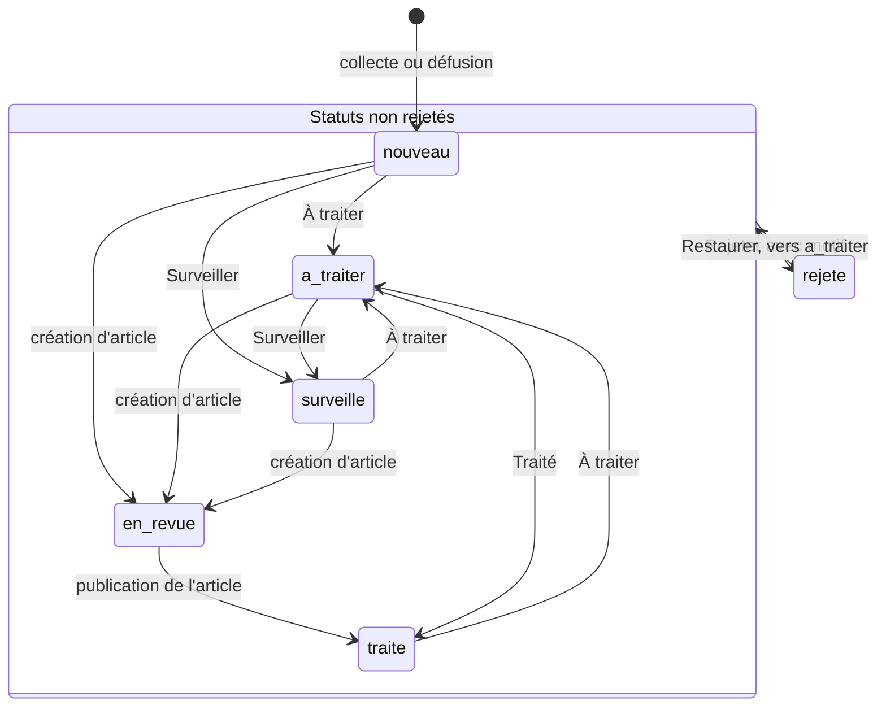
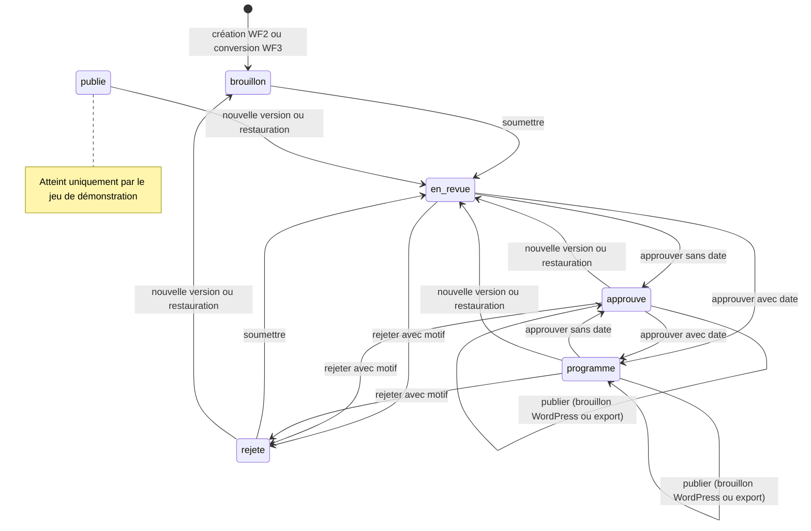
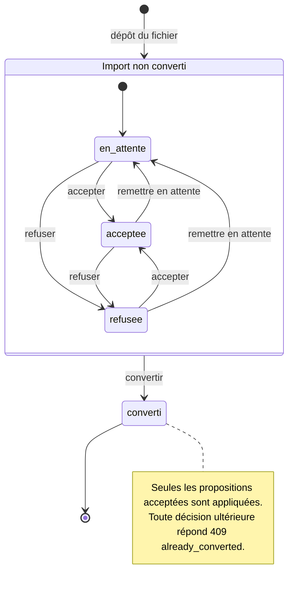
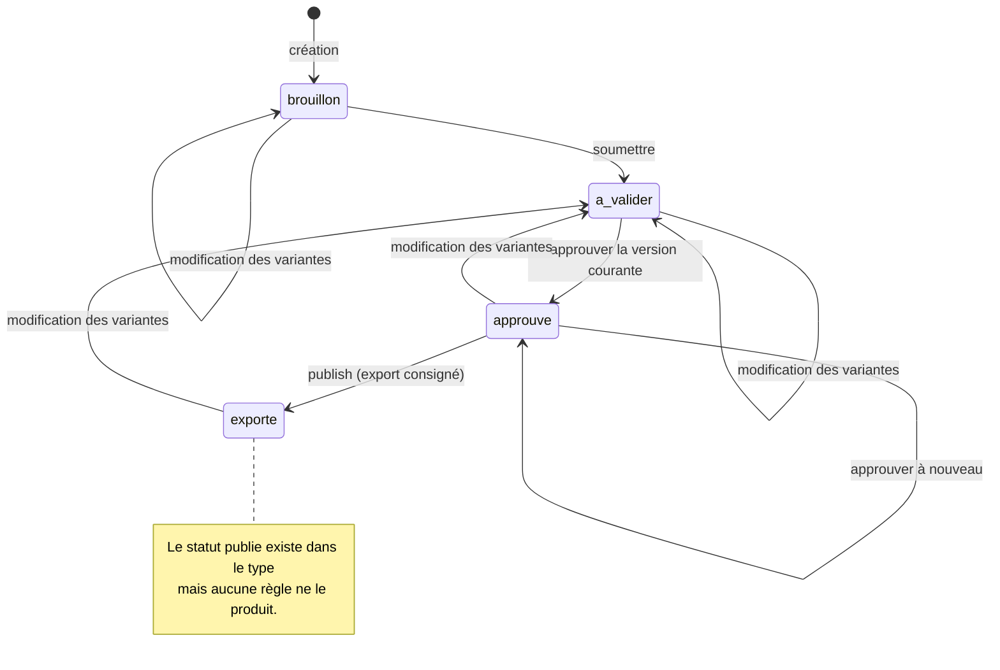
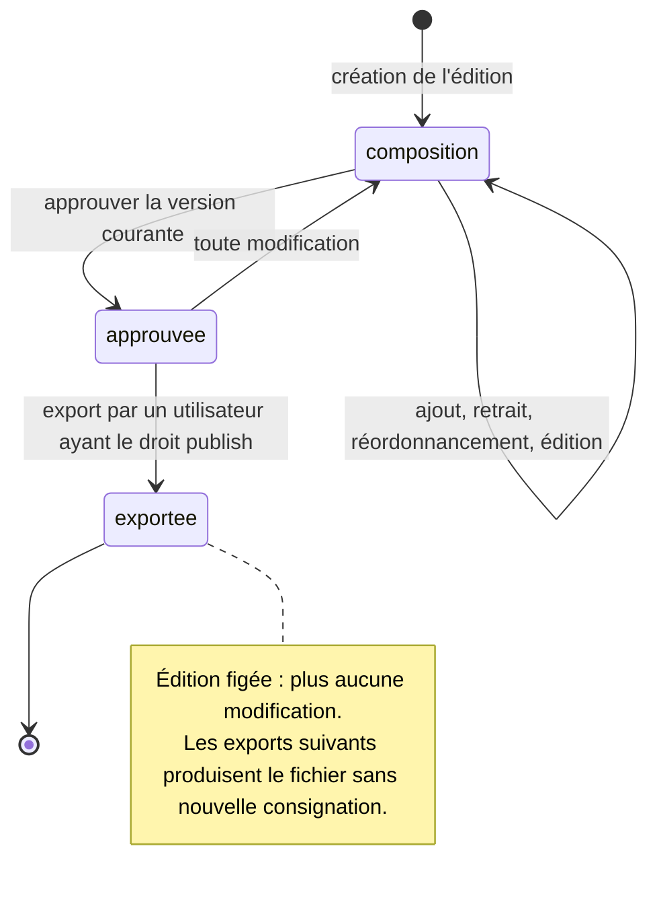

# Règles métier et workflows

**Objet.** Ce document décrit les règles métier appliquées par le serveur KORA : score éditorial et indicateur documentaire, Signal Engine (rattachement, regroupement, fusion, dates), workflows WF1 à WF6, approbation et publication, matrice des droits, quotas et budget, Editorial DNA, imports humains, newsletter et amélioration par OpenAI. Il s'adresse aux ingénieurs qui modifient ces règles ou doivent expliquer un comportement observé. Les règles pures sont dans `src/server/domain/`, leur orchestration dans `src/server/services/` et `src/server/handlers/`. Le format exact des requêtes et réponses est dans la [Référence API](03-reference-api.md), les champs dans le [Dictionnaire des données](04-dictionnaire-des-donnees.md). Les règles qui ne figurent qu'au cahier des charges sont signalées comme telles ; la couverture complète est dans [Couverture du cahier des charges](10-couverture-cahier-des-charges.md).

## Sommaire

- [Score éditorial](#score-éditorial)
- [Indicateur documentaire](#indicateur-documentaire)
- [Signal Engine](#signal-engine)
- [Workflows WF1 à WF6](#workflows-wf1-à-wf6)
- [Approbation et publication](#approbation-et-publication)
- [Matrice des droits](#matrice-des-droits)
- [Quotas et budget](#quotas-et-budget)
- [Editorial DNA](#editorial-dna)
- [Imports humains](#imports-humains)
- [Newsletter](#newsletter)
- [Amélioration par OpenAI](#amélioration-par-openai)

## Score éditorial

Le score éditorial mesure la priorité éditoriale d'un signal. C'est un entier de 0 à 100 (`score.total`), somme pondérée de cinq sous-notes de 0 à 100 (`score.subScores`), chacune accompagnée d'un motif rédigé (`score.reasons`). Le calcul est dans [`domain/scoring.ts`](../src/server/domain/scoring.ts).

### Critères et poids

| Critère | Clé (`Criterion`) | Poids de la grille v1 (`DEFAULT_WEIGHTS`) |
|---|---|---|
| Importance | `importance` | 30 |
| Nouveauté | `nouveaute` | 20 |
| Adéquation territoriale | `territoire` | 20 |
| Intérêt pour les lecteurs | `lecteurs` | 20 |
| Potentiel de diffusion | `diffusion` | 10 |

### Sous-notes et motifs

La fonction `assess` calcule les sous-notes à partir des seules données du signal : catégorie, titre, résumé et extraits des observations, fiche entreprise, signaux antérieurs et écart entre l'événement et sa détection. Chaque sous-note est bornée entre 0 et 100, puis arrondie.

**Importance.** La base dépend de la catégorie (`CATEGORY_IMPORTANCE`) :

| Catégorie | Base |
|---|---|
| `financement`, `acquisition` | 82 |
| `contrat`, `international` | 74 |
| `partenariat`, `innovation` | 72 |
| `croissance` | 70 |
| `recherche` | 68 |
| `produit`, `distinction` | 66 |
| `brevet` | 62 |
| `recrutement` | 58 |

Le plus gros montant cité dans les textes (extrait par `extractAmountsM` dans [`domain/text.ts`](../src/server/domain/text.ts), formes « 100 M€ » ou « 12 millions d'euros ») ajoute 12 points s'il atteint 50 M€, 6 points s'il atteint 10 M€. Une entreprise de priorité `haute` ajoute 5 points ; une priorité `basse` en retire 5.

**Nouveauté.** La note vaut 86 si aucun signal de la même entreprise et de la même catégorie n'a été créé dans les 90 jours précédents, 55 sinon. Elle perd 8 points si la date de l'événement est inconnue (ni date d'événement ni date de publication) et 25 points si l'événement précède sa détection de plus de 30 jours.

**Territoire.** Sans entreprise rattachée, la note vaut 30. Elle vaut 95 si le territoire de l'entreprise contient « inovall », 88 s'il cite une commune de l'agglomération reconnue par l'expression régulière du code (Grenoble, Meylan, Montbonnot, Crolles, Isère, Échirolles, Saint-Égrève, Voiron), 60 sinon.

**Lecteurs.** La note dépend de la première thématique de l'entreprise : 85 pour une thématique prioritaire (`PRIORITY_THEMES` : `deeptech_quantique`, `ia_industrie`, `transition_energetique`), 80 pour `talents_rh`, 72 pour une autre thématique, 65 sans thématique. Chaque thématique supplémentaire ajoute 5 points, dans la limite de 10.

**Diffusion.** Soit k le nombre de domaines de médias distincts parmi les observations, hors reprises et hors domaine de l'entreprise. La note vaut 45 pour k = 0, 60 pour k = 1, 75 pour k = 2 et 85 au-delà. Elle gagne 10 points si l'un de ces médias figure dans `NATIONAL_OUTLETS` (lesechos.fr, lefigaro.fr, bfmtv.com, usinenouvelle.com, latribune.fr, ec.europa.eu).

Les notes éditoriales du signal en découlent : « Pourquoi c'est intéressant » (`whyInteresting`) reprend les motifs des trois meilleures sous-notes, et l'angle suggéré (`suggestedAngle`) provient du gabarit de la catégorie (`ANGLE_TEMPLATES` dans [`store/catalog.ts`](../src/server/store/catalog.ts)).

### Total et affichage sur 10

`computeTotal` calcule `round(Σ subScores[c] × weights[c] / 100)`, borné entre 0 et 100. Pour le signal Pasqal du jeu de démonstration, (95 × 30 + 90 × 20 + 95 × 20 + 90 × 20 + 85 × 10) / 100 = 92 :

```json
{
  "total": 92,
  "gridVersion": 1,
  "subScores": { "importance": 95, "nouveaute": 90, "territoire": 95, "lecteurs": 90, "diffusion": 85 },
  "reasons": {
    "importance": "Catégorie « financement », montant élevé (100 M€), entreprise prioritaire du registre",
    "nouveaute": "Premier sujet de cette nature sur 90 jours",
    "territoire": "Entreprise de l'agglomération grenobloise (Grenoble)",
    "lecteurs": "Thématique prioritaire de la ligne éditoriale",
    "diffusion": "2 média(s) indépendant(s), dont un média national"
  }
}
```

L'API renvoie toujours l'échelle 0 à 100. L'interface affiche le score sur 10 avec une décimale (`scoreOn10` dans [`labels.ts`](../src/components/kora/labels.ts)) : 92 devient « 9.2 ». Le seuil de « sujet prioritaire » du tableau de bord est `PRIORITY_SCORE = 80` ([`domain/dashboard.ts`](../src/server/domain/dashboard.ts)) ; un nouveau signal de score supérieur ou égal à 80 déclenche une notification lors de la collecte (seuil écrit en dur dans [`services/collection.ts`](../src/server/services/collection.ts)).

Les sous-notes du jeu de démonstration sont ajustées pour reproduire la maquette (`fitScores` dans [`store/seed.ts`](../src/server/store/seed.ts)), alors que les motifs proviennent de `assess`. Un motif peut donc ne pas correspondre exactement à la sous-note affichée : pour Pasqal, la sous-note territoire vaut 95 avec le motif « Entreprise de l'agglomération grenobloise (Grenoble) », qui correspond à la note 88 dans `assess`. Toute reconstruction du signal recalcule les deux de façon cohérente.

### Grille versionnée et validation des poids

Une grille (`GridRecord`) porte un identifiant `grid_v{n}`, un numéro de version, les cinq poids, la date et le nom de son auteur, un indicateur `active` et une note. La grille active est celle marquée `active`, à défaut celle de version la plus haute.

`POST /api/scoring-grids` (administrateur, action `grid.write`) crée une grille. `validateWeights` exige pour chaque critère un entier de 0 à 100 et une somme exactement égale à 100 ; sinon l'API répond 422 `weights_sum_invalid`. Le schéma zod accepte tout nombre : le contrôle d'entier est fait par `validateWeights`, qui refuse donc 30,5. La nouvelle grille prend le numéro de version maximal plus un, devient active, et toutes les autres sont désactivées. L'événement `grid.create` est journalisé. Les grilles précédentes restent consultables par `GET /api/scoring-grids`. Aucun endpoint ne supprime ni ne réactive une grille : revenir à d'anciens poids revient à créer une nouvelle version avec ces poids.

La création d'une grille ne recalcule aucun score.

### Recalcul et décisions historiques

`POST /api/signals/rescore` (administrateur, `grid.write`) applique la grille active à tous les signaux non décidés et renvoie `{ "rescored": n }`. `applyGrid` recalcule le total à partir des sous-notes déjà stockées et met à jour `gridVersion` ; les sous-notes et les motifs ne changent pas. L'événement `grid.rescore` est journalisé.

Le cahier des charges (§3.3) exige qu'un changement de grille ne réécrive pas les décisions historiques. Le code le garantit ainsi :

1. `isDecided(status)` considère comme décidés les signaux `traite` et `rejete`.
2. Le recalcul ignore les signaux décidés.
3. Toutes les reconstructions d'un signal (nouvelle observation rattachée à la collecte, rattachement ou détachement manuel, fusion, défusion) recalculent le score, puis restaurent l'ancien score, `whyInteresting` et `suggestedAngle` si le signal est décidé : voir `ingest` dans [`services/collection.ts`](../src/server/services/collection.ts) et `rebuild` dans [`handlers/signals.ts`](../src/server/handlers/signals.ts).
4. Chaque score conserve la version de grille qui l'a produit (`gridVersion`) et aucune grille n'est supprimée ; les exports `signals` et `scores` contiennent cette version.

Le test « une nouvelle grille ne réécrit pas l'historique des signaux décidés » de [`signals.test.ts`](../src/test/server/signals.test.ts) vérifie ce comportement.

Cette protection a trois limites :

- Seuls `traite` et `rejete` sont protégés. Un signal `surveille`, `en_revue`, `a_traiter` ou `nouveau` est recalculé.
- Les transitions de statut sont libres (voir [Statuts d'un signal](#statuts-dun-signal)). Un signal rejeté puis restauré en `a_traiter` redevient recalculable, et son score antérieur n'est pas historisé : seul le journal d'audit garde trace du changement de statut.
- Une reconstruction d'un signal non décidé applique la grille active et recalcule les sous-notes. La `gridVersion` d'un signal non décidé peut donc changer sans appel à `/signals/rescore`.

## Indicateur documentaire

L'indicateur documentaire (`EvidenceState`) décrit la qualité des preuves réunies pour un signal. Il est calculé par `computeEvidence` ([`domain/evidence.ts`](../src/server/domain/evidence.ts)) à chaque lecture d'un signal (`toSignal` dans [`services/view.ts`](../src/server/services/view.ts)) et n'est jamais stocké : il reflète l'état courant des observations et de la date du jour.

### Reprises

`markSyndication` ([`domain/clustering.ts`](../src/server/domain/clustering.ts)) trie les observations du signal par date (publication, à défaut collecte), puis par identifiant. Une observation est marquée comme reprise (`isSyndicated`) si une observation antérieure d'un autre domaine a un extrait similaire à au moins 0,8 (`SYNDICATION_THRESHOLD`). La similarité (`textSimilarity` dans [`domain/text.ts`](../src/server/domain/text.ts)) est un indice de Jaccard sur les mots normalisés : minuscules, sans accents, sans mots vides, longueur supérieure à un caractère. Le marquage est refait à chaque reconstruction du signal. Une reprise n'est jamais comptée comme confirmation.

### Composantes

- **Source directe.** Une observation est directe si l'entreprise est connue et que le domaine du média est le domaine officiel de l'entreprise, ou que l'hôte de l'URL se termine par ce domaine.
- **Corroborations indépendantes.** Ce sont les domaines distincts des observations ni reprises ni directes. En présence d'une source directe, tous comptent ; sinon le premier tient lieu de source primaire et ne se corrobore pas lui-même : le nombre retenu est `max(0, n − 1)`.
- **Fraîcheur.** C'est le nombre de jours écoulés depuis la date la plus récente parmi les dates de publication, à défaut d'événement. Elle vaut `null` si aucune date n'est connue ; la date de collecte n'est jamais utilisée.
- **Contradictions.** `detectContradictions` extrait les montants en millions d'euros des titres et extraits des observations non reprises. Au moins deux montants distincts produisent un message de la forme « Montants divergents selon les sources : 100 M€ (Les Echos) / 120 M€ (La Tribune) ». Seuls les montants sont comparés, et une seule source citant deux montants suffit à déclencher l'alerte.

### Niveau

| Condition, dans l'ordre | Niveau (`level`) |
|---|---|
| Au moins une contradiction | `fragile` |
| Source directe et au moins une corroboration | `solide` |
| Source directe ou au moins une corroboration | `a_consolider` |
| Aucune des deux | `fragile` |

La liste `explanation` détaille chaque composante en phrases et se termine toujours par « Indicateur documentaire explicable, pas une probabilité de véracité ». Exemple réel (`GET /api/signals/sig_pasqal`) :

```json
{
  "level": "solide",
  "directSource": true,
  "independentCorroborations": 2,
  "freshnessDays": 0,
  "contradictions": [],
  "explanation": [
    "Source directe disponible (Pasqal)",
    "2 corroboration(s) indépendante(s) : Les Echos, La Tribune",
    "1 reprise(s) du même communiqué non comptée(s) : Le Dauphiné Libéré",
    "Publication du jour",
    "Indicateur documentaire explicable, pas une probabilité de véracité"
  ]
}
```

### Score, indicateur et confiance de rattachement

Trois valeurs distinctes accompagnent un signal. Aucune n'est une probabilité.

| Valeur | Champ | Échelle | Calcul | Stockage |
|---|---|---|---|---|
| Score éditorial | `score.total` | 0 à 100, affiché sur 10 | `assess` puis `applyGrid` | stocké, versionné par grille |
| Indicateur documentaire | `evidence.level` | `solide`, `a_consolider`, `fragile` | `computeEvidence` | recalculé à chaque lecture |
| Confiance de rattachement | `matchConfidence` | 0 à 100, affichée « Confiance 92% » | `matchCompany` | stockée |

Le score dit si le sujet mérite d'être traité, l'indicateur dit si le dossier est suffisamment étayé, la confiance dit seulement si l'entreprise rattachée est la bonne. Le critère de diffusion du score compte aussi les médias indépendants, mais une contradiction ne fait pas baisser le score : elle n'agit que sur l'indicateur et, au niveau de l'article, sur le dossier factuel (voir [WF2](#wf2--sujet-sélectionné-vers-brouillon-sourcé)).

## Signal Engine

### Chaîne d'ingestion

Chaque élément renvoyé par le collecteur passe par `ingest` ([`services/collection.ts`](../src/server/services/collection.ts)) :

1. L'URL est contrôlée par `validateSourceUrl` (voir [Filtrage SSRF](06-securite-et-flux-tiers.md#filtrage-ssrf)). Une URL refusée est ignorée sans erreur.
2. L'URL est canonisée (`canonicalUrl` : hôte sans `www`, chemin sans barre finale, paramètres `utm_*` et fragment supprimés, minuscules). Une URL déjà connue est ignorée.
3. Le titre (300 caractères au plus) et l'extrait (1 200 au plus) sont nettoyés par `sanitizeText`. Un élément vide après nettoyage est ignoré.
4. L'entreprise est recherchée par `matchCompany` ; elle n'est retenue que si la confiance atteint `MATCH_THRESHOLD = 60`.
5. La catégorie est déduite par `classifyCategory`.
6. `decideCluster` rattache l'observation à un signal existant ou crée un signal.
7. Le signal est reconstruit (`rebuildSignal` dans [`services/signals.ts`](../src/server/services/signals.ts)) : reprises, dates, observation primaire, score. Un nouveau signal de score au moins égal à 80 déclenche une notification.

Une collecte retient au plus trois éléments par source (`MAX_ITEMS`).

### Rattachement aux entreprises

`matchCompany` ([`domain/clustering.ts`](../src/server/domain/clustering.ts)) cherche les noms et alias du registre dans le titre et l'extrait, à frontière de mots, sans tenir compte de la casse, des accents ni de la ponctuation.

| Situation | Confiance | Entreprise retenue | Revue (`review`) |
|---|---|---|---|
| Hôte de l'URL égal au domaine officiel ou à un sous-domaine | 97 | oui | aucune |
| Une seule entreprise citée, celle de la source, par son nom | 92 | oui | aucune |
| Une seule entreprise citée, celle de la source, par un alias | 84 | oui | aucune |
| Une seule entreprise citée, autre que celle de la source, par son nom | 82 | oui | aucune |
| Une seule entreprise citée, autre que celle de la source, par un alias | 66 | oui | aucune |
| Plusieurs entreprises citées, dont celle de la source, avec au plus un nom exact | 70 | oui, celle de la source | aucune |
| Plusieurs entreprises citées, autres cas | 45 | non | `homonymie` |
| Aucune entreprise citée, source rattachée à une entreprise | 52 | non | `homonymie` |
| Aucune entreprise citée, source sans entreprise | 20 | non | `homonymie` |

Sous le seuil de 60, `companyId` vaut `null` : le signal est « à rattacher » et la revue indique les candidates ou le motif. `PATCH /api/signals/:id` avec `companyId` rattache manuellement le signal et ses observations, fixe la confiance à 100, efface la revue, reprend les thématiques de l'entreprise et reconstruit le signal (audit `signal.attach`). `companyId: null` détache le signal et pose une revue `homonymie` « Détaché manuellement » (audit `signal.detach`). La suppression d'une entreprise détache ses signaux de la même manière.

### Classement taxonomique

`classifyCategory` teste, dans un ordre fixe, des expressions régulières de mots-clés sur le titre et l'extrait sans accents : financement, acquisition, contrat, partenariat, brevet, recrutement, distinction, international, croissance, produit, recherche. À défaut, la catégorie est `innovation`. La catégorie est fixée à la création du signal ; aucun endpoint ne la modifie.

### Regroupement d'un même événement

`decideCluster` décide du rattachement d'une observation :

- Sans entreprise, l'observation crée toujours un nouveau signal.
- Les candidats sont les signaux de la même entreprise créés dans les 8 derniers jours (`CLUSTER_WINDOW_DAYS + 1`) dont la date de référence (date d'événement, à défaut de création) est à 7 jours au plus de la date de l'observation (publication, à défaut collecte).
- Si l'extrait est similaire à au moins 0,8 à celui d'une observation d'un candidat, l'observation est rattachée à ce candidat quelle que soit la catégorie : c'est une reprise.
- Sinon, seuls les candidats de même catégorie sont comparés sur les titres. Une similarité d'au moins 0,5 (`CLUSTER_SIMILARITY`) rattache l'observation. Une similarité d'au moins 0,3 (`UNCERTAIN_SIMILARITY`) crée un nouveau signal avec une revue `fusion_incertaine` (« Proche du signal … : fusion à confirmer »). En dessous, un nouveau signal est créé.

Les homonymies et les fusions incertaines sont ainsi soumises à revue humaine (§3.2) : la revue s'affiche sur le signal et se résout par rattachement, fusion ou défusion.

### Fusion et défusion

`POST /api/signals/:id/merge` (`signal.write`) fusionne les signaux `otherIds` (1 à 50) dans le signal `:id`. Les contrôles sont les suivants : un signal ne peut être fusionné avec lui-même (422 `invalid_merge`), tous les signaux doivent exister (404), et ils ne peuvent concerner deux entreprises différentes (422 `company_mismatch`). Les observations sont déplacées. Les articles, posts LinkedIn et éléments de newsletter des signaux absorbés sont repointés vers le signal cible ; un doublon dans une même édition est retiré. Les signaux absorbés sont supprimés. Le signal cible garde son statut, prend la confiance maximale et l'union des tags (six au plus), et sa revue est effacée. Il est reconstruit, avec préservation du score s'il est décidé, puis l'événement `signal.merge` est journalisé. Le statut et le motif propres aux signaux absorbés sont perdus ; seul le journal d'audit en garde trace.

`POST /api/signals/:id/split` (`signal.write`) détache les observations `observationIds` (1 à 200) dans un nouveau signal. Toutes doivent appartenir au signal et au moins une doit y rester (422 `invalid_split`). Le nouveau signal est au statut `nouveau`, de même entreprise et catégorie, titré d'après la plus ancienne observation déplacée, et son résumé est produit par `enhanceSummary`. Une revue `fusion_incertaine` du signal d'origine est effacée. Les deux signaux sont reconstruits. La réponse est 201 `{ original, created }` et l'événement `signal.split` est journalisé.

### Dates

Chaque observation porte trois dates : `collectedAt` (toujours renseignée, heure du serveur à l'ingestion), `publishedAt` (fournie par la source ou `null`) et `eventDate` (`null` si inconnue). Le collecteur simulé ne fournit jamais de date d'événement ; seul le jeu de démonstration en contient. Le signal reprend la plus ancienne valeur de chaque date parmi ses observations, recalculée à chaque reconstruction.

Une date inconnue n'est jamais inventée : elle reste `null` dans l'API et dans les exports JSON, vide dans les exports CSV. L'interface affiche la date de publication, à défaut la date d'événement (`signalDate` dans [`signal-utils.ts`](../src/components/signals/signal-utils.ts)), et « Date inconnue » si les deux manquent (`formatDate` dans [`labels.ts`](../src/components/kora/labels.ts)). La liste des sources du brouillon écrit « date inconnue ». La date de collecte sert de repli uniquement pour ordonner les observations et calculer les fenêtres de regroupement ; elle n'est jamais présentée comme date de publication. Une date d'événement inconnue retire 8 points à la nouveauté, et une fraîcheur inconnue est signalée dans l'indicateur documentaire (« Date de publication inconnue »).

### Statuts d'un signal

| Statut | Libellé | Signification |
|---|---|---|
| `nouveau` | Nouveau | Créé par la collecte ou la défusion, pas encore examiné |
| `a_traiter` | À traiter | Retenu, en attente de rédaction |
| `en_revue` | En revue | Un article est en cours |
| `surveille` | Surveillé | Suivi sans rédaction immédiate |
| `traite` | Traité | Article publié ou exporté, ou marqué traité à la main ; décision figée |
| `rejete` | Rejeté | Écarté avec motif ; décision figée |



Le diagramme montre les transitions automatiques et les principales actions de l'interface (`StatusActions`). Depuis tout statut autre que `rejete`, l'interface propose « Surveiller », « À traiter », « Traité » et « Rejeter » ; depuis `rejete`, seulement « Restaurer », qui ramène le signal en `a_traiter`. Le serveur, lui, accepte toute transition par `PATCH /api/signals/:id` (`signal.write`) ; seul le passage à `rejete` exige un motif (422 `reason_required`). Chaque changement est journalisé (`signal.status`, avec le motif). Les transitions automatiques sont les suivantes :

- La création d'un article fait passer le signal en `en_revue`, sauf s'il est `traite`.
- Une publication réussie de l'article le fait passer en `traite`, sauf s'il est `traite` ou `rejete`.
- Un signal `rejete` ne peut pas donner lieu à un article (422 `signal_rejected`).

Les endpoints des signaux, de la fusion, de la défusion et des grilles sont décrits dans [Signaux et grilles de score](03-reference-api.md#7-signaux-et-grilles-de-score).

## Workflows WF1 à WF6

Les six workflows sont ceux du §6 du cahier des charges. Les endpoints cités sont détaillés dans la [Référence API](03-reference-api.md).

| Workflow | Objet | Déclencheur | Rôles |
|---|---|---|---|
| WF1 | Collecte et classement | Bouton « Lancer la collecte » ou « Réessayer » | rédacteur, administrateur |
| WF2 | Sujet sélectionné vers brouillon sourcé | Bouton « Rédiger » sur un signal | rédacteur ; validateur pour l'approbation |
| WF3 | Import d'un article humain | Dépôt d'un fichier DOCX ou TXT | rédacteur, administrateur |
| WF4 | Post LinkedIn | Création depuis un article ou un signal | rédacteur ; validateur pour l'approbation et l'export |
| WF5 | Newsletter | Création d'une édition ou interrupteur « Inclure dans la prochaine édition » | rédacteur ; validateur pour l'approbation et l'export |
| WF6 | Corrections et référentiel | Enregistrement d'une version humaine après une version KORA | automatique ; administrateur pour la décision |

### WF1 — Collecte et classement

**Déclencheur.** `POST /api/collect` collecte toutes les sources actives ; `POST /api/sources/:id/collect` collecte une source. La collecte est uniquement manuelle : le champ `frequency` des sources est informatif et la collecte quotidienne planifiée du §12 n'est pas implémentée.

**Rôles.** Action `collect` : rédacteur et administrateur.

**Étapes.**

1. Une source désactivée est refusée (409 `source_disabled`) ; la collecte globale l'ignore.
2. Le coût est réservé avant l'appel (`paidCall`, type `search_query`, estimation `COSTS.search + 3 × COSTS.observation`, soit 0,075 €). En cas de refus, la collecte est enregistrée au statut `bloque_quota` avec le code `budget_exhausted`. Une collecte unitaire répond alors 402 ; la collecte globale marque aussi `bloque_quota` toutes les sources restantes et répond 200 avec la liste des collectes.
3. Le collecteur est appelé jusqu'à trois fois (`MAX_ATTEMPTS`) dans la même requête, sans délai entre les essais. L'indicateur `transient` de l'échec n'est pas pris en compte : un refus HTTP 403 est aussi réessayé.
4. En cas d'échec, la source passe en `erreur` avec le code et le motif (`failureCode`, `failureReason`) et un compteur d'essais limité à 3. Une notification `erreur_source` n'est émise qu'au premier échec, pas si la source était déjà en erreur. La collecte est enregistrée au statut `echec`.
5. En cas de succès, les éléments sont ingérés (voir [Chaîne d'ingestion](#chaîne-dingestion)). La source repasse en `ok`, la date de dernière réussite est mise à jour et le motif d'échec effacé. La collecte est au statut `succes` si au moins une observation nouvelle a été créée, `succes_sans_actualite` sinon.
6. La consommation enregistrée est d'une recherche (0,012 €) et d'une observation (0,021 €) par élément renvoyé, y compris les éléments écartés comme doublons.

**États.** Une source a un accès `ok`, `erreur`, `en_attente` ou `desactivee`. Une collecte (`CollectionRun`) est `succes`, `succes_sans_actualite`, `echec` ou `bloque_quota` : une source en échec n'est jamais présentée comme « succès sans actualité ». L'accès d'une source ne peut pas être mis manuellement à `erreur` (422 `invalid_access`) ; une modification d'URL le repasse en `en_attente`.

**Contrôles.** Droit `collect`, filtrage des URL, réservation budgétaire, dédoublonnage par URL canonique, nettoyage du texte.

**Sorties.** Collectes, observations et signaux `nouveau` ; notifications (signal prioritaire, erreur de source, alertes de quota) ; événement `collect.all` pour la collecte globale. La collecte d'une seule source n'est pas journalisée.

**Endpoints.** [Sources et collecte](03-reference-api.md#6-sources-et-collecte).

### WF2 — Sujet sélectionné vers brouillon sourcé

**Déclencheur.** `POST /api/articles` avec `signalId` et, en option, `angle`.

**Rôles.** Rédacteur et administrateur créent, modifient et soumettent (`article.write`) ; validateur et administrateur approuvent ou rejettent (`article.decide`) ; l'arbitrage du dossier factuel est ouvert aux deux groupes.

**Contrôles avant génération.** Le signal doit exister (404) et ne pas avoir déjà d'article (409 `article_exists`). Il ne doit pas être rejeté (422 `signal_rejected`). Le quota d'articles doit être disponible (422 `quota_exceeded`) et le budget aussi (402 `budget_exhausted`, coût réservé `COSTS.article` = 0,45 €).

**Génération du dossier.** `generateDossier` ([`adapters/text-model.ts`](../src/server/adapters/text-model.ts)) produit :

- les faits (`factChecks`) : la première phrase de chaque extrait, regroupée avec les phrases similaires à au moins 0,5 ; les reprises sont rattachées au fait le plus proche ;
- leur statut : `etaye` si le fait a une source directe ou au moins deux domaines indépendants, `non_corrobore` sinon, et un fait `contradictoire` par contradiction détectée ;
- les angles (quatre au plus), le plan, et un brouillon composé du titre, du chapô, du corps, de l'extrait (200 caractères), du titre SEO (60 caractères), des catégories et des tags.

Le premier fait forme le chapô, les suivants le corps. Les faits non corroborés et les contradictions sont précédés de « [À vérifier] » dans le chapô comme dans le corps. Le corps se termine par une section « Sources consultées » (média, titre, date, URL). Aucune citation n'est créée. Le brouillon peut ensuite être réécrit par OpenAI (voir [Amélioration par OpenAI](#amélioration-par-openai)) ; les faits, angles et plan ne le sont jamais.

**Résultat.** L'article est créé au statut `brouillon`, d'origine `kora`, sans auteur humain, avec une version 1 signée « KORA ». Le signal passe en `en_revue` (sauf s'il est `traite`) et l'événement `article.create` mentionne les contradictions à arbitrer.

**Arbitrage du dossier factuel.** `PATCH /api/articles/:id/fact-checks/:fid` fixe le statut d'un fait à `etaye` ou `non_corrobore`, avec une note facultative, et enregistre l'arbitrage (`resolution` : nom, date, note). L'événement `article.fact_check` est journalisé. L'arbitrage ne crée pas de version et n'invalide pas les approbations. Seuls les faits `contradictoire` bloquent l'approbation et la publication ; un fait `non_corrobore` ne bloque pas, son marqueur reste dans le texte.

**Versions.** `POST /api/articles/:id/versions` enregistre une nouvelle version signée par l'utilisateur. `POST /api/articles/:id/restore` recopie le contenu d'une version antérieure dans une nouvelle version, avec la note « Restauration de la version N » ; restaurer la version courante répond 409 `already_current`, une version inexistante 422 `version_not_found`. Dans les deux cas (`pushVersion`), l'historique est conservé, toutes les approbations valides sont invalidées avec le motif « Contenu modifié après approbation », et le statut évolue comme suit : un article `approuve`, `programme` ou `publie` repasse `en_revue`, un article `rejete` repasse `brouillon`, les autres statuts sont inchangés. Une version humaine qui suit une version KORA déclenche WF6.

**Cycle de vie de l'article.**



La soumission (`POST /api/articles/:id/submit`) n'est possible que depuis `brouillon` ou `rejete` ; répétée sur un article `en_revue`, elle est sans effet ; depuis un autre statut, elle répond 409 `invalid_state`. Elle notifie les validateurs. L'approbation et le rejet sont décrits dans [Approbation et publication](#approbation-et-publication). La publication ne change pas le statut de l'article : aucune règle du code ne produit le statut `publie` ni ne renseigne `publishedAt`, que seul le jeu de démonstration contient. Le statut `programme` enregistre une date sans qu'aucun planificateur ne l'exploite.

**Endpoints.** [Articles, dossier factuel et publication](03-reference-api.md#8-articles-dossier-factuel-et-publication).

### WF3 — Import d'un article humain

**Déclencheur.** `POST /api/imports` en `multipart/form-data` avec les champs `file` et `author`.

**Rôles.** Action `import.write` (rédacteur, administrateur) pour l'import, les décisions et la conversion.

**Étapes.**

1. Contrôles : corps multipart (400 `multipart_required`), fichier présent (400 `file_required`), auteur renseigné (400 `author_required`), taille (413 `file_too_large`), format (415 `unsupported_format`), quota de stockage (422 `quota_exceeded`), extraction (415 `invalid_encoding` ou `invalid_docx`).
2. Extraction du texte et calcul des propositions (voir [Imports humains](#imports-humains)). L'événement `import.create` est journalisé.
3. Décision sur chaque proposition par `PATCH /api/imports/:id/proposals/:pid` (`import.proposal`).
4. Conversion en article par `POST /api/imports/:id/convert` (`import.convert`).



**Sorties.** Un enregistrement d'import (original, texte extrait, propositions), puis un article au statut `brouillon`, d'origine `import_humain`, dont l'auteur et le signataire de la version 1 sont l'auteur déclaré. L'article suit ensuite le cycle de vie de WF2.

**Endpoints.** [Imports humains](03-reference-api.md#9-imports-humains).

### WF4 — Post LinkedIn

**Déclencheur.** `POST /api/linkedin` avec `articleId` ou `signalId`.

**Rôles.** Rédacteur et administrateur créent, modifient et soumettent (`linkedin.write`) ; validateur et administrateur approuvent (`linkedin.decide`) et consignent l'export (`publish`).

**Contrôles à la création.** L'article ou le signal doit exister (404). Un seul post en préparation est admis par contenu : un post non `exporte` ni `publie` sur le même article, ou sur le même signal sans article, répond 409 `post_exists`. Le quota `linkedin_posts` (422) et le budget (402, `COSTS.linkedin` = 0,08 €) doivent être disponibles. Le serveur accepte un article dans n'importe quel statut, y compris `brouillon`, alors que le cahier des charges décrit WF4 comme le « post LinkedIn d'un article approuvé » ; l'interface se contente de proposer d'abord les articles approuvés.

**Génération.** Le gabarit produit deux variantes à partir du titre et d'une accroche : chapô de la version courante, à défaut extrait de l'article, à défaut résumé du signal, sans le préfixe « [À vérifier] ». Les hashtags sont `#Inovallée`, `#Grenoble` et jusqu'à deux thématiques. OpenAI peut remplacer ces variantes (trois au plus). Le post est créé au statut `brouillon`, version 1.

**Modification.** `PATCH /api/linkedin/:id` modifie les variantes (une à quatre, texte de 3 000 caractères au plus, quinze hashtags au plus) ou la variante sélectionnée. Un post `publie` n'est pas modifiable (409). Sans changement effectif, rien n'est versionné. Sinon la version augmente, l'approbation est invalidée et un post `approuve` ou `exporte` repasse `a_valider`.

**Soumission, approbation, export.** La soumission n'est possible que depuis `brouillon` (sans effet si le post est déjà `a_valider`). L'approbation exige la version courante (409 `version_mismatch`) et un statut `a_valider` ou `approuve` (409 `invalid_state`) ; elle remplace l'approbation précédente. `POST /api/linkedin/:id/publish` vérifie l'approbation (voir [Contrôle juste avant l'envoi](#contrôle-juste-avant-lenvoi)), consigne une tentative réussie en mode `export` avec le code `linkedin_api_unavailable` et fait passer le post en `exporte`. `GET /api/linkedin/:id/export` renvoie le texte de la variante sélectionnée et ses hashtags, sans effet de bord ; si la version courante n'est pas approuvée, le fichier commence par « [APERÇU — version non approuvée, ne pas publier] ». Il n'existe pas de rejet de post.



**Endpoints.** [LinkedIn](03-reference-api.md#10-linkedin).

### WF5 — Newsletter

**Déclencheur.** `POST /api/newsletters`, ou `PATCH /api/signals/:id` avec `inNewsletter: true`, qui crée l'édition courante si elle n'existe pas.

**Rôles.** Rédacteur et administrateur composent (`newsletter.write`) ; validateur et administrateur approuvent (`newsletter.decide`) ; l'export n'est consigné que pour un utilisateur ayant le droit `publish`.

**Étapes.**

1. Création de l'édition, sous réserve du quota `newsletters` (cinq éditions créées dans le mois).
2. Ajout de sujets (signal ou article), avec un résumé payant par sujet.
3. Réordonnancement, modification des résumés, du titre et de l'introduction ; retrait de sujets.
4. Approbation de la version courante (`POST /api/newsletters/:id/approve`).
5. Export HTML ou texte (`GET /api/newsletters/:id/export?format=html|txt`).

**Contrôles.** Une édition exportée n'est plus modifiable (409 `invalid_state`). Un même sujet ne peut figurer deux fois (409 `already_in_newsletter`). L'approbation exige la version courante (409 `version_mismatch`) et au moins un sujet (422 `newsletter_empty`). Il n'y a ni étape de soumission ni rejet.

**Sorties.** Fichiers d'export ; à la première exportation d'une édition approuvée par un utilisateur ayant le droit `publish`, une tentative de publication réussie en mode `export` et le passage en `exportee`. Aucun e-mail n'est jamais envoyé. Les règles de sélection, d'ordre et de rendu sont dans [Newsletter](#newsletter).



**Endpoints.** [Newsletters](03-reference-api.md#11-newsletters).

### WF6 — Corrections et référentiel éditorial

**Déclencheur.** Automatique : l'enregistrement d'une version humaine qui suit une version signée « KORA » appelle `refreshProposals` ([`services/dna.ts`](../src/server/services/dna.ts)). Les règles peuvent aussi être créées et modifiées manuellement.

**Rôles.** Les rédacteurs produisent les corrections ; seul l'administrateur décide des propositions et modifie les règles (`rule.write`).

**États.** Une proposition est `proposee`, puis `acceptee` ou `refusee` ; une proposition déjà décidée répond 409 `already_decided`.

**Sorties.** Règles versionnées ; événements `rule.create`, `rule.update`, `rule.proposal`. Le détail est dans [Editorial DNA](#editorial-dna).

**Endpoints.** [Editorial DNA](03-reference-api.md#12-editorial-dna).

## Approbation et publication

### Contenu d'une approbation

Une approbation (`Approval`, [`store/records.ts`](../src/server/store/records.ts)) enregistre :

| Champ | Contenu |
|---|---|
| `id` | Identifiant `apv_…` |
| `version` | Numéro de la version approuvée |
| `channel` | `wordpress`, `linkedin` ou `newsletter` |
| `approvedBy` | Nom affiché du validateur |
| `approvedAt` | Date de l'approbation |
| `scheduledAt` | Date de programmation ou `null` |
| `valid` | `true` tant que l'approbation n'est pas invalidée |
| `invalidatedAt`, `invalidatedReason` | Date et motif de l'invalidation |

Un article peut porter une approbation valide par canal ; une nouvelle approbation sur le même canal invalide la précédente avec le motif « Remplacée par une nouvelle approbation ». Un post LinkedIn et une édition de newsletter ont une seule approbation. Par rapport au §6, l'identité du validateur est son nom affiché et non son identifiant, et les médias ne sont pas couverts : le modèle de données n'en contient pas.

L'approbation d'un article (`POST /api/articles/:id/approve`, `article.decide`) exige :

- la version relue égale à la version courante (409 `version_mismatch`, avec `details.currentVersion`) ;
- un statut `en_revue`, `approuve` ou `programme` (409 `invalid_state`) ;
- aucune contradiction non arbitrée dans le dossier factuel (422 `contradiction_unresolved`, avec `details.factCheckIds`) ;
- une date de programmation future si elle est fournie (422 `schedule_in_past`).

L'événement `article.approve` est journalisé. Le rejet (`POST /api/articles/:id/reject`, `article.decide`) exige un motif d'au moins trois caractères (400 `validation_error`) et un statut `en_revue`, `approuve` ou `programme`. Il invalide toutes les approbations valides avec le motif « Rejet : … », journalise `article.reject` et notifie.

Aucune règle n'empêche un utilisateur d'approuver une version qu'il a rédigée. Seuls les rôles comptent : dans la démonstration, Sophie Martin cumule les rôles rédacteur et validateur et peut approuver son propre texte. Le cahier des charges (§7) admet ce cumul par décision d'Inovallée, en précisant qu'il ne constitue pas une séparation à deux personnes.

### Invalidation

| Contenu | Événement invalidant | Motif enregistré |
|---|---|---|
| Article | Nouvelle version ou restauration | « Contenu modifié après approbation » |
| Article | Rejet | « Rejet : motif » |
| Article | Nouvelle approbation sur le même canal | « Remplacée par une nouvelle approbation » |
| Post LinkedIn | Modification des variantes ou de la sélection | « Contenu modifié après approbation » |
| Newsletter | Modification du titre, de l'introduction, des sujets ou de leur ordre | « Contenu modifié après approbation » |

L'arbitrage d'un fait du dossier ne modifie pas le texte et n'invalide pas l'approbation. Une restauration crée une nouvelle version et exige donc une nouvelle approbation, conformément au §6.

### Contrôle juste avant l'envoi

Chaque demande de publication revérifie le droit `publish` (administrateur, validateur), puis l'état par `checkPublishable` ([`domain/workflow.ts`](../src/server/domain/workflow.ts)) sur la version courante et le canal demandé. Les conditions sont évaluées dans cet ordre :

| Ordre | Condition | Résultat |
|---|---|---|
| 1 | Un fait `contradictoire` sans arbitrage | `contradiction_unresolved` |
| 2 | Une approbation valide pour ce canal et cette version | publication autorisée |
| 3 | Une approbation valide pour ce canal, sur une autre version | `approval_version_mismatch` |
| 4 | Une approbation valide pour cette version, sur un autre canal | `approval_wrong_channel` |
| 5 | La dernière approbation de ce canal a été invalidée | `approval_invalidated` |
| 6 | Aucune approbation | `approval_missing` |

Un refus répond 422 avec le code, un message explicatif et la tentative bloquée dans `details.attempt`. Pour un post LinkedIn, seul l'état d'approbation est vérifié : les faits de l'article source ne sont pas examinés. Pour la newsletter, l'export n'appelle pas `checkPublishable` ; il ne consigne la publication que si l'approbation est valide sur la version courante. Le modèle de texte n'a aucun droit : une publication ne résulte que d'un appel HTTP d'un utilisateur autorisé.

### Clé d'idempotence

```ts
idempotencyKey(contentId, version, channel) = sha256Hex(`${contentId}:${version}:${channel}`)
```

La clé ([`domain/workflow.ts`](../src/server/domain/workflow.ts)) est l'empreinte SHA-256 en hexadécimal (64 caractères) de la chaîne UTF-8 `identifiant:version:canal`, calculée par une implémentation JavaScript pure ([`domain/sha256.ts`](../src/server/domain/sha256.ts)). L'identifiant est celui de l'article, du post ou de l'édition. Par exemple, `art_pasqal:1:wordpress` donne `d49c3a574a302ed418569561b903df66d6abf55156707a8dedd1477685055b0e`, clé de la tentative `pub_0001` du jeu de démonstration.

Avant tout envoi, le serveur cherche une tentative réussie portant la même clé. S'il la trouve, il la renvoie telle quelle (200) sans nouvel envoi ; pour un article, l'événement `publication.replay` est journalisé. Une tentative bloquée de même clé et de même code est mise à jour (compteur `attempts` incrémenté) plutôt que dupliquée. Une nouvelle version produit une nouvelle clé ; pour WordPress, le même brouillon distant est alors mis à jour, car son identifiant distant est conservé sur l'article.

### Reprise après une réponse ambiguë

Le §6 demande de vérifier l'existence du contenu distant avant toute reprise, à défaut de passer en revue humaine. L'interface `WordPressClient` prévoit `findDraftByKey(key)`, appelée quand l'article n'a pas encore d'identifiant distant, et `upsertDraft`, qui réutilise le brouillon connu par sa clé ou par son identifiant. L'adaptateur simulé ne produit jamais d'échec ni de réponse ambiguë. Les statuts `echec` et `verification_requise` existent dans le type `PublicationStatus` mais aucune règle ne les produit, et l'appel à `upsertDraft` n'est pas protégé : une exception de l'adaptateur donne une erreur 500 `internal_error` sans tentative enregistrée. Un client WordPress réel devra rechercher le brouillon par sa clé avant toute reprise et enregistrer `verification_requise` quand cette vérification est impossible.

### Tentatives et codes d'échec

- **Collecte.** Trois essais au plus par collecte, code et motif visibles sur la source et sur la collecte, notification au premier échec. Codes du collecteur simulé : `HTTP_403`, `HTTP_404`, `TIMEOUT`, `TLS_ERROR`.
- **Publication.** Aucune reprise automatique. Chaque demande refusée est enregistrée comme tentative `bloque` avec son code ; le compteur `attempts` compte les demandes répétées et n'est pas borné.
- **Budget.** Un appel refusé répond 402 `budget_exhausted` ; une collecte refusée est enregistrée `bloque_quota`.

### Comportement réel de chaque canal au pilote

| Canal | Endpoint | Adaptateur | Mode | Effet sur le contenu |
|---|---|---|---|---|
| WordPress | `POST /api/articles/:id/publish` avec `channel: "wordpress"` | `SimulatedWordPress` | `brouillon_distant` | `wordpress.status = "brouillon"`, identifiant distant conservé |
| LinkedIn (post) | `POST /api/linkedin/:id/publish` | `ExportOnlyLinkedIn` | `export` | post `exporte` |
| Newsletter | `GET /api/newsletters/:id/export` | aucun | `export` | édition `exportee` |
| LinkedIn ou newsletter (article) | `POST /api/articles/:id/publish` avec `channel: "linkedin"` ou `"newsletter"` | aucun | `export` | aucun |

[`adapters/channels.ts`](../src/server/adapters/channels.ts) contient les adaptateurs. Leur comportement est le suivant :

- **WordPress** est simulé. L'adaptateur crée ou met à jour en mémoire un brouillon fictif `wp-NNNN` avec le titre, le contenu (chapô puis corps), l'extrait, les catégories et les tags. Le titre SEO et les médias ne sont pas transmis. Rien ne sort du serveur et le message précise « Aucune publication publique : la mise en ligne reste manuelle. »
- **LinkedIn** n'a pas d'API (`apiAvailable: false`). La publication consigne seulement que l'export est prêt ; le texte est récupéré par `GET /api/linkedin/:id/export`.
- **Newsletter** : le fichier HTML ou texte est produit à la demande, jamais envoyé.
- **Publication d'un article sur un autre canal** que WordPress : une tentative « Export … prêt : diffusion manuelle » est consignée, sans fichier associé.

Toute publication réussie d'un article fait passer son signal en `traite` et notifie. Le statut de l'article ne change pas (voir [WF2](#wf2--sujet-sélectionné-vers-brouillon-sourcé)) ; la programmation (`scheduledAt`) ne conditionne pas la publication.

## Matrice des droits

Les droits sont définis dans [`domain/permissions.ts`](../src/server/domain/permissions.ts) et contrôlés côté serveur dans chaque handler par `assertCan`. Un refus répond 403 `forbidden` avec un message qui cite les rôles de l'utilisateur. Un utilisateur cumule les droits de tous ses rôles.

| Action | Endpoints | Lecteur | Rédacteur | Validateur | Administrateur |
|---|---|---|---|---|---|
| Lecture (aucun contrôle) | Tous les `GET`, y compris exports, audit et liste des utilisateurs | oui | oui | oui | oui |
| Aucun contrôle | `POST /me`, `POST /notifications/read` | oui | oui | oui | oui |
| `registry.write` | `POST`, `PATCH /companies` ; `POST`, `PATCH`, `DELETE /sources` | non | oui | non | oui |
| `registry.delete` | `DELETE /companies/:id` | non | non | non | oui |
| `collect` | `POST /collect`, `POST /sources/:id/collect` | non | oui | non | oui |
| `signal.write` | `PATCH /signals/:id` (statut, motif, entreprise), `merge`, `split` | non | oui | non | oui |
| `newsletter.write` | `PATCH /signals/:id` (`inNewsletter`), création et composition des éditions | non | oui | non | oui |
| `article.write` | `POST /articles`, `versions`, `restore`, `submit` | non | oui | non | oui |
| `article.write` ou `article.decide` | `PATCH /articles/:id/fact-checks/:fid` | non | oui | oui | oui |
| `article.decide` | `approve`, `reject` d'un article | non | non | oui | oui |
| `import.write` | `POST /imports`, décisions, conversion | non | oui | non | oui |
| `linkedin.write` | `POST /linkedin`, `PATCH`, `submit` | non | oui | non | oui |
| `linkedin.decide` | `POST /linkedin/:id/approve` | non | non | oui | oui |
| `newsletter.decide` | `POST /newsletters/:id/approve` | non | non | oui | oui |
| `publish` | `POST /articles/:id/publish`, `POST /linkedin/:id/publish`, consignation de l'export newsletter | non | non | oui | oui |
| `grid.write` | `POST /scoring-grids`, `POST /signals/rescore` | non | non | non | oui |
| `rule.write` | Règles et propositions de l'Editorial DNA | non | non | non | oui |

Les comptes de démonstration sont décrits dans [Démarrage](01-demarrage.md). Les tests de [`security.test.ts`](../src/test/server/security.test.ts) et [`studio.test.ts`](../src/test/server/studio.test.ts) vérifient notamment qu'un lecteur ne peut rien modifier, qu'un rédacteur ne peut pas approuver et qu'un validateur ne peut pas rédiger.

Quatre points sont à connaître :

- **Approbation de son propre texte.** Rien ne compare le validateur à l'auteur de la version : un utilisateur à la fois rédacteur et validateur (Sophie Martin dans la démonstration) approuve son propre texte.
- **Suppression d'une source.** `DELETE /sources/:id` exige `registry.write` et est donc ouvert aux rédacteurs, alors que la suppression d'une entreprise est réservée à l'administrateur.
- **Propriété des contenus.** Aucune règle de propriété n'existe : tout rédacteur peut modifier tout article, post ou édition.
- **Lectures.** Toutes les lectures sont ouvertes à tous les rôles, y compris le journal d'audit et les exports. La sécurité de la session elle-même est décrite dans [Sécurité et flux tiers](06-securite-et-flux-tiers.md).

## Quotas et budget

Les plafonds et coûts sont dans [`domain/budget.ts`](../src/server/domain/budget.ts), leur application dans [`services/usage.ts`](../src/server/services/usage.ts). L'état est consultable par `GET /api/usage` ; les réponses 402 et 422 sont décrites dans [Budget API et quotas](03-reference-api.md#budget-api-et-quotas).

### Compteurs et plafonds

| Compteur | Clé | Plafond (`DEFAULT_LIMITS`) | Mesure | Blocage au plafond |
|---|---|---|---|---|
| Budget API | `api_budget_eur` | 150 € HT | Somme des coûts du mois | 402 `budget_exhausted` |
| Recherches web | `search_queries` | 3 000 | Recherches du mois | aucun |
| Nouvelles observations | `observations` | 6 000 | Observations du mois | aucun |
| Dossiers et articles | `articles` | 25 | Générations d'articles du mois | 422 à `POST /articles` |
| Posts LinkedIn | `linkedin_posts` | 25 | Générations de posts du mois | 422 à `POST /linkedin` |
| Éditions de newsletter | `newsletters` | 5 | Éditions créées dans le mois | 422 à la création d'une édition |
| Entreprises suivies | `companies` | 150 | Total du registre | 422 à `POST /companies` |
| Sources configurées | `sources` | 300 | Total du registre | 422 à `POST /sources` |
| Stockage | `storage_gb` | 10 Go | Base fixe des réglages plus taille des imports | 422 à `POST /imports` |

`assertQuota` répond 422 `quota_exceeded`. Les compteurs `search_queries` et `observations` sont mesurés et alertés mais ne bloquent rien ; seul le budget limite la collecte. La conversion d'un import ne consomme pas le quota d'articles. Les autres plafonds du §12 ne sont pas appliqués : cinq comptes, deux variantes par article, une collecte quotidienne par source, nombre de traitements simultanés.

### Coûts unitaires

| Clé (`COSTS`) | Coût estimé (€ HT) | Appel concerné |
|---|---|---|
| `article` | 0,45 | Dossier et brouillon (`generation_article`) |
| `linkedin` | 0,08 | Variantes LinkedIn (`generation_linkedin`) |
| `summary` | 0,02 | Résumé d'un sujet de newsletter (`generation_summary`) |
| `search` | 0,012 | Recherche de la collecte (`search_query`) |
| `observation` | 0,021 | Observation collectée (`observation`) |

Le coût est réservé et enregistré par unité, que le texte soit produit par les gabarits ou par OpenAI : la présence de la clé `AI_API_KEY` ne change ni l'estimation ni la consommation enregistrée. Le coût réellement facturé par OpenAI n'est pas mesuré.

### Réservation avant l'appel

`paidCall` encadre chaque appel payant :

1. Il calcule la dépense du mois à partir du journal de consommation.
2. `decideReservation` refuse l'appel si les appels payants sont déjà suspendus pour le mois, ou si la dépense, plus les réservations en cours (`reservedEur`), plus l'estimation dépassent le plafond.
3. En cas de refus, il marque la suspension pour le mois (`paidCallsSuspended`, `suspendedMonth`), journalise `quota.suspension` au nom de « KORA », notifie « Budget API : appels payants suspendus » et répond 402 `budget_exhausted`.
4. Sinon il ajoute l'estimation aux réservations, exécute l'appel, puis libère la réservation, que l'appel réussisse ou échoue.
5. Il enregistre les lignes de consommation : le coût réel fourni par l'appelant (seule la collecte en fournit un) ou, à défaut, l'estimation. Le total enregistré ne dépasse jamais l'estimation réservée.
6. Il vérifie les alertes.

Deux appels à OpenAI échappent à cette réservation. Le résumé produit à la collecte est calculé pendant l'ingestion, après la libération de la réservation, et aucune ligne de consommation ne lui correspond en propre. Le résumé produit à la défusion n'est encadré par aucun `paidCall` et reste possible quand le budget est suspendu.

### Alertes à 80 % et 100 %

`alertLevel` classe chaque compteur : `seuil_80` à partir de 80 % du plafond, `atteint` à 100 %, `ok` sinon. Après chaque appel payant, `checkAlerts` examine le budget, les recherches, les observations, les articles, les posts, les newsletters et le stockage (pas les entreprises ni les sources) et émet une notification par compteur, par niveau et par mois, mémorisée sous la clé `AAAA-MM:clé:niveau` dans `notifiedAlerts`. Seul le niveau courant est notifié : un compteur qui passe en une fois de moins de 80 % à 100 % ne reçoit que l'alerte `atteint`. Les alertes ne sont vérifiées qu'après un appel payant : un dépassement du stockage par un import, par exemple, n'est notifié qu'au prochain appel payant.

### Comportement à 100 % du budget

Les appels payants sont refusés : création d'article, création de post LinkedIn, ajout d'un sujet à une newsletter, collecte. La consultation, les exports CSV et JSON, les exports LinkedIn et newsletter, les décisions (approbation, rejet, publication), les imports, les modifications du registre et l'enregistrement de versions restent possibles. Le test « budget épuisé » de [`budget.test.ts`](../src/test/server/budget.test.ts) vérifie la consultation, l'export CSV, l'export de newsletter et la publication WordPress. Le moteur est affiché comme inactif sur le tableau de bord.

La suspension dure jusqu'à la fin du mois, même si le plafond était relevé. Aucun endpoint ne modifie les plafonds : ils sont copiés de `DEFAULT_LIMITS` dans les réglages au démarrage (voir [Exploitation](09-exploitation.md)).

### Période

Le mois courant est `monthKey(now)`, au format `AAAA-MM`, calculé en heure locale du serveur ([`domain/dates.ts`](../src/server/domain/dates.ts)). Les totaux sont recalculés à chaque appel à partir du journal de consommation ; rien n'est reporté d'un mois sur l'autre.

## Editorial DNA

### Règles

Une règle (`RuleRecord`) a un type (`ton`, `longueur`, `structure`, `vocabulaire`, `interdit`), un texte de 500 caractères au plus, un indicateur `active` et une version. L'administrateur la crée (`POST /api/editorial-dna/rules`) ou la modifie (`PATCH /api/editorial-dna/rules/:id`) ; toute modification augmente la version et conserve l'état précédent dans `history`, qui n'est exposé ni par l'API ni par les exports.

À la création d'un article, les règles actives sont transmises à `generateDossier`. Seule une règle de type `longueur` mentionnant « titre » et un nombre de caractères est interprétée : elle borne la longueur du titre. Les autres règles ne modifient pas le texte produit par les gabarits et ne sont pas transmises à OpenAI.

### Exemples

Les exemples d'articles (`EditorialExample` : titre, extrait, URL, date) proviennent du jeu de démonstration et sont affichés par `GET /api/editorial-dna`. Aucun endpoint n'en ajoute et la génération ne les utilise pas : la récupération d'exemples pertinents au moment de la rédaction (§4.1) n'est pas implémentée.

### Propositions issues des corrections

`collectCorrections` ([`domain/dna.ts`](../src/server/domain/dna.ts)) forme les paires (version KORA, version humaine suivante) de tous les articles. `analyzeCorrections` ne propose une règle qu'à partir de trois corrections concordantes (`MIN_CORRECTIONS`) :

- **Longueur.** Si au moins trois titres ont été raccourcis sous 85 % de leur longueur, la règle proposée est « Titres de N caractères maximum. », N étant la longueur moyenne des titres humains arrondie aux 5 supérieurs, et au moins 40. Elle cible la règle de longueur existante mentionnant « titre ».
- **Vocabulaire.** L'analyse porte sur le chapô et le corps. Si un mot d'au moins quatre lettres est retiré et qu'une expression de deux mots est ajoutée exactement dans les mêmes corrections, au moins trois fois, la règle proposée est « Préférer « ajout » à « retrait ». ». Elle cible la règle de vocabulaire existante qui mentionne le mot retiré.
- **Terme interdit.** Si un mot d'au moins quatre lettres est retiré du chapô ou du corps dans au moins trois corrections, et qu'il n'est ni déjà l'objet d'une proposition de vocabulaire ni mentionné par une règle `interdit`, la règle proposée est « Éviter le terme « mot ». ». Le nombre de ces propositions n'est pas limité.

L'acceptation d'une proposition qui cible une règle existante remplace tout le texte de cette règle par le texte proposé.

`refreshProposals` ([`services/dna.ts`](../src/server/services/dna.ts)) dédoublonne les propositions par signature, met à jour celles qui sont en attente et ne repropose jamais une proposition déjà décidée.

### Décision

`PATCH /api/editorial-dna/proposals/:id` (administrateur) accepte ou refuse une proposition. L'acceptation met à jour la règle ciblée (version augmentée, règle réactivée) ou crée une nouvelle règle ; le refus ne change que le statut. Le nom du décideur et la date sont enregistrés et l'événement `rule.proposal` est journalisé. Rien n'est appliqué sans cette décision et aucun modèle n'est réentraîné ; le test « propose des règles à partir des corrections et n'applique rien sans décision » de [`studio.test.ts`](../src/test/server/studio.test.ts) le vérifie.

## Imports humains

Les règles sont dans [`domain/imports.ts`](../src/server/domain/imports.ts) et [`handlers/imports.ts`](../src/server/handlers/imports.ts).

### Formats et taille

`detectFormat` exige une extension et un type MIME compatibles :

| Extension | Types MIME acceptés | Format |
|---|---|---|
| `.txt` | vide, `text/plain` (avec ou sans jeu de caractères), `application/octet-stream` | texte |
| `.docx` | vide, `application/vnd.openxmlformats-officedocument.wordprocessingml.document`, `application/octet-stream`, `application/zip` | DOCX |

Toute autre combinaison répond 415 `unsupported_format` (par exemple un PDF, ou un `.txt` déclaré `application/pdf`). La taille maximale est `MAX_IMPORT_BYTES` = 10 Mio (10 × 1 024 × 1 024 octets). Une requête dont l'en-tête `content-length` dépasse 10 Mio plus 64 Kio est refusée avant lecture du corps ; la taille du fichier est ensuite contrôlée. Les deux refus répondent 413 `file_too_large`. Il n'y a pas d'OCR.

### Extraction

- **Texte.** Le contenu doit être de l'UTF-8 strict, sinon 415 `invalid_encoding`. Le BOM est retiré. L'original est le texte décodé ; le texte extrait en normalise seulement les fins de ligne.
- **DOCX.** Le fichier doit commencer par la signature ZIP `PK`. Seule la partie `word/document.xml` est décompressée (fflate), et seulement si sa taille décompressée ne dépasse pas 50 Mio. Les paragraphes `<w:p>`, les textes `<w:t>`, les tabulations et les sauts de ligne sont extraits par expressions régulières, et les entités XML sont décodées. L'original est la suite des paragraphes séparés par un saut de ligne ; le texte extrait est la suite des paragraphes non vides séparés par une ligne vide. Les en-têtes, pieds de page, notes, commentaires et images sont ignorés. Tout échec répond 415 `invalid_docx`.

Le nom de fichier est assaini (chemin et caractères de contrôle retirés, 200 caractères au plus). L'auteur est obligatoire (400 `author_required`) et tronqué à 120 caractères. Les octets originaux sont conservés en mémoire avec l'import, mais aucun endpoint ne permet de les télécharger.

### Propositions

`buildProposals` calcule sur le texte extrait des propositions positionnées (début, fin, texte avant, texte après), sans chevauchement et au nombre de soixante au plus :

| Type (`kind`) | Règle |
|---|---|
| `correction` | Espace insécable avant « : » (sauf après un chiffre ou une barre oblique) et espace fine insécable avant « ; », « ? » et « ! » |
| `mise_en_forme` | Passage entre guillemets droits (300 caractères au plus, sur une seule ligne) remis entre guillemets « » avec espaces insécables |
| `correction` | Doubles espaces réduites à une seule |
| `enrichissement` | Première mention d'une entreprise du registre transformée en lien interne `[Nom](/entreprises?id=…)` |

Chaque proposition est `en_attente` jusqu'à décision. Une décision peut être changée, y compris en revenant à `en_attente`, tant que l'import n'est pas converti ; ensuite elle répond 409 `already_converted`. Le serveur ne calcule pas de différence : l'interface ([`ImportView.tsx`](../src/components/articles/imports/ImportView.tsx)) affiche la différence mot à mot (`diffWords` dans [`diff.ts`](../src/components/articles/diff.ts)) de chaque proposition et celle entre l'original et le texte extrait.

### Conversion

`POST /api/imports/:id/convert` applique les seules propositions acceptées, de la fin du texte vers le début, et seulement si le texte situé aux positions enregistrées est encore celui de la proposition. `splitArticle` découpe ensuite le texte en paragraphes (lignes non vides) sans ajouter ni retirer de mot :

- avec au moins trois paragraphes et un premier paragraphe de 180 caractères au plus, le premier devient le titre, le deuxième le chapô et le reste le corps ;
- avec deux paragraphes et un premier paragraphe de 180 caractères au plus, le premier devient le titre et le second le corps ;
- sinon, le titre est le nom du fichier sans extension et tout le texte forme le corps.

L'article créé est au statut `brouillon`, d'origine `import_humain`. Son auteur (`author`) est l'auteur déclaré à l'import et la version 1 est signée de ce même nom, jamais « KORA ». La note de version indique le nombre de propositions acceptées. L'entreprise est recherchée dans le texte avec le seuil de confiance de 60. L'article n'a ni signal ni dossier factuel. Le champ `author` n'est modifiable par aucun endpoint : les versions suivantes enregistrent le nom de leur rédacteur dans `createdBy`, mais l'auteur n'est jamais remplacé. Un article importé n'alimente pas WF6, puisque sa première version n'est pas signée « KORA ».

## Newsletter

Les règles sont dans [`domain/newsletter.ts`](../src/server/domain/newsletter.ts), [`services/newsletters.ts`](../src/server/services/newsletters.ts) et [`handlers/distribution.ts`](../src/server/handlers/distribution.ts).

### Édition courante et création

L'édition courante est l'édition non exportée la plus récente. Une nouvelle édition porte par défaut le titre « Newsletter Inovallée — semaine du … ». Sa semaine (`weekOf`) est le lundi de la date fournie, à défaut le lundi suivant. Sa date d'envoi prévue (`scheduledFor`, le lundi à 9 h) est purement informative, car KORA n'envoie rien. Elle reçoit une introduction par défaut et démarre en `composition`, version 1.

### Sélection et résumés

Un sujet est ajouté par `POST /api/newsletters/:id/items` (signal ou article), ou par l'interrupteur « Inclure dans la prochaine édition » (`PATCH /api/signals/:id` avec `inNewsletter`). Son titre est celui de l'article, à défaut celui du signal. Son résumé est un appel payant (`COSTS.summary` = 0,02 €) qui part de l'extrait de l'article, à défaut du résumé du signal, à défaut du titre. Le gabarit retient la première phrase, 280 caractères au plus, sans le préfixe « [À vérifier] » ; OpenAI peut la remplacer par un résumé de 400 caractères au plus.

### Ordre et modifications

Chaque sujet a un rang (`order`) de 1 à n. `PATCH /api/newsletters/:id` modifie le titre, l'introduction et, pour chaque sujet, le résumé (1 500 caractères au plus) et le rang ; un sujet inconnu répond 422 `item_not_found`. Les sujets sont triés par rang demandé puis renumérotés de 1 à n : un rang de 20 place le sujet en dernier. Le retrait (`DELETE /api/newsletters/:id/items/:itemId`, ou l'interrupteur désactivé) renumérote aussi. Toute modification augmente la version, invalide l'approbation et ramène l'édition en `composition`.

### Export HTML et texte

`GET /api/newsletters/:id/export?format=html|txt` produit un fichier `newsletter-AAAA-MM-JJ-vN.html` ou `.txt` (400 `invalid_format` pour un autre format) :

- Le **HTML** est une page autonome aux styles en ligne, sur une largeur de 640 pixels : en-tête « Inovallée · Semaine du … », titre, introduction, sujets numérotés (titre et résumé), pied de page. Tout le texte est échappé (`escapeHtml`).
- Le **texte** contient le titre en majuscules, l'en-tête, l'introduction, les sujets numérotés et le pied de page.

Le pied de page indique « Export préparé avec KORA Newsroom ; aucun envoi automatique. ». Sans approbation valide sur la version courante, le fichier porte la mention « Aperçu — version N non approuvée. » en bandeau HTML ou « [APERÇU — version N non approuvée] » en première ligne du texte.

À la première exportation d'une édition approuvée par un utilisateur ayant le droit `publish`, le serveur consigne une tentative réussie en mode `export`, fait passer l'édition en `exportee` et journalise `publication.success`. Les exports suivants produisent le fichier sans nouvelle consignation. Un rédacteur qui exporte une édition approuvée obtient le fichier sans mention d'aperçu, et rien n'est consigné.

## Amélioration par OpenAI

La chaîne de génération est décrite dans [Architecture](02-architecture.md#chaîne-de-génération-avec-openai) ; les données transmises et la gestion de la clé sont dans [Sécurité et flux tiers](06-securite-et-flux-tiers.md#openai). Cette section décrit les règles métier.

### Activation

`OpenAiEnhancer` ([`adapters/openai.ts`](../src/server/adapters/openai.ts)) est instancié par `adapters()` ([`adapters/index.ts`](../src/server/adapters/index.ts)) si la variable `AI_API_KEY` est définie au premier appel et que le processus n'est pas lancé par Vitest. Sans clé, toutes les sorties viennent des gabarits de `TemplateTextModel`.

### Points d'insertion

| Point | Fichier | Texte remplacé | Encadrement budgétaire |
|---|---|---|---|
| Résumé de signal à la collecte | [`services/collection.ts`](../src/server/services/collection.ts) | `summary` du signal créé | hors réservation, après la réservation de la collecte |
| Résumé de signal à la défusion | [`handlers/signals.ts`](../src/server/handlers/signals.ts) | `summary` du nouveau signal | aucun |
| Dossier et brouillon | [`handlers/articles.ts`](../src/server/handlers/articles.ts) | titre, chapô, corps, extrait, titre SEO de la version 1 | `paidCall`, 0,45 € |
| Variantes LinkedIn | [`handlers/distribution.ts`](../src/server/handlers/distribution.ts) | variantes du post (trois au plus) | `paidCall`, 0,08 € |
| Résumé de newsletter | [`services/newsletters.ts`](../src/server/services/newsletters.ts) | résumé du sujet (400 caractères au plus) | `paidCall`, 0,02 € |

OpenAI ne touche jamais aux faits du dossier, aux angles, au plan, aux catégories, aux tags, aux notes éditoriales, au score ni à l'indicateur documentaire.

### Garde-fous

- **Gabarit d'abord.** Le texte du gabarit est toujours calculé. OpenAI ne fait que le remplacer.
- **Repli silencieux.** Toute erreur réseau, réponse non 2xx, réponse vide ou dépassement du délai de 30 secondes conserve le texte du gabarit. C'est aussi le cas d'un JSON invalide ou incomplet : un dossier sans titre, chapô ou corps, des variantes sans texte ni hashtags, un résumé de 20 caractères ou moins. Aucun échec n'est journalisé.
- **Consigne système.** Le modèle reçoit la consigne d'un rédacteur en chef factuel et journalistique, en français, avec la « Règle absolue : n'invente AUCUN fait, chiffre ou citation. Utilise uniquement les éléments fournis. » et l'ordre de conserver les marqueurs « [À vérifier] ». La demande de dossier exige en plus de reprendre à l'identique la section « Sources consultées ». La consigne ne contient pas d'instruction spécifique contre les consignes injectées dans les contenus.
- **Aucun contrôle de sortie.** Rien ne vérifie que les marqueurs « [À vérifier] » et la section « Sources consultées » sont conservés, ni qu'aucun chiffre nouveau n'apparaît. La demande LinkedIn fixe deux variantes de 600 caractères au plus, mais le code en accepte trois et ne contrôle ni leur longueur ni leurs hashtags. La sortie est seulement tronquée : extrait à 200 caractères, titre SEO à 60, résumé à 400.
- **Approbation humaine.** Le texte réécrit passe par les mêmes versions, approbations et contrôles avant envoi que le texte du gabarit, et le modèle n'a aucun droit de publication.

Le gabarit lui-même retire le marqueur « [À vérifier] » de l'accroche LinkedIn, des résumés et de l'extrait de l'article : une phrase non corroborée peut ainsi y figurer sans marqueur.

### Budget

La réservation se fait par unité, selon `COSTS`, quel que soit le fournisseur ; la consommation enregistrée est l'estimation, pas le coût réel en jetons (voir [Coûts unitaires](#coûts-unitaires)). Le modèle (`gpt-4o-mini`) et la température (0,4) sont fixés dans le code ; aucune limite de jetons (`max_tokens`) ni format de réponse imposé (`response_format`) n'est transmis.
