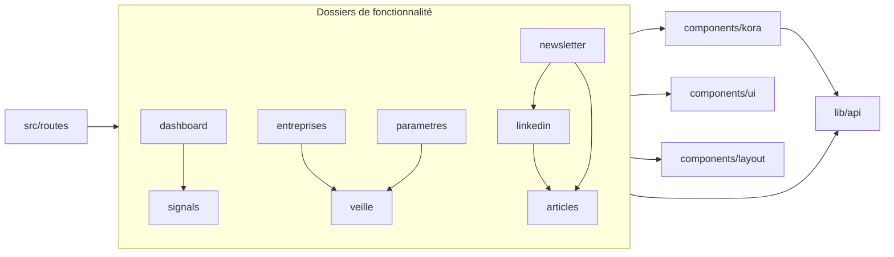
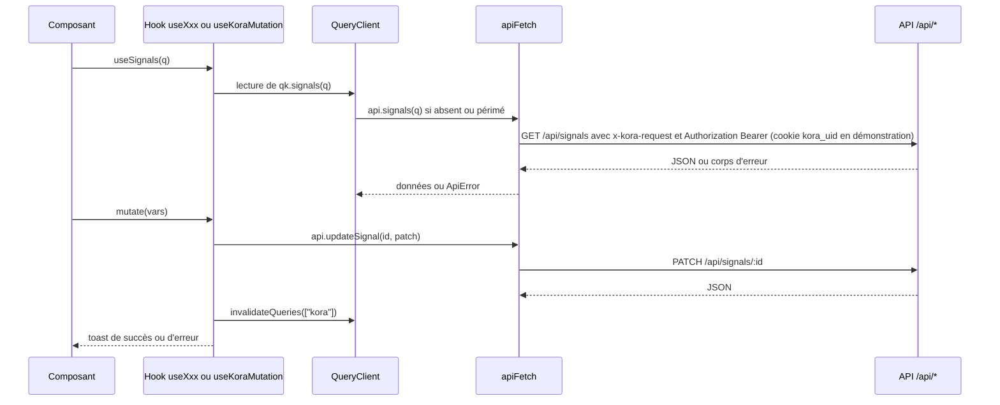
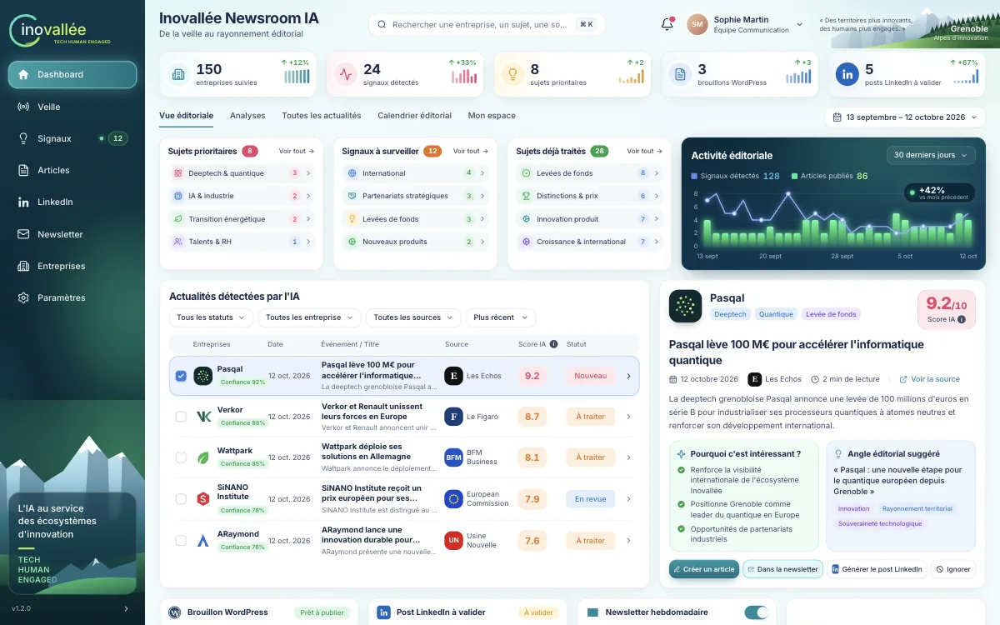
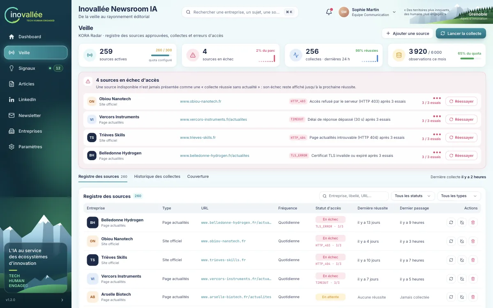
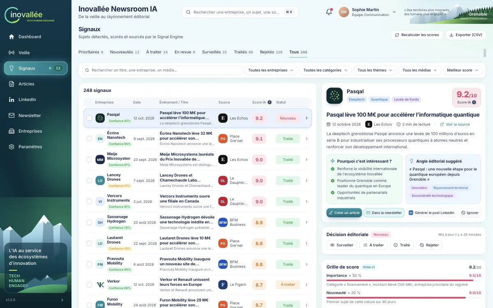
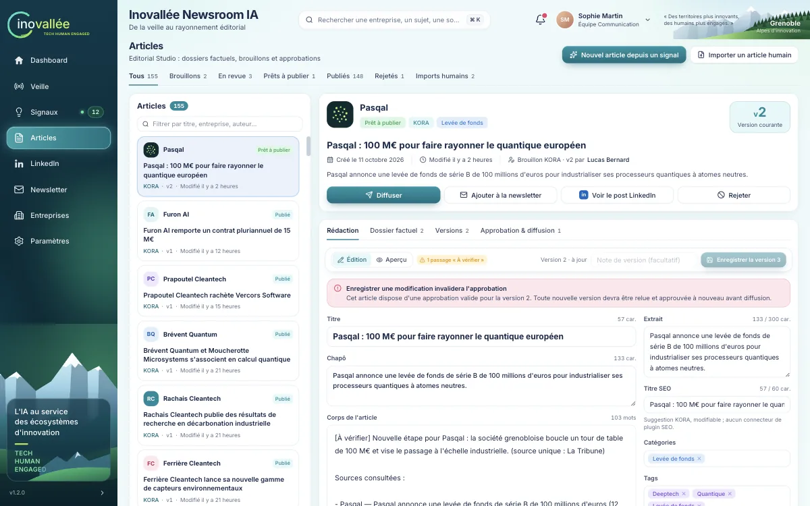
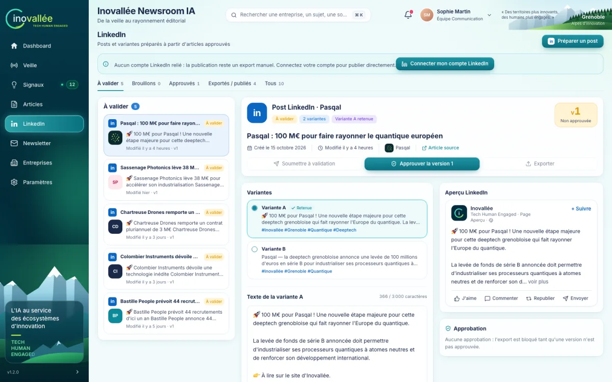
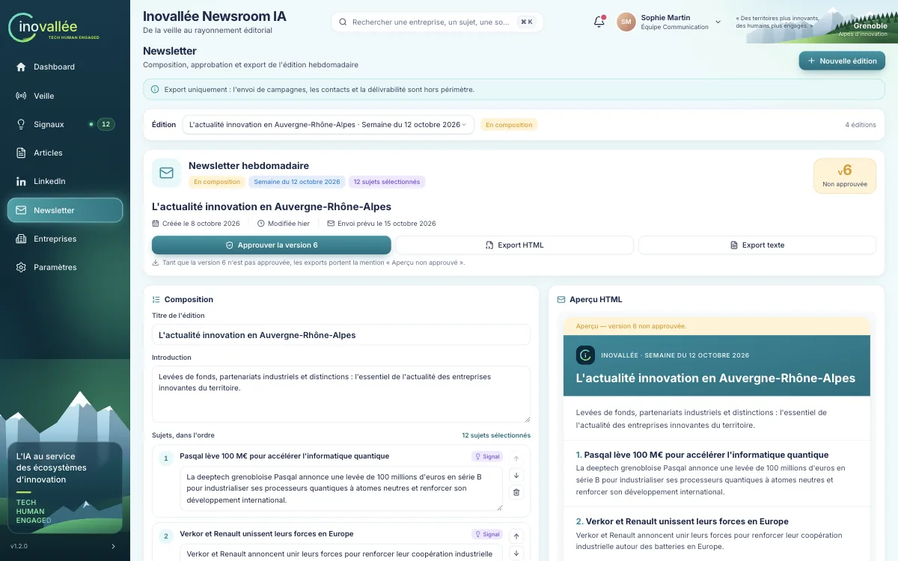
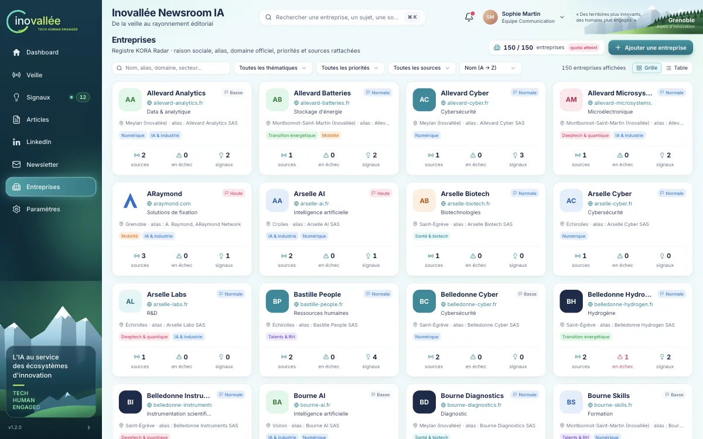
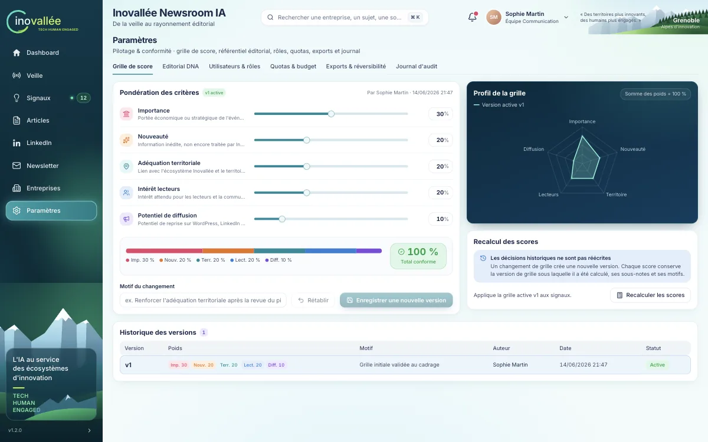

# Frontend

## Objet

Ce document s'adresse aux ingénieurs front qui reprennent l'interface de KORA Newsroom IA configurée pour Inovallée. Il décrit l'organisation du code exécuté dans le navigateur, le routage, l'accès aux données, le design system tiré de la maquette, les pièges connus de Tailwind CSS v4 et du TypeScript strict, puis, page par page, les composants, les données consommées et les interactions principales. Il se termine par des recettes et par l'état de l'accessibilité.

Le client a exigé un « respect strict du design et des couleurs » de la maquette. La section [Design system](#design-system) fait donc référence : toute évolution visuelle doit réutiliser les tokens, classes et primitives qui y sont décrits, sans valeur de couleur littérale.

Documents liés : [Architecture](02-architecture.md) pour la vue d'ensemble et le trajet d'une requête, [Référence API](03-reference-api.md) pour les endpoints, [Dictionnaire des données](04-dictionnaire-des-donnees.md) pour les DTO, [Règles métier](05-regles-metier.md) pour les workflows et le score, [Sécurité et flux tiers](06-securite-et-flux-tiers.md) pour les rôles et la protection CSRF, [Guide utilisateur](08-guide-utilisateur.md) pour l'usage des écrans, [Démarrage](01-demarrage.md) pour l'installation et les commandes.

## Sommaire

- [Organisation du code](#organisation-du-code)
- [Routage](#routage)
- [Accès aux données](#accès-aux-données)
- [Design system](#design-system)
- [Pièges connus Tailwind v4 et TypeScript strict](#pièges-connus-tailwind-v4-et-typescript-strict)
- [Pages](#pages)
- [Recettes](#recettes)
- [Accessibilité et internationalisation](#accessibilité-et-internationalisation)
- [Dette technique connue](#dette-technique-connue)

## Organisation du code

### Briques utilisées côté navigateur

| Brique | Version (`package.json`) | Rôle |
|---|---|---|
| React | `^19.2.0` | Rendu des composants |
| `@tanstack/react-start` | `1.168.60` | SSR, entrées client et serveur |
| `@tanstack/react-router` | `1.170.41` | Routage par fichiers, search params validés |
| `@tanstack/react-query` | `^5.101.1` | Cache des données de l'API |
| `tailwindcss` | `^4.2.1` | Styles utilitaires, tokens déclarés dans `@theme` |
| shadcn/ui (Radix) | style `new-york` | Primitives accessibles copiées dans `src/components/ui` |
| `lucide-react` | `^0.575.0` | Icônes |
| `recharts` | `^2.15.4` | Graphiques (dashboard, veille, paramètres) |
| `sonner` | `^2.0.7` | Toasts |
| `cmdk` | `^1.1.1` | Palette de recherche globale |
| `react-day-picker`, `date-fns` | `^9.14.0`, `^4.1.0` | Calendrier et périodes du dashboard |

`zod` n'est utilisé que côté serveur ([`validation.ts`](../src/server/validation.ts)) ; le front valide ses search params et ses formulaires à la main.

### Arborescence annotée

```text
src/
├── routes/                    Pages (routage par fichiers)
│   ├── __root.tsx             Shell HTML, <head>, QueryClientProvider, AuthGate, AppLayout, 404, erreur
│   ├── connexion/             /connexion et /connexion/nouveau-mot-de-passe (hors AppLayout)
│   ├── index.tsx              /             Dashboard éditorial
│   ├── veille.tsx             /veille
│   ├── signaux.tsx            /signaux
│   ├── articles.tsx           /articles     (enveloppe de ArticlesPage)
│   ├── linkedin.tsx           /linkedin     (enveloppe de LinkedInPage)
│   ├── newsletter.tsx         /newsletter   (enveloppe de NewsletterPage)
│   ├── entreprises.tsx        /entreprises
│   ├── parametres.tsx         /parametres
│   ├── api/$.ts               /api/*        Route serveur sans interface : appelle handleApiRequest
│   └── api/oauth/linkedin/return.ts         Page publique de retour du consentement LinkedIn (HTML minimal)
├── routeTree.gen.ts           Arbre des routes généré (ne pas éditer)
├── router.tsx                 getRouter() : QueryClient par requête + createRouter
├── start.ts, server.ts        Entrées TanStack Start (middlewares, rendu SSR)
├── styles.css                 Tokens du design system et classes .kora-*
├── components/
│   ├── kora/                  Design system maison : primitives, BrandMark, libellés et formatage
│   ├── auth/                  AuthGate, formulaires de connexion et de mot de passe, UserFormDialog
│   ├── layout/                AppLayout, AppSidebar, AppHeader, Artwork (illustrations SVG)
│   ├── ui/                    46 composants shadcn/ui générés, 15 importés par l'application
│   ├── dashboard/             Page /
│   ├── signals/               Page /signaux (table et fiche réutilisées par le dashboard)
│   ├── veille/                Page /veille ; veille/kit : boîte à outils partagée
│   ├── entreprises/           Page /entreprises
│   ├── parametres/            Page /parametres (onglets, dna/, scoring/)
│   ├── articles/              Page /articles (+ imports/) ; ui.tsx : seconde boîte à outils
│   ├── linkedin/              Page /linkedin
│   └── newsletter/            Page /newsletter
├── lib/
│   ├── api/client.ts          apiFetch, ApiError, objet api, downloadUrl
│   ├── api/hooks.ts           Clés qk, hooks useXxx, useKoraMutation
│   ├── api/types.ts           DTO partagés entre le front et le serveur
│   ├── auth/                  Session Supabase (useAuth), mode, jeton, redirections, messages
│   ├── utils.ts               cn() = clsx + tailwind-merge
│   └── error-*.ts, lovable-error-reporting.ts   Capture et remontée des erreurs (Lovable)
├── hooks/use-mobile.tsx       Hook shadcn, utilisé seulement par ui/sidebar (non monté)
├── server/                    Back-end, jamais importé par le front
└── test/                      Vitest : setup.ts, app-routing.test.tsx, server/*
```

Les quinze composants shadcn importés par l'application sont `calendar`, `checkbox` (formulaire des comptes), `command`, `dialog`, `dropdown-menu`, `input`, `popover`, `radio-group`, `select`, `skeleton`, `slider`, `sonner`, `switch`, `textarea` et `tooltip` (plus `button`, utilisé par `calendar`). Les autres fichiers de `src/components/ui` sont le socle générique de shadcn et ne sont montés nulle part.

### Rôle des dossiers et dépendances

Chaque fichier de `src/routes/` lit ses search params, compose les composants de son dossier de fonctionnalité et ne contient pas de logique d'accès aux données hors hooks. Les dossiers de fonctionnalité s'appuient sur `kora/` (primitives et libellés), `ui/` (Radix), `layout/` (illustrations) et `lib/api` ; trois d'entre eux servent aussi de bibliothèque à d'autres pages.



- `veille/kit` ([`index.ts`](../src/components/veille/kit/index.ts)) fournit tables, dialogues, filtres, retours d'erreur et métriques aux pages Veille, Entreprises et Paramètres.
- `articles/` fournit à LinkedIn et Newsletter ses hooks de droits ([`hooks.ts`](../src/components/articles/hooks.ts)), ses composants de publication ([`publication.tsx`](../src/components/articles/publication.tsx)), ses marques de canal ([`channel.tsx`](../src/components/articles/channel.tsx)) et sa boîte à outils [`ui.tsx`](../src/components/articles/ui.tsx).
- `signals/` fournit au dashboard la table [`SignalTable`](../src/components/signals/SignalTable.tsx), la fiche [`SignalDetailCard`](../src/components/signals/SignalDetailCard.tsx) et les hooks [`useAllSignals`](../src/components/signals/hooks.ts) et `useSignalActions`.
- `kora/` ne dépend d'aucun dossier de fonctionnalité ; il ne dépend que des types de `lib/api/types.ts`.

### Conventions de nommage

- Composants : PascalCase, export nommé (`export function SignalTable`), un composant principal par fichier portant son nom. Aucun export par défaut hors des fichiers générés.
- Modules non visuels d'un dossier : `labels.ts` (libellés et tons d'énumérations), `format.ts` (formatage), `hooks.ts` (hooks de la fonctionnalité), `search.ts` (search params de la route), `diff.ts`, `draft.ts`, `workflow.ts`. Quelques fichiers dérogent à la casse (`signal-utils.ts`, `dashboard-style.ts`, `companyFormModel.ts`).
- Dossiers nommés d'après la page, en français (`veille`, `entreprises`, `parametres`), sauf `dashboard` (page `/`) et `signals` (page `/signaux`).
- Valeurs d'énumération en snake_case français, identiques au serveur (`a_traiter`, `en_revue`, `succes_sans_actualite`), définies comme unions dans [`types.ts`](../src/lib/api/types.ts).
- Tables de libellés en majuscules, de type `Record<Enum, { label; tone }>` : `SIGNAL_STATUS`, `ARTICLE_STATUS`, `CATEGORY`, `THEME`…
- Hooks préfixés `use` ; toute mutation passe par `useKoraMutation`.
- Imports internes par l'alias `@/` (`@/components/kora/primitives`), déclaré dans [`tsconfig.json`](../tsconfig.json) et [`components.json`](../components.json).

### Frontière entre le front et le serveur

Le code de `src/server/**` n'est jamais importé par un composant, un hook ou une route d'interface. Seules la route serveur [`api/$.ts`](../src/routes/api/$.ts) et les tests de `src/test/server/` l'importent. Le contrat passe exclusivement par [`types.ts`](../src/lib/api/types.ts), que le serveur importe en type seulement, et par HTTP via [`client.ts`](../src/lib/api/client.ts). Importer un module serveur dans un composant embarquerait le dépôt de données et le seed dans le bundle navigateur et contournerait l'autorité de l'API. Le client Supabase navigateur ([`integrations/supabase/client.ts`](../src/integrations/supabase/client.ts), clé publique) ne sert qu'à l'authentification, dans `lib/auth/` (connexion, session, mot de passe) ; les tables `kora_records` et `kora_settings` lui sont fermées (sécurité par ligne sans règle d'accès). Toutes les données doivent continuer de passer par `/api`.

Cette règle est une convention : aucune règle ESLint ne l'impose (la seule règle `no-restricted-imports` de [`eslint.config.js`](../eslint.config.js) interdit le paquet `server-only`).

### Outillage

| Outil | Configuration | Points notables |
|---|---|---|
| TypeScript | [`tsconfig.json`](../tsconfig.json) | `strict`, `exactOptionalPropertyTypes`, `noUncheckedIndexedAccess`, `noPropertyAccessFromIndexSignature`, `noImplicitReturns`, `noImplicitOverride`, `noFallthroughCasesInSwitch`, `noUncheckedSideEffectImports` ; `noUnusedLocals` désactivé |
| ESLint | [`eslint.config.js`](../eslint.config.js) | `typescript-eslint` recommandé, `react-hooks`, `react-refresh` (avertissement), Prettier ; `@typescript-eslint/no-unused-vars` désactivé |
| Prettier | [`.prettierrc`](../.prettierrc) | `printWidth` 100, points-virgules, guillemets doubles, virgules finales ; pas de tri automatique des classes Tailwind |
| Vitest | [`vitest.config.ts`](../vitest.config.ts) | Environnement jsdom, [`setup.ts`](../src/test/setup.ts) (jest-dom, simulations de `scrollTo` et `matchMedia`) ; tests front à la racine de `src/test/` : routage ([`app-routing.test.tsx`](../src/test/app-routing.test.tsx)), authentification (`auth-*.test.ts(x)`, `securite-nouveau-mot-de-passe.test.ts`) et WordPress (`wordpress-*.test.ts(x)`) |
| shadcn CLI | [`components.json`](../components.json) | Style `new-york`, couleur de base `slate`, variables CSS, icônes lucide |
| Vite | [`vite.config.ts`](../vite.config.ts) | `@lovable.dev/vite-tanstack-config` fournit déjà TanStack Start, React, Tailwind, alias et Nitro : ne pas les ajouter à la main |

Comme les variables et exports inutilisés ne sont signalés ni par TypeScript ni par ESLint, du code mort subsiste (voir [Dette technique connue](#dette-technique-connue)). Les commandes `lint`, `test` et `format` sont décrites dans [Démarrage](01-demarrage.md#commandes).

## Routage

### Table des routes

Chaque fichier de `src/routes/` déclare sa route par `createFileRoute`, son titre et sa description par `head()`, et ses search params par `validateSearch`.

| Chemin | Fichier | Titre de l'onglet | Search params |
|---|---|---|---|
| `/` | [`index.tsx`](../src/routes/index.tsx) | « Dashboard éditorial — Inovallée Newsroom IA » | aucun |
| `/veille` | [`veille.tsx`](../src/routes/veille.tsx) | « Veille — Inovallée Newsroom IA » | `source`, `tab` |
| `/signaux` | [`signaux.tsx`](../src/routes/signaux.tsx) | « Signaux — Inovallée Newsroom IA » | `id`, `status`, `theme`, `category`, `companyId` |
| `/articles` | [`articles.tsx`](../src/routes/articles.tsx) | « Articles — Inovallée Newsroom IA » | `id`, `tab`, `importId` |
| `/linkedin` | [`linkedin.tsx`](../src/routes/linkedin.tsx) | « LinkedIn — Inovallée Newsroom IA » | `id`, `tab` |
| `/newsletter` | [`newsletter.tsx`](../src/routes/newsletter.tsx) | « Newsletter — Inovallée Newsroom IA » | `id` |
| `/entreprises` | [`entreprises.tsx`](../src/routes/entreprises.tsx) | « Entreprises — Inovallée Newsroom IA » | `id` |
| `/parametres` | [`parametres.tsx`](../src/routes/parametres.tsx) | « Paramètres — Inovallée Newsroom IA » | `tab` |
| `/connexion` | [`connexion/index.tsx`](../src/routes/connexion/index.tsx) | « Connexion — Inovallée Newsroom IA » | `redirect` (chemin interne filtré par `safeRedirect`) |
| `/connexion/nouveau-mot-de-passe` | [`connexion/nouveau-mot-de-passe.tsx`](../src/routes/connexion/nouveau-mot-de-passe.tsx) | « Choisir un mot de passe — Inovallée Newsroom IA » | aucun (le lien e-mail porte ses paramètres dans l'URL) |
| `/api/*` | [`api/$.ts`](../src/routes/api/$.ts) | sans objet | route serveur (`server.handlers.ANY`) |

La route racine définit le titre par défaut « Inovallée Newsroom IA — KORA », la description, les balises Open Graph et Twitter, la feuille `styles.css`, les polices Google Fonts et le favicon.

### Search params

Les validateurs reçoivent un `Record<string, unknown>` et renvoient `undefined` pour toute valeur inconnue : la page applique alors sa valeur par défaut. Les routes Articles, LinkedIn et Newsletter délèguent la validation à `parseArticlesSearch`, `parseLinkedInSearch` et `parseNewsletterSearch` (fichiers `search.ts` de chaque dossier) ; [`searchString`](../src/components/articles/search.ts) accepte aussi un nombre, car le parseur par défaut de TanStack Router convertit `?id=12` en nombre.

| Route | Paramètre | Valeurs acceptées | Défaut | Effet |
|---|---|---|---|---|
| `/signaux` | `status` | `SignalStatus`, `tous`, `prioritaires` | `nouveau`, ou `tous` si `id` est fourni | Onglet de statut de la liste |
| `/signaux` | `id` | identifiant de signal | premier signal de la liste | Signal affiché dans la colonne de droite |
| `/signaux` | `theme`, `category`, `companyId` | `Theme`, `Category`, identifiant | aucun | Filtres de la liste |
| `/veille` | `tab` | `registre`, `historique`, `couverture` | `registre` | Onglet affiché |
| `/veille` | `source` | identifiant de source | aucun | Force l'onglet registre, met en évidence la ligne `#source-<id>` et la fait défiler |
| `/articles` | `tab` | `tous`, `brouillons`, `en_revue`, `prets`, `publies`, `rejetes`, `imports` | `tous` | Filtre de la liste ou bascule vers les imports humains |
| `/articles` | `id` | identifiant d'article | premier article filtré | Article ouvert dans l'espace de travail |
| `/articles` | `importId` | identifiant d'import | aucun | Import ouvert (onglet `imports`) |
| `/linkedin` | `tab` | `a_valider`, `brouillons`, `approuves`, `diffuses`, `tous` | `a_valider`, ou `tous` si `id` est fourni | Filtre de la liste |
| `/linkedin` | `id` | identifiant de post | premier post filtré | Post affiché |
| `/newsletter` | `id` | identifiant d'édition | édition en composition, sinon la plus récente | Édition affichée |
| `/entreprises` | `id` | identifiant d'entreprise | aucun | Ouvre le panneau latéral `CompanyDetailSheet` |
| `/parametres` | `tab` | `grille`, `dna`, `utilisateurs`, `wordpress`, `quotas`, `exports`, `audit` | `grille` (retiré de l'URL) | Onglet affiché |

Sur `/signaux`, l'onglet « Prioritaires » n'existe que côté front : il réunit les signaux `nouveau` et `a_traiter` dont le score atteint `PRIORITY_MIN_SCORE = 80`, valeur qui doit rester alignée sur `PRIORITY_SCORE` de [`dashboard.ts`](../src/server/domain/dashboard.ts). Changer de statut ou de filtre de route remet `id` à `undefined` ; un effet resélectionne alors le premier signal avec `navigate({ replace: true })` pour ne pas polluer l'historique.

Les pages modifient l'URL par `Route.useNavigate()` avec une fonction de fusion :

```ts
const navigate = Route.useNavigate();
const onSearch = (patch: ArticlesSearch) =>
  void navigate({ search: (prev) => ({ ...prev, ...patch }) });
```

Plusieurs états restent locaux et sont perdus au rechargement : onglet et période du dashboard, recherche texte, média et tri de `/signaux`, filtres et mode grille ou table de `/entreprises`, filtre d'accès de `/veille`, section de l'espace de travail d'un article, filtres du journal d'audit.

### Mise en page globale

[`__root.tsx`](../src/routes/__root.tsx) déclare la route racine par `createRootRouteWithContext<{ queryClient: QueryClient }>()` et assemble la page :

```text
RootShell                <html lang="fr"> <head><HeadContent/></head> <body>… <Scripts/></body>
└── RootComponent
    └── QueryClientProvider        client issu du contexte du routeur
        ├── <Outlet/>              pages /connexion/* seules (isAuthPage), sans AuthGate ni AppLayout
        ├── AuthGate               toutes les autres pages
        │   └── AppLayout          TooltipProvider (delayDuration 150), div.kora-page-bg
        │       ├── AppSidebar     232 px, 76 px replié, sticky, .kora-sidebar-bg
        │       └── colonne principale
        │           ├── AppHeader
        │           └── <main class="flex-1 px-6 pb-6"> contenant <Outlet/> (page courante)
        └── Toaster                sonner, richColors, position top-right
```

Une page ne rend donc que son contenu : barre latérale, en-tête, fond et toasts sont fournis par la racine. Les pages de connexion font exception : elles s'affichent dans leur propre cadre ([`AuthPageShell`](../src/components/auth/AuthPageShell.tsx)), sans barre latérale ni en-tête.

[`AuthGate`](../src/components/auth/AuthGate.tsx) garde l'application. Il lit l'état d'authentification (`useAuth` de [`lib/auth/session.ts`](../src/lib/auth/session.ts), un magasin externe lu par `useSyncExternalStore`, toujours `loading` pendant le rendu serveur). Le mode vient de `GET /api/auth/config` ([`lib/auth/mode.ts`](../src/lib/auth/mode.ts)) : `supabase` quand le serveur utilise une base, `demo` sinon, et `demo` par repli si la lecture échoue (le serveur reste seul garant de la sécurité). En mode `demo`, la page s'affiche sans connexion. En mode `supabase`, rien n'est rendu (`AuthLoading`) tant que la session Supabase n'a pas été validée par le serveur (`POST /api/auth/session`, qui pose aussi le cookie `__Host-kora_session` des téléchargements). Sans session, `AuthGate` vide le cache `["kora"]` et redirige vers `/connexion?redirect=<page demandée>`. Un lien d'invitation ou de réinitialisation arrivé sur une autre page (adresse de retour refusée par Supabase) est renvoyé vers `/connexion/nouveau-mot-de-passe`.

[`AppSidebar`](../src/components/layout/AppSidebar.tsx) lit la constante `NAV` :

| Libellé | Chemin | Icône | Particularité |
|---|---|---|---|
| Dashboard | `/` | `HomeSolidIcon` (Artwork) | `exact: true` |
| Veille | `/veille` | `Radio` | |
| Signaux | `/signaux` | `Lightbulb` | Badge du nombre de signaux `nouveau` |
| Articles | `/articles` | `FileText` | |
| LinkedIn | `/linkedin` | `LinkedInIcon` (Artwork) | |
| Newsletter | `/newsletter` | `Mail` | |
| Entreprises | `/entreprises` | `Building2` | |
| Paramètres | `/parametres` | `Settings` | |

Le badge provient de `useSignals({ status: "nouveau", limit: 1 }).data.total`. L'élément actif reçoit la chaîne `ACTIVE` via `activeProps` de `Link` (voir [Pièges connus](#pièges-connus-tailwind-v4-et-typescript-strict)) ; `Link` ajoute aussi `aria-current="page"`. L'état replié est un `useState` d'`AppLayout`, non persisté. Le pied affiche `APP_VERSION` (« v1.2.0 », valeur codée en dur) et le bouton « Replier le menu » / « Déplier le menu ».

[`AppHeader`](../src/components/layout/AppHeader.tsx) contient :

- le titre « Inovallée Newsroom IA » (`h1`, 24 px) et le sous-titre « De la veille au rayonnement éditorial » ;
- `GlobalSearch` : bouton puis `CommandDialog` (cmdk), ouvert aussi par ⌘K ou Ctrl+K, requête `api.search` sous la clé `qk.search(q)` après 180 ms de stabilité et à partir de 2 caractères, résultats groupés « Entreprises », « Sujets », « Articles », « Sources » ; la sélection navigue vers `r.link`, URL construite par le serveur (`/entreprises?id=`, `/signaux?id=`, `/articles?id=`, `/veille?source=`) ;
- `Notifications` : popover avec pastille rose si des notifications sont non lues, marquées lues à la fermeture (`api.markNotificationsRead`, invalidation limitée à `qk.notifications`) ;
- `UserMenu`, qui dépend du mode : en mode `supabase`, `AccountMenu` affiche le nom, l'adresse e-mail et les rôles du compte (`useMe`, à défaut l'utilisateur renvoyé par la vérification de session) et l'entrée « Se déconnecter » (`signOut` : déconnexion Supabase, effacement du cookie serveur par `POST /api/auth/logout`, puis rechargement sur `/connexion`) ; en mode `demo` seulement, `DemoUserMenu` affiche le profil courant, la liste des comptes (`useUsers`) sous « Changer de profil » (`api.switchUser`, toast « Connecté en tant que … ») ;
- l'illustration `HeaderLandscape` et la citation « Des territoires plus innovants, des humains plus engagés. », affichée quand l'en-tête dépasse 1 120 px (requête de conteneur `@min-[1120px]/header`).

### Page introuvable et erreurs

- `notFoundComponent` (`NotFoundComponent`) : carte `.kora-card` « 404 », « Page introuvable », lien « Retour au dashboard ». Elle s'affiche dans l'`<Outlet/>`, donc avec la barre latérale et l'en-tête.
- `errorComponent` (`ErrorComponent`) : « Cette page n'a pas pu se charger », boutons « Réessayer » (`router.invalidate()` puis `reset()`) et « Dashboard ». L'erreur est journalisée et transmise à `reportLovableError` ([`lovable-error-reporting.ts`](../src/lib/lovable-error-reporting.ts)), qui n'agit que dans l'aperçu Lovable. Aucune route enfant ne déclare d'`errorComponent` : une erreur de rendu dans une page remonte jusqu'à la racine et remplace toute l'application, barre latérale comprise.
- Une erreur pendant le rendu serveur est interceptée par [`server.ts`](../src/server.ts), qui renvoie la page statique de [`error-page.ts`](../src/lib/error-page.ts).
- Les erreurs de données ne passent pas par ces composants : chaque bloc affiche son propre état d'erreur (voir [Gestion des erreurs](#gestion-des-erreurs)).

### Arbre des routes généré

[`routeTree.gen.ts`](../src/routeTree.gen.ts) est régénéré par le plugin TanStack Router de Vite à chaque ajout, renommage ou suppression de fichier dans `src/routes/`. Il ne doit jamais être modifié à la main. Il enregistre aussi le type du routeur (`declare module '@tanstack/react-router'`) et active le SSR (`ssr: true`), ce qui donne le typage de `to`, `search` et `Route.useSearch()`. Le test de routage, [`app-routing.test.tsx`](../src/test/app-routing.test.tsx), vérifie que `/` correspond à une page et non au « not found ».

### Rendu serveur et chargement des données

[`router.tsx`](../src/router.tsx) crée un `QueryClient` par appel de `getRouter()`, donc par requête SSR, sans options par défaut, et active `scrollRestoration` et `defaultPreloadStaleTime: 0`.

Aucune route ne déclare de `loader`, aucune requête n'est préchargée (`ensureQueryData`, `prefetchQuery`, `useSuspenseQuery` sont absents) et l'intégration SSR de TanStack Query n'est pas branchée. Le rendu serveur produit donc la structure de la page et ses squelettes ; toutes les données sont chargées dans le navigateur par `useQuery` après l'hydratation. Conséquences pratiques :

- `apiFetch` appelle des URL relatives (`/api/...`) et ne peut pas être exécuté tel quel dans un `loader` côté serveur (pas d'origine, pas de jeton : `getAccessToken` renvoie `null` hors navigateur) ;
- l'état d'authentification vaut `loading` pendant le rendu serveur : le HTML initial d'une page de l'application ne contient que l'écran d'attente d'`AuthGate` ;
- les composants qui ont besoin du DOM (graphiques recharts `ResponsiveContainer`) attendent le montage grâce à un hook `useMounted` local ([`ActivityCard.tsx`](../src/components/dashboard/ActivityCard.tsx), [`AnalyticsView.tsx`](../src/components/dashboard/AnalyticsView.tsx)) ;
- les options par défaut de TanStack Query s'appliquent : `staleTime` nul, rafraîchissement au retour sur l'onglet, et trois nouvelles tentatives en cas d'échec, y compris sur une réponse 403, 404 ou 422 ; un état d'erreur n'apparaît donc qu'après ces tentatives.

### Liens entre pages

Deux façons de lier une autre page coexistent :

- `Link` typé de TanStack Router : `<Link to="/articles" search={{ id: post.articleId }}>` ([`PostDetail.tsx`](../src/components/linkedin/PostDetail.tsx)), `navigate({ to: "/signaux", search: { id, status: "tous" } })` ([`AllNewsView.tsx`](../src/components/dashboard/AllNewsView.tsx)) ;
- `HrefLink`, ancre qui intercepte le clic et appelle `navigate({ href })` sur une URL déjà construite (`/signaux?id=…`), sans typage des search params. Trois implémentations existent : [`signals/links.tsx`](../src/components/signals/links.tsx), [`veille/kit/actions.tsx`](../src/components/veille/kit/actions.tsx) (arrête aussi la propagation du clic) et [`articles/ui.tsx`](../src/components/articles/ui.tsx) (style teal intégré).

Pour un nouveau lien, `Link` typé est préférable : une erreur de chemin ou de paramètre est alors détectée à la compilation.

## Accès aux données

Le front n'appelle l'API que par trois fichiers : [`client.ts`](../src/lib/api/client.ts), [`hooks.ts`](../src/lib/api/hooks.ts) et [`types.ts`](../src/lib/api/types.ts). Les endpoints et leurs contrats sont décrits dans la [Référence API](03-reference-api.md) et les champs des DTO dans le [Dictionnaire des données](04-dictionnaire-des-donnees.md).



### Client HTTP

`apiFetch<T>(path, init)` :

- préfixe le chemin par `/api` et envoie la requête avec `credentials: "same-origin"` ;
- en mode `supabase`, ajoute l'en-tête `authorization: Bearer <jeton d'accès>` de la session Supabase courante (`getAccessToken` de [`lib/auth/token.ts`](../src/lib/auth/token.ts)), sauf si l'appelant en fournit déjà un ; le serveur vérifie ce jeton à chaque requête. En mode `demo`, aucun jeton n'est envoyé et le profil est désigné par le cookie `kora_uid` ;
- ajoute l'en-tête `x-kora-request: 1` à toutes les requêtes, lectures comprises ; le serveur l'exige pour toute écriture et répond sinon 403 `csrf_header_missing` (voir [Sécurité et flux tiers](06-securite-et-flux-tiers.md)) ;
- hors des routes `/auth/*`, une réponse 401, ou 403 `account_not_authorized` (compte retiré de KORA), appelle `handleUnauthenticated` : la session locale est retirée, le motif est mémorisé pour la page de connexion, puis le navigateur recharge `/connexion?redirect=<page courante>` ; l'`ApiError` est levée comme pour toute autre erreur ;
- ajoute `content-type: application/json` quand un corps non `FormData` est présent ;
- renvoie `undefined` sur une réponse 204, le JSON décodé sinon ;
- sur une réponse non 2xx, lit le corps `{ "error": { "code", "message", "details" } }` (`ApiErrorBody`) et lève `ApiError(status, code, message, details)` ; si le corps n'est pas du JSON, le code vaut `http_error` et le message `res.statusText`.

Exemple de corps d'erreur réel, obtenu par `GET /api/signals?status=inconnu` :

```json
{ "error": { "code": "invalid_filter", "message": "Statut inconnu : inconnu" } }
```

L'objet `api` regroupe une fonction par endpoint, typée par les DTO de `types.ts`, par domaine : authentification (`openServerSession`, `closeServerSession`), session et gestion des utilisateurs (`createUser`, `updateUser`, `deleteUser`, `resendInvitation`), connexion LinkedIn de l'utilisateur, WordPress, dashboard et recherche, registre (entreprises, sources, collectes), Signal Engine (signaux, fusion, défusion, recalcul, grilles), Studio (articles, versions, approbations, publication, faits), imports humains, LinkedIn, newsletter, Editorial DNA et exploitation (usage, audit). L'assistant interne `json(method, body)` sérialise le corps ; `toQuery` omet les paramètres `undefined`, `null` ou vides.

### Clés de cache et hooks de lecture

Toutes les clés commencent par `"kora"`, ce qui permet d'invalider tout le cache d'un coup, sauf `wordpressCheck` et `wordpressCategories` (`["wordpress-site", …]`), dont les requêtes appellent le site WordPress et ne partent qu'au clic :

| Clé `qk` | Valeur | Hook |
|---|---|---|
| `me`, `users` | `["kora", "me"]`, `["kora", "users"]` | `useMe`, `useUsers` ; mutations `useCreateUser`, `useUpdateUser`, `useDeleteUser`, `useResendInvitation` |
| `linkedinConnection` | `["kora", "linkedinConnection"]` | `useLinkedInConnection` ; mutations `useLinkedInLink`, `useLinkedInComplete`, `useLinkedInUnlink` |
| `wordpress` | `["kora", "wordpress"]` | `useWordPressStatus` |
| `dashboard(q)` | `["kora", "dashboard", q]` | `useDashboard({ from, to })` |
| `search(q)` | `["kora", "search", q]` | aucun (requête locale à `GlobalSearch`) |
| `notifications` | `["kora", "notifications"]` | `useNotifications` |
| `companies(q)`, `company(id)` | `["kora", "companies", q]`, `["kora", "company", id]` | `useCompanies`, `useCompanyDetail` (dossier entreprises) |
| `sources(q)`, `runs(q)` | `["kora", "sources", q]`, `["kora", "runs", q]` | `useSources`, `useCollectionRuns` |
| `signals(q)`, `signal(id)` | `["kora", "signals", q]`, `["kora", "signal", id]` | `useSignals`, `useSignal` |
| `grids` | `["kora", "grids"]` | `useScoringGrids` |
| `articles(q)`, `article(id)` | `["kora", "articles", q]`, `["kora", "article", id]` | `useArticles`, `useArticle` |
| `imports` | `["kora", "imports"]` | `useImports` |
| `publications(q)` | `["kora", "publications", q]` | `usePublications` |
| `linkedin`, `newsletters` | `["kora", "linkedin"]`, `["kora", "newsletters"]` | `useLinkedInPosts`, `useNewsletters` |
| `newsletter(id)` | `["kora", "newsletter", id]` | aucun |
| `dna`, `usage` | `["kora", "dna"]`, `["kora", "usage"]` | `useEditorialDna`, `useUsage` |
| `audit(q)` | `["kora", "audit", q]` | `useAudit` |

Les hooks à identifiant (`useSignal`, `useArticle`, `useCompanyDetail`) acceptent `undefined` ou `null` et ne lancent la requête que si l'identifiant est défini (`enabled: !!id`). Les hooks composés vivent dans les dossiers de fonctionnalité : `useAllSignals` charge tous les signaux par pages de 200 avec `useQueries`, `useSignalStatusCounts` lance une requête `limit: 1` par statut pour les compteurs d'onglets, `usePrioritySignals` (dans `signaux.tsx`) réunit deux listes.

### Mutations

`useKoraMutation<TVars, TData>(fn, opts)` enveloppe `useMutation` :

| Option | Effet |
|---|---|
| `success` | Message de toast de succès, chaîne ou fonction des données renvoyées ; une chaîne vide n'affiche rien |
| `invalidate` | Clé invalidée après succès ; `["kora"]` par défaut, c'est-à-dire tout le cache |
| `onSuccess` | Rappel exécuté après l'invalidation et le toast |

En cas d'échec, un toast d'erreur affiche `errorMessage(e)`, c'est-à-dire le message français rédigé par le serveur pour une `ApiError`, le message brut de toute autre `Error` (par exemple « Failed to fetch » en cas de coupure réseau), ou « Erreur inattendue ». L'invalidation globale par défaut garde cohérents les compteurs de la barre latérale, du dashboard et des listes, au prix d'un rechargement de toutes les requêtes actives après chaque écriture.

Les mutations de comptes (`useCreateUser`, `useUpdateUser`, `useDeleteUser`, `useResendInvitation`) n'utilisent pas `useKoraMutation` : elles invalident seulement `qk.users`, `qk.me` et le journal d'audit, sans toast automatique, car le message affiché dépend du résultat de l'invitation.

Quand la réponse contient l'objet mis à jour, plusieurs écrans l'injectent aussitôt dans le cache pour éviter un aller-retour visible : `useSetArticle` ([`workflow.ts`](../src/components/articles/workflow.ts)) pour `qk.article(id)`, `useUpsertImport` ([`imports/cache.ts`](../src/components/articles/imports/cache.ts)) pour `qk.imports`, `setPost` dans [`PostDetail.tsx`](../src/components/linkedin/PostDetail.tsx) pour `qk.linkedin`, `setEdition` dans [`EditionWorkspace.tsx`](../src/components/newsletter/EditionWorkspace.tsx) pour `qk.newsletters`.

### Gestion des erreurs

- Lecture : chaque bloc teste `query.error` puis `query.isPending` (ou l'absence de `data`) et affiche, selon la boîte à outils du dossier, `ErrorPanel` ([`veille/kit/feedback.tsx`](../src/components/veille/kit/feedback.tsx), avec le statut HTTP et un bouton « Réessayer » appelant `refetch`) ou `LoadError` ([`articles/ui.tsx`](../src/components/articles/ui.tsx)). Le dashboard affiche un bandeau `role="alert"` avec « Réessayer ».
- Écriture : toast d'erreur automatique de `useKoraMutation`. Les formulaires qui doivent montrer l'erreur sur place lisent `mutation.error` et l'affichent par `InlineError` ; [`AddSourceDialog.tsx`](../src/components/veille/AddSourceDialog.tsx) distingue ainsi `url_refused`, les codes contenant `quota` et le statut 403.
- Champs : la validation locale (formulaires d'entreprise, de source, motifs de rejet) n'affiche les erreurs qu'après une première tentative d'envoi (état `submitted`).

### Téléchargements

Les fichiers générés ne passent pas par `apiFetch` : `downloadUrl` construit des URL directes, utilisées dans des ancres (`DownloadLink`, `GhostLink` ou `<a download>`).

| Fonction | URL |
|---|---|
| `downloadUrl.export(entity, "csv" \| "json")` | `/api/export/<entity>?format=csv` |
| `downloadUrl.exportManifest()` | `/api/export/manifest` |
| `downloadUrl.newsletter(id, "html" \| "txt")` | `/api/newsletters/<id>/export?format=html` |
| `downloadUrl.linkedin(id)` | `/api/linkedin/<id>/export` |

Ces requêtes GET n'emportent ni l'en-tête `x-kora-request` ni le jeton `Authorization`. En mode `supabase`, le serveur les authentifie par le cookie `__Host-kora_session` (HttpOnly, `SameSite=Strict`, une heure au plus), posé lors de la validation de la session et effacé à la déconnexion ; il ne l'accepte que sur les routes de téléchargement, en GET ou HEAD, pour une navigation de même origine. En mode `demo`, c'est le cookie `kora_uid`. Un téléchargement n'a aucun effet côté serveur, y compris celui d'une newsletter approuvée. La consignation de l'export est une requête distincte : [`EditionWorkspace.tsx`](../src/components/newsletter/EditionWorkspace.tsx) appelle `api.recordNewsletterExport` (`POST /api/newsletters/:id/export`) au clic sur un lien d'export, quand la version est approuvée, l'édition pas encore exportée et l'utilisateur validateur (`onExported`) ; la réponse, l'édition passée `exportee`, est injectée dans le cache (`setEdition`) et tout le cache est invalidé.

### Droits d'interface

Le serveur reste l'autorité ([`permissions.ts`](../src/server/domain/permissions.ts)) ; le front se contente de désactiver les actions. Deux hooks `usePermissions` coexistent avec des sémantiques différentes :

| Hook | Dossiers utilisateurs | Valeurs | Règle |
|---|---|---|---|
| [`articles/hooks.ts`](../src/components/articles/hooks.ts) | articles, LinkedIn, newsletter | `canWrite`, `canValidate`, `readOnly` | `canWrite` si admin ou rédacteur, `canValidate` si admin ou validateur ; tout est permis tant que le profil n'est pas chargé |
| [`veille/kit/hooks.ts`](../src/components/veille/kit/hooks.ts) | veille, entreprises, paramètres | `readOnly`, `isAdmin`, `readOnlyTitle` | `readOnly` seulement si tous les rôles valent `lecteur` |

La page `/signaux` et les cartes du dashboard ne désactivent aucune action selon le rôle, hormis « Recalculer les scores », réservé à l'administrateur. L'onglet « Utilisateurs & rôles » lit directement `useMe` : « Ajouter », la modification, le renvoi d'invitation et la suppression ne sont affichés qu'aux administrateurs. La suppression y est désactivée pour son propre compte et pour le dernier compte portant le rôle administrateur, et la case « Administrateur » est verrouillée sur son propre compte ; le serveur, en mode `supabase`, ne compte que les administrateurs ayant déjà activé leur compte et peut donc refuser une suppression que l'interface permet (422 `last_admin`). Les écarts avec la matrice serveur sont listés dans [Dette technique connue](#dette-technique-connue). Les droits eux-mêmes sont décrits dans [Sécurité et flux tiers](06-securite-et-flux-tiers.md).

### Ajouter un hook et une mutation

`api.newsletter(id)` et `qk.newsletter(id)` existent sans hook. Un hook de lecture suit le modèle de `useArticle` :

```ts
// src/lib/api/hooks.ts
export const useNewsletter = (id: string | null | undefined) =>
  useQuery({
    queryKey: qk.newsletter(id ?? ""),
    queryFn: () => api.newsletter(id!),
    enabled: !!id,
  });
```

Pour un nouvel endpoint, l'ordre est le suivant : déclarer le DTO dans `types.ts` (en accord avec le serveur), ajouter la fonction dans l'objet `api` de `client.ts`, puis la clé dans `qk` (toujours préfixée `"kora"`) et le hook dans `hooks.ts`.

Une mutation s'écrit dans le composant ou dans un hook du dossier de fonctionnalité, comme `useSignalActions` ([`signals/hooks.ts`](../src/components/signals/hooks.ts)) :

```tsx
import { Eye } from "lucide-react";
import { GhostButton } from "@/components/kora/primitives";
import { api } from "@/lib/api/client";
import { useKoraMutation } from "@/lib/api/hooks";
import type { Signal } from "@/lib/api/types";

export function WatchButton({ signal }: { signal: Signal }) {
  const watch = useKoraMutation(
    () => api.updateSignal(signal.id, { status: "surveille", statusReason: null }),
    { success: (s) => `« ${s.title} » placé en surveillance` },
  );
  return (
    <GhostButton disabled={watch.isPending} onClick={() => watch.mutate(undefined)}>
      <Eye className="size-4" /> Surveiller
    </GhostButton>
  );
}
```

`mutate(undefined)` est nécessaire quand la fonction ne prend pas de variable, car `TVars` est alors inféré comme `unknown` ; pour écrire `mutate()`, typer explicitement `useKoraMutation<void, TData>(…)` comme dans `ScoringGridTab`. Pour limiter l'invalidation, passer `invalidate: qk.notifications` par exemple ; pour une mise à jour immédiate, appeler `queryClient.setQueryData` dans `onSuccess`.

## Design system

### Source de vérité

Les couleurs, rayons et polices sont déclarés dans [`styles.css`](../src/styles.css), « palette relevée sur la maquette ». Le fichier :

1. importe Tailwind avec `source(none)` puis `@source "../src"` : seules les classes écrites littéralement dans `src/` sont générées ;
2. importe `tw-animate-css` (animations des composants Radix) ;
3. déclare une variante `dark`, mais aucun thème sombre : l'application est en thème clair uniquement ;
4. associe chaque variable CSS à une classe Tailwind dans `@theme inline` (`--color-kora-rose` donne `bg-kora-rose`, `text-kora-rose`, `border-kora-rose`, `ring-kora-rose`, avec les variantes d'opacité `/NN`) ;
5. définit les valeurs dans `:root`, toutes en oklch (le fichier l'impose : « All colors MUST use oklch format ») ;
6. définit dans `@layer base` la couleur de bordure par défaut, `html { font-size: 15px }`, la police et le fond du `body` ;
7. définit dans `@layer components` les classes `.kora-*`.

Les correspondances hexadécimales des tableaux ci-dessous sont des conversions sRGB arrondies, données pour comparaison avec la maquette ; la valeur normative est l'oklch.

### Palette KORA

| Variable | Classes | oklch | Hex | Usage |
|---|---|---|---|---|
| `--kora-ink` | `text-kora-ink` | `0.289 0.062 263.9` | `#1b2a4a` | Texte principal, titres |
| `--kora-ink-soft` | `text-kora-ink-soft` | `0.413 0.052 264.4` | `#3d4b68` | Texte secondaire, métadonnées |
| `--kora-teal` | `*-kora-teal` | `0.581 0.098 210.3` | `#0f8a9b` | Couleur de marque : liens, onglet actif, icônes |
| `--kora-teal-dark` | `*-kora-teal-dark` | `0.495 0.084 212.6` | `#0a6e7e` | Survol des liens, bas du bouton principal |
| `--kora-teal-light` | `*-kora-teal-light` | `0.802 0.105 199.1` | `#5ed3d8` | Bordure au survol, anneau du logo |
| `--kora-teal-bg` | `bg-kora-teal-bg` | `0.963 0.019 200.9` | `#e5f7f8` | Fond teal pastel, survol des boutons secondaires |
| `--kora-rose` | `*-kora-rose` | `0.628 0.198 10` | `#e5446d` | Ton rose |
| `--kora-rose-bg` | `bg-kora-rose-bg` | `0.947 0.028 1.3` | `#ffe6ec` | Fond rose pastel |
| `--kora-orange` | `*-kora-orange` | `0.678 0.171 49.4` | `#e8711c` | Ton orange |
| `--kora-orange-bg` | `bg-kora-orange-bg` | `0.958 0.03 69.1` | `#ffeedc` | Fond orange pastel |
| `--kora-amber` | `*-kora-amber` | `0.737 0.153 75.9` | `#e09a0b` | Ton ambre |
| `--kora-amber-bg` | `bg-kora-amber-bg` | `0.965 0.044 89.9` | `#fff3d3` | Fond ambre pastel |
| `--kora-green` | `*-kora-green` | `0.627 0.17 149.2` | `#16a34a` | Ton vert |
| `--kora-green-bg` | `bg-kora-green-bg` | `0.952 0.036 158` | `#dcf7e6` | Fond vert pastel |
| `--kora-blue` | `*-kora-blue` | `0.592 0.157 253.3` | `#2b7fd8` | Ton bleu, ligne sélectionnée des tables |
| `--kora-blue-bg` | `bg-kora-blue-bg` | `0.944 0.023 252.2` | `#e2eefc` | Fond bleu pastel |
| `--kora-purple` | `*-kora-purple` | `0.55 0.206 293.7` | `#7c4ddb` | Ton violet |
| `--kora-purple-bg` | `bg-kora-purple-bg` | `0.942 0.029 298.9` | `#eee8fd` | Fond violet pastel |
| `--kora-linkedin` | `*-kora-linkedin` | `0.516 0.163 254.7` | `#0a66c2` | Marque LinkedIn |
| `--kora-lime` | `*-kora-lime` | `0.855 0.192 123.8` | `#b6e33b` | Filet de la carte promotionnelle de la barre latérale |
| `--kora-aurora` | `*-kora-aurora` | `0.818 0.174 160.5` | `#2ee59d` | Vert « aurore » de la barre latérale et des panneaux sombres |
| `--kora-night` | `bg-kora-night` | `0.269 0.054 233.4` | `#022a3c` | Début du dégradé des panneaux sombres |
| `--kora-night-2` | `bg-kora-night-2` | `0.345 0.078 242` | `#053d5e` | Fin du dégradé des panneaux sombres |
| `--kora-signals` | `*-kora-signals` | `0.754 0.139 232.7` | `#38bdf8` | Série secondaire des graphiques sombres |
| `--kora-line` | `*-kora-line` | `0.881 0.111 176.7` | `#7ff0d6` | Courbe des graphiques sombres |
| `--kora-sidebar-top` | aucune | `0.322 0.059 225.9` | `#04394a` | Haut du dégradé `.kora-sidebar-bg` |
| `--kora-sidebar-bottom` | aucune | `0.224 0.042 229.1` | `#021f2b` | Bas du dégradé `.kora-sidebar-bg` |

`--kora-shadow` vaut `0 1px 2px oklch(0.289 0.062 263.9 / 4%), 0 6px 24px -8px oklch(0.495 0.084 212.6 / 14%)` et sert d'ombre aux cartes. Les variables `--kora-*` sont aussi utilisables directement en CSS ou en SVG, par exemple `fill="var(--kora-rose)"` dans un graphique recharts ([`CoveragePanel.tsx`](../src/components/veille/CoveragePanel.tsx)).

### Variables shadcn

Les composants de `src/components/ui` lisent les variables shadcn, alignées sur la palette KORA :

| Variable | oklch | Hex | Usage dans l'application |
|---|---|---|---|
| `--background` | `0.972 0.011 204.1` | `#eef8f9` | Fond du `body` |
| `--foreground` | `0.289 0.062 263.9` | `#1b2a4a` | Texte par défaut (= `--kora-ink`) |
| `--card`, `--popover` | `1 0 0` | `#ffffff` | Fonds des popovers et menus |
| `--primary` | `0.581 0.098 210.3` | `#0f8a9b` | `= --kora-teal` |
| `--secondary` | `0.964 0.008 236.6` | `#eef4f8` | En-têtes de table (`Th`) |
| `--muted` | `0.974 0.006 239.8` | `#f3f7fa` | Fond du ton `gray` |
| `--muted-foreground` | `0.554 0.041 257.4` | `#64748b` | Texte tertiaire, ton `gray` |
| `--accent` | `0.962 0.017 201.4` | `#e6f6f7` | Survol dans les menus Radix |
| `--accent-foreground` | `0.495 0.084 212.6` | `#0a6e7e` | `= --kora-teal-dark` |
| `--destructive` | `0.586 0.222 17.6` | `#e11d48` | Composants shadcn seulement ; l'application utilise `kora-rose` |
| `--success`, `--warning` | `0.627 0.17 149.2`, `0.666 0.157 58.3` | `#16a34a`, `#d97708` | Déclarées, non utilisées |
| `--border` | `0.933 0.013 244.3` | `#e2eaf1` | Bordure par défaut de tous les éléments |
| `--input` | `0.911 0.016 245.1` | `#d9e3ec` | Bordure des champs shadcn |
| `--ring` | `0.656 0.11 208.2` | `#13a3b4` | Anneau de focus shadcn |
| `--chart-1` à `--chart-5` | voir `styles.css` | `#22c55e`, `#38bdf8`, `#7ff0d6`, `#e09a0b`, `#e5446d` | Déclarées, non utilisées par les graphiques |
| `--sidebar`, `--sidebar-foreground` | `0.277 0.05 224`, `0.957 0.015 207.1` | `#022d3a`, `#e6f4f6` | Milieu du dégradé de la barre latérale, `text-sidebar-foreground` |

### Tons sémantiques

Les pastilles, badges, tuiles d'icône et compteurs ne reçoivent jamais une couleur, mais un ton : `type Tone = "rose" | "orange" | "amber" | "green" | "blue" | "purple" | "teal" | "gray"` ([`labels.ts`](../src/components/kora/labels.ts)). `TONE_CLASSES[tone]` fournit trois classes complètes : `bg` (fond pastel `bg-kora-<ton>-bg`), `fg` (texte `text-kora-<ton>`) et `solid` (fond plein `bg-kora-<ton>`). Le ton `gray` utilise `bg-muted`, `text-muted-foreground` et `bg-muted-foreground`.

| Ton | Sens dominant | Exemples (constante et valeur) |
|---|---|---|
| `rose` | Priorité haute, nouveauté, échec | `SIGNAL_STATUS.nouveau`, score ≥ 9/10, `EVIDENCE.fragile`, `SOURCE_ACCESS.erreur`, `RUN_STATUS.echec`, `ARTICLE_STATUS.rejete`, priorité d'entreprise `haute`, quota atteint |
| `orange` | À traiter | `SIGNAL_STATUS.a_traiter`, score de 7,5 à 8,9, groupe « à surveiller » du dashboard, `CATEGORY.recrutement` |
| `amber` | En attente, vigilance | score de 6 à 7,4, `EVIDENCE.a_consolider`, `LINKEDIN_STATUS.a_valider`, `NEWSLETTER_STATUS.composition`, `SOURCE_ACCESS.en_attente`, `RUN_STATUS.bloque_quota`, quota ≥ 80 %, confiance de 50 à 74 % |
| `green` | Validé, réussi | `SIGNAL_STATUS.traite`, `ARTICLE_STATUS.approuve` (« Prêt à publier »), `LINKEDIN_STATUS.approuve`, `NEWSLETTER_STATUS.approuvee`, `EVIDENCE.solide`, `SOURCE_ACCESS.ok`, `RUN_STATUS.succes`, confiance ≥ 75 % |
| `blue` | En revue, information | `SIGNAL_STATUS.en_revue`, `ARTICLE_STATUS.en_revue`, priorité d'entreprise `normale`, compteurs par défaut (`CountBadge`) |
| `purple` | Surveillance | `SIGNAL_STATUS.surveille`, `CATEGORY.financement`, `CATEGORY.innovation`, `CATEGORY.recherche` |
| `teal` | Marque, diffusé | `ARTICLE_STATUS.programme` et `publie`, `LINKEDIN_STATUS.exporte` et `publie`, `NEWSLETTER_STATUS.exportee`, `RUN_STATUS.succes_sans_actualite` |
| `gray` | Neutre, inactif | `SIGNAL_STATUS.rejete`, brouillons, `SOURCE_ACCESS.desactivee`, score < 6/10, priorité d'entreprise `basse` |

Les catégories et thématiques réutilisent ces tons sans sens d'état (par exemple `THEME.deeptech_quantique` en rose, `THEME.mobilite` en orange). Les seuils de score viennent de `scoreTone` (90, 75 et 60 sur 100), ceux de la confiance de `ConfidenceBadge` (75 et 50 %), ceux des quotas de `ratioTone` ([`veille/kit/format.ts`](../src/components/veille/kit/format.ts) : 80 % et 100 %).

### Typographie

- Polices : Inter (graisses 400 à 800) et JetBrains Mono (400 et 500), chargées depuis Google Fonts dans `head()` de la racine. `--font-sans` vaut `"Inter", system-ui, -apple-system, "Segoe UI", sans-serif` ; `--font-mono` sert aux identifiants techniques (identifiants d'entités du journal d'audit, URL de sources, identifiants de publication).
- Le `body` active les variantes Inter `font-feature-settings: "cv11", "ss01"` et le lissage `-webkit-font-smoothing: antialiased`.
- `html { font-size: 15px }` : 1 rem vaut 15 px. Toutes les tailles Tailwind en rem sont réduites d'un seizième (`text-sm` fait 13,125 px, `text-xs` 11,25 px, `h-9` 33,75 px, `p-4` 15 px). Les tailles arbitraires en pixels (`text-[13px]`) restent exactes, ce qui explique leur usage majoritaire.
- Les chiffres alignés utilisent `tabular-nums` (scores, compteurs, dates de tables).

| Taille | Usage |
|---|---|
| `text-[24px]` | Titre de l'application dans l'en-tête |
| `text-xl` gras | Titre de page (`PageTitle`) |
| `text-[17px]`, `text-[18px]` | Titres de fiches (post, édition, article) |
| `text-[15px]` gras | Titre de carte (`KoraCard`) |
| `text-[13px]` | Boutons, onglets, corps des tables |
| `text-[12px]`, `text-[12.5px]` | Texte secondaire, cellules |
| `text-[11px]`, `text-[11.5px]` | Métadonnées, aides, compteurs |
| `text-[10px]` | Petites pastilles (`Pill size="sm"`) |

Les graisses courantes sont `font-medium`, `font-semibold` et `font-bold`.

### Rayons, ombres et espacements

`--radius` vaut `0.75rem`, soit 11,25 px. Les rayons Tailwind en dérivent :

| Classe | Calcul | Valeur | Usage |
|---|---|---|---|
| `rounded-sm` | `--radius - 6px` | 5,25 px | Rare |
| `rounded-md` | `--radius - 4px` | 7,25 px | Pastilles, badges, petites tuiles |
| `rounded-lg` | `--radius` | 11,25 px | Boutons, champs, tuiles d'icône, en-têtes de table |
| `rounded-xl` | `--radius + 4px` | 15,25 px | Cartes (`.kora-card`), panneaux, encadrés |
| `rounded-2xl` | `--radius + 8px` | 19,25 px | Carte promotionnelle de la barre latérale |
| `rounded-full` | | | `SolidBadge`, avatars, `IconTile size="lg"` |

Ombres : `--kora-shadow` pour les cartes, `0 1px 2px oklch(0.289 0.062 263.9 / 5%)` pour les boutons secondaires et champs, l'ombre propre de `.kora-btn-primary` pour le bouton principal.

Espacements courants : contenu principal `px-6 pb-6`, `gap-4` ou `space-y-4` entre cartes, en-tête de carte `px-4 pt-3.5 pb-2`, corps de carte `px-4 pb-4`, cellules de table `px-3 py-2.5`. L'interface est conçue pour le poste de travail : la barre latérale est toujours visible et aucune mise en page mobile n'est prévue. Le dashboard et `/signaux` adaptent leur grille par requêtes de conteneur (`@container`, `@min-[1040px]:grid-cols-[1.45fr_1fr]`) ; les autres pages utilisent au plus les points de rupture larges (`xl:`, `2xl:`, par exemple `grid-cols-3 2xl:grid-cols-4` pour les entreprises).

### Classes utilitaires .kora-*

Déclarées dans `@layer components` de [`styles.css`](../src/styles.css) :

| Classe | Rendu | Utilisée par |
|---|---|---|
| `.kora-page-bg` | Trois halos radiaux menthe et bleutés sur un dégradé vertical très clair | `AppLayout` |
| `.kora-card` | Fond blanc à 88 %, bordure `--color-border`, rayon `--radius-xl`, ombre `--kora-shadow`, flou d'arrière-plan 6 px | `KoraCard` et de nombreuses cartes ad hoc |
| `.kora-night-panel` | Halo radial et dégradé à 160° de `--kora-night` à `--kora-night-2`, bordure teal translucide, texte quasi blanc, ombre portée | Activité éditoriale, analyses, collectes par jour, budget API |
| `.kora-sidebar-bg` | Halos « aurore » et dégradé vertical `--kora-sidebar-top`, `--sidebar`, `--kora-sidebar-bottom` | `AppSidebar` |
| `.kora-nav-active` | Dégradé turquoise, bordure lumineuse, halo | `AppSidebar`, mais entièrement recouverte par la chaîne `ACTIVE` |
| `.kora-btn-primary` | Dégradé vertical de `oklch(0.62 0.1 208)` à `--kora-teal-dark`, texte blanc, ombre ; luminosité 1,06 au survol | `PrimaryButton`, `DownloadLink variant="primary"`, boutons de la 404 et de l'erreur |
| `.kora-scrollbar` | Barre de défilement WebKit de 8 px, pouce `oklch(0.85 0.02 240)` arrondi | Zones défilantes, `DataTable` |

Ces classes vivent dans la couche `components` : un utilitaire posé sur le même élément l'emporte toujours (par exemple `bg-white` remplacerait le fond de `.kora-card`).

### Primitives

[`primitives.tsx`](../src/components/kora/primitives.tsx) contient les briques visuelles de la maquette. Tout nouvel écran doit les utiliser avant de créer un style.

| Composant | Props | Rendu |
|---|---|---|
| `Pill` | `tone?` (`gray`), `size?` (`"md"` ou `"sm"`), `className?`, `children` | Pastille `rounded-md` teintée ; `md` : `px-2.5 py-1 text-xs`, `sm` : `px-1.5 py-0.5 text-[10px]` |
| `StatusPill` | `status: SignalStatus`, `className?` | `Pill` du libellé et du ton de `SIGNAL_STATUS`, largeur minimale 5,5 rem |
| `ScorePill` | `total` (0 à 100), `className?` | Score sur 10 (`scoreOn10`), ton `scoreTone`, `text-base font-bold` |
| `ConfidenceBadge` | `value` (pourcentage), `className?` | « Confiance 92% », vert, ambre ou rose |
| `CountBadge` | `value: number`, `tone?` (`blue`) | Compteur pastel `h-5 min-w-5`, `text-[11px]` |
| `SolidBadge` | `value: number \| string`, `tone` | Compteur plein arrondi, texte blanc |
| `IconTile` | `icon`, `tone`, `size?` (`"sm"`, `"md"`, `"lg"`) | Tuile d'icône teintée : `size-6 rounded-md`, `size-8 rounded-lg`, `size-11 rounded-full` |
| `SeeAll` | `to: string`, `label?` (« Voir tout ») | Lien discret avec flèche (non utilisé à ce jour) |
| `KoraCard` | `title?`, `badge?`, `action?`, `children`, `className?`, `bodyClassName?` | `section.kora-card` ; un titre texte devient un `h2` en 15 px gras |
| `PageTitle` | `title`, `subtitle?`, `actions?` | `h1` de page et zone d'actions alignée à droite |
| `EmptyState` | `title`, `children?` | Encadré pointillé centré sur fond blanc translucide |
| `UnderlineTabs<T>` | `tabs: { value; label; count? }[]`, `value`, `onChange`, `className?` | Onglets soulignés, actif en teal semi-gras, compteur optionnel |
| `PrimaryButton` | attributs de `<button>` | Bouton `.kora-btn-primary` `h-9 px-4`, `rounded-lg`, `text-[13px]` |
| `GhostButton` | attributs de `<button>` | Bouton blanc bordé, survol `border-kora-teal-light` et `bg-kora-teal-bg` |

`PrimaryButton` et `GhostButton` posent `type="button"` par défaut (à surcharger par `type="submit"` dans un formulaire) et passent à 50 % d'opacité quand ils sont désactivés. La maquette n'a qu'une action principale par zone ; les autres actions sont des `GhostButton`. Il n'existe pas de bouton destructif commun : le style rose (`border-kora-rose/35`, `text-kora-rose`, survol `bg-kora-rose-bg`) est répété dans les dialogues de confirmation.

Exemple de carte conforme :

```tsx
import { Radio } from "lucide-react";
import { CountBadge, EmptyState, GhostButton, IconTile, KoraCard, Pill } from "@/components/kora/primitives";
import { SOURCE_ACCESS } from "@/components/kora/labels";
import type { Source } from "@/lib/api/types";

export function FailingSourcesCard({ sources }: { sources: Source[] }) {
  const failing = sources.filter((s) => s.access === "erreur");
  return (
    <KoraCard
      title="Sources en échec"
      badge={<CountBadge value={failing.length} tone="rose" />}
      action={<GhostButton className="h-8 text-[12px]">Tout relancer</GhostButton>}
    >
      {failing.length === 0 ? (
        <EmptyState title="Aucune source en échec" />
      ) : (
        <ul className="space-y-2">
          {failing.map((s) => (
            <li key={s.id} className="flex items-center gap-3">
              <IconTile icon={Radio} tone="rose" size="sm" />
              <span className="flex-1 truncate text-[13px] font-semibold text-kora-ink">{s.label}</span>
              <Pill tone={SOURCE_ACCESS[s.access].tone} size="sm">
                {SOURCE_ACCESS[s.access].label}
              </Pill>
            </li>
          ))}
        </ul>
      )}
    </KoraCard>
  );
}
```

### Récupération automatique des logos des entreprises

`BrandMark` accepte désormais `domain` (facultatif). Pour les entreprises, il utilise le domaine du registre et un identifiant public `VITE_BRANDFETCH_CLIENT_ID` pour charger, depuis le navigateur, le logo via Brandfetch Logo API. Sans identifiant ou sans domaine valide, le rendu historique (monogramme/glyphe) reste inchangé. Aucune migration ni import manuel requis.

- Configurer le **Client ID public** de [Brandfetch](https://brandfetch.com/developers/logo-api) dans `VITE_BRANDFETCH_CLIENT_ID` lors du build ; ne jamais utiliser une clé API secrète. Redéployer après configuration.
- Les images sont intégrées directement par `` depuis `cdn.brandfetch.io`, conformément aux conditions de hotlinking : pas de téléchargement, proxy ni cache applicatif.
- La politique `strict-origin-when-cross-origin` transmet uniquement l’**origine** de l’application dans l’en-tête Referer, requis par Brandfetch ; ne pas utiliser `no-referrer`.
- `fallback/404` permet de conserver le monogramme local pour les entreprises inconnues du fournisseur. Les erreurs d’image et les attentes supérieures à dix secondes utilisent également le repli.
- Les médias (sources de presse) restent inchangés. Le logo d’entreprise n’est pas une preuve d’identité ; ne pas réutiliser automatiquement ces images dans des publications.
- Avant activation en production : vérifier conditions d’utilisation, politique de confidentialité, disponibilité réelle sur un échantillon, politique CSP `img-src` et coût/quota effectifs.

### Logos d'entreprises et de médias

[`BrandMark`](../src/components/kora/BrandMark.tsx) affiche le logo d'une entreprise ou d'un média à partir de son nom et de son objet `brand` (`initials`, `bg`, `fg`, fourni par l'API) :

| Taille | Classes |
|---|---|
| `xs` | `size-6 rounded-md text-[9px]` |
| `sm` | `size-8 rounded-lg text-[11px]` |
| `md` (défaut) | `size-10 rounded-lg text-xs` |
| `lg` | `size-14 rounded-xl text-base` |

Par défaut, il dessine un monogramme `brand.initials` sur le fond `brand.bg` en couleur `brand.fg` (styles en ligne). Quelques noms, reconnus par `startsWith` sur le nom en minuscules, reçoivent un glyphe SVG dessiné d'après la maquette : `pasqal` (constellation), `wattpark`, `sinano`, `araymond`, `verkor`, `european commission` et `commission europ`. Les quatre marques `wattpark`, `sinano`, `araymond` et `verkor` sont affichées sans fond. « les echos » et « le figaro » utilisent des initiales en Georgia. Le nom sert de `title` et d'`aria-label`. Ajouter une marque consiste à compléter `SpecialGlyph`, `WITH_GLYPH` et, si besoin, `TRANSPARENT`.

### Illustrations

[`Artwork.tsx`](../src/components/layout/Artwork.tsx) regroupe les SVG de la maquette : `InovalleeLogo` (anneau dégradé `#5ed3d8`, `#2ee59d`, `#b6e33a`, `role="img"`), `SidebarMountains`, `CardHills`, `HeaderLandscape`, `LandscapeThumb` (vignettes LinkedIn et newsletter), `LinkedInIcon` et `HomeSolidIcon`. Les identifiants de dégradés passent par `useSvgId()`, qui nettoie `useId()` pour un usage sûr dans `url(#…)`. D'autres SVG vivent près de leur usage : `ArchitectureThumb` et `QuantumThumb` ([`Thumbs.tsx`](../src/components/dashboard/Thumbs.tsx)), `InovalleeAvatar` ([`InovalleeAvatar.tsx`](../src/components/linkedin/InovalleeAvatar.tsx)), `WordPressIcon` ([`BottomCardShell.tsx`](../src/components/dashboard/BottomCardShell.tsx)), `LinkedInMark`, `WordPressMark`, `NewsletterMark` et `ChannelMark` ([`channel.tsx`](../src/components/articles/channel.tsx)). Ces illustrations contiennent des couleurs hexadécimales : c'est la seule exception admise à la règle des tokens, à condition de reprendre les teintes de la palette.

### Libellés et formatage

[`labels.ts`](../src/components/kora/labels.ts) centralise les libellés français des énumérations de l'API et leurs tons :

| Constante | Énumération | Contenu |
|---|---|---|
| `SIGNAL_STATUS` | `SignalStatus` | libellé et ton |
| `ARTICLE_STATUS` | `ArticleStatus` | libellé et ton (`approuve` s'affiche « Prêt à publier ») |
| `LINKEDIN_STATUS`, `NEWSLETTER_STATUS` | statuts de diffusion | libellé et ton |
| `WORDPRESS_STATUS` | `WordPressRemoteStatus` | libellé, ton et consigne (« En ligne sur le site : toute modification se fait dans WordPress. ») ; seule source des libellés de statut WordPress |
| `WORDPRESS_MODE` | `WordPressMode` | libellé et ton (« Site configuré », « Mode démonstration », « Non configuré ») |
| `CATEGORY`, `THEME` | `Category`, `Theme` | libellé et ton |
| `CHANNEL` | `Channel` | libellé (non utilisé ; les pages utilisent `CHANNEL_INFO` de [`articles/format.ts`](../src/components/articles/format.ts)) |
| `ROLE` | `Role` | libellé (« Administrateur », « Rédacteur », « Validateur », « Lecteur ») |
| `CRITERION` | `Criterion` | libellé des critères de la grille de score |
| `EVIDENCE` | `EvidenceLevel` | libellé et ton de l'indicateur documentaire |
| `SOURCE_TYPE`, `SOURCE_ACCESS`, `RUN_STATUS` | sources et collectes | libellé, et ton pour les deux derniers |

D'autres tables, propres à une page, vivent dans les `labels.ts` des dossiers : `PRIORITY` ([`entreprises/labels.ts`](../src/components/entreprises/labels.ts)), `CRITERION_META`, `RULE_KIND`, `ROLE_TONE`, `AUDIT_ENTITY`, `EXPORT_ENTITY`, `METER_ICON` ([`parametres/labels.ts`](../src/components/parametres/labels.ts)), `FREQUENCY` et les listes d'options des filtres ([`veille/labels.ts`](../src/components/veille/labels.ts)), `CHANNEL_INFO` et `PUBLICATION_STATUS` ([`articles/format.ts`](../src/components/articles/format.ts)).

Fonctions de formatage, toutes en `fr-FR` :

| Fonction | Exemple de sortie | Valeur absente |
|---|---|---|
| `scoreOn10(total)` | `92` donne « 9.2 » | sans objet |
| `scoreTone(total)` | `rose` si ≥ 90, `orange` si ≥ 75, `amber` si ≥ 60, `gray` sinon | sans objet |
| `formatDate(iso)` | « 26 mars 2025 » | « Date inconnue » |
| `formatDateShort(iso)` | « 12 oct. 2026 » | « Date inconnue » |
| `formatDateTime(iso)` | « 12/10/2026 14:05 » (`dateStyle` et `timeStyle` courts) | « — » |
| `formatRelative(iso, now?)` | « à l'instant », « il y a 5 minutes », « hier » | « — » |
| `formatNumber(n, digits?)` ([`veille/kit/format.ts`](../src/components/veille/kit/format.ts)) | « 1 248 », « 12,50 » | sans objet |
| `weekLabel(weekOf)` ([`newsletter/format.ts`](../src/components/newsletter/format.ts)) | « Semaine du 12 octobre 2026 » | « Semaine à définir » |

Règle « Date inconnue » : une date absente n'est jamais inventée ni remplacée par la date de collecte. L'API renvoie `null`, et l'interface affiche « Date inconnue » par `formatDate` ou `formatDateShort`. La date affichée d'un signal est `signalDate(s)`, c'est-à-dire `publishedAt`, sinon `eventDate` ([`signal-utils.ts`](../src/components/signals/signal-utils.ts)). `formatDateTime` et `formatRelative` renvoient « — », réservé aux horodatages techniques (création, modification, audit). Le score s'affiche avec un point décimal (« 9.2 ») comme sur la maquette, alors que `formatNumber` utilise la virgule française.

### Boîtes à outils secondaires

Au-delà des primitives, deux boîtes à outils parallèles fournissent dialogues, champs, tables et retours d'erreur. Elles ont été écrites séparément et se recouvrent.

| Besoin | `veille/kit` (veille, entreprises, paramètres) | `articles/ui.tsx` et voisins (articles, LinkedIn, newsletter) |
|---|---|---|
| Dialogue | `KoraDialog` (`icon`, `tone`, `title`, `description`, `footer`, `onSubmit`), `KoraSheet`, `ConfirmDialog` ([`dialog.tsx`](../src/components/veille/kit/dialog.tsx)) | `KoraDialog` (`size`), `DialogBody`, `DialogFooterBar` ([`KoraDialog.tsx`](../src/components/articles/KoraDialog.tsx)) |
| Champ | `Field`, `fieldClass` | `Field`, `inputClass`, `TagInput` |
| Bascule | `SegmentedToggle` (`aria-pressed`) | `Segmented` |
| Filtres | `FilterSelect` (valeur `ALL = "all"`), `SearchField`, `FilterBar` | sans objet (les signaux ont leur propre `FilterSelect`) |
| Table | `DataTable`, `Th`, `Td`, `Tr` (`selected`, `interactive`), `EmptyRow`, `Pager`, `usePaged` | tables natives ponctuelles (`AttemptHistory` de `publication.tsx`) |
| Erreur | `ErrorPanel`, `InlineError` | `LoadError` |
| Encadré | `Notice` | `Banner`, `MintPanel`, `SkyPanel` |
| Lien et action | `HrefLink`, `DownloadLink`, `ExternalAnchor`, `IconAction` | `HrefLink`, `GhostLink`, `IconButton` |
| Squelette | `TableSkeleton`, `CardGridSkeleton`, `BlockSkeleton` | `ListSkeleton`, `DetailSkeleton` |
| Métrique | `KpiTile`, `MiniBars`, `ProgressBar`, `AsideLabel` | `ScoreBox`, `CheckItem` |

Les dialogues de `/signaux` (`ReasonDialog`, `MergeDialog`) utilisent directement le `Dialog` de shadcn. Pour un nouvel écran hors du périmètre articles, `veille/kit` est la boîte la plus complète ; elle s'importe par `@/components/veille/kit`.

### Couleurs hors tokens

Les graphiques recharts et quelques effets lumineux contiennent des couleurs littérales : `TONE_HEX` et `TONE_GLOW` dans [`dashboard-style.ts`](../src/components/dashboard/dashboard-style.ts), plusieurs teintes de [`ActivityCard.tsx`](../src/components/dashboard/ActivityCard.tsx) et d'[`AnalyticsView.tsx`](../src/components/dashboard/AnalyticsView.tsx), des `rgba()` d'axes et de grilles sur fond sombre, des `oklch(...)` arbitraires dans les ombres et lueurs, ainsi que le fond ambré du bandeau de `ReviewPanel` (`bg-[oklch(0.985_0.03_85)]`). Pour un nouveau graphique, préférer `var(--kora-<couleur>)` comme [`CoveragePanel.tsx`](../src/components/veille/CoveragePanel.tsx) et [`QuotasTab.tsx`](../src/components/parametres/QuotasTab.tsx).

### Règles de conformité à la maquette

1. Aucune couleur littérale dans un composant : classes `*-kora-*`, variables shadcn ou `var(--kora-*)`.
2. Une nouvelle couleur s'ajoute dans `:root` en oklch (`--kora-x`) puis dans `@theme inline` (`--color-kora-x: var(--kora-x)`).
3. Un état, une catégorie ou un niveau passe par un ton et `TONE_CLASSES`, jamais par une classe construite dynamiquement.
4. Les blocs sont des `.kora-card` (ou `KoraCard`) ; les panneaux sombres des `.kora-night-panel`.
5. Une seule action principale (`PrimaryButton`) par zone ; les autres sont des `GhostButton`.
6. Les libellés d'énumération viennent des tables `labels.ts` ; les dates passent par les fonctions de formatage.
7. Toute comparaison visuelle se fait avec les captures de `docs/images/`, à 1 rem = 15 px.

## Pièges connus Tailwind v4 et TypeScript strict

### Classes de composants et variantes

Une classe définie en CSS dans `@layer components` n'est pas un utilitaire Tailwind : elle n'accepte aucune variante. `hover:kora-card` ou `data-[status=active]:kora-nav-active` ne génèrent rien. Pour un état actif de lien, utiliser `activeProps` de `Link`, comme [`AppSidebar`](../src/components/layout/AppSidebar.tsx) :

```tsx
<Link
  to={item.to}
  activeOptions={{ exact: "exact" in item && item.exact }}
  activeProps={{ className: ACTIVE }}
  className="… border border-transparent text-white/90 …"
>
```

Pour rendre une classe maison compatible avec les variantes, il faudrait la déclarer par `@utility` au lieu de `@layer components`.

La couche `components` est aussi moins prioritaire que les utilitaires. Dans `AppSidebar`, la chaîne `ACTIVE` ajoute `kora-nav-active` mais aussi `bg-[linear-gradient(…)]`, `shadow-[…]`, `!text-white` et `!border-[…]` : ces utilitaires recouvrent entièrement le fond, l'ombre et la bordure de `.kora-nav-active`. Le rendu réel de l'élément actif est donc défini par `ACTIVE`, et non par `styles.css`. Les modificateurs `!` en préfixe sont la syntaxe héritée de Tailwind v3, encore acceptée par v4 (la syntaxe v4 place `!` en suffixe : `text-white!`).

### Classes construites dynamiquement

Avec `source(none)` et `@source "../src"`, Tailwind ne génère que les classes présentes en toutes lettres dans le code. `` `bg-kora-${tone}-bg` `` ne produit aucune règle CSS. C'est la raison d'être de `TONE_CLASSES`, qui écrit chaque classe en entier ; toute nouvelle table de styles doit faire de même.

### Valeurs arbitraires

Dans une valeur arbitraire, les espaces s'écrivent `_` et l'opacité oklch se colle : `shadow-[0_1px_2px_oklch(0.289_0.062_263.9/5%)]`. Les requêtes de conteneur nommées s'écrivent `@container/header` sur le parent et `@min-[1120px]/header:block` sur l'enfant.

### Soulignement des onglets

`UnderlineTabs` dessine sa ligne de base par une ombre intérieure, `shadow-[inset_0_-1px_0_color-mix(in_oklab,var(--color-border)_80%,transparent)]`, et non par une bordure. L'onglet actif pose sa propre bordure `border-b-2` à l'intérieur de la boîte. Le conteneur peut ainsi recevoir `overflow-x-auto` sans débordement vertical, donc sans barre de défilement parasite ; `/signaux` l'utilise avec `overflow-x-auto [scrollbar-width:none] [&::-webkit-scrollbar]:hidden [&>button]:shrink-0`.

### exactOptionalPropertyTypes

Une prop optionnelle déclarée `prop?: T` refuse la valeur explicite `undefined`. Trois solutions sont employées dans le code :

```tsx
// 1. Étendre conditionnellement (veille.tsx)
{ value: "registre", label: "Registre des sources", ...(sources.data && { count: sources.data.length }) }

// 2. Déclarer explicitement undefined dans le type (search params)
interface SignauxSearch {
  id?: string | undefined;
}

// 3. Supprimer les clés undefined avant usage (signal-utils.ts)
void navigate({ search: (prev) => compact({ ...prev, ...patch }) });
```

Les attributs DOM des types React incluent déjà `| undefined` : `title={cond ? "…" : undefined}` est accepté sur un `<button>` ou sur `GhostButton`, qui en reprend les attributs, mais pas sur une prop de composant maison déclarée sans `| undefined`.

### noUncheckedIndexedAccess et noPropertyAccessFromIndexSignature

- Un accès indexé renvoie `T | undefined` : `filtered[0]?.id`, `results[i]?.data?.total`, `AVATAR_TONES[hash % AVATAR_TONES.length] ?? "teal"`.
- Une propriété d'un type à signature d'index se lit par crochets : `s["id"]` dans les `validateSearch`, qui reçoivent un `Record<string, unknown>`.
- Les valideurs de type par `v in RECORD` ([`signal-utils.ts`](../src/components/signals/signal-utils.ts)) acceptent aussi les clés héritées de `Object.prototype` ; `Object.hasOwn` serait plus sûr.

### Invalidation globale et formulaires

Chaque mutation invalide tout le cache, et chaque retour sur l'onglet relance les requêtes : un formulaire initialisé depuis les données ne doit pas se réinitialiser à chaque nouvel objet reçu. Deux modèles existent :

- [`CompanyEditCard`](../src/components/entreprises/CompanyEditCard.tsx) mémorise un instantané JSON de la fiche et ne réinitialise le formulaire que si cet instantané change ;
- `usePostDraft` ([`PostDetail.tsx`](../src/components/linkedin/PostDetail.tsx)) et `useArticleDraft` ([`draft.ts`](../src/components/articles/draft.ts)) indexent le brouillon local par identifiant et version.

### SVG et identifiants

Un dégradé SVG doit avoir un identifiant unique par instance : utiliser `useSvgId()` ou `useId()` nettoyé, comme [`Artwork.tsx`](../src/components/layout/Artwork.tsx). [`CoveragePanel.tsx`](../src/components/veille/CoveragePanel.tsx) emploie l'identifiant fixe `veille-success`, sans conséquence tant que le panneau n'est rendu qu'une fois.

### Dialogues Radix

Radix exige un titre pour chaque dialogue (`DialogTitle`, éventuellement en `sr-only`). Les `KoraDialog`, `KoraSheet` et `ConfirmDialog` le fournissent ; le `CommandDialog` de la recherche globale n'en a pas.

## Pages

Chaque section donne les fichiers, les données et les interactions principales. Le déroulé fonctionnel est décrit dans le [Guide utilisateur](08-guide-utilisateur.md) et les règles appliquées par le serveur dans [Règles métier](05-regles-metier.md).

### Dashboard



- Route : [`index.tsx`](../src/routes/index.tsx), conteneur `@container`. Onglet (`DashboardTab` : `vue`, `analyses`, `actualites`, `calendrier`, `espace`) et période personnalisée en état local.
- Données : `useDashboard(custom ? toApiRange(custom) : undefined)`. Sans période choisie, le serveur applique les 30 derniers jours et la page relit `dashboard.data.period` ; tant que la réponse n'est pas arrivée, le sélecteur affiche le mois courant (`currentMonth()`).
- Composants : [`KpiCards`](../src/components/dashboard/KpiCards.tsx) (cinq indicateurs ordonnés par `KPI_ORDER`, chacun lié à une page par `KPI_STYLE` ; « sujets prioritaires » ouvre `/signaux?status=prioritaires`) ; [`DashboardTabs`](../src/components/dashboard/DashboardTabs.tsx) avec [`PeriodPicker`](../src/components/dashboard/PeriodPicker.tsx) (préréglages de [`period.ts`](../src/components/dashboard/period.ts) et calendrier).
- « Vue éditoriale » ([`EditorialView`](../src/components/dashboard/EditorialView.tsx)) : trois [`GroupCard`](../src/components/dashboard/GroupCard.tsx) (prioritaires en rose, à surveiller en orange, traités en vert, liens vers `/signaux` filtré), [`ActivityCard`](../src/components/dashboard/ActivityCard.tsx) (panneau sombre, recharts, sa propre requête `useDashboard` sur 7, 30 ou 90 jours), [`LatestSignalsCard`](../src/components/dashboard/LatestSignalsCard.tsx) et `SignalDetailCard` pour le signal sélectionné, puis [`WordpressDraftCard`](../src/components/dashboard/WordpressDraftCard.tsx), [`LinkedInPostCard`](../src/components/dashboard/LinkedInPostCard.tsx), [`NewsletterCard`](../src/components/dashboard/NewsletterCard.tsx) (interrupteur « prochaine newsletter » du signal sélectionné) et [`EngineCard`](../src/components/dashboard/EngineCard.tsx).
- « Analyses » ([`AnalyticsView`](../src/components/dashboard/AnalyticsView.tsx)) : statistiques calculées dans le navigateur sur `useAllSignals()`, filtrées par date de création dans la période.
- « Toutes les actualités » ([`AllNewsView`](../src/components/dashboard/AllNewsView.tsx)) : 50 derniers signaux ; un clic ouvre `/signaux?id=…&status=tous`.
- « Calendrier éditorial » ([`EditorialCalendarView`](../src/components/dashboard/EditorialCalendarView.tsx)) : articles, posts et éditions placés sur un mois (`useArticles`, `useLinkedInPosts`, `useNewsletters`).
- « Mon espace » ([`MySpaceView`](../src/components/dashboard/MySpaceView.tsx)) : brouillons et validations selon les rôles de l'utilisateur courant.

### Veille



- Route : [`veille.tsx`](../src/routes/veille.tsx). Données : `useSources()`, `useCollectionRuns({ limit: 500 })`, `useUsage()`, `useCompanyMap()` et `usePermissions()` du kit.
- En-tête : « Ajouter une source » ([`AddSourceDialog`](../src/components/veille/AddSourceDialog.tsx), validation locale de l'URL et affichage des refus serveur) et « Lancer la collecte » (`useCollectAll` de [`useCollect.ts`](../src/components/veille/useCollect.ts) : `collectAllInBatches` enchaîne les lots de `POST /api/collect` avec le même `since` jusqu'à `remaining: 0`, un toast d'avancement « Collecte en cours : n / N sources » mis à jour à chaque lot, puis le toast de synthèse sur l'ensemble des exécutions). Côté serveur, les collectes lisent réellement les flux RSS et Google News, complétés par une recherche Perplexity (elles ne sont simulées que dans les tests). Une collecte refusée parce qu'une autre est en cours (409 `collection_in_progress`) n'a pas de traitement dédié : le toast d'erreur de `useKoraMutation` affiche le message du serveur, « Une collecte est déjà en cours : réessayez dans quelques minutes. » Le toast d'une collecte réussie ne mentionne pas un avertissement (`NO_FEED`, échec de Google News relayé) : seul l'historique l'affiche.
- [`FailingSourcesAlert`](../src/components/veille/FailingSourcesAlert.tsx) : sources en échec et relance unitaire ; [`VeilleKpis`](../src/components/veille/VeilleKpis.tsx) : quatre tuiles (sources actives, en échec, collectes des dernières 24 h, observations du mois).
- Onglets : « Registre des sources » ([`SourceRegistry`](../src/components/veille/SourceRegistry.tsx) : filtre d'accès, pagination par 20, collecte, activation et suppression confirmée ; ligne `id="source-<id>"`), « Historique des collectes » ([`CollectionHistory`](../src/components/veille/CollectionHistory.tsx) : filtres, pagination ; un clic ouvre la source dans le registre ; colonnes Date, Source, Statut, Nouvelles observations, Perplexity et « Erreur ou avertissement ». La colonne Perplexity (`EnrichmentCell`) affiche « — » sans recherche, « N résultats · M pertinents » suivi de « +K » en vert pour les observations ajoutées, ou une pastille « Erreur » ou « Non configuré » avec le message. La dernière colonne affiche l'erreur d'une collecte en échec ou bloquée (pastille rose, code) ou l'avertissement d'une collecte réussie (pastille orange, libellé en français : « Articles écartés », « Vérification incomplète », « Google News indisponible » ; code au survol), suivi du message sur trois lignes au plus ; la recherche porte sur le code et sur le libellé), « Couverture » ([`CoveragePanel`](../src/components/veille/CoveragePanel.tsx) : collectes par jour sur 14 jours, statistiques ; « Codes d'erreur fréquents » pour les collectes en échec ou bloquées, « Avertissements fréquents » à part pour les collectes réussies). Les agrégats viennent de [`runs.ts`](../src/components/veille/runs.ts), qui compte à part les échecs d'accès et ne les confond jamais avec une collecte « sans actualité ». `runNotice` y classe le couple `errorCode` / `errorMessage` d'une exécution en erreur ou en avertissement d'après son statut, `topNotices` en fait les deux décomptes, et `toastRun` ([`useCollect.ts`](../src/components/veille/useCollect.ts)) affiche une notification d'avertissement, avec le motif, pour une collecte réussie qui en porte un.

### Signaux



- Route : [`signaux.tsx`](../src/routes/signaux.tsx), grille deux colonnes à partir de 1 040 px de conteneur.
- Données : `useSignals` (200 signaux au plus par onglet), `usePrioritySignals` pour l'onglet « Prioritaires », `useSignalStatusCounts` pour les compteurs, `useSignal(search.id)` pour le détail, `useMe` pour le bouton administrateur.
- Barre de titre : « Recalculer les scores » (administrateur seulement, `api.rescoreSignals`) et « Exporter (CSV) » (export complet de l'entité `signals`, indépendant des filtres).
- [`UnderlineTabs`](../src/components/kora/primitives.tsx) de statut, puis [`SignalFiltersBar`](../src/components/signals/SignalFiltersBar.tsx) : recherche (250 ms de stabilité), entreprise, catégorie, thématique, média, tri. Entreprise, catégorie et thématique vont dans l'URL ; recherche, média et tri restent locaux.
- Colonne gauche : [`SignalTable`](../src/components/signals/SignalTable.tsx) (table ARIA, sélection au clic ou au clavier, cases à cocher [`KoraCheckbox`](../src/components/signals/KoraCheckbox.tsx)). À partir de deux signaux cochés, « Fusionner » ouvre [`MergeDialog`](../src/components/signals/MergeDialog.tsx).
- Colonne droite : [`SignalDetailCard`](../src/components/signals/SignalDetailCard.tsx) (« Créer un article », « Dans la newsletter », « Générer le post LinkedIn », « Ignorer » ; bloc [`SignalSources`](../src/components/signals/SignalSources.tsx) « Sources prises en compte dans le score » : nombre de publications et de reprises, média, date, pastilles « Perplexity » et « Reprise », lien vers la source, quatre lignes puis « Voir les N autres sources »), [`ReviewPanel`](../src/components/signals/ReviewPanel.tsx) (homonymie, fusion incertaine, entreprise ou observations non rattachées : rattachement manuel, regroupement avec le sujet proche), [`StatusActions`](../src/components/signals/StatusActions.tsx) (« Surveiller », « À traiter », « Traité », « Rejeter » avec motif dans [`ReasonDialog`](../src/components/signals/ReasonDialog.tsx)), [`ScoreBreakdown`](../src/components/signals/ScoreBreakdown.tsx) (sous-notes et pondérations), [`EvidencePanel`](../src/components/signals/EvidencePanel.tsx) (indicateur documentaire), [`ObservationList`](../src/components/signals/ObservationList.tsx) (observations sources et défusion ; pastille `PerplexityPill` et provenance « Collecté le … via flux de la source, Google News ou Perplexity », libellés `VIA_LABEL` de [`signal-utils.ts`](../src/components/signals/signal-utils.ts)).
- Les actions passent par `useSignalActions` ([`signals/hooks.ts`](../src/components/signals/hooks.ts)) ; une fusion ou une défusion resélectionne le signal obtenu avec `status: "tous"`.

### Articles



- Route : [`articles.tsx`](../src/routes/articles.tsx), qui délègue à [`ArticlesPage`](../src/components/articles/ArticlesPage.tsx).
- Données : `useArticles()`, `useArticle(id)` pour le détail, `useImports()` pour l'onglet imports, `useCompanyMap()` et `usePermissions()` d'[`articles/hooks.ts`](../src/components/articles/hooks.ts).
- Colonne gauche : [`ArticleList`](../src/components/articles/ArticleList.tsx) (recherche locale) ou, sur l'onglet `imports`, [`ImportList`](../src/components/articles/imports/ImportList.tsx). « Nouvel article depuis un signal » ouvre [`NewArticleDialog`](../src/components/articles/NewArticleDialog.tsx), qui propose les signaux `nouveau` et `a_traiter` trouvés parmi les 100 meilleurs scores, tous statuts confondus.
- Espace de travail ([`ArticleWorkspace`](../src/components/articles/ArticleWorkspace.tsx)) : [`ArticleHeader`](../src/components/articles/ArticleHeader.tsx) (statut, signal d'origine, actions du circuit calculées par `useArticleWorkflow`), bandeau « Profil lecteur : consultation seule » le cas échéant, puis quatre sections en `UnderlineTabs` locales : « Rédaction » ([`ArticleEditor`](../src/components/articles/ArticleEditor.tsx), édition et aperçu, compteurs de caractères dont les repères de 300 pour l'extrait et de 60 pour le titre SEO, enregistrement d'une version), « Dossier factuel » ([`EvidencePack`](../src/components/articles/EvidencePack.tsx), arbitrage d'un fait par [`FactCheckDialog`](../src/components/articles/FactCheckDialog.tsx)), « Versions » ([`VersionsPanel`](../src/components/articles/VersionsPanel.tsx), différences mot à mot par [`diff.ts`](../src/components/articles/diff.ts) et [`DiffText`](../src/components/articles/DiffText.tsx), restauration), « Approbation & diffusion » ([`ApprovalPanel`](../src/components/articles/ApprovalPanel.tsx), étapes, publication par canal, historique des tentatives, journal). La ligne WordPress lit `useWordPressStatus` (envoi désactivé en `non_configure`, mention en `simule`) et affiche l'état distant, le lien d'édition, « Actualiser le statut » et les refus propres à WordPress ([`WordPressChannel`](../src/components/articles/WordPressChannel.tsx), fonctions pures dans [`articles/wordpress.ts`](../src/components/articles/wordpress.ts)).
- Dialogues : [`ArticleDialogs.tsx`](../src/components/articles/ArticleDialogs.tsx) (`ApproveDialog` avec choix du canal et programmation, `RejectDialog` avec motif d'au moins 5 caractères).
- Imports humains : [`ImportWorkspace`](../src/components/articles/imports/ImportWorkspace.tsx), [`ImportUpload`](../src/components/articles/imports/ImportUpload.tsx) (TXT ou DOCX, contrôle local de 10 Mo identique à `MAX_IMPORT_BYTES` du serveur, messages dédiés aux réponses 413 et 415), [`ImportView`](../src/components/articles/imports/ImportView.tsx) (décision sur chaque proposition, conversion en article).
- Les marqueurs « [À vérifier] » du texte sont repérés par `MARKER_SOURCE` ([`format.ts`](../src/components/articles/format.ts)) et surlignés par [`markers.tsx`](../src/components/articles/markers.tsx).

### LinkedIn



- Route : [`linkedin.tsx`](../src/routes/linkedin.tsx), qui délègue à [`LinkedInPage`](../src/components/linkedin/LinkedInPage.tsx).
- [`ConnectionCard`](../src/components/linkedin/ConnectionCard.tsx), sous l'en-tête : état du compte LinkedIn de l'utilisateur courant (`useLinkedInConnection`). Relié : « Compte LinkedIn connecté … — les publications partiront de ce compte. » (nom lu sur LinkedIn) et « Déconnecter » (`useLinkedInUnlink`). Autorisation à renouveler : « Reconnecter LinkedIn ». LinkedIn injoignable (`error: "linkedin_unavailable"`) : « Votre compte LinkedIn est relié, mais LinkedIn ne répond pas pour le moment… », avec « Réessayer » (nouvelle lecture de l'état) et « Déconnecter ». Requête en erreur : son message. Sinon : « Aucun compte LinkedIn relié : la publication reste un export manuel… » et « Connecter mon compte LinkedIn ». La connexion ouvre une fenêtre surgissante vide au clic (pour échapper au bloqueur ; une fenêtre bloquée affiche `POPUP_BLOCKED`), obtient l'adresse de consentement (`useLinkedInLink`), y dirige la fenêtre puis attend le message de [`return.ts`](../src/routes/api/oauth/linkedin/return.ts) : seuls sont acceptés les messages de même origine, venus de cette fenêtre et du connecteur `linkedin`. Le code reçu est transmis avec `state` à `useLinkedInComplete`, puis l'état est rechargé. Une fenêtre fermée avant la fin, un retour sans code ou un échec affichent un toast d'erreur ; le motif d'échec n'est jamais affiché tel quel, seuls `access_denied` et `offline_access_disabled` ont un message propre (`OAUTH_FAILURES` de [`connection.ts`](../src/components/linkedin/connection.ts)). C'est le seul endroit où relier son compte : ni Paramètres ni le menu ne le proposent.
- Données : `useLinkedInPosts()` (liste triée par date de modification), `usePublications({ channel: "linkedin" })` pour les tentatives, `useArticles()` dans le dialogue de création.
- [`PostList`](../src/components/linkedin/PostList.tsx) à gauche, [`PostDetail`](../src/components/linkedin/PostDetail.tsx) à droite : choix de la variante (`RadioGroup`), édition du texte et des hashtags (limite `LINKEDIN_MAX_CHARS = 3000`, [`text.ts`](../src/components/linkedin/text.ts)), aperçu [`LinkedInPreview`](../src/components/linkedin/LinkedInPreview.tsx), puis une suite de trois boutons « Soumettre à validation », « Approuver la version n » et un troisième bouton, dont seul le suivant attendu est un `PrimaryButton` ; chaque bouton désactivé porte la raison dans `title`. Le troisième s'intitule « Publier sur LinkedIn » si une clé de connexion est enregistrée pour l'utilisateur (`hasLinkedAccount` de [`connection.ts`](../src/components/linkedin/connection.ts) : compte relié, même injoignable ou à reconnecter), « Exporter » sinon ; les deux appellent `POST /api/linkedin/:id/publish`, et le serveur choisit selon le compte relié. Un `useRef` écarte le double clic avant que `isPending` ne désactive le bouton.
- Résultat sous les boutons : toast « Post publié sur LinkedIn », « Export LinkedIn prêt » ou « Publication confirmée » ; bandeau « Publication déjà en cours » sur 409 `publication_in_progress`, avec rechargement automatique au bout de 5 secondes ; `RefusalResult` pour un autre refus, `AttemptResult` sinon ([`publication.tsx`](../src/components/articles/publication.tsx)).
- [`UnconfirmedPublication`](../src/components/linkedin/UnconfirmedPublication.tsx) remplace ce résultat quand la dernière tentative de la version courante est `verification_requise` : bandeau « Publication LinkedIn à vérifier » (auteur, date, message), boutons « Le post est bien sur LinkedIn » (`resolution: "published"`) et « Le post n'y est pas : republier » (`not_published`, après le dialogue « Republier ce post sur LinkedIn ? »). Le bouton de publication est alors désactivé (« Indiquez d'abord si la publication précédente figure sur LinkedIn. »). [`resolution.ts`](../src/components/linkedin/resolution.ts) reproduit la règle du serveur (auteur de la tentative ou administrateur) pour désactiver les boutons ; un utilisateur sans droit de validation lit « La vérification est réservée aux validateurs. ».
- Après export ou publication : « Télécharger l'export » (`downloadUrl.linkedin`) et « Copier le texte » (presse-papiers). « Historique des exports (N) » liste toutes les tentatives, publications comprises, avec leur mode.
- [`NewPostDialog`](../src/components/linkedin/NewPostDialog.tsx) : choix d'un article non rejeté, les articles approuvés, programmés ou publiés en tête ; un article qui a déjà un post est grisé (« Post existant »).

### Newsletter



- Route : [`newsletter.tsx`](../src/routes/newsletter.tsx), qui délègue à [`NewsletterPage`](../src/components/newsletter/NewsletterPage.tsx). Bandeau « Export uniquement » : aucun envoi de campagne n'est implémenté.
- Données : `useNewsletters()`, `usePublications({ channel: "newsletter" })`, et dans le panneau d'ajout `useSignals({ sort: "score", limit: 60 })` et `useArticles()`.
- Sélecteur d'édition (`Select` shadcn) et « Nouvelle édition » ([`NewEditionDialog`](../src/components/newsletter/NewEditionDialog.tsx), semaine par défaut au lundi suivant).
- [`EditionWorkspace`](../src/components/newsletter/EditionWorkspace.tsx) : en-tête avec version et statut, « Approuver la version n », « Export HTML » et « Export texte » ; titre, introduction et résumés éditables puis enregistrés ensemble ; [`ItemsList`](../src/components/newsletter/ItemsList.tsx) (ordre par flèches, retrait) ; [`AddTopicsPanel`](../src/components/newsletter/AddTopicsPanel.tsx) (ajout de signaux ou d'articles) ; aperçu [`NewsletterPreview`](../src/components/newsletter/NewsletterPreview.tsx). Les liens d'export téléchargent le fichier sans effet ; pour un validateur, sur une version approuvée et non encore exportée, le clic appelle aussi `POST /api/newsletters/:id/export` (`recordExport`), qui fige l'édition (voir [Téléchargements](#téléchargements)). La ligne sous les boutons l'annonce : « L'export de la version approuvée est consigné (clé d'idempotence) et fige l'édition. », ou, pour un autre profil, « seul un validateur peut le consigner comme diffusion ». Une édition exportée est verrouillée.

### Entreprises



- Route : [`entreprises.tsx`](../src/routes/entreprises.tsx). Données : `useCompanies()`, `useUsage()` pour le quota, `useCompanyDetail(id)` pour la fiche.
- En-tête : [`QuotaChip`](../src/components/entreprises/QuotaChip.tsx) (compteur du quota `companies`) et « Ajouter une entreprise » ([`CreateCompanyDialog`](../src/components/entreprises/CreateCompanyDialog.tsx)).
- Filtres locaux (recherche sur nom, domaine, secteur, territoire et alias ; thématique ; priorité ; santé des sources ; tri), bascule grille ou table, pagination par 24 : [`CompanyGrid`](../src/components/entreprises/CompanyGrid.tsx) ou [`CompanyTable`](../src/components/entreprises/CompanyTable.tsx).
- [`CompanyDetailSheet`](../src/components/entreprises/CompanyDetailSheet.tsx) (panneau `KoraSheet` piloté par `?id=`) : en-tête et trois mini-indicateurs, [`CompanyEditCard`](../src/components/entreprises/CompanyEditCard.tsx) (formulaire [`CompanyForm`](../src/components/entreprises/CompanyForm.tsx) validé par [`companyFormModel.ts`](../src/components/entreprises/companyFormModel.ts), qui normalise le domaine), [`CompanySourcesCard`](../src/components/entreprises/CompanySourcesCard.tsx) (collecte, lien vers `/veille?source=`), [`CompanySignalsCard`](../src/components/entreprises/CompanySignalsCard.tsx) (six derniers signaux), suppression confirmée.

### Paramètres



- Route : [`parametres.tsx`](../src/routes/parametres.tsx). Un encadré « consultation seule » s'affiche sur les onglets grille et DNA pour un profil lecteur.
- « Grille de score » ([`ScoringGridTab`](../src/components/parametres/ScoringGridTab.tsx), `useScoringGrids`) : curseurs [`WeightEditor`](../src/components/parametres/scoring/WeightEditor.tsx) dont la somme doit valoir 100 ([`weights.ts`](../src/components/parametres/scoring/weights.ts)), radar [`GridRadar`](../src/components/parametres/scoring/GridRadar.tsx), motif, enregistrement d'une nouvelle version, recalcul des scores, historique [`GridHistory`](../src/components/parametres/scoring/GridHistory.tsx).
- « Editorial DNA » ([`EditorialDnaTab`](../src/components/parametres/EditorialDnaTab.tsx), `useEditorialDna`) : [`RulesCard`](../src/components/parametres/dna/RulesCard.tsx), [`ProposalsCard`](../src/components/parametres/dna/ProposalsCard.tsx) (acceptation ou refus explicite), [`ExamplesCard`](../src/components/parametres/dna/ExamplesCard.tsx).
- « Utilisateurs & rôles » ([`UsersRolesTab`](../src/components/parametres/UsersRolesTab.tsx), `useUsers`, `useMe`, `useAuth`) : carte « Comptes nominatifs » (nom, adresse, équipe, rôles ; en mode `supabase`, pastille « Compte activé » ou « Invitation en attente » selon `hasAccount`), compteur « n / 5 comptes inclus dans l'abonnement » (`MAX_ACCOUNTS`, [`lib/auth/limits.ts`](../src/lib/auth/limits.ts)), matrice de droits affichée (constante `MATRIX` locale), alerte en cas de cumul rédacteur et validateur. Pour un administrateur : « Ajouter » et « Modifier les rôles de … » ouvrent [`UserFormDialog`](../src/components/auth/UserFormDialog.tsx) (nom, équipe, adresse non modifiable après création, au moins un rôle ; bouton « Ajouter et inviter » en mode `supabase`) ; « Renvoyer l'invitation » n'apparaît qu'en mode `supabase` pour un compte non activé ; la suppression passe par un `ConfirmDialog`. Les retours (invitation envoyée, compte existant rattaché, échec d'envoi) et les erreurs (`email_taken`, `account_limit`, `last_admin`, `self_demotion`, `self_delete`) sont traduits par [`lib/auth/accounts.ts`](../src/lib/auth/accounts.ts). Quand les 5 comptes sont attribués, « Ajouter » est désactivé et un encadré « Nombre de comptes atteint » l'explique à l'administrateur ; le serveur applique le même plafond (`422 account_limit`).
- « WordPress » ([`WordPressTab`](../src/components/parametres/WordPressTab.tsx), `useWordPressStatus`) : mode et site, procédure de configuration en `non_configure` (variables de `missing`), « Tester la connexion » (`useWordPressCheck`, activé au clic, administrateurs), correspondance des catégories (`useWordPressCategories` chargé au clic sur « Modifier la correspondance », `useSaveWordPressSettings`), lecture seule pour les autres profils. Fonctions pures dans [`parametres/wordpress.ts`](../src/components/parametres/wordpress.ts) (arborescence des catégories, construction des réglages, verdict du test).
- « Quotas & budget » ([`QuotasTab`](../src/components/parametres/QuotasTab.tsx), `useUsage`) : jauge circulaire du budget API sur panneau sombre, compteurs avec alerte à 80 %.
- « Exports & réversibilité » ([`ExportsTab`](../src/components/parametres/ExportsTab.tsx)) : manifeste et export CSV ou JSON de chaque entité de `EXPORT_ENTITY`.
- « Journal d'audit » ([`AuditTab`](../src/components/parametres/AuditTab.tsx), `useAudit` limité à 500 événements) : filtre d'entité, recherche locale, pagination par 25, export CSV.

### Connexion

- Routes : [`connexion/index.tsx`](../src/routes/connexion/index.tsx) et [`connexion/nouveau-mot-de-passe.tsx`](../src/routes/connexion/nouveau-mot-de-passe.tsx), rendues hors `AuthGate` et `AppLayout` dans [`AuthPageShell`](../src/components/auth/AuthPageShell.tsx), avec la balise `robots: noindex`. Toute la logique est dans [`lib/auth/session.ts`](../src/lib/auth/session.ts) ; les messages d'erreur de Supabase Auth sont traduits par [`lib/auth/messages.ts`](../src/lib/auth/messages.ts).
- `/connexion` : [`LoginForm`](../src/components/auth/LoginForm.tsx) (« Adresse e-mail », « Mot de passe », « Se connecter » ; erreur sur place « Connexion impossible »). `signInWithPassword` ouvre la session Supabase puis la fait valider par le serveur ; un refus (compte absent de KORA) ferme aussitôt la session. Une fois la session validée, la page vide le cache `["kora"]`, y place l'utilisateur renvoyé (`qk.me`) et navigue vers `redirect`, à défaut `/`. Un bandeau reprend le motif d'une déconnexion forcée (« Vous avez été déconnecté », « Compte non autorisé »). « Mot de passe oublié ? » bascule sur [`ResetRequestForm`](../src/components/auth/ResetRequestForm.tsx), qui demande un lien de réinitialisation vers `/connexion/nouveau-mot-de-passe` et répond de la même façon que le compte existe ou non. En mode `demo`, la page indique « Mode démonstration » et renvoie au dashboard.
- `/connexion/nouveau-mot-de-passe` : page d'arrivée des liens d'invitation (« Activez votre compte », bouton « Activer mon compte ») et de réinitialisation (« Nouveau mot de passe », « Enregistrer le mot de passe »). [`NewPasswordForm`](../src/components/auth/NewPasswordForm.tsx) exige 8 caractères au moins (`MIN_PASSWORD_LENGTH`) et une confirmation identique ; après l'enregistrement, les autres sessions du compte sont fermées, le cache est vidé et la page navigue vers `/`. Un lien expiré, déjà utilisé ou invalide affiche « Lien expiré ou invalide » et renvoie vers la page de connexion.

## Recettes

### Ajouter une page

1. Créer `src/routes/ma-page.tsx`. Le plugin régénère `routeTree.gen.ts` au prochain passage du serveur de développement ou du build.

   ```tsx
   import { createFileRoute } from "@tanstack/react-router";
   import { PageTitle } from "@/components/kora/primitives";
   import { MaPageContent } from "@/components/ma-page/MaPageContent";

   const TABS = ["general", "historique"] as const;
   type Tab = (typeof TABS)[number];

   export const Route = createFileRoute("/ma-page")({
     validateSearch: (s: Record<string, unknown>): { id?: string | undefined; tab?: Tab | undefined } => ({
       id: typeof s["id"] === "string" ? s["id"] : undefined,
       tab: TABS.find((t) => t === s["tab"]),
     }),
     head: () => ({
       meta: [
         { title: "Ma page — Inovallée Newsroom IA" },
         { name: "description", content: "Une phrase décrivant la page." },
       ],
     }),
     component: MaPage,
   });

   function MaPage() {
     const search = Route.useSearch();
     const navigate = Route.useNavigate();
     return (
       <div className="space-y-4">
         <PageTitle title="Ma page" subtitle="Sous-titre de la maquette" />
         <MaPageContent
           tab={search.tab ?? "general"}
           onTab={(tab) => void navigate({ search: (prev) => ({ ...prev, tab }) })}
         />
       </div>
     );
   }
   ```

2. Placer les composants dans `src/components/ma-page/`, avec si besoin `labels.ts`, `hooks.ts` et `search.ts`.
3. Ajouter l'entrée dans `NAV` de [`AppSidebar.tsx`](../src/components/layout/AppSidebar.tsx) (libellé, chemin, icône lucide de 20 px).
4. Ne pas répéter la mise en page : la barre latérale, l'en-tête, le fond et les marges viennent d'`AppLayout`. Le contenu commence par `PageTitle`, puis des cartes espacées de `gap-4` ou `space-y-4`.
5. Lancer `bun run lint` et `bun run test`.

### Ajouter un composant conforme au design

1. Chercher d'abord une primitive (`kora/primitives.tsx`) ou un composant de boîte à outils qui convient.
2. Composer avec `cn()` et les classes de tokens ; ne jamais écrire de couleur littérale ni de classe construite dynamiquement.
3. Exprimer chaque état par un `Tone` et `TONE_CLASSES`, et lire libellé et ton dans une table `labels.ts`.
4. Respecter les tailles de la maquette : titre de carte 15 px gras, corps 13 px, métadonnées 11 à 12 px, `tabular-nums` pour les chiffres, rayons `rounded-lg` pour les contrôles et `rounded-xl` pour les blocs.
5. Prévoir les trois états de données : squelette (`Skeleton` ou squelettes des boîtes à outils), erreur avec « Réessayer », vide (`EmptyState`).
6. Donner un nom accessible à tout bouton icône (`aria-label`) et un titre à tout dialogue.
7. Comparer le rendu avec la capture correspondante de `docs/images/`.

### Ajouter un libellé ou une énumération

1. Ajouter la valeur à l'union de [`types.ts`](../src/lib/api/types.ts), en accord avec le serveur (validation et règles côté `src/server`).
2. Compléter la table de [`labels.ts`](../src/components/kora/labels.ts), ou du `labels.ts` du dossier, avec son libellé français et son ton. Comme ces tables sont des `Record<Enum, …>`, TypeScript signale toute valeur manquante.
3. Les listes dérivées se mettent à jour d'elles-mêmes : `SIGNAL_STATUSES`, `THEMES` et `CATEGORIES` ([`signal-utils.ts`](../src/components/signals/signal-utils.ts)), les options de filtres de [`veille/labels.ts`](../src/components/veille/labels.ts), les gardes `isSignalStatus`, `isTheme` et `isCategory` des search params.
4. Vérifier les listes écrites à la main : `STATUS_TABS` de [`signaux.tsx`](../src/routes/signaux.tsx), `ARTICLE_TABS` et `matchesTab` de [`articles/search.ts`](../src/components/articles/search.ts), `LINKEDIN_TABS` et `matchesLinkedInTab`, `CRITERIA` et `CRITERION_META` de [`parametres/labels.ts`](../src/components/parametres/labels.ts), `ROLES` et `MATRIX` d'`UsersRolesTab`, `ROLES` et `ROLE_HINT` d'[`UserFormDialog`](../src/components/auth/UserFormDialog.tsx).
5. Pour un nouveau texte d'interface, l'écrire directement en français dans le JSX, guillemets « » compris (`&apos;` pour l'apostrophe dans le texte JSX).

## Accessibilité et internationalisation

### Rôles et attributs ARIA

| Élément | Implémentation |
|---|---|
| Table des signaux | `SignalTable` : `role="table"`, `rowgroup`, `row`, `columnheader`, `cell` sur des `div` en grille ; lignes focalisables (`tabIndex={0}`), sélection par Entrée ou Espace, `aria-selected` sur la ligne |
| Autres tables | `<table>` natives de `DataTable` |
| Cases à cocher | `KoraCheckbox` : `button` `role="checkbox"` avec `aria-checked` |
| Choix exclusifs | `role="radiogroup"` et `role="radio"` dans `MergeDialog`, `FactCheckDialog`, `NewPostDialog`, `NewArticleDialog` et le dialogue d'approbation d'`ArticleDialogs` ; `RadioGroup` Radix dans `PostDetail` |
| Bascules | `SegmentedToggle` avec `aria-pressed` |
| Alertes | `role="alert"` sur `ErrorPanel`, `InlineError`, `ReviewPanel`, le bandeau d'erreur du dashboard |
| Chargement | `aria-busy="true"` et `aria-label` sur les squelettes du kit et de la fiche entreprise |
| Jauges | `ProgressBar` avec `role="progressbar"` |
| Navigation | `aria-current="page"` posé par `Link` dans la barre latérale ; `aria-current` sur l'élément sélectionné d'`ArticleList` et de `PostList` |
| Boutons icône | `aria-label` (« Notifications », « Replier le menu », « Page précédente », « Vider la sélection »…) ; `IconAction` copie son libellé dans `title` et `aria-label` |
| Illustrations | `aria-hidden` sur les décors, `role="img"` et `aria-label` sur `InovalleeLogo` |

Lacunes connues :

- `UnderlineTabs` n'expose pas les rôles `tablist`, `tab` et `aria-selected` ;
- `aria-selected` n'est défini par ARIA que pour les rôles `grid` ou `treegrid`, pas pour une ligne de `role="table"` ;
- les lignes cliquables de `Tr interactive` (table des entreprises, historique des collectes) ne sont pas atteignables au clavier ;
- `BrandMark` pose `aria-label` sur un `span` sans rôle, que les lecteurs d'écran peuvent ignorer ;
- le `CommandDialog` de la recherche globale n'a pas de titre accessible.

### Langue et formats

- L'interface est entièrement en français, textes écrits directement dans le JSX, sans bibliothèque d'internationalisation. `<html lang="fr">` est posé par `RootShell`.
- Dates, nombres et durées relatives passent par `Intl` en `fr-FR` (`formatDate`, `formatNumber`, `formatRelative`, `weekLabel`, `formatMonth` de `QuotasTab`) ; le calendrier du dashboard utilise la locale française de `date-fns`. Les tris alphabétiques utilisent `localeCompare(…, "fr")`.
- Restent en anglais : la page d'erreur SSR de [`error-page.ts`](../src/lib/error-page.ts) (« This page didn't load », `lang="en"`) et le texte masqué « Close » du bouton de fermeture de [`ui/dialog.tsx`](../src/components/ui/dialog.tsx), lu par les lecteurs d'écran dans `ReasonDialog`, `MergeDialog` et la recherche globale.

## Dette technique connue

Ces points n'empêchent pas le fonctionnement mais compliquent la maintenance ou la conformité ; ils sont à traiter avant d'étendre l'interface.

- Doublons de composants entre boîtes à outils : trois `HrefLink`, deux `KoraDialog` de même nom aux props différentes plus le `Dialog` shadcn, deux `Field`, deux `TagInput`, deux `FilterSelect` (valeurs « tout » `__tous__` et `all`), trois `plural` (dont un sans séparateur de milliers), deux `ScoreBox`, deux `MiniBars`, deux `useCompanyMap` plus `useCompanyIndex`, deux `useMounted`, deux `useSvgId`, deux logos LinkedIn (`LinkedInIcon`, `LinkedInMark`) et deux logos WordPress (`WordPressIcon`, `WordPressMark`), deux `ROLE_TONE` aux tons différents (rédacteur bleu dans les paramètres, teal dans « Mon espace »).
- Droits d'interface : `usePermissions` du kit ne désactive les actions que pour un profil exclusivement lecteur, alors que le serveur réserve la suppression d'entreprise, la grille de score, le recalcul et l'Editorial DNA à l'administrateur, et le registre et la collecte aux rédacteurs. `/signaux` ne désactive aucune action pour un lecteur. La matrice affichée dans « Utilisateurs & rôles » ne correspond pas à celle du serveur.
- Code mort : `SeeAll`, `CHANNEL`, `TONE_HEX`, `useIsReadOnly`, `api.newsletter`, `api.setNewsletterIncludeNext`, `qk.newsletter`, la branche de `LoadError` dédiée au statut 501, que le serveur ne renvoie jamais, 30 composants shadcn jamais montés (les 15 importés directement plus `button`, utilisé par `calendar`, sont les seuls actifs) et `use-mobile.tsx`.
- Sources de vérité multiples : `.kora-nav-active` recouverte par `ACTIVE`, couleurs littérales des graphiques, seuil de priorité 80 répété dans `signaux.tsx` et `AnalyticsView.tsx`, quotas de repli codés en dur (150 entreprises, 300 sources, 6 000 observations), version `APP_VERSION` codée en dur, période par défaut du dashboard différente côté front (mois courant affiché pendant le chargement) et côté serveur (30 derniers jours).
- Options de TanStack Query laissées par défaut (trois nouvelles tentatives même sur 4xx) et invalidation de tout le cache à chaque mutation, qui recharge notamment toutes les pages de `useAllSignals`.
