# Guide utilisateur — KORA Newsroom IA

## Objet

Ce guide est le mode d'emploi de KORA Newsroom IA, l'espace éditorial d'Inovallée. Il présente chaque écran : à quoi il sert, comment lire ce qu'il affiche et comment réaliser les actions courantes, puis enchaîne les parcours types de l'équipe. Il s'adresse à l'équipe éditoriale et aux ingénieurs qui doivent comprendre l'usage pour tester ou dépanner l'application.

Le guide décrit la version pilote telle qu'elle est codée. Les fonctions simulées ou absentes sont signalées comme telles. Les libellés entre « » sont ceux qui s'affichent à l'écran. Les captures d'écran ont été prises sur les données de démonstration : en production, l'application démarre vide et se remplit avec votre registre et vos collectes (voir [Premiers pas sur une application vide](#premiers-pas-sur-une-application-vide)). Pour installer l'application, voir [Démarrage rapide](01-demarrage.md) ; pour le détail des règles appliquées par le serveur, voir [Règles métier](05-regles-metier.md).

## Sommaire

- [Présentation](#présentation)
- [Prise en main](#prise-en-main)
- [Dashboard](#dashboard)
- [Veille](#veille)
- [Signaux](#signaux)
- [Articles](#articles)
- [LinkedIn](#linkedin)
- [Newsletter](#newsletter)
- [Entreprises](#entreprises)
- [Paramètres](#paramètres)
- [Parcours types](#parcours-types)
- [Comprendre les indicateurs](#comprendre-les-indicateurs)
- [Ce que l'application ne fait pas au pilote](#ce-que-lapplication-ne-fait-pas-au-pilote)
- [FAQ et dépannage](#faq-et-dépannage)
- [Pour aller plus loin](#pour-aller-plus-loin)

## Présentation

### À quoi sert l'application

KORA Newsroom IA accompagne l'équipe de communication d'Inovallée, de la veille jusqu'à la diffusion. L'application suit les entreprises du registre (150 au maximum), collecte les publications de leurs sources, regroupe les articles qui parlent du même événement en un **signal**, note l'intérêt éditorial de chaque signal, prépare un dossier factuel et un brouillon d'article sourcé, puis prépare la diffusion vers trois canaux : WordPress, LinkedIn et la newsletter hebdomadaire.

### La chaîne « De la veille au rayonnement éditorial »

Le sous-titre affiché en haut de chaque page résume la chaîne de travail. Chaque étape correspond à un écran.

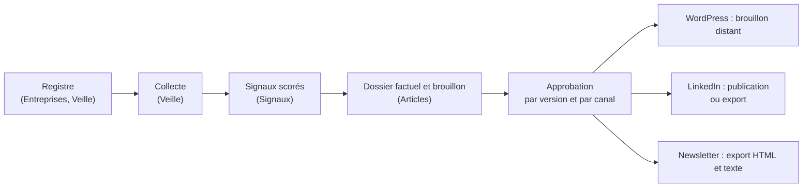

1. Vous tenez à jour le registre des entreprises et de leurs sources (sites officiels, pages d'actualités, flux RSS…). Chaque entreprise ajoutée reçoit automatiquement une source Google News.
2. La collecte lit les flux RSS et Atom des sources et les résultats de Google News, complétés par une recherche Perplexity sur l'entreprise, puis rapporte des **observations** : un article, une page, un communiqué, avec son URL, son média et ses dates.
3. Les observations qui décrivent le même événement sont regroupées en un **signal**, qui reçoit un **score IA** sur 10 et un **indicateur documentaire**.
4. À partir d'un signal, KORA prépare un **dossier factuel** (faits, sources, contradictions), des angles et un brouillon. Vous pouvez aussi importer un article rédigé par l'équipe.
5. Un validateur approuve une version précise pour un canal précis.
6. La diffusion crée un brouillon WordPress distant, publie le post LinkedIn depuis votre compte si vous l'avez relié, ou produit un fichier d'export. La mise en ligne sur WordPress et l'envoi de la newsletter restent manuels.

### Les trois principes de confiance

**Toute publication repose sur une version approuvée.** Une approbation enregistre le validateur, la date, le numéro de version et le canal. Toute modification du contenu crée une nouvelle version et invalide l'approbation précédente, avec le motif « Contenu modifié après approbation ». Juste avant chaque envoi, le serveur revérifie les droits, l'approbation et l'absence de contradiction ; une clé d'idempotence empêche tout doublon si l'envoi est relancé.

**Chaque sujet garde ses sources.** Un signal conserve toutes ses observations (média, URL, dates de publication et de collecte). Dans le dossier factuel, chaque fait renvoie aux observations qui l'appuient. Une date absente est affichée « Date inconnue » et n'est jamais inventée. Les reprises d'un même communiqué ne comptent pas comme des confirmations indépendantes.

**L'IA propose, l'humain décide.** Le score, les angles, les brouillons, les variantes LinkedIn, les résumés de newsletter, les corrections proposées sur un import et les évolutions de règles éditoriales sont des propositions. Rien n'est appliqué sans une action explicite de votre part : accepter, enregistrer, approuver. Les éléments que les sources ne confirment pas sont marqués « [À vérifier] » dans le brouillon.

### Ce qui est simulé au pilote

La collecte, la conservation des données, l'envoi des brouillons vers WordPress et la publication sur LinkedIn depuis un compte relié sont réels ; la mise en ligne sur WordPress reste manuelle et la newsletter passe par un export.

| Élément | Comportement au pilote |
|---|---|
| Collecte web | Réelle : lecture des flux RSS et Atom des sources et recherche Google News sur le nom de l'entreprise, complétée par une recherche Perplexity ([`RealCollector`](../src/server/adapters/collector.ts)). Déclenchée à la main uniquement. |
| WordPress | Réel en production : KORA crée et met à jour des brouillons sur le site configuré, sans jamais les mettre en ligne ([`src/server/wordpress/`](../src/server/wordpress/)). Simulé sur une installation de démonstration : le brouillon reçoit un identifiant `wp-NNNN` et rien n'est envoyé ([`SimulatedWordPress`](../src/server/adapters/channels.ts)). |
| LinkedIn | Réel pour qui a relié son compte : le post est publié sur le profil LinkedIn de la personne qui clique ([`src/server/linkedin/`](../src/server/linkedin/)). Sans compte relié, la publication reste un export manuel. |
| Newsletter | Export HTML et texte ; KORA n'envoie jamais la newsletter. |
| Textes générés | Gabarits déterministes, réécrits par un modèle OpenAI si l'exploitant l'a configuré ([`text-model.ts`](../src/server/adapters/text-model.ts)). |
| Données | Conservées dans une base de données : un redémarrage du serveur ne remet plus rien à zéro. |
| Budget API | Estimé : chaque appel est décompté à un coût forfaitaire, y compris les collectes, alors que les flux RSS et Google News sont gratuits ; la recherche Perplexity est comprise dans le forfait de la collecte. |

**Production et démonstration.** En production, l'application démarre vide : ni compte, ni entreprise, ni source, ni signal, ni article. Seules existent la grille de score et les règles éditoriales de départ. Le premier administrateur est désigné par l'équipe technique ; il invite ensuite ses collègues (voir [Se connecter](#se-connecter)). Les données de démonstration, que montrent les captures de ce guide, ne sont chargées que sur une installation sans base de données, par exemple le poste d'un développeur. Elles y reviennent à leur état initial à chaque redémarrage du serveur, et la collecte y est également réelle : son résultat dépend de ce que répondent les adresses, souvent fictives, de ces données.

## Prise en main

### Disposition générale

Chaque page comporte une barre latérale à gauche, un en-tête en haut et le contenu de la page. La plupart des écrans suivent le même schéma : une liste à gauche et le détail de l'élément sélectionné à droite. L'élément sélectionné figure dans l'adresse de la page (par exemple `/articles?id=…`), ce qui permet de partager un lien direct vers un article, un signal ou un post.

### Barre latérale

| Entrée | Adresse | Usage |
|---|---|---|
| Dashboard | `/` | Vue d'ensemble de l'activité éditoriale. |
| Veille | `/veille` | Registre des sources, collectes et erreurs d'accès. |
| Signaux | `/signaux` | Qualification des sujets détectés. |
| Articles | `/articles` | Rédaction, approbation, diffusion, imports d'articles humains. |
| LinkedIn | `/linkedin` | Posts et variantes. |
| Newsletter | `/newsletter` | Édition hebdomadaire. |
| Entreprises | `/entreprises` | Registre des entreprises suivies. |
| Paramètres | `/parametres` | Grille de score, référentiel éditorial, rôles, quotas, exports, journal. |

Le badge à côté de « Signaux » indique le nombre de signaux au statut « Nouveau ». Le bouton « Replier le menu » réduit la barre aux icônes ; « Déplier le menu » la rétablit. Le numéro de version de l'application figure en bas de la barre.

### En-tête

**Recherche globale.** Cliquez dans le champ « Rechercher une entreprise, un sujet, une source... » ou utilisez le raccourci ⌘K (Mac) ou Ctrl+K (Windows, Linux). Saisissez au moins deux caractères. Les résultats sont groupés en « Entreprises », « Sujets », « Articles » et « Sources » ; un clic ouvre la fiche entreprise, le signal, l'article ou la source dans le registre de veille. Sans correspondance, le message « Aucun résultat. » s'affiche.

**Notifications.** La cloche porte un point rouge lorsqu'il existe des notifications non lues. Le panneau indique le nombre de non lues et liste les plus récentes : article ou post à valider, article rejeté, brouillon WordPress prêt, nouveau signal prioritaire, source en échec, alertes de quota et de budget. Un clic sur une notification ouvre l'écran concerné. Toutes les notifications sont marquées comme lues à la fermeture du panneau. Au pilote, les notifications sont communes à tous les utilisateurs : ce que vous marquez comme lu l'est aussi pour vos collègues.

**Menu utilisateur.** Il affiche votre nom, votre adresse e-mail et vos rôles, et propose « Se déconnecter ». Sur une installation de démonstration, il propose à la place « Changer de profil » (voir ci-dessous).

### Se connecter

L'accès à KORA est nominatif : chaque personne se connecte avec son adresse e-mail et son propre mot de passe, et le journal d'audit indique qui a fait quoi. Il n'existe pas d'inscription libre : c'est un administrateur qui crée les comptes (voir [Utilisateurs & rôles](#utilisateurs--rôles)). Toute page ouverte sans être connecté renvoie vers la page « Connexion ».

**Activer son compte.** Lorsqu'un administrateur vous ajoute, vous recevez un e-mail d'invitation. Son lien ouvre la page « Activez votre compte » : choisissez un « Nouveau mot de passe » d'au moins 8 caractères, saisissez-le de nouveau dans « Confirmation », puis cliquez sur « Activer mon compte ». Le message « Compte activé : bienvenue sur KORA. » s'affiche et le Dashboard s'ouvre. Si le mot de passe est jugé trop faible, le message en donne la raison. Le lien ne sert qu'une fois et pour une durée limitée : s'il a expiré ou a déjà servi, la page « Lien expiré ou invalide » s'affiche ; demandez un nouveau lien avec « Mot de passe oublié ? » ou demandez à l'administrateur de renvoyer l'invitation.

**Connexion.** Sur la page « Connexion », saisissez votre « Adresse e-mail » et votre « Mot de passe », puis cliquez sur « Se connecter ». Vous arrivez sur la page que vous vouliez ouvrir, à défaut sur le Dashboard. En cas d'échec, l'encadré « Connexion impossible » en donne la raison, par exemple « E-mail ou mot de passe incorrect. ». Une adresse qui n'a pas de compte KORA est refusée avec « Votre compte n'est pas autorisé sur KORA. Demandez à un administrateur de vous inviter. ».

**Mot de passe oublié.** Cliquez sur « Mot de passe oublié ? », à côté du champ « Mot de passe », saisissez votre adresse puis cliquez sur « Envoyer le lien ». Le message « Vérifiez votre boîte de réception » s'affiche, que l'adresse corresponde ou non à un compte. Le lien reçu ouvre la page « Nouveau mot de passe » : choisissez votre nouveau mot de passe, confirmez-le, puis cliquez sur « Enregistrer le mot de passe ». Vos sessions ouvertes sur d'autres appareils sont alors fermées.

**Se déconnecter.** Votre session reste ouverte dans le navigateur d'une visite à l'autre. Pour la fermer, par exemple sur un poste partagé, ouvrez le menu utilisateur et cliquez sur « Se déconnecter » : la page de connexion s'affiche. Si votre session expire ou si votre compte est supprimé pendant que vous travaillez, KORA vous renvoie vers la page de connexion avec l'encadré « Vous avez été déconnecté » ou « Compte non autorisé » ; les modifications non enregistrées sont perdues. Après reconnexion, vous revenez sur la page où vous étiez.

**Installation de démonstration.** Sur une installation sans base de données, par exemple le poste d'un développeur, il n'y a pas d'écran de connexion : la page « Connexion » affiche « Mode démonstration ». Quatre profils sont disponibles : Sophie Martin (par défaut ; administratrice, rédactrice et validatrice), Lucas Bernard (rédacteur), Claire Dubois (validatrice) et Marc Lefèvre (lecteur). Pour en changer, choisissez un nom sous « Changer de profil » dans le menu utilisateur ; le message « Connecté en tant que … » confirme le changement. Pour tester un circuit complet de double contrôle, rédigez avec Lucas Bernard puis approuvez avec Claire Dubois.

### Les quatre rôles

| Rôle | Ce qu'il permet |
|---|---|
| Administrateur | Tout ce que permettent les autres rôles, plus la gestion des comptes et des rôles, la connexion au site WordPress, la modification de la grille de score, du référentiel éditorial et la suppression d'une entreprise. |
| Rédacteur | Registre (entreprises, sources), collectes, qualification des signaux, articles, imports, posts LinkedIn, composition de la newsletter. |
| Validateur | Approbation et rejet des contenus, diffusion vers WordPress, publication ou export LinkedIn et export consigné de la newsletter. |
| Lecteur | Consultation de tous les écrans et téléchargement des exports ; aucune modification. |

Chacun, quel que soit son rôle, peut relier son propre compte LinkedIn depuis l'écran [LinkedIn](#linkedin) ; seuls les validateurs et les administrateurs publient.

Les droits sont contrôlés par le serveur ([`permissions.ts`](../src/server/domain/permissions.ts)). Un refus s'affiche sous la forme d'un message qui se termine par « Votre profil (…) ne le permet pas. ». Le tableau « Droits par rôle » de l'onglet Paramètres reprend ces droits : l'administrateur dispose aussi de la rédaction et de la validation.

### Conventions d'interface

- **Bouton grisé** : survolez-le, une infobulle donne presque toujours la raison (rôle, modifications non enregistrées, statut…). Voir [Le bouton est grisé](#le-bouton-est-grisé).
- **Messages de confirmation** : chaque action réussie ou refusée affiche un message temporaire en bas de l'écran. En cas de refus, le message est celui du serveur et explique la règle appliquée.
- **Erreur de chargement** : un panneau d'erreur propose « Réessayer ». Une adresse inconnue affiche « Page introuvable » avec « Retour au dashboard » ; une erreur inattendue affiche « Cette page n'a pas pu se charger » avec « Réessayer » et « Dashboard ».
- **Modifications non enregistrées** : les zones d'édition affichent « Modifications non enregistrées » ; tant que vous n'avez pas enregistré, les actions de circuit (soumettre, approuver, diffuser) restent bloquées.

### Premiers pas sur une application vide

En production, l'application démarre sans aucune donnée. Avant la première collecte, le Dashboard et les écrans Signaux, Articles, LinkedIn et Newsletter sont vides ; les compteurs de consommation sont à zéro, sauf « Stockage », qui part d'une base fixe de 2,4 Go. Pour démarrer la veille :

1. **Inviter l'équipe**. Connecté avec le premier compte administrateur, ajoutez vos collègues dans Paramètres, onglet [Utilisateurs & rôles](#utilisateurs--rôles). L'ajout d'entreprises et de sources demande le rôle rédacteur ou administrateur.
2. **Créer les entreprises**. Dans Entreprises, cliquez sur « Ajouter une entreprise » pour chacune des entreprises à suivre (150 au maximum ; voir [Ajouter une entreprise](#ajouter-une-entreprise)). Soignez la raison sociale, les alias et le domaine officiel : les recherches Google News et Perplexity portent sur la raison sociale, et le rattachement des publications s'appuie sur les noms et le domaine. KORA crée pour chaque entreprise la source « Google News — » suivie de la raison sociale.
3. **Compléter les sources**, si vous le souhaitez. Dans Veille, « Ajouter une source » permet d'ajouter le flux RSS d'un site officiel ou d'un média (voir [Ce que lit la collecte](#ce-que-lit-la-collecte)).
4. **Lancer la collecte**. Dans Veille, cliquez sur « Lancer la collecte ». Le bouton affiche « Collecte en cours… » et une notification suit l'avancement, lot par lot (« Collecte en cours : 16 / 60 sources ») ; pour un registre complet, comptez une à deux minutes. Le message « Collecte terminée sur N sources » donne le bilan, et chaque collecte consomme une part du budget API (voir [Lancer une collecte](#lancer-une-collecte)).
5. **Qualifier les premiers signaux**. Ouvrez Signaux. La collecte ne retient que les publications de moins de 30 jours : les actualités plus anciennes des entreprises n'apparaissent pas, même au premier passage.

Le « Corpus d'exemples historiques » de l'onglet « Editorial DNA » reste vide en production (« Aucun exemple dans le corpus ») : aucun écran ne permet d'y ajouter des exemples.

## Dashboard

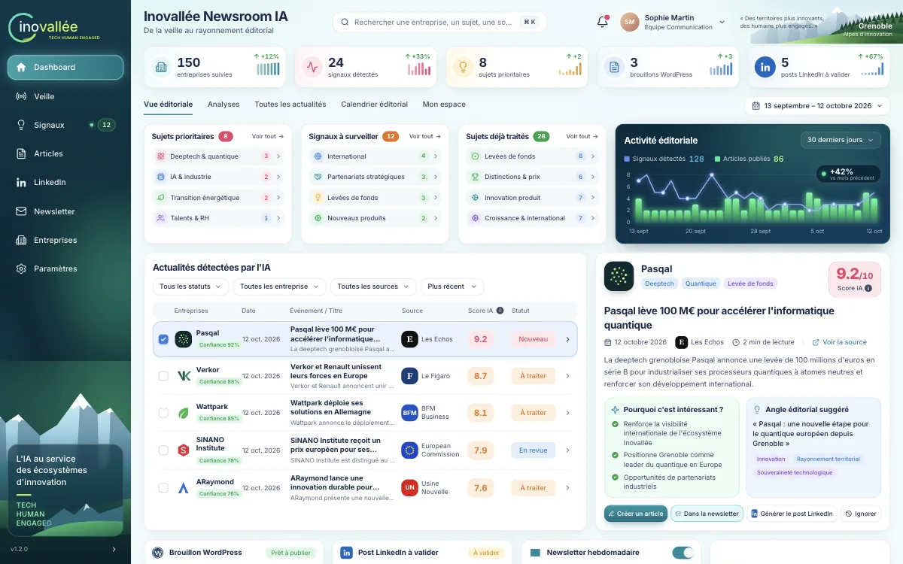

Le Dashboard donne en un coup d'œil l'état de la veille et de la production. Il comporte cinq onglets : « Vue éditoriale », « Analyses », « Toutes les actualités », « Calendrier éditorial » et « Mon espace ». Le sélecteur de période, en haut à droite, propose « Ce mois-ci », « Mois précédent », « 7 derniers jours », « 30 derniers jours » (par défaut) et « 90 derniers jours » ; pour une plage libre, choisissez une date de début et de fin dans le calendrier puis cliquez sur « Appliquer ».

### Vue éditoriale

**Les cinq compteurs du haut.** Chaque carte est un lien vers l'écran détaillé.

| Carte | Ce qu'elle compte | Ouvre |
|---|---|---|
| entreprises suivies | Entreprises du registre. | Entreprises |
| signaux détectés | Signaux détectés sur les 7 derniers jours, quelle que soit la période choisie. | Signaux |
| sujets prioritaires | Signaux de la période au statut « Nouveau » ou « À traiter » avec un score d'au moins 8/10. | Signaux, onglet « Prioritaires » |
| brouillons WordPress | Articles dont un brouillon WordPress distant existe. | Articles |
| posts LinkedIn à valider | Posts au statut « À valider ». | LinkedIn |

**Les trois cartes de regroupement.** « Sujets prioritaires » regroupe les sujets prioritaires par thématique (les quatre premières), « Signaux à surveiller » regroupe les signaux au statut « Surveillé » par catégorie, et « Sujets déjà traités » ceux au statut « Traité ». « Voir tout » ouvre l'écran Signaux filtré sur le statut et la thématique ou la catégorie. Une carte vide affiche « Aucun sujet sur la période. ».

**Activité éditoriale.** Le graphique compare « Signaux détectés » et « Articles publiés ». Il possède son propre sélecteur (« 30 derniers jours », « 7 derniers jours », « 90 derniers jours ») et ne suit pas le sélecteur de période de la page. L'évolution est comparée à la période précédente de même durée (« vs mois précédent », « vs 7 jours précédents », « vs trimestre précédent »).

**Actualités détectées par l'IA.** Ce tableau montre les cinq signaux les plus récents, avec les colonnes « Entreprises », « Date », « Événement / Titre », « Source », « Score IA » et « Statut ». Les filtres « Tous les statuts », « Toutes les entreprises » et « Toutes les sources » et le tri « Plus récent » ou « Meilleur score » s'appliquent à ce tableau. Survolez le symbole ⓘ à côté de « Score IA » pour voir comment le score est calculé. Un signal sans entreprise rattachée affiche « À rattacher » et la pastille « Rattachement à revoir ».

**Le détail du signal sélectionné.** La première ligne est sélectionnée automatiquement ; cliquez sur une autre ligne pour changer. La carte de détail présente l'entreprise, le titre, le temps de lecture, le lien « Voir la source », la rubrique « Pourquoi c'est intéressant ? », l'« Angle éditorial suggéré » et le bloc « Sources prises en compte dans le score ». Ce bloc et la barre d'actions sont décrits dans [Signaux](#le-détail-dun-signal).

**Les quatre cartes du bas.**

- « Brouillon WordPress » montre le dernier brouillon envoyé à WordPress. La pastille « Brouillon envoyé » (suivie de « mise en ligne dans WordPress ») indique que la version approuvée est sur le site, en brouillon ; « En préparation » indique que l'article a changé depuis ou n'est plus approuvé. « Voir le brouillon » ouvre l'article.
- « Post LinkedIn à valider » montre le post en attente ; « Relire le post » l'ouvre.
- « Newsletter hebdomadaire » indique le nombre de sujets de l'édition en cours et la date d'envoi prévue. L'interrupteur « Inclure dans la prochaine édition » ajoute ou retire le signal sélectionné de l'édition. « Composer l'édition » ouvre l'écran Newsletter.
- « Moteur d'analyse IA » affiche « Actif », ou « En pause » lorsque le budget API du mois est épuisé.

### Analyses

Quatre tuiles résument la période : « Signaux sur la période », « Score IA moyen », « Signaux pertinents (≥ 8/10) » et « Dossiers documentaires solides ». Trois graphiques suivent : « Répartition par catégorie », « Score moyen par thématique » et « Pertinence des signaux » (répartition par tranche de score et par statut).

### Toutes les actualités

La liste des 50 signaux les plus récents. Un clic sur une ligne ouvre le signal dans l'écran Signaux.

### Calendrier éditorial

Le calendrier mensuel place les « Article programmé », « Article publié », « Brouillon WordPress », « WordPress : en attente de relecture », « Post LinkedIn » et « Édition newsletter ». Un brouillon WordPress apparaît à la date de sa dernière synchronisation. Naviguez avec « Mois précédent », « Aujourd'hui » et « Mois suivant ». Le panneau « À venir » liste les prochaines échéances et le panneau « Légende » explique les couleurs. Une date de programmation est une indication : aucune diffusion ne part automatiquement à cette date (voir [Ce que l'application ne fait pas au pilote](#ce-que-lapplication-ne-fait-pas-au-pilote)).

### Mon espace

« Mes brouillons » liste les articles au statut brouillon préparés par KORA ou dont vous êtes l'auteur, ainsi que tous les posts LinkedIn au statut brouillon. « Validations en attente » liste les articles en revue, les posts à valider et l'édition de newsletter en composition qui contient des sujets. Sous un profil lecteur, l'onglet affiche « Profil lecteur : consultation seule ».

## Veille

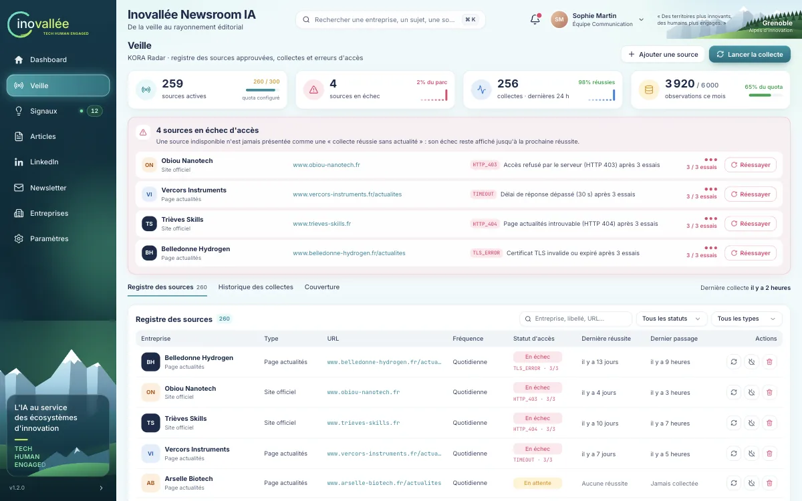

L'écran Veille (« KORA Radar ») gère les sources approuvées, lance les collectes et met en évidence les erreurs d'accès.

### Lire l'écran

**Les compteurs.** « sources actives » rapporte le nombre de sources au plafond configuré (300) ; « sources en échec » donne le nombre et la part du parc ; « collectes · dernières 24 h » donne le taux de réussite ; « observations ce mois » donne la consommation du quota mensuel d'observations.

**L'encadré des sources en échec.** Il affiche « Aucune source en échec. » ou « N sources en échec d'accès ». Pour chacune (quatre au plus, puis « Voir les N sources → »), il indique le code d'erreur, le motif (ou « Motif non communiqué par la source »), le nombre d'essais (« 3 / 3 essais ») et un bouton « Réessayer ». La règle est rappelée dans l'encadré : une source indisponible n'est jamais présentée comme une « collecte réussie sans actualité » ; son échec reste affiché jusqu'à la prochaine réussite.

**L'onglet « Registre des sources ».** Le tableau liste les sources, 20 par page, avec les colonnes « Entreprise », « Type », « URL », « Fréquence », « Statut d'accès », « Dernière réussite » et « Dernier passage ». Filtrez avec le champ « Entreprise, libellé, URL… », « Tous les statuts » et « Tous les types ». Les icônes de la colonne « Actions » sont décrites plus bas.

**L'onglet « Historique des collectes ».** Chaque passage de collecte y figure avec sa date, la source, le statut, le nombre de « Nouvelles observations », le bilan « Perplexity » et le « Code d'erreur ». La colonne « Perplexity » indique ce qu'a donné la recherche complémentaire : « 5 résultats · 2 pertinents · +1 » signifie que Perplexity a renvoyé cinq articles, que deux concernaient bien l'entreprise et qu'un seul était nouveau ; la pastille « Erreur » ou « Non configuré » signale une recherche qui n'a pas abouti, sans faire échouer la collecte ; un tiret indique qu'aucune recherche n'a eu lieu pour cette source. La colonne « Code d'erreur » affiche aussi les avertissements d'une collecte réussie, avec leur motif (voir [Ce que lit la collecte](#ce-que-lit-la-collecte)). Une source supprimée apparaît comme « Source supprimée ». Cliquer sur une ligne cible la source : le bandeau « Source ciblée : … » apparaît et le registre se concentre sur elle.

**L'onglet « Couverture ».** Le graphique « Collectes par jour » montre les 14 derniers jours en trois séries : « Avec nouveautés », « Sans actualité » et « Échecs ». « Couverture du registre » donne la part des sources actives jointes avec succès sur 14 jours et les « Codes d'erreur fréquents ». « Couverture par type de source » détaille la même mesure par type.

### Ajouter une source

1. Cliquez sur « Ajouter une source ».
2. Choisissez l'« Entreprise » rattachée, le « Type de source » (« Site officiel », « Page actualités », « Communiqués », « Flux RSS », « Recherche web », « Newsletter importée ») et la « Fréquence de collecte » (« Quotidienne » ou « Hebdomadaire »).
3. Saisissez un « Libellé » et l'« URL » complète, commençant par `https://` ou `http://`.
4. Cliquez sur « Ajouter la source ». Le message « Source « … » ajoutée au registre » confirme l'ajout ; la source démarre au statut « En attente ».

Le serveur refuse une URL déjà suivie pour la même entreprise (« Cette URL est déjà suivie pour cette entreprise. »), une URL interne ou non publique (« URL de source refusée : … »), et toute création au-delà de 300 sources (« Quota de sources atteint »). Les sources Google News créées avec les entreprises comptent parmi ces 300 sources.

Le type de source détermine ce que la collecte lit réellement (voir ci-dessous). Pour un site officiel ou un média, indiquez de préférence l'adresse de son flux RSS.

### Ce que lit la collecte

| Type de source | Ce que KORA interroge |
|---|---|
| « Recherche web » | Google News et Perplexity, sur la raison sociale. |
| « Page actualités » | Google News et Perplexity, sauf si l'adresse est celle d'un flux. |
| « Site officiel », « Communiqués », « Flux RSS », « Newsletter importée » | L'adresse saisie. |

**Google News.** KORA recherche la raison sociale entre guillemets ; les alias ne sont pas interrogés. Pour une source « Recherche web », l'adresse saisie n'est utilisée que si c'est une adresse Google News ; sinon, KORA interroge Google News sous la raison sociale actuelle. La source créée avec l'entreprise garde le nom saisi à la création : si vous renommez l'entreprise, elle continue de chercher l'ancien nom dans Google News, alors que la recherche Perplexity suit le nom actuel. Une « Page actualités » n'est lue directement que si son adresse contient « rss », « feed », « atom » ou « xml ». Le lien d'une observation trouvée par Google News pointe vers une adresse `news.google.com` qui redirige vers l'article du média ; le nom du média est celui qu'indique Google News.

**Perplexity.** En même temps que Google News, KORA interroge Perplexity, un moteur de recherche d'actualités, sur la raison sociale suivie des mots « Grenoble actualité entreprise » (cinq résultats du dernier mois au plus). Un résultat n'est gardé que s'il a un titre, une adresse et une date, s'il ne vient pas du site de l'entreprise et s'il cite la raison sociale ou un alias. Un article déjà trouvé par Google News n'est pas compté deux fois. Les observations trouvées ainsi portent la pastille violette « Perplexity ». Une panne de Perplexity ne fait jamais échouer la collecte : elle n'apparaît que dans la colonne « Perplexity » de l'historique.

**Relais quand Google News échoue.** Si Google News ne répond pas mais que Perplexity répond, la collecte est réussie avec les seuls résultats de Perplexity, et l'historique affiche un avertissement : le code de l'erreur de Google News, avec un motif qui commence par « Google News : ». Si Perplexity échoue aussi, la collecte est en échec comme d'habitude.

**Date vérifiée des articles Google News.** Google News date un article du jour où il l'a indexé : une vidéo de 2019 remise en avant peut y paraître publiée hier. Pour chaque article trouvé par Google News, KORA ouvre donc la page du média et y lit la date de publication d'origine. L'article n'est gardé que si cette date est lisible et date de moins de 30 jours ; l'observation porte alors la date du média, pas celle de Google News. Dans le cas contraire, l'article est écarté, et l'historique des collectes le dit : la colonne « Code d'erreur » affiche `DATE_REJECTED` avec le décompte par motif, par exemple « Google News : 5 publications écartées par la vérification de la date (4 pages d'éditeur inaccessibles, 1 sans date de publication lisible). » La collecte reste réussie.

| Motif affiché | Ce que cela veut dire | Que faire |
|---|---|---|
| page d'éditeur inaccessible | Le site du média a refusé la lecture ou n'a pas répondu. Plusieurs titres de la presse économique refusent toute lecture automatique : leurs articles sont écartés à chaque collecte. | Rien à corriger dans KORA. Si l'article compte, vérifiez-le vous-même sur le site du média. Perplexity peut le retrouver de son côté. |
| sans date de publication lisible | La page a été lue, mais elle n'indique pas sa date de publication sous une forme exploitable. | Idem. |
| hors de la fenêtre de 30 jours | L'article est en réalité ancien : c'est le cas que cette vérification doit écarter. | Rien. |
| lien non résolu | Google News n'a pas donné l'adresse de l'article. | Relancez la collecte plus tard. |

La vérification s'arrête à 15 articles ou 60 secondes par source. Les articles qui restent ne sont pas écartés, seulement « non examinés » : ils sont cités à la suite du message (« … ; 7 non examinées (limite de 15 vérifications ou de 60 s par source). »), ou seuls sous le code `DATE_UNCHECKED` si aucun article n'a été écarté. Relancez la collecte : ils seront examinés s'ils figurent encore dans Google News. Quand KORA a déjà trouvé ses cinq publications nouvelles et n'a rien écarté, il n'affiche aucun avertissement.

Un article écarté n'est pas mémorisé : tant que Google News le propose, il est examiné de nouveau et compté de nouveau à chaque collecte. Voir un même décompte d'une collecte à l'autre est donc normal. Les flux RSS des entreprises et les résultats de Perplexity ne sont pas concernés par cette vérification.

**Adresse saisie.** Un flux RSS ou Atom est lu directement. Pour une page web, KORA cherche le flux que la page déclare et lit celui-ci ; il ne lit pas le contenu de la page elle-même. Si la page ne déclare aucun flux, KORA essaie les adresses habituelles du site (`/feed/`, `/rss`, `/feed.xml`, `/rss.xml`). Si aucune ne répond, la source passe en échec `NO_FEED` dans l'encadré des sources en échec, avec le motif « Aucun flux RSS annoncé sur cette page, ni aux adresses habituelles … : rien à collecter. Indiquez l'adresse du flux ou d'une page d'actualités. » ; elle n'est pas réessayée tant que son adresse n'est pas corrigée.. Remplacez alors la source par l'adresse de son flux.

**Filtres.** Lorsqu'un flux n'appartient pas au domaine officiel de l'entreprise, par exemple celui d'un média, seules les publications qui citent la raison sociale ou un alias sont retenues. Seules les publications de moins de 30 jours sont retenues. Celles qui n'ont pas de date sont écartées, tout comme celles datées de plus d'un jour dans le futur, par exemple les annonces d'un agenda d'événements.

### Lancer une collecte

« Lancer la collecte » interroge toutes les sources actives par lots de huit, plusieurs sources lues en même temps ; le bouton affiche « Collecte en cours… », une notification donne l'avancement (« Collecte en cours : 16 / 60 sources ») et le message « Collecte terminée sur N sources » donne le bilan. Une collecte complète prend une à deux minutes : chaque essai attend jusqu'à 15 secondes la réponse de la source, et une source injoignable (403, 404) n'est pas réessayée. Pour une seule source, utilisez l'icône « Collecter maintenant » du registre, « Réessayer » dans l'encadré des échecs, ou le bouton de la fiche entreprise. Le résultat s'affiche alors en clair :

| Message | Signification |
|---|---|
| « Collecte réussie » | De nouvelles observations ont été rattachées. |
| « Succès · aucune actualité » | La source a répondu, mais aucune publication nouvelle n'a été retenue. |
| « Échec de collecte · CODE » | La source n'a pas pu être lue après trois essais. |
| « Échec de collecte · budget_busy » | Le budget API était en cours de mise à jour par une autre action : la source n'a pas été interrogée, rien n'a été décompté et elle n'est pas marquée en échec. Relancez-la dans quelques secondes. |
| « Budget API atteint : la collecte est suspendue… » | Le budget API du mois est épuisé. |

Lors d'une collecte complète, une source tombée sur un budget momentanément occupé compte parmi les échecs du bilan, sans apparaître dans l'encadré des échecs, et la collecte continue avec les sources suivantes. Les autres codes d'échec et la conduite à tenir sont décrits dans le [parcours F](#f-traiter-une-source-en-échec). Un avertissement (page sans flux, Google News relayé par Perplexity) n'apparaît pas dans ce message : consultez l'onglet « Historique des collectes ».

**Une collecte à la fois.** Une seule collecte peut tourner à un moment donné, toutes personnes confondues. Si vous lancez une collecte, complète ou d'une seule source, pendant qu'une autre est en cours, le message « Une collecte est déjà en cours : réessayez dans quelques minutes. » s'affiche et rien n'est lancé.

**Trois nouvelles publications par source.** À chaque passage, KORA rattache au plus trois publications nouvelles par source, en commençant par les plus récentes. Les publications déjà connues sont écartées et ne comptent pas dans cette limite ; si aucune n'est nouvelle, la collecte est « Succès · aucune actualité ». Si une source en a publié davantage, les suivantes seront reprises aux collectes suivantes tant qu'elles ont moins de 30 jours : collectez plus souvent les sources très actives. Les nouvelles observations sont regroupées avec les signaux existants quand elles décrivent le même événement, ou forment un nouveau signal. Un signal d'au moins 8/10 déclenche la notification « Nouveau signal prioritaire ».

**Coût d'une collecte.** Chaque passage sur une source est décompté du budget API comme un appel payant estimé : 0,012 € pour l'interrogation, plus 0,021 € par publication nouvelle (trois au plus), soit au plus 0,075 € par source. Une collecte complète de 150 sources coûte ainsi entre 1,80 € et environ 11 €, et le budget mensuel de 150 € permet au moins une douzaine de collectes complètes. Chaque passage compte aussi une unité dans « Recherches web ». Seules les publications nouvelles sont facturées et décomptées dans « observations ce mois » ; une publication déjà connue ne coûte rien. Une source en échec ne coûte que l'interrogation, quel que soit le nombre d'essais.

### Désactiver, réactiver ou supprimer une source

- « Désactiver la source » la retire des collectes sans la supprimer ; elle passe au statut « Désactivée ». Une source désactivée ne peut pas être collectée.
- « Réactiver la source » la remet au statut « En attente » jusqu'à la prochaine collecte.
- « Supprimer la source » ouvre la confirmation « Supprimer cette source ? ». Les observations déjà rattachées et l'historique des collectes sont conservés.

L'interface ne permet pas de modifier l'URL d'une source existante : supprimez-la puis recréez-la.

Sous le profil lecteur, « Ajouter une source » et « Lancer la collecte » sont grisés (« Profil lecteur : consultation seule »).

## Signaux

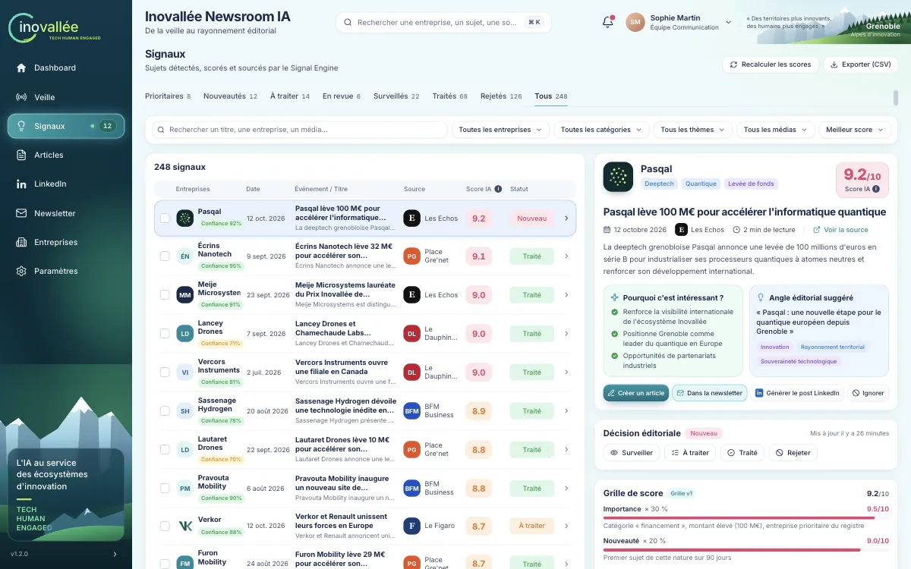

L'écran Signaux (« Sujets détectés, scorés et sourcés par le Signal Engine ») sert à qualifier les sujets : décider de leur sort, vérifier leur rattachement, comprendre leur score et leurs sources.

### Lire la liste

**Les onglets de statut.** « Prioritaires », « Nouveautés » (par défaut), « À traiter », « En revue », « Surveillés », « Traités », « Rejetés » et « Tous », chacun avec son effectif. « Prioritaires » réunit les signaux « Nouveau » et « À traiter » d'au moins 8/10.

**Les filtres.** Champ « Rechercher un titre, une entreprise, un média… », listes « Toutes les entreprises », « Toutes les catégories », « Tous les thèmes », « Tous les médias », tri « Meilleur score » ou « Plus récent », et « Réinitialiser ». « Plus récent » classe les signaux selon la date de l'actualité : sa date de publication, à défaut la date de l'événement, à défaut la date de collecte. Si la liste est tronquée, le message « N premiers signaux affichés sur T — affinez les filtres pour voir les autres. » s'affiche.

**Les boutons d'en-tête.** « Exporter (CSV) » télécharge les signaux. « Recalculer les scores » (administrateurs seulement) applique la grille active à tous les signaux non décidés ; les signaux « Traité » et « Rejeté » gardent leur score d'origine.

### Le détail d'un signal

Cliquez sur une ligne. Le panneau de droite empile plusieurs cartes.

**La carte de détail** reprend celle du Dashboard et porte la barre d'actions :

- « Créer un article » prépare le dossier factuel et le brouillon (message « Brouillon d'article sourcé créé ») puis ouvre l'article. Si un article existe déjà, le bouton devient « Ouvrir l'article ».
- « Ajouter à la newsletter » ajoute le sujet à la prochaine édition (« Ajouté à la prochaine newsletter ») ; « Dans la newsletter » indique qu'il y figure déjà, et un nouveau clic l'en retire.
- « Générer le post LinkedIn » prépare des variantes et ouvre l'écran LinkedIn.
- « Ignorer » ouvre « Ignorer ce signal » : indiquez un motif, puis « Ignorer le signal ». Le signal passe au statut « Rejeté ». Un signal rejeté affiche « Restaurer », qui le remet « À traiter ».

Au-dessus de la barre d'actions, le bloc **« Sources prises en compte dans le score »** liste les publications sur lesquelles repose le signal, avec leur nombre et celui des reprises (« 5 publications dont 2 reprises »). Chaque ligne donne le média, la date de publication, le titre et un lien vers l'article ; la pastille « Perplexity » signale une publication trouvée par la recherche Perplexity, la pastille « Reprise » une reprise d'un même communiqué. Les quatre premières sont affichées ; « Voir les N autres sources » déplie la liste.

**L'alerte de revue** apparaît lorsque l'application n'est pas sûre d'elle : « Homonymie à vérifier », « Fusion incertaine », « Entreprise non rattachée » ou « Observations à rattacher ». Pour rattacher le signal, choisissez l'entreprise dans « Choisir une entreprise… » puis cliquez sur « Rattacher » (« Rattachement enregistré »). Pour une fusion incertaine, « Regrouper avec ce sujet » fusionne avec le signal jumeau cité dans la note.

**La carte « Décision éditoriale »** montre le statut, la date de mise à jour et le motif éventuel. Les boutons « Surveiller », « À traiter » et « Traité » changent le statut ; le bouton du statut courant est grisé. « Rejeter » ouvre « Rejeter ce signal » : le motif est obligatoire (au moins trois caractères), conservé dans le journal des décisions, et le signal reste restaurable. Quatre motifs rapides sont proposés : « Hors périmètre territorial », « Doublon d'un sujet existant », « Information non vérifiable » et « Intérêt éditorial insuffisant ».

**La carte « Grille de score »** détaille les cinq sous-notes, leur poids et leur motif (par exemple « date de l'événement inconnue » ou « entreprise implantée sur Inovallée »). Si le score a été calculé avec une ancienne grille, la carte l'indique (« Score calculé avec la grille vX (grille active : vY)… »).

**La carte « Indicateur documentaire »** indique s'il existe une « Source directe », le nombre de « Corroborations indépendantes » et la « Fraîcheur » de l'information, puis liste les « Contradictions » et les « Explications ». Voir [Indicateur documentaire](#indicateur-documentaire).

**La liste « Observations »** montre chaque article source avec son média, ses dates et sa provenance (« Collecté le … via flux de la source », « via Google News » ou « via Perplexity »), sa confiance de rattachement et, le cas échéant, les pastilles « Perplexity », « Reprise » ou « À rattacher ». « Ouvrir » affiche la page d'origine.

### Fusionner et défusionner

- **Fusionner** : cochez au moins deux signaux dans la liste, cliquez sur « Fusionner », choisissez le signal principal puis confirmez. Les observations, articles, posts et sujets de newsletter des autres signaux sont rattachés au signal principal (« Signaux fusionnés »). Deux signaux d'entreprises différentes ne peuvent pas être fusionnés.
- **Défusionner** : dans la liste « Observations », cochez les observations à isoler puis cliquez sur « Détacher (N) ». Elles forment un nouveau signal au statut « Nouveau » (« Observations détachées dans un nouveau signal »). Au moins une observation doit rester dans le signal d'origine.

Les deux opérations sont journalisées. « Vider la sélection » décoche tous les signaux.

### Cycle de vie d'un signal

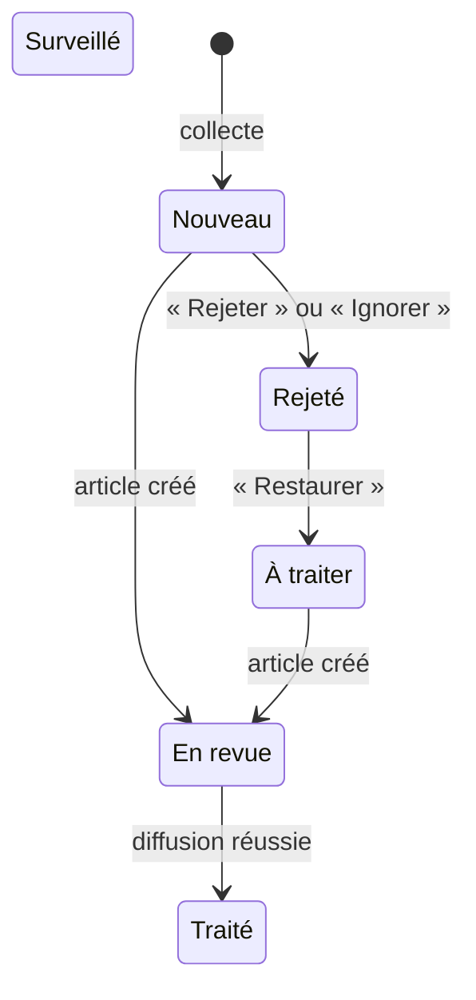

En plus de ces transitions automatiques, les boutons « Surveiller », « À traiter » et « Traité » de la carte « Décision éditoriale » font passer un signal à ces statuts à tout moment, et « Rejeter » est disponible quel que soit le statut.

**Actualités anciennes.** Avant l'introduction de la règle des 30 jours, la collecte retenait des publications de plusieurs mois. Pour les retirer de la file « Nouveautés », l'équipe technique dispose d'un traitement ponctuel ([`2026-10-15_signaux_anciens_hors_file.sql`](../db/data/2026-10-15_signaux_anciens_hors_file.sql)) : une fois appliqué, les signaux « Nouveau » dont l'actualité a plus de 30 jours passent « Rejeté », avec le motif « Actualité ancienne : publiée il y a plus de 30 jours ». Ils figurent dans l'onglet « Rejetés », le journal d'audit attribue ce changement à « KORA », et « Restaurer » remet un signal « À traiter » si vous souhaitez malgré tout le traiter. Les signaux sans date ne sont pas touchés.

## Articles

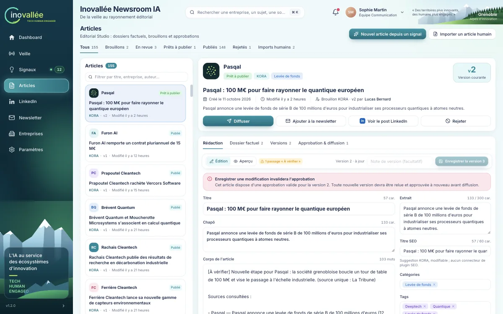

L'écran Articles réunit la rédaction, le circuit d'approbation, la diffusion et les imports d'articles rédigés par l'équipe.

### La liste

Les onglets « Tous », « Brouillons », « En revue », « Prêts à publier » (approuvés et programmés), « Publiés », « Rejetés » et « Imports humains » filtrent la liste de gauche. Le champ « Filtrer par titre, entreprise, auteur… » affine la recherche. Chaque article indique son origine : « KORA » (préparé depuis un signal) ou « Import humain » avec le nom de l'auteur.

Les boutons « Nouvel article depuis un signal » et « Importer un article humain » sont réservés aux rédacteurs.

### Créer un article depuis un signal

1. Cliquez sur « Nouvel article depuis un signal » (ou sur « Créer un article » dans le détail d'un signal).
2. Choisissez un sujet dans la liste « Sujets à traiter, triés par score éditorial ». Seuls les signaux « Nouveau » et « À traiter » y figurent ; ceux qui ont déjà un article portent « Article déjà créé ».
3. Choisissez l'angle : « Angle suggéré », « Autre angle » (à saisir) ou « Laisser KORA proposer plusieurs angles ».
4. Cliquez sur « Préparer le dossier et le brouillon ».

KORA prépare le dossier factuel, des angles, un titre, un chapô, un plan et un brouillon sourcé, enregistrés comme version 1 au statut « Brouillon ». Le signal passe « En revue ». Chaque création consomme une unité du quota mensuel d'articles (25) et un appel payant du budget API.

### L'en-tête de l'article

L'en-tête rappelle l'entreprise, le statut, l'origine, le score du signal, la date de création et l'auteur : « Brouillon KORA · vN par … » pour un article préparé par KORA, « Auteur : … (conservé) » pour un import. « Voir le signal » ouvre le signal source.

Le bouton principal dépend du statut : « Soumettre en revue » pour un brouillon ou un article rejeté, « Approuver la version N » pour un article en revue, « Diffuser » ensuite (il ouvre l'onglet de diffusion). Les autres boutons sont « Ajouter à la newsletter », « Générer le post LinkedIn » (ou « Voir le post LinkedIn ») et « Rejeter ».

Le contenu de l'article est réparti en quatre onglets : « Rédaction », « Dossier factuel », « Versions » et « Approbation & diffusion ». L'onglet « Rédaction » devient « Rédaction • » lorsque des modifications ne sont pas enregistrées.

### Rédiger et enregistrer une version

L'onglet « Rédaction » contient les champs « Titre », « Chapô », « Corps de l'article », « Extrait » (300 caractères au plus), « Titre SEO » (60 caractères au plus, suggestion modifiable), « Catégories » et « Tags ». La bascule « Édition » / « Aperçu » affiche le texte mis en forme, avec les marqueurs « [À vérifier] » surlignés ; le compteur « N passage(s) « À vérifier » » indique combien il en reste.

Pour enregistrer, saisissez éventuellement une « Note de version (facultatif) » puis cliquez sur « Enregistrer la version N+1 ». « Annuler » abandonne les modifications. Lorsque l'article est approuvé, le bandeau « Enregistrer une modification invalidera l'approbation » vous prévient : l'article repasse alors « En revue » et doit être approuvé à nouveau.

### Le dossier factuel et les points « À vérifier »

L'onglet « Dossier factuel » rassemble :

- « Angles éditoriaux proposés » et « Plan proposé » ;
- « Solidité documentaire », qui reprend l'indicateur du signal ;
- « Faits vérifiables et sources » : chaque fait porte le statut « Étayé », « Non corroboré » ou « Contradictoire » et renvoie à ses observations ;
- « Passages marqués « À vérifier » dans le brouillon » : les phrases du texte qui portent le marqueur ;
- « Sources du dossier (N) » ;
- pour un import, l'encadré « Human Content Guard ».

Un fait est « Étayé » s'il provient du site de l'entreprise ou de deux médias indépendants. Un fait « Contradictoire » signale des sources qui divergent, par exemple sur un montant.

**Lever une contradiction.** Une contradiction bloque l'approbation et la diffusion. Cliquez sur « Arbitrer » à côté du fait, choisissez « Étayé » ou « Non corroboré » après vérification, expliquez votre décision dans « Justification » puis cliquez sur « Enregistrer l'arbitrage ». L'arbitrage est tracé (auteur, date, justification). Les rédacteurs comme les validateurs peuvent arbitrer.

**Traiter les marqueurs « [À vérifier] ».** Ce sont des passages de texte, pas des cases à cocher. Vérifiez l'information, puis corrigez ou supprimez le passage et retirez le marqueur dans l'onglet « Rédaction », et enregistrez une nouvelle version. Attention : l'application ne bloque ni l'approbation ni la diffusion tant qu'il reste des marqueurs ; seule une contradiction non arbitrée bloque. Vérifiez le compteur avant de soumettre.

### Versions et restauration

L'onglet « Versions » affiche l'« Historique » : chaque version avec son auteur, sa date et sa note ; la version courante porte « Courante ». « Comparer à la courante » affiche les différences mot à mot, champ par champ, en vert (« Ajouts ») et en rose (« Suppressions »). Les listes « De » et « à » permettent de comparer deux versions quelconques.

Pour revenir en arrière, cliquez sur « Restaurer cette version » puis confirmez avec « Restaurer en version N ». La restauration ne supprime rien : le contenu choisi devient une nouvelle version, et l'encadré « Nouvelle approbation nécessaire » rappelle qu'elle devra être relue et approuvée. Le bouton est grisé tant que vous avez des modifications non enregistrées.

### Soumettre, approuver, rejeter

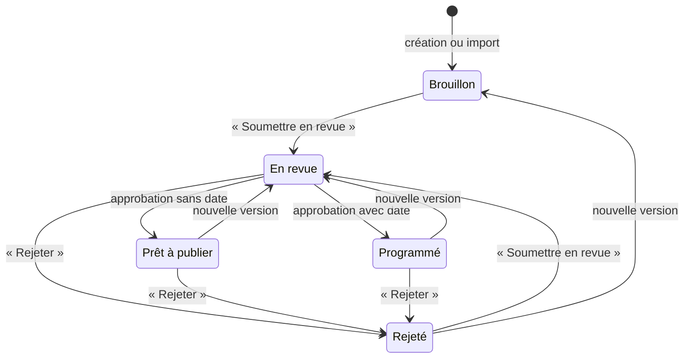

**Soumettre** (rédacteur). « Soumettre en revue » fait passer l'article « En revue » et notifie les validateurs (« Article à valider »).

**Approuver** (validateur). « Approuver la version N » ou « Approuver… » ouvre « Approuver pour diffusion ».

1. Vérifiez la « Version relue » : le titre, l'auteur et la date de la version que vous approuvez.
2. Choisissez le « Canal de diffusion » : WordPress, LinkedIn ou Newsletter. Une approbation vaut pour un seul canal ; un canal déjà approuvé porte « déjà approuvé ».
3. Activez au besoin l'interrupteur « Programmer la diffusion », qui est facultatif, et indiquez une date et une heure futures. L'article passe alors « Programmé » au lieu de « Prêt à publier ».
4. Cliquez sur « Approuver la version N ».

Pour diffuser sur plusieurs canaux, répétez l'approbation pour chacun. Si un collègue a enregistré une nouvelle version entre-temps, le serveur refuse : « Vous avez relu la version X, mais la version courante est la Y. Relisez la dernière version avant d'approuver. ».

**Rejeter** (validateur). « Rejeter » ou « Rejeter… » ouvre « Rejeter l'article ». Le « Motif du rejet (obligatoire) » doit compter au moins cinq caractères ; il est conservé dans l'historique et exportable. Le rejet invalide les approbations valides et notifie l'équipe (« Article rejeté »). Le rédacteur corrige, enregistre une nouvelle version et soumet à nouveau.

### Diffuser

L'onglet « Approbation & diffusion » commence par le bandeau « Pilote : WordPress en brouillon distant uniquement — aucune publication publique », puis présente :

- la frise « Brouillon », « En revue », « Approuvé », « Brouillon distant / export » et les boutons « Soumettre en revue », « Approuver… », « Rejeter… » ;
- un bandeau rouge si des contradictions restent à arbitrer, avec « Arbitrer dans le dossier » ;
- « Approbations (N) » : chaque approbation avec son canal, sa version, son auteur, sa date, et la mention « Valide » ou « Invalidée » avec la date et le motif ;
- « Diffusion par canal » : une ligne par canal avec l'état « Approuvé · vN » ou « Non approuvé » et le bouton d'envoi ;
- « Historique des tentatives (N) » et « Journal de l'article ».

Pour diffuser (validateur), cliquez sur le bouton WordPress ou sur « Exporter » dans la ligne du canal. Le bouton reste grisé tant que la version courante n'est pas approuvée pour ce canal (« Approbation valide requise pour la version N sur ce canal. »).

- **WordPress** : le brouillon distant reçoit le titre, le corps, l'extrait, les catégories et les tags. Le bouton s'intitule « Créer le brouillon WordPress » au premier envoi, « Mettre à jour le brouillon WordPress » lorsqu'un brouillon existe, « Recréer le brouillon WordPress » s'il a été supprimé sur le site, et « Envoyer à WordPress » lorsque le contenu est déjà en ligne ou programmé. Le résultat « Brouillon WordPress envoyé (version N) » indique son identifiant distant. La mise en ligne reste manuelle dans WordPress. Un second envoi de la même version ne crée pas de doublon ; l'envoi d'une nouvelle version approuvée met à jour le même brouillon.
- **État WordPress** : sous le bouton, l'encadré « État WordPress » donne le statut du contenu sur le site, son numéro et la « Dernière synchronisation ». Les statuts sont « Aucun brouillon WordPress », « Brouillon WordPress », « En attente de relecture », « Programmé sur WordPress », « Publié sur WordPress » et « Supprimé sur WordPress » ; dès le premier envoi, le même libellé apparaît dans l'en-tête de l'article, à côté de son statut. « Ouvrir dans WordPress » ouvre le contenu dans l'administration du site, dans un nouvel onglet. « Actualiser le statut » (validateur ou administrateur, lorsqu'un brouillon existe) relit le statut sur WordPress, par exemple après une mise en ligne faite dans WordPress ; si le contenu y est publié, l'article passe « Publié » dans KORA. Une fois le contenu programmé ou publié, KORA ne le modifie plus : toute correction se fait dans WordPress.
- **WordPress non configuré** : tant qu'un administrateur n'a pas renseigné la connexion au site, le bouton est grisé et l'encadré « WordPress n'est pas configuré : voir Paramètres > WordPress. » renvoie vers l'onglet [WordPress](#wordpress) des Paramètres. Sur une installation de démonstration, la mention « Mode démonstration : brouillon simulé » rappelle qu'aucun site réel ne reçoit le brouillon.
- **LinkedIn et Newsletter** : le résultat « Export … prêt (version N) : diffusion manuelle. » est consigné ; rien n'est publié depuis l'article, même avec un compte LinkedIn relié. Pour publier un post ou obtenir un texte, utilisez l'écran [LinkedIn](#linkedin) ou [Newsletter](#newsletter).

Un envoi refusé s'affiche dans un encadré qui nomme le problème (« Envoi bloqué par l'API » pour une règle d'approbation, « Site WordPress injoignable », « Identifiants WordPress refusés »…) avec le message du serveur (voir [Envoi bloqué](#envoi-bloqué)). Le refus est lui aussi consigné dans l'historique, au statut « Bloqué ». La diffusion réussie fait passer le signal source à « Traité » ; l'article garde son statut « Prêt à publier » jusqu'à ce que KORA constate sa mise en ligne sur WordPress.

### Importer un article rédigé par l'équipe

L'onglet « Imports humains » applique le « Human Content Guard » : l'original est conservé tel que déposé, le texte extrait est présenté à part, toute différence est soumise à votre validation, et l'auteur nommé n'est jamais remplacé.

1. Cliquez sur « Importer un article humain » ou « Nouvel import ».
2. Déposez le fichier ou cliquez sur « parcourez ». Formats acceptés : DOCX ou texte UTF-8 (`.txt`), 10 Mo au plus, sans OCR.
3. Renseignez « Auteur (obligatoire) » : le nom de la personne qui a rédigé l'article.
4. Cliquez sur « Importer et analyser ». Le message indique le nombre de propositions à valider.
5. Dans l'onglet « Propositions », examinez chaque proposition : sa nature (« Correction » typographique, « Mise en forme » des guillemets, « Enrichissement » par un lien vers la fiche d'une entreprise), la différence surlignée et sa justification. Cliquez sur « Accepter » ou « Refuser » ; « Remettre en attente » annule votre choix.
6. Consultez au besoin « Texte extrait » (avec la vue « Différences avec l'original ») et « Original ».
7. Cliquez sur « Créer l'article ».

L'article créé reprend le texte extrait et seulement les propositions acceptées ; les propositions refusées ou encore en attente sont ignorées (bandeau « Aucune substitution silencieuse »). Il démarre en version 1 au statut « Brouillon », avec l'auteur nommé, puis suit le même circuit que les autres articles. Une fois l'article créé, les propositions sont figées et le bouton devient « Ouvrir l'article ».

Les fichiers refusés produisent un message explicite : « Format .doc non pris en charge : enregistrez le document au format .docx. », « Format non pris en charge : seuls les fichiers DOCX et texte UTF-8 (.txt) sont acceptés (pas d'OCR). », « Le fichier est vide. » ou « Fichier trop volumineux : 10 Mo maximum par fichier. ».

## LinkedIn

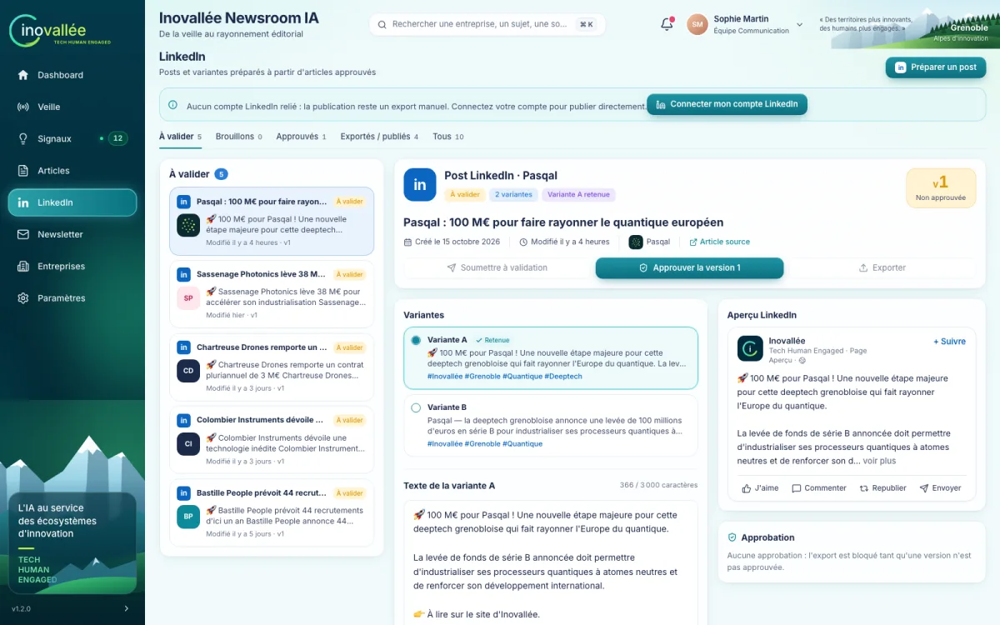

L'écran LinkedIn (« Posts et variantes préparés à partir d'articles approuvés ») sert à préparer, faire valider, puis publier ou exporter les posts. La publication part du compte LinkedIn de la personne qui clique, si elle l'a relié : le post paraît sur son profil personnel, pas sur une page entreprise. Sans compte relié, ou pour diffuser sur la page Inovallée, passez par l'export et publiez le texte vous-même.

### Relier votre compte LinkedIn

Le bandeau placé sous le titre indique l'état de votre propre compte ; chacun relie le sien, quel que soit son rôle.

- « Aucun compte LinkedIn relié : la publication reste un export manuel. Connectez votre compte pour publier directement. » Cliquez sur « Connecter mon compte LinkedIn ». Une fenêtre LinkedIn s'ouvre : connectez-vous et acceptez que KORA lise votre profil et publie en votre nom. La fenêtre se ferme seule et le bandeau affiche « Compte LinkedIn connecté », suivi de votre nom, « — les publications partiront de ce compte. » Si votre navigateur bloque la fenêtre, un message vous demande d'autoriser les fenêtres surgissantes pour KORA. Une fenêtre fermée trop tôt affiche « Fenêtre LinkedIn fermée avant la fin de la connexion. », un refus sur LinkedIn « Connexion LinkedIn annulée : l'autorisation n'a pas été accordée. ». Si le message indique qu'aucune clé de connexion n'a été délivrée, le réglage vient de la plateforme : prévenez un administrateur.
- « Votre accès LinkedIn doit être renouvelé. Reconnectez votre compte pour publier à nouveau. » Cliquez sur « Reconnecter LinkedIn » et refaites le consentement.
- « Votre compte LinkedIn est relié, mais LinkedIn ne répond pas pour le moment : réessayez dans quelques minutes. » Votre connexion est conservée ; « Réessayer » vérifie de nouveau. Une publication lancée entre-temps part de votre compte et peut échouer si LinkedIn ne répond toujours pas.
- « Déconnecter » retire à KORA l'accès à votre compte (« Compte LinkedIn déconnecté. ») ; vos publications suivantes redeviennent des exports.

Votre connexion ne sert qu'à vous : un collègue qui publie le fait depuis son propre compte, ou par export s'il n'en a pas relié. La suppression de votre compte KORA retire aussi votre connexion LinkedIn.

### Lire l'écran

Les onglets « À valider » (par défaut), « Brouillons », « Approuvés », « Exportés / publiés » et « Tous » filtrent la liste de gauche. Le détail du post sélectionné présente :

- l'en-tête : statut, nombre de variantes, variante retenue, et l'encadré de version (« Version approuvée » ou « Non approuvée ») ; le lien « Article source » ouvre l'article ;
- les boutons « Soumettre à validation », « Approuver la version N » et « Publier sur LinkedIn » (votre compte est relié, même si LinkedIn ne répond pas ou demande une reconnexion) ou « Exporter » (il ne l'est pas) ; celui qui correspond à l'étape suivante est mis en avant ;
- « Variantes » : les propositions de KORA (« Variante A », « Variante B »…), dont une porte « Retenue » ;
- « Texte de la variante … » et « Hashtags », avec le compteur de caractères ;
- « Aperçu LinkedIn », qui montre le post tel qu'il apparaîtra ;
- « Approbation » et « Historique des exports (N) », qui liste aussi les publications.

### Préparer et faire valider un post

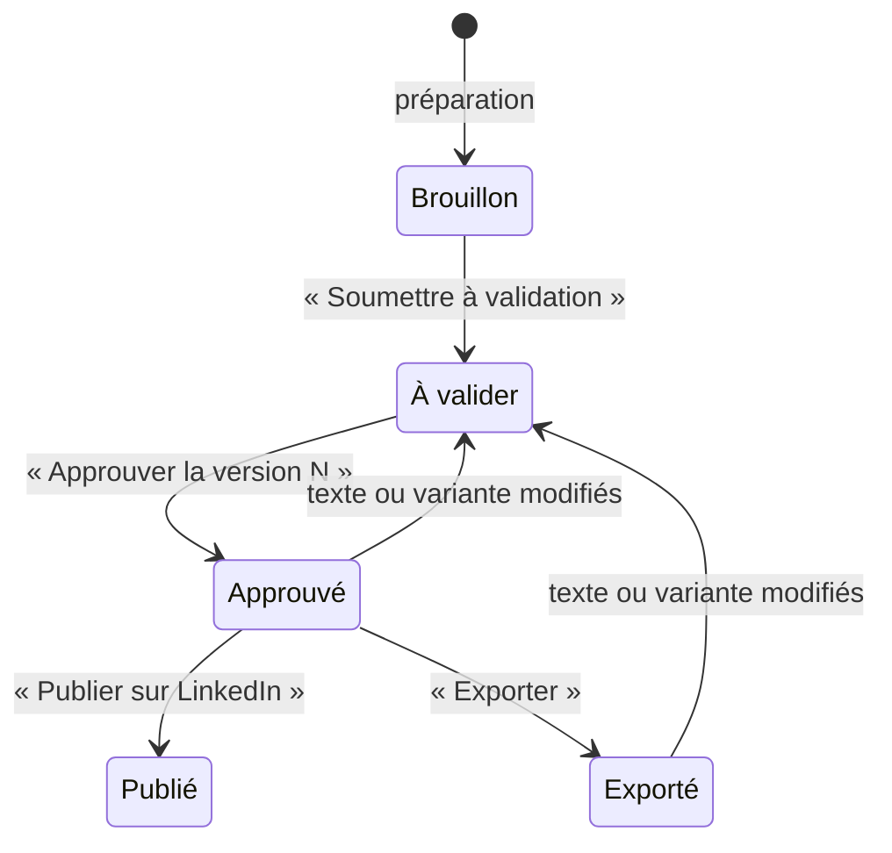

1. **Préparer** (rédacteur). Cliquez sur « Préparer un post », choisissez l'article source (les articles approuvés sont en tête de liste) puis « Préparer le post ». Vous pouvez aussi partir d'un article (« Générer le post LinkedIn ») ou d'un signal. Un contenu ne peut avoir qu'un post en préparation à la fois.
2. **Choisir et retoucher** (rédacteur). Sélectionnez la variante à retenir, modifiez le texte et les hashtags, puis cliquez sur « Enregistrer la version N+1 ». Chaque enregistrement ou changement de variante crée une nouvelle version.
3. **Soumettre** (rédacteur). « Soumettre à validation » fait passer le post « À valider » et notifie les validateurs.
4. **Approuver** (validateur). Relisez l'aperçu puis cliquez sur « Approuver la version N ».
5. **Publier ou exporter** (validateur).
   - Votre compte est relié : « Publier sur LinkedIn » publie la variante retenue et ses hashtags sur votre profil. Le message « Post publié sur LinkedIn » s'affiche, le résultat affiché sous les boutons donne le lien du post, et le post passe « Publié » : il n'est plus modifiable.
   - Il ne l'est pas : « Exporter » consigne l'export et fait passer le post « Exporté ». Les boutons « Télécharger l'export » (fichier texte) et « Copier le texte » apparaissent alors ; publiez le texte à la main sur LinkedIn.

Un double clic, ou un collègue qui clique en même temps, ne publie pas deux fois : la seconde demande affiche « Publication déjà en cours » et l'écran se met à jour quelques secondes plus tard. Une version déjà exportée peut encore être publiée : reliez votre compte, puis cliquez sur « Publier sur LinkedIn ». Si LinkedIn refuse (autorisation expirée, texte refusé, trop de publications rapprochées), le motif s'affiche sous « Envoi bloqué par l'API » ; corrigez la cause, par exemple avec « Reconnecter LinkedIn », puis cliquez de nouveau.

Une modification après approbation crée une nouvelle version, invalide l'approbation et renvoie le post « À valider » : le bandeau « Toute modification invalidera l'approbation » vous prévient. Un fichier téléchargé alors que la version n'est pas approuvée commence par la mention « [APERÇU — version non approuvée, ne pas publier] ».

### Si la publication est à vérifier

Quand KORA ne sait pas si le post a été créé (connexion coupée pendant l'envoi, LinkedIn momentanément indisponible, réponse incomplète, contenu signalé comme déjà publié), il n'essaie pas de republier : le bandeau « Publication LinkedIn à vérifier » indique qui a lancé la publication et quand, et bloque tout nouvel envoi de cette version.

1. Ouvrez le fil LinkedIn du compte indiqué et cherchez le post.
2. S'il y figure, cliquez sur « Le post est bien sur LinkedIn » : le post passe « Publié » et le message « Publication confirmée » s'affiche.
3. S'il n'y figure pas, cliquez sur « Le post n'y est pas : republier » et confirmez « Republier ». Le post est publié depuis **votre** compte relié, ou exporté si vous n'en avez pas. Ne confirmez qu'après avoir vérifié le fil : si le post y est déjà, il paraîtra deux fois.

Seuls la personne qui a lancé la publication et un administrateur peuvent répondre ; pour les autres, les boutons sont grisés avec la raison. Si le bandeau indique que KORA n'a pas encore reçu la confirmation et que la publication vient d'être lancée, patientez quelques secondes puis actualisez.

## Newsletter

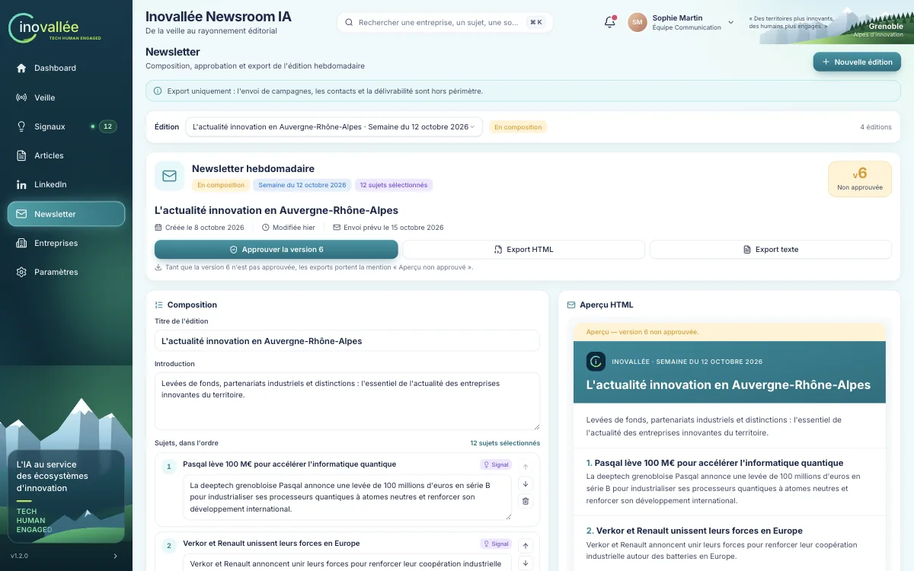

L'écran Newsletter (« Composition, approbation et export de l'édition hebdomadaire ») sert à composer l'édition de la semaine. Le bandeau rappelle que KORA se limite à l'export : l'envoi, les contacts et la délivrabilité sont hors périmètre.

### Lire l'écran

Le sélecteur « Édition » liste toutes les éditions avec leur semaine et leur statut ; par défaut, l'édition en composition est ouverte. L'en-tête de l'édition affiche le statut, la semaine, le nombre de sujets, l'encadré de version, la date de création et la date d'envoi prévue (le lundi à 9 h). Cette date sert de repère : KORA n'envoie rien.

En dessous, à gauche : la carte « Composition » (« Titre de l'édition », « Introduction », « Sujets, dans l'ordre ») et le panneau « Ajouter des sujets ». À droite : l'« Aperçu HTML » et l'« Approbation ». En bas : « Historique des exports (N) ».

### Composer une édition

1. Cliquez sur « Nouvelle édition » si besoin. Le « Titre » est facultatif (KORA en propose un) ; « Semaine du » est le lundi suivant par défaut. Cliquez sur « Créer l'édition ». Le quota est de cinq éditions par mois.
2. Dans « Ajouter des sujets », basculez entre « Signaux » (triés par score) et « Articles », filtrez, puis cliquez sur « Ajouter ». KORA rédige un résumé pour chaque sujet ajouté (appel payant). Vous pouvez aussi ajouter un sujet depuis un signal ou un article (« Ajouter à la newsletter ») ; si aucune édition n'est en composition, une édition est créée automatiquement.
3. Réordonnez avec « Monter » et « Descendre » ; « Retirer de l'édition » supprime un sujet. Chaque déplacement, ajout ou retrait est enregistré immédiatement comme nouvelle version.
4. Modifiez le titre, l'introduction ou les résumés, puis cliquez sur « Enregistrer la version N+1 ». Les résumés modifiés portent « Résumé modifié » jusqu'à l'enregistrement.

### Approuver et exporter

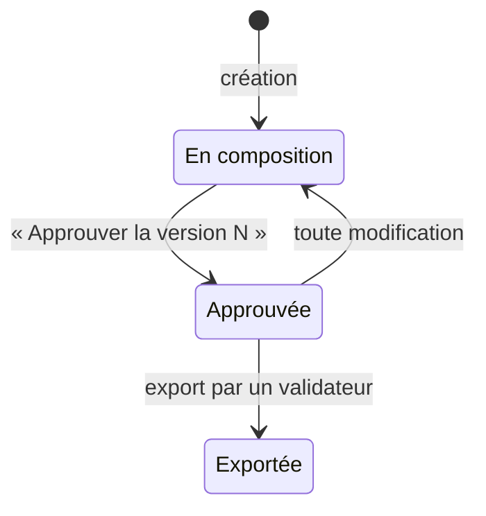

1. **Approuver** (validateur). Cliquez sur « Approuver la version N ». Une édition vide ne peut pas être approuvée (« Ajoutez au moins un sujet avant d'approuver. »).
2. **Exporter**. « Export HTML » et « Export texte » téléchargent l'édition. Tant que la version n'est pas approuvée, les fichiers portent la mention « Aperçu — version N non approuvée. ».
3. **Figer**. Lorsqu'un validateur clique sur « Export HTML » ou « Export texte » pour une version approuvée, le fichier est téléchargé et, en même temps, l'export est consigné : l'édition passe « Exportée », l'export rejoint l'« Historique des exports » et l'édition n'est plus modifiable (« Édition exportée — version N figée »). Ses fichiers restent téléchargeables à l'identique. Pour la semaine suivante, créez une nouvelle édition.

Le premier clic d'un validateur sur un bouton d'export fige l'édition : vérifiez le contenu avant de cliquer. La phrase sous les boutons le rappelle (« L'export de la version approuvée est consigné (clé d'idempotence) et fige l'édition. »). Pour un rédacteur ou un lecteur, le clic télécharge le fichier sans rien consigner (« seul un validateur peut le consigner comme diffusion »). Si la consignation échoue, un message d'erreur s'affiche : le fichier est téléchargé, mais l'édition n'est pas figée ; cliquez de nouveau sur le bouton.

## Entreprises

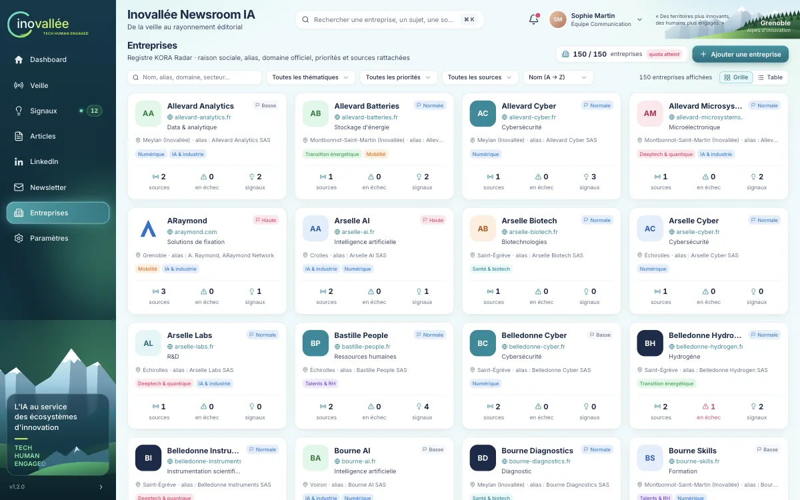

L'écran Entreprises (« Registre KORA Radar ») tient le registre des entreprises suivies : raison sociale, alias, domaine officiel, priorités et sources rattachées.

### Lire l'écran

La pastille de quota indique le nombre d'entreprises sur le plafond de 150 (« quota atteint » lorsqu'il est plein). Les filtres sont le champ « Nom, alias, domaine, secteur… », « Toutes les thématiques », « Toutes les priorités », « Toutes les sources » (« Avec source en échec », « Sans source ») et le tri (« Nom (A → Z) », « Priorité », « Plus de signaux », « Sources en échec »). La bascule « Grille » / « Table » change la présentation ; 24 entreprises sont affichées par page.

Chaque carte montre le domaine, le secteur, la priorité, le territoire, les alias, les thématiques et trois compteurs : sources, sources en échec et signaux.

### Ajouter une entreprise

1. Cliquez sur « Ajouter une entreprise ».
2. Renseignez « Raison sociale », « Alias » (noms commerciaux, sigles, anciennes dénominations, séparés par une virgule), « Domaine officiel » (par exemple `pasqal.com`), « Secteur », « Territoire », « Priorité éditoriale » et « Thématiques » (elles servent aux regroupements du Dashboard).
3. Cliquez sur « Ajouter au registre ».

KORA crée en même temps la source « Google News — » suivie de la raison sociale, de type « Recherche web », à fréquence quotidienne et au statut « En attente » : la fiche compte donc une source dès sa création, collectée au prochain « Lancer la collecte ». La fenêtre d'ajout indique encore « Les sources se rattachent ensuite depuis la fiche. » ; ajoutez-y les autres sources utiles.

Le serveur refuse un nom ou un domaine déjà présents (« Entreprise déjà présente dans le registre ») et toute création au-delà de 150 entreprises (« Quota d'entreprises atteint »). En production, le registre démarre vide ; seules les données de démonstration occupent déjà les 150 places (voir [Quota d'entreprises atteint](#quota-dentreprises-atteint)).

### La fiche entreprise

Cliquez sur une carte ou une ligne pour ouvrir la fiche. Elle présente :

- les compteurs « sources rattachées », « sources en échec » et « signaux détectés » ;
- « Fiche registre » : modifiez les champs puis cliquez sur « Enregistrer » (« Annuler » rétablit les valeurs) ;
- « Sources rattachées » : la liste des sources avec leur type, leur fréquence et leur dernière réussite, « Ajouter une source », « Collecter maintenant » et « Voir dans le registre des sources ». Une entreprise sans source n'est pas collectée ;
- « Derniers signaux » ;
- « Retirer l'entreprise du registre » : « Supprimer » ouvre la confirmation « Supprimer « … » ? », validée par « Supprimer l'entreprise ».

La suppression est réservée aux administrateurs. Elle retire la fiche et ses sources ; les signaux de l'entreprise restent dans l'application, marqués à rattacher.

## Paramètres

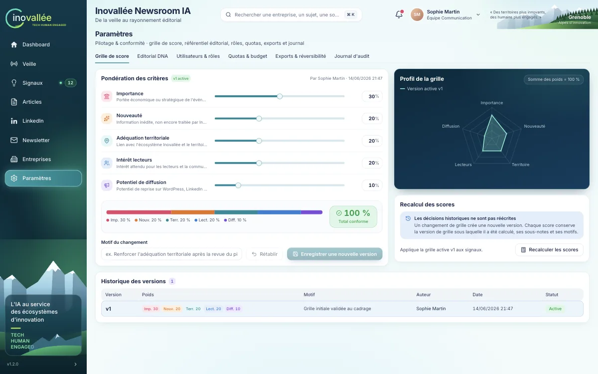

L'écran Paramètres (« Pilotage & conformité ») réunit sept onglets : « Grille de score », « Editorial DNA », « Utilisateurs & rôles », « WordPress », « Quotas & budget », « Exports & réversibilité » et « Journal d'audit ». Sous le profil lecteur, la grille et le référentiel sont consultables mais non modifiables.

### Grille de score

La carte « Pondération des critères » montre la grille active (« vN active ») et le poids de chacun des cinq critères : « Importance », « Nouveauté », « Adéquation territoriale », « Intérêt lecteurs » et « Potentiel de diffusion ». Réglez chaque poids avec le curseur ou le champ numérique ; l'écart avec la grille active s'affiche en vert ou en orange. L'indicateur de total affiche « Total conforme » à 100 %, sinon « Il manque N points » ou « N points en trop ».

Le « Profil de la grille » compare graphiquement la version active et votre brouillon. La carte « Recalcul des scores » rappelle que « Les décisions historiques ne sont pas réécrites » et propose « Recalculer les scores ». L'« Historique des versions » liste chaque grille avec ses poids, son motif, son auteur, sa date et la mention « Active » ou « Archivée ».

La modification est réservée aux administrateurs ; la marche à suivre figure dans le [parcours E](#e-ajuster-la-grille-de-score).

### Editorial DNA

Le référentiel éditorial décrit le style d'Inovallée. Il comprend trois cartes.

- **« Règles éditoriales »**, classées par type : « Ton », « Longueur », « Structure », « Vocabulaire » et « Interdits ». « Ajouter une règle » ouvre un formulaire (type, texte, « Ajouter la règle »). L'icône « Modifier la règle » permet de réécrire une règle et l'interrupteur de l'activer ou la désactiver. Chaque changement crée une nouvelle version de la règle.
- **« Propositions issues des corrections »**. Lorsque l'équipe corrige au moins trois brouillons de KORA dans le même sens (titres raccourcis, terme remplacé ou supprimé), une proposition apparaît avec sa justification. Elle reste « À décider » jusqu'à ce qu'un administrateur clique sur « Accepter » ou « Refuser ». Aucune règle n'est modifiée automatiquement.
- **« Corpus d'exemples historiques »** : publications d'Inovallée qui servent de références de style. Aucun entraînement dédié ni fine-tuning n'est réalisé.

La modification du référentiel est réservée aux administrateurs.

### Utilisateurs & rôles

« Comptes nominatifs » liste les comptes avec leur nom, leur adresse e-mail, leur équipe et leurs rôles ; votre compte porte « Vous ». Sous chaque adresse, la pastille « Compte activé » indique que la personne a choisi son mot de passe, « Invitation en attente » qu'elle ne l'a pas encore fait. « Droits par rôle » présente la matrice des droits et ses définitions ; si votre compte cumule rédaction et validation, un encadré rappelle qu'une approbation donnée sur son propre contenu ne vaut pas double contrôle.

Les administrateurs gèrent les comptes depuis cette carte ; les autres profils la consultent seulement.

- **Ajouter un utilisateur.** Cliquez sur « Ajouter ». Renseignez le « Nom complet », l'« Équipe » (facultative) et l'« Adresse e-mail » professionnelle qui servira à se connecter, cochez au moins un rôle, puis cliquez sur « Ajouter et inviter ». La personne reçoit un e-mail d'invitation pour choisir son mot de passe (voir [Se connecter](#se-connecter)) ; le message « Invitation envoyée à … » le confirme. Si l'adresse possède déjà un compte de connexion confirmé, elle est rattachée sans nouvel e-mail et la personne peut se connecter aussitôt. Une adresse déjà utilisée par un autre compte KORA est refusée (« Adresse e-mail déjà utilisée »).
- **Modifier les rôles.** Cliquez sur l'icône crayon (« Modifier les rôles de … »), changez le nom, l'équipe ou les rôles, puis cliquez sur « Enregistrer ». L'adresse e-mail, qui identifie le compte, ne se modifie pas. Vous ne pouvez pas retirer votre propre rôle d'administrateur.
- **Renvoyer l'invitation.** Pour un compte « Invitation en attente », l'icône d'envoi (« Renvoyer l'invitation à … ») envoie un nouvel e-mail, par exemple lorsque le premier lien a expiré. Si l'envoi échoue, le message l'indique et invite à réessayer.
- **Supprimer un compte.** Cliquez sur l'icône corbeille, puis confirmez « Supprimer le compte de … ? ». La personne n'a plus accès à KORA et sa connexion LinkedIn est retirée ; ses contenus et le journal d'audit sont conservés. Vous ne pouvez pas supprimer votre propre compte, ni le dernier administrateur : KORA en garde toujours au moins un.

Chaque ajout, modification, renvoi et suppression est consigné dans le journal d'audit. Sur une installation de démonstration, les comptes sont créés sans invitation par e-mail.

### WordPress

La carte « Connexion au site » indique le mode : « Site configuré » (avec l'adresse du site), « Mode démonstration » (brouillons simulés, rien n'est envoyé à un site réel) ou « Non configuré ». Dans ce dernier cas, l'envoi vers WordPress est désactivé et la carte détaille la procédure, à suivre par un administrateur :

1. Créer dans WordPress un compte dédié à KORA, avec le rôle **Contributeur** : il peut créer des brouillons, mais ni publier, ni programmer, ni téléverser de médias.
2. Connecté avec ce compte, générer un mot de passe d'application dans **Profil › Mots de passe d'application**. Il n'est affiché qu'une fois : copiez-le directement dans le secret de l'étape suivante, sans le transmettre par e-mail ni messagerie.
3. Renseigner les secrets `WORDPRESS_URL`, `WORDPRESS_USERNAME` et `WORDPRESS_APP_PASSWORD` dans la console de l'hébergement. Chaque variable porte la pastille « Renseignée » ou « Manquante ou invalide ».
4. Recharger la page une fois les secrets enregistrés (et l'application redéployée si l'hébergement l'exige) : le mode doit indiquer « Site configuré ».

« Tester la connexion » (administrateur) vérifie l'identifiant, le mot de passe d'application et le rôle du compte, sans rien écrire sur le site. Le résultat affiche le compte et ses rôles. « Connexion réussie, mais le rôle du compte est trop élevé » signale un compte capable de publier lui-même : donnez-lui le rôle Contributeur. En cas d'échec, « Connexion impossible » reprend le message du serveur. Le mot de passe d'application n'est jamais affiché.

La carte « Correspondance des catégories » associe chaque catégorie KORA à une catégorie WordPress. Sans correspondance, KORA cherche une catégorie WordPress de même nom ou de même slug, puis applique la « Catégorie par défaut ». Un administrateur clique sur « Modifier la correspondance » : les catégories du site sont lues, avec leur hiérarchie (les sous-catégories sont en retrait), et chaque ligne propose une liste dont « — aucune — ». « Enregistrer » applique la correspondance aux envois suivants ; « Annuler » rétablit la correspondance enregistrée. Une catégorie enregistrée qui n'existe plus sur le site porte la mention « (introuvable sur le site) ». Les autres profils consultent la correspondance sans pouvoir la modifier.

### Quotas & budget

Le panneau « Budget API » montre la consommation du mois en euros et en pourcentage, le reste disponible et l'état « Appels payants actifs » ou « Appels payants suspendus ». Les autres compteurs (« Recherches web », « Nouvelles observations », « Dossiers et articles », « Posts LinkedIn », « Éditions newsletter », « Entreprises suivies », « Sources configurées », « Stockage ») portent chacun la pastille « Sous le seuil », « Alerte 80 % » ou « Plafond atteint ».

| Compteur | Plafond |
|---|---|
| Budget API | 150 € HT par mois |
| Recherches web | 3 000 par mois |
| Nouvelles observations | 6 000 par mois |
| Dossiers et articles | 25 par mois |
| Posts LinkedIn | 25 par mois |
| Éditions newsletter | 5 par mois |
| Entreprises suivies | 150 |
| Sources configurées | 300 |
| Stockage | 10 Go |

Le moteur réserve le coût maximal estimé avant chaque appel payant. Les collectes en font partie : voir [Lancer une collecte](#lancer-une-collecte) pour leur coût. Une alerte est notifiée à 80 % puis à 100 %. À 100 % du budget, les appels payants sont suspendus ; la consultation et les exports restent accessibles. Les plafonds ne se modifient pas depuis l'interface.

### Exports & réversibilité

« Télécharger le manifeste » fournit la description de tous les fichiers exportables. Neuf cartes proposent chacune un export « CSV » ou « JSON » : « Entreprises », « Sources », « Signaux », « Observations », « Scores », « Règles éditoriales », « Décisions », « Articles » et « Journal d'audit ». Les exports sont accessibles à tous les profils, y compris lorsque le budget est épuisé. Le format des fichiers est décrit dans le [Dictionnaire des données](04-dictionnaire-des-donnees.md).

### Journal d'audit

Le journal liste les actions horodatées : date, acteur, action, entité et détails. Filtrez avec « Acteur, action, détail… » et « Toutes les entités » ; « Exporter (CSV) » télécharge le journal complet. Le journal affiche les 500 événements les plus récents, 25 par page. La colonne « Action » montre un code technique (par exemple `article.approve`) ; la colonne « Détails » en donne la description.

## Parcours types

### A. De l'actualité détectée à l'article sur WordPress

1. **Repérer** (rédacteur). Sur le Dashboard, ouvrez « sujets prioritaires », ou dans Signaux l'onglet « Prioritaires ». Sélectionnez le signal.
2. **Vérifier le signal**. Contrôlez le rattachement (pas d'alerte « Homonymie à vérifier » ou « Entreprise non rattachée »), la carte « Indicateur documentaire » et les observations.
3. **Lancer la rédaction**. Cliquez sur « Créer un article » ; l'article s'ouvre en version 1.
4. **Vérifier le dossier**. Dans « Dossier factuel », arbitrez chaque fait « Contradictoire » avec « Arbitrer ». Repérez les passages « [À vérifier] ».
5. **Rédiger**. Dans « Rédaction », corrigez le texte, retirez les marqueurs vérifiés, complétez l'extrait, le titre SEO, les catégories et les tags, puis cliquez sur « Enregistrer la version 2 ».
6. **Soumettre**. Cliquez sur « Soumettre en revue ».
7. **Approuver** (validateur, de préférence une autre personne que le rédacteur). Ouvrez l'article depuis la notification « Article à valider » ou l'onglet « En revue ». Cliquez sur « Approuver la version 2 », choisissez « WordPress », puis confirmez.
8. **Diffuser** (validateur). Cliquez sur « Diffuser », puis sur « Créer le brouillon WordPress » dans « Diffusion par canal ». Le résultat indique l'identifiant du brouillon distant ; le signal passe « Traité ».
9. **Mettre en ligne**. Au pilote, la mise en ligne publique se fait à la main dans WordPress : « Ouvrir dans WordPress » mène au brouillon. Une fois l'article publié sur le site, « Actualiser le statut » le fait passer « Publié » dans KORA. Sur une installation de démonstration, le brouillon est simulé et aucune page n'est publiée.

Si vous modifiez l'article après l'étape 7, l'approbation est invalidée : soumettez et approuvez de nouveau avant de renvoyer le brouillon.

### B. Importer un article rédigé par l'équipe

1. Dans Articles, cliquez sur « Importer un article humain ».
2. Déposez le fichier `.docx` ou `.txt`, saisissez l'auteur, puis cliquez sur « Importer et analyser ».
3. Dans « Propositions », acceptez ou refusez chaque proposition.
4. Comparez au besoin « Texte extrait » et « Original ».
5. Cliquez sur « Créer l'article ». L'article s'ouvre au statut « Brouillon », avec l'auteur conservé.
6. Complétez l'extrait, les catégories et les tags, enregistrez, puis suivez les étapes 6 à 9 du parcours A.

### C. Préparer et valider un post LinkedIn

1. **Préparer** (rédacteur). Depuis un article approuvé, cliquez sur « Générer le post LinkedIn », ou dans LinkedIn sur « Préparer un post ».
2. **Choisir**. Comparez les variantes, sélectionnez celle à retenir, ajustez le texte et les hashtags en surveillant le compteur de caractères et l'aperçu, puis cliquez sur « Enregistrer la version N+1 ».
3. **Soumettre**. Cliquez sur « Soumettre à validation ».
4. **Approuver** (validateur). Dans l'onglet « À valider », relisez puis cliquez sur « Approuver la version N ».
5. **Publier** (validateur). Si votre compte LinkedIn est relié, cliquez sur « Publier sur LinkedIn » : le post paraît sur votre profil et passe « Publié ». En cas de bandeau « Publication LinkedIn à vérifier », voir [Si la publication est à vérifier](#si-la-publication-est-à-vérifier).
6. **Ou exporter** (validateur). Sans compte relié, ou pour la page LinkedIn d'Inovallée, cliquez sur « Exporter », puis sur « Copier le texte » ou « Télécharger l'export », et collez le texte sur LinkedIn.

### D. Composer la newsletter de la semaine

1. **Sélectionner au fil de la semaine** (rédacteur). Depuis un signal ou un article, cliquez sur « Ajouter à la newsletter », ou activez « Inclure dans la prochaine édition » sur le Dashboard.
2. **Ouvrir l'édition**. Dans Newsletter, l'édition en composition s'ouvre par défaut. Complétez au besoin avec « Ajouter des sujets ».
3. **Ordonner et rédiger**. Réordonnez avec « Monter » et « Descendre », retouchez le titre, l'introduction et les résumés, puis cliquez sur « Enregistrer la version N+1 ». Contrôlez l'« Aperçu HTML ».
4. **Approuver** (validateur). Cliquez sur « Approuver la version N ».
5. **Exporter** (validateur). Cliquez sur « Export HTML » ou « Export texte ». Dès le premier clic, l'export est consigné : l'édition passe « Exportée » et se fige. Le second format reste téléchargeable.
6. **Envoyer**. Importez le HTML ou le texte dans votre outil d'envoi habituel ; KORA n'envoie rien.

### E. Ajuster la grille de score

1. Sous un profil administrateur, ouvrez Paramètres, onglet « Grille de score ».
2. Réglez les poids. Le total doit afficher « Total conforme » (100 %). Comparez votre brouillon à la version active dans le « Profil de la grille ».
3. Expliquez le changement dans « Motif du changement ».
4. Cliquez sur « Enregistrer une nouvelle version ». La nouvelle grille devient active ; l'ancienne passe « Archivée ».
5. La nouvelle grille s'applique aussitôt aux signaux en cours : le message indique « Grille vN enregistrée et activée · k signaux recalculés ». Les signaux « Traité » et « Rejeté » conservent le score et la version de grille sous lesquels ils ont été décidés. « Recalculer les scores » reste disponible pour réappliquer la grille active si besoin.
6. Contrôlez le résultat dans Signaux : la carte « Grille de score » indique la version utilisée pour chaque signal.

« Rétablir » abandonne un brouillon de grille non enregistré.

### F. Traiter une source en échec

1. **Repérer**. La notification « Source en échec : … », le compteur « sources en échec » et l'encadré des échecs de la page Veille signalent la source. Le filtre « Avec source en échec » de l'écran Entreprises permet aussi de les retrouver.
2. **Lire le diagnostic**. Notez le code, le motif et le nombre d'essais (voir le tableau ci-dessous). L'onglet « Historique des collectes » montre depuis quand la source échoue.
3. **Réessayer**. Cliquez sur « Réessayer » : KORA refait jusqu'à trois essais. Une erreur passagère (`TIMEOUT`, `NETWORK`, `HTTP_429`, `HTTP_5xx`) se résout souvent ainsi, éventuellement quelques heures plus tard ; la source repasse alors « Opérationnelle ».
4. **Corriger**. Si l'échec persiste, ouvrez l'URL dans votre navigateur. Si l'adresse a changé, supprimez la source (« Supprimer la source ») et recréez-la avec la bonne URL (« Ajouter une source »). Si le site refuse la collecte mais publie un flux RSS, ajoutez ce flux comme source.
5. **Mettre en pause**. Si la source est durablement indisponible, cliquez sur « Désactiver la source ». Réactivez-la plus tard avec « Réactiver la source ».

| Code | Signification | Que faire |
|---|---|---|
| `HTTP_403` | Le site refuse l'accès au collecteur. | Chercher un flux RSS public ou une autre source. |
| `HTTP_404` | L'adresse n'existe plus. | Recréer la source avec la bonne URL. |
| `HTTP_429` | Le site limite le nombre de requêtes. | Réessayer plus tard. |
| `HTTP_5xx` (500, 502, 503…) | Le site est en panne. | Réessayer plus tard. |
| Autre `HTTP_xxx` | Le site renvoie le statut HTTP indiqué. | Vérifier l'URL dans le navigateur. |
| `TIMEOUT` | Pas de réponse en 15 secondes. | Réessayer, puis désactiver si l'échec dure. |
| `NETWORK` | Site injoignable : domaine inconnu, connexion refusée ou certificat invalide. | Vérifier le domaine et l'URL. |

Le motif accompagne le code : « Réponse HTTP » suivi du statut pour les codes `HTTP_xxx`, « Délai de réponse dépassé » pour `TIMEOUT`, et le message technique transmis par le serveur, parfois en anglais, pour `NETWORK`. Plus rarement, un autre code technique peut apparaître tel quel. Un site peut s'afficher normalement dans votre navigateur et refuser malgré tout le collecteur de KORA, d'où l'intérêt de passer par son flux RSS.

Une source désactivée puis réactivée repasse « En attente » et sort de la liste des échecs, même si le problème n'est pas réglé, jusqu'à la collecte suivante.

## Comprendre les indicateurs

### Score IA sur 10

Le score mesure l'**intérêt éditorial** d'un signal, pas la fiabilité de ses sources. Il est calculé de 0 à 100 comme la somme pondérée de cinq sous-notes, puis affiché sur 10 avec une décimale (par exemple « 9.2 »). Les poids par défaut sont les suivants : « Importance » 30 %, « Nouveauté » 20 %, « Adéquation territoriale » 20 %, « Intérêt lecteurs » 20 % et « Potentiel de diffusion » 10 %. Chaque sous-note s'accompagne d'un motif lisible dans la carte « Grille de score ».

| Score affiché | Couleur |
|---|---|
| 9.0 et plus | Rose |
| De 7.5 à 8.9 | Orange |
| De 6.0 à 7.4 | Ambre |
| Moins de 6.0 | Gris |

Un signal est **prioritaire** à partir de 8/10 s'il est encore au statut « Nouveau » ou « À traiter ». Le score d'un signal décidé (« Traité » ou « Rejeté ») n'est jamais recalculé.

### Confiance xx %

La pastille « Confiance xx % » indique la certitude avec laquelle l'observation ou le signal a été rattaché à une entreprise du registre. Elle est verte à partir de 75 %, ambre de 50 à 74 % et rose en dessous de 50 %. En dessous de 60 %, l'observation n'est pas rattachée automatiquement : elle porte « À rattacher » et le signal affiche une alerte de revue. Un rattachement manuel porte la confiance à 100 %.

### Indicateur documentaire

L'indicateur documentaire décrit la **solidité des sources** d'un signal. Ce n'est pas une probabilité que l'information soit vraie ; c'est un état explicable, distinct du score.

| Niveau | Couleur | Condition |
|---|---|---|
| « Dossier solide » | Vert | Une source directe (site de l'entreprise) et au moins une corroboration indépendante, sans contradiction. |
| « À consolider » | Ambre | Une source directe ou des corroborations, mais pas les deux. |
| « Fragile » | Rose | Aucune des deux, ou au moins une contradiction. |

Les reprises quasi identiques d'un même communiqué (pastille « Reprise ») ne comptent pas comme corroborations indépendantes. Une contradiction correspond à des montants divergents entre sources. La « Fraîcheur » est en vert lorsque l'information date de 14 jours au plus ; elle affiche « Inconnue » sans date.

### Date inconnue

Lorsqu'aucune date de publication ni d'événement n'est connue, l'application affiche « Date inconnue » plutôt que d'en estimer une. La sous-note « Nouveauté » le signale par le motif « date de l'événement inconnue ». La collecte écarte désormais les publications sans date : ce cas ne concerne plus que des signaux collectés avant l'introduction de la règle des 30 jours.

### Statuts et couleurs

**Signaux**

| Statut | Couleur | Sens |
|---|---|---|
| Nouveau | Rose | Détecté, pas encore qualifié. |
| À traiter | Orange | Retenu pour traitement. |
| En revue | Bleu | Un article est en préparation. |
| Surveillé | Violet | À suivre, sans traitement immédiat. |
| Traité | Vert | Diffusé ou clos. |
| Rejeté | Gris | Écarté, avec motif ; restaurable. |

**Articles**

| Statut | Couleur | Sens |
|---|---|---|
| Brouillon | Gris | En rédaction. |
| En revue | Bleu | Soumis aux validateurs. |
| Prêt à publier | Vert | Approuvé pour au moins un canal. |
| Programmé | Bleu-vert | Approuvé avec une date de diffusion. |
| Publié | Bleu-vert | Mis en ligne sur WordPress, constaté par KORA à l'actualisation du statut ou à un envoi. |
| Rejeté | Rose | Renvoyé au rédacteur avec un motif. |

**Posts LinkedIn** : « Brouillon » (gris), « À valider » (ambre), « Approuvé » (vert), « Exporté » et « Publié » (bleu-vert).

**Éditions de newsletter** : « En composition » (ambre), « Approuvée » (vert), « Exportée » (bleu-vert).

**Sources** : « Opérationnelle » (vert), « En échec » (rose), « En attente » (ambre), « Désactivée » (gris).

**Collectes** : « Succès » (vert), « Succès · aucune actualité » (bleu-vert), « Échec » (rose), « Bloquée (quota) » (ambre).

**Tentatives de diffusion** : « Succès » (vert), « Échec » et « Bloqué » (rose), « Vérification requise » (ambre).

**Faits du dossier** : « Étayé » (vert), « Non corroboré » (ambre), « Contradictoire » (rose).

**Approbations** : « Valide » (vert) ou « Invalidée » (rose), avec la date et le motif de l'invalidation.

## Ce que l'application ne fait pas au pilote

- **Elle ne collecte pas d'elle-même.** La collecte lit réellement les flux RSS, Google News et Perplexity, mais seulement lorsque vous cliquez sur « Lancer la collecte », « Collecter maintenant » ou « Réessayer » : il n'existe pas de collecte planifiée, la « Fréquence » d'une source est indicative.
- **Elle ne lit pas le contenu des pages web.** Seuls les flux RSS et Atom, déclarés ou saisis, et les résultats de Google News et de Perplexity sont exploités, à raison de cinq publications nouvelles de moins de 30 jours au plus par source et par collecte (voir [Ce que lit la collecte](#ce-que-lit-la-collecte)). Seule exception : la page d'un article trouvé par Google News est ouverte pour y lire sa date de publication, rien d'autre.
- **Elle ne garde pas un article Google News dont la date n'est pas vérifiable.** Un article publié sur un site qui refuse les lectures automatiques est écarté, même s'il est récent et pertinent ; l'historique des collectes en donne le nombre et le motif (`DATE_REJECTED`).
- **Elle ne publie directement que sur LinkedIn.** Seul « Publier sur LinkedIn », cliqué par un validateur ou un administrateur qui a relié son compte, met un contenu en ligne, sur son profil. WordPress reçoit un brouillon distant, que vous mettez en ligne vous-même ; la newsletter passe par un export que vous envoyez vous-même. Aucune page LinkedIn tierce n'est collectée.
- **Elle n'exécute pas les programmations.** « Programmer la diffusion » enregistre une date et fait passer l'article « Programmé », mais aucun envoi ne part à cette date.
- **Elle ne fait passer un article « Publié » qu'après coup.** Le statut suit la mise en ligne faite dans WordPress, lorsque KORA la constate (« Actualiser le statut »).
- **Elle n'envoie pas la newsletter** et ne gère ni contacts ni délivrabilité.
- **Elle ne lit pas les PDF, les .doc ni les images** : pas d'OCR, seulement DOCX et texte UTF-8.
- **Elle n'apprend pas seule.** Aucun modèle n'est entraîné sur vos textes ; les corrections produisent des propositions de règles que vous acceptez ou refusez.
- **Elle ne propose pas d'inscription libre.** Les comptes sont créés sur invitation par un administrateur ; il n'existe ni connexion par un compte Google ou Microsoft, ni double authentification.
- **Elle ne permet pas de modifier les plafonds** de quotas et de budget, ni l'URL d'une source existante, depuis l'interface.
- **Elle ne propose ni corbeille ni restauration.** Les données sont conservées dans une base, mais une suppression est définitive, et le projet ne prévoit ni sauvegarde documentée ni procédure de restauration. Exportez régulièrement ce que vous souhaitez garder (voir [Exports & réversibilité](#exports--réversibilité) et [Exploitation](09-exploitation.md)).

## FAQ et dépannage

### Le bouton est grisé

Survolez le bouton : l'infobulle donne la raison. Les cas les plus fréquents :

| Infobulle ou message | Que faire |
|---|---|
| « Réservé aux rédacteurs. » / « Réservé aux validateurs. » | Demandez le rôle nécessaire à un administrateur, ou confiez l'action à un collègue qui l'a. |
| « Profil lecteur : consultation seule » | Demandez un autre rôle à un administrateur. |
| « Modifications non enregistrées : enregistrez d'abord une nouvelle version. » | Enregistrez ou annulez vos modifications. |
| « Soumettez d'abord l'article en revue. » | Cliquez sur « Soumettre en revue ». |
| « N contradiction(s) à arbitrer dans le dossier factuel avant approbation. » | Arbitrez dans « Dossier factuel ». |
| « Approbation valide requise pour la version N sur ce canal. » | Faites approuver la version courante pour ce canal. |
| « Seul un article soumis en revue peut être rejeté. » | Un brouillon ne se rejette pas. |
| « Cochez au moins deux signaux » | Sélectionnez deux signaux pour fusionner. |
| « Au moins une observation doit rester dans le signal » | Ne détachez pas toutes les observations. |
| « Ajoutez au moins un sujet avant d'approuver. » | Ajoutez des sujets à l'édition. |
| « Édition exportée : elle n'est plus modifiable. » | Créez une nouvelle édition. |
| « La somme des poids doit être égale à 100 % » | Ajustez les poids de la grille. |
| « Source désactivée » | Réactivez la source. |

Certains boutons restent cliquables alors que votre profil ne permet pas l'action ; le serveur refuse alors avec un message qui se termine par « Votre profil (…) ne le permet pas. ». C'est le cas notamment des actions sur les signaux sous le profil lecteur, de l'ajout d'entreprise ou de source sous le profil validateur, de la suppression d'une entreprise sous le profil rédacteur, et de la grille de score ou du référentiel sous un profil non administrateur.

### Mon approbation a disparu

Une approbation n'est jamais supprimée : elle est **invalidée**, et reste visible dans la liste « Approbations » avec la mention « Invalidée le … — Contenu modifié après approbation » ou le motif du rejet. Les causes possibles :

- quelqu'un a enregistré une nouvelle version de l'article, du post ou de l'édition ;
- une ancienne version a été restaurée ;
- l'article a été rejeté ;
- pour un post LinkedIn, la variante retenue a changé ;
- pour une newsletter, un sujet a été ajouté, retiré ou déplacé, ou le titre, l'introduction ou un résumé a changé ;
- sur une installation de démonstration sans base de données, le serveur a redémarré et les données sont revenues à leur état initial ; en production, un redémarrage ne change rien.

Ouvrez l'onglet « Versions » ou le « Journal de l'article » pour savoir qui a modifié quoi, puis faites approuver la version courante.

### Envoi bloqué

Le serveur revérifie tout juste avant l'envoi et explique le blocage :

| Message | Cause |
|---|---|
| « Envoi bloqué : N contradiction(s) non résolue(s) dans le dossier factuel. » | Une contradiction n'a pas été arbitrée. |
| « Envoi bloqué : l'approbation porte sur la version X, la version courante est la Y. » | L'article a changé depuis l'approbation. |
| « Envoi bloqué : la version X est approuvée pour A, pas pour B. » | L'approbation concerne un autre canal. |
| « Envoi bloqué : l'approbation de la version X a été invalidée (…). Une nouvelle approbation est requise. » | L'approbation a été invalidée. |
| « Envoi bloqué : aucune approbation valide pour … sur la version X. » | Aucune approbation pour ce canal. |

Chaque blocage est consigné dans l'« Historique des tentatives » au statut « Bloqué ».

Pour WordPress, l'encadré nomme aussi les refus propres au site :

- « Contenu déjà en ligne ou programmé : la modification se fait dans WordPress » : KORA ne modifie jamais un contenu publié ou programmé. « Ouvrir dans WordPress » permet de faire la correction sur le site.
- « Plusieurs brouillons identiques sur WordPress » : un envoi précédent a été interrompu et plusieurs brouillons correspondent. L'encadré liste les « Brouillons candidats » (titre, numéro, date, lien d'édition) : supprimez les doublons dans WordPress, puis renvoyez.
- « Le brouillon a été modifié dans WordPress depuis le dernier envoi de KORA » : reprenez ces retouches dans KORA puis renvoyez, ou confirmez l'écrasement pour remplacer le brouillon par la version de KORA.
- « Le compte WordPress utilisé par KORA peut publier » : KORA n'envoie plus rien tant qu'un administrateur n'a pas donné à ce compte le rôle Contributeur dans WordPress.
- « WordPress n'est pas configuré », « Identifiants WordPress refusés », « Droit manquant pour le compte WordPress » : un administrateur vérifie la connexion dans Paramètres, onglet [WordPress](#wordpress).
- « Site WordPress injoignable », « Trop de requêtes vers WordPress », « Accès bloqué par la protection du site » : réessayez plus tard ; si le problème persiste, signalez-le à l'administrateur du site.

Après un envoi interrompu, aucune vérification manuelle n'est nécessaire : au prochain envoi, KORA recherche lui-même le brouillon sur WordPress avant d'en créer un autre.

### Budget atteint

Lorsque le budget API du mois est épuisé, les actions qui appellent le modèle de texte ou le collecteur sont refusées avec le message « Plafond budgétaire API atteint (… € consommés sur 150 €) : les appels payants sont suspendus. Consultation et exports restent disponibles. » ou « Les appels payants sont suspendus : plafond budgétaire API du mois atteint. ». Sont concernés la création d'un article, la préparation d'un post LinkedIn, l'ajout d'un sujet à la newsletter (son résumé est généré) et la collecte. Le refus peut survenir un peu avant 150 € : le coût estimé de l'action est réservé avant l'appel, et l'action est refusée si cette réservation dépasse le plafond.

Restent disponibles : la consultation, les exports, la rédaction et l'enregistrement de versions, les approbations, la diffusion WordPress, la publication et l'export LinkedIn, et l'export de la newsletter. La carte « Moteur d'analyse IA » passe « En pause » et l'onglet « Quotas & budget » affiche « Budget API atteint ». Le plafond ne se modifie pas depuis l'interface. La consommation est comptée par mois : les appels payants redeviennent possibles le mois suivant. En production, un redémarrage du serveur ne remet pas la consommation à zéro ; sur une installation de démonstration, il la ramène à son niveau initial (environ 112 €).

Les collectes pèsent lourd dans ce budget : une collecte complète de 150 sources coûte jusqu'à environ 11 € (voir [Lancer une collecte](#lancer-une-collecte)). Si le budget s'épuise en cours de collecte, les sources suivantes sont marquées « Bloquée (quota) » dans l'historique.

### Quota d'entreprises atteint

Le registre est limité à 150 entreprises. Au-delà, toute création échoue avec « Quota mensuel atteint : Entreprises suivies (150 maximum). », et la fenêtre d'ajout l'annonce d'avance (« Quota de 150 entreprises atteint »). Pour ajouter une entreprise, un administrateur doit d'abord en retirer une depuis sa fiche.

En production, le registre démarre vide : ce message n'apparaît qu'une fois 150 entreprises enregistrées. Il ne concerne d'emblée que les installations de démonstration, dont les données comptent déjà 150 entreprises : pour y tester l'ajout, retirez d'abord une entreprise.

Les autres quotas fonctionnent de même avec leur propre libellé, par exemple « Quota mensuel atteint : Dossiers et articles (25 maximum). ».

### Autres messages fréquents

| Message | Que faire |
|---|---|
| « Vous avez relu la version X, mais la version courante est la Y. Relisez la dernière version avant d'approuver. » | Un collègue a enregistré une version : rechargez, relisez, approuvez. |
| « Un article existe déjà pour ce signal. » | Ouvrez l'article existant (« Ouvrir l'article »). |
| « Ce signal a été rejeté : réouvrez-le avant de lancer la rédaction. » | Cliquez sur « Restaurer » dans le signal. |
| « Un post LinkedIn est déjà en préparation pour ce contenu. » | Ouvrez le post existant dans LinkedIn. |
| « Ce sujet figure déjà dans l'édition. » | Le sujet est déjà présent ; rien à faire. |
| « Cette édition a déjà été exportée : créez une nouvelle édition. » | Créez une nouvelle édition. |
| « Le motif est obligatoire pour rejeter un signal. » | Saisissez un motif. |
| « Fusion impossible : les signaux concernent des entreprises différentes. » | Ne fusionnez que des signaux d'une même entreprise. |
| « Cette source est désactivée : réactivez-la avant de lancer une collecte. » | Réactivez la source. |
| « Une collecte est déjà en cours : réessayez dans quelques minutes. » | Un collègue, ou vous-même dans un autre onglet, a lancé une collecte : attendez qu'elle se termine, puis consultez l'historique. |
| « Le budget API est en cours de mise à jour : réessayez dans quelques secondes. » | Une autre action payante se termine au même moment : réessayez quelques secondes plus tard. |
| « Votre autorisation LinkedIn a expiré ou a été révoquée : reconnectez votre compte depuis la page LinkedIn. » | Cliquez sur « Reconnecter LinkedIn » dans l'écran LinkedIn, puis publiez de nouveau. |
| « Une publication de ce post est déjà en cours. Patientez quelques secondes puis actualisez. » | Un collègue, ou vous-même dans un autre onglet, publie ce post : attendez le résultat, qui s'affiche après actualisation. |
| « Cette URL est déjà suivie pour cette entreprise. » | La source existe déjà dans le registre. |
| « URL de source refusée : … » | Utilisez une adresse publique complète. |
| « La date de programmation doit être dans le futur. » | Choisissez une date et une heure à venir. |
| « Erreur interne du serveur. » | Réessayez ; si le message s'affiche sur tous les écrans, prévenez l'équipe technique (base de données injoignable, par exemple). |

### Je n'arrive pas à me connecter

| Message | Que faire |
|---|---|
| « E-mail ou mot de passe incorrect. » | Vérifiez l'adresse et le mot de passe, ou utilisez « Mot de passe oublié ? ». |
| « Votre adresse e-mail n'est pas encore confirmée : ouvrez le lien d'invitation reçu par e-mail. » | Activez d'abord votre compte avec le lien de l'invitation. |
| « Votre compte n'est pas autorisé sur KORA. Demandez à un administrateur de vous inviter. » | Votre adresse n'a pas de compte KORA, ou le compte a été supprimé : demandez à un administrateur de vous ajouter. |
| « Lien expiré ou invalide » | Le lien d'invitation ou de réinitialisation a déjà servi ou a expiré : demandez-en un nouveau avec « Mot de passe oublié ? » ou auprès d'un administrateur (« Renvoyer l'invitation »). |
| « Trop de tentatives : patientez quelques minutes avant de réessayer. » | Attendez quelques minutes avant de réessayer. |
| « Le service de connexion est injoignable. Vérifiez votre connexion réseau puis réessayez. » | Vérifiez votre connexion internet ; si le problème persiste, prévenez l'équipe technique. |

Vous ne recevez pas l'e-mail d'invitation ou de réinitialisation ? Vérifiez le dossier des indésirables, puis demandez à un administrateur de renvoyer l'invitation ; vérifiez avec lui l'adresse saisie dans « Utilisateurs & rôles ».

### Mes saisies ont disparu après une pause

En production, ce que vous avez enregistré est conservé dans la base de données, même si le serveur redémarre. Les causes possibles sont les suivantes :

- **Vos modifications n'étaient pas enregistrées.** Le texte saisi dans un article ou un post n'existe que dans la page ouverte tant que vous n'avez pas cliqué sur « Enregistrer la version N+1 ». Il est perdu si vous rechargez ou quittez la page, ou si KORA vous renvoie vers la page de connexion parce que votre session a expiré. Il est aussi remplacé, sans avertissement, si un collègue enregistre une nouvelle version du même contenu : l'application rafraîchit les données lorsque vous revenez sur la fenêtre après une pause.
- **Quelqu'un d'autre a modifié ou supprimé les données.** Le « Journal d'audit » de l'onglet Paramètres et l'onglet « Versions » d'un article indiquent ce qui a changé, et qui l'a fait.
- **Vous travaillez sur une installation de démonstration.** Sans base de données, par exemple sur le poste d'un développeur, chaque redémarrage du serveur ramène les données à leur état initial.

Voir aussi [Ce que l'application ne fait pas au pilote](#ce-que-lapplication-ne-fait-pas-au-pilote).

## Pour aller plus loin

- [Règles métier](05-regles-metier.md) : calcul du score, indicateur documentaire, workflows et blocages en détail.
- [Référence API](03-reference-api.md) : les appels derrière chaque bouton, pour reproduire un cas en test.
- [Sécurité et flux tiers](06-securite-et-flux-tiers.md) : contrôles des droits, filtrage des URL, données envoyées aux services tiers.
- [Frontend](07-frontend.md) : organisation des écrans dans le code.
- [Exploitation](09-exploitation.md) : redémarrage, exports, procédures d'incident.
- [Couverture du cahier des charges](10-couverture-cahier-des-charges.md) : ce qui est livré, simulé ou reste à faire.
