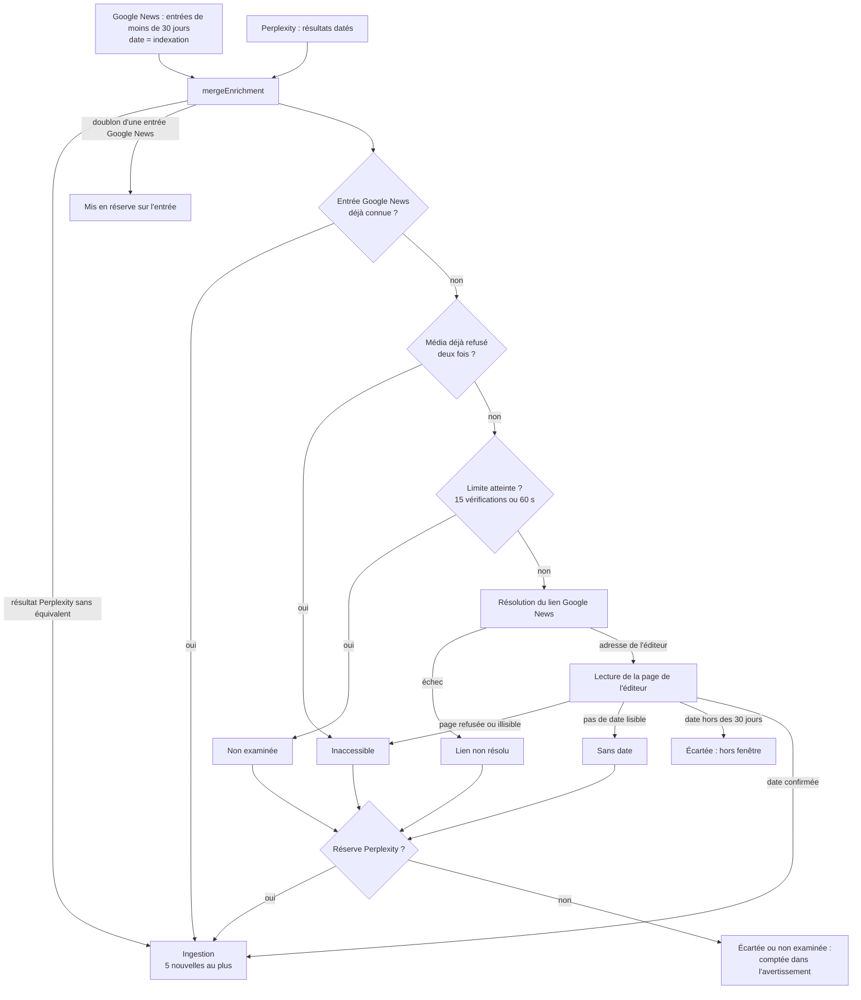

# 13 — Date de publication des articles Google News

**Statut** : en service dans `main` depuis le 13 novembre 2026. Le site public ne change qu'après une publication depuis l'éditeur Lovable.

**Périmètre** : la collecte des sources lues par Google News (« Recherche web », et « Page actualités » sans flux). Les flux RSS et Atom des entreprises ne sont pas concernés. Aucun champ nouveau dans les données, aucune migration, aucun secret nouveau.

Ce document décrit le chantier de bout en bout : le problème, la chaîne de traitement, les règles, les bornes, ce que voit la rédaction, les tests, les limites. Les autres documents en reprennent chacun une partie : [référence de l'API](03-reference-api.md#date-originale-google-news), [règles métier](05-regles-metier.md#wf1--collecte-et-classement), [sécurité](06-securite-et-flux-tiers.md), [guide utilisateur](08-guide-utilisateur.md#ce-que-lit-la-collecte), [anomalies connues](11-anomalies-connues.md).

## 1. Le problème

Google News date une entrée du jour où il l'indexe, pas du jour où l'article a paru. Une archive remise en avant paraît donc récente. Cas constaté en octobre 2026 : deux signaux Kalray datés des 19 et 20 octobre 2026 correspondaient, selon toute vraisemblance, à des émissions de janvier 2019 et de mai 2021 reprises par un agrégateur (la page de l'agrégateur n'a pas pu être relue).

La collecte ne gardait que les entrées de moins de 30 jours, mais en se fiant à cette date d'indexation. Elle laissait donc entrer ces archives comme des actualités.

## 2. Ce qui a été livré

| Commit | Contenu |
|---|---|
| `1df6a7a` | Fusion de la PR 2 (`fix/kora-publication-dates`) : la date d'un article Google News est lue sur la page de l'éditeur ; sans date confirmée et récente, l'article n'est pas ingéré. |
| `ecc9d9c` | Le nombre d'articles écartés et le motif sont affichés dans l'historique des collectes (`DATE_REJECTED`, `DATE_UNCHECKED`). |
| `4464024` | Un article non vérifiable est repris dans sa version Perplexity quand Perplexity a renvoyé le même article. |
| `cb3910c` | Un média qui refuse deux fois la lecture n'est plus sollicité pendant la collecte : ses autres articles n'occupent plus les vérifications. |
| `903bda2` | Dans Veille, l'avertissement d'une collecte réussie n'est plus affiché comme une erreur : pastille orange, libellé en français, décompte à part. |

Le rapport d'origine de la PR 2 est conservé dans [`reference/2026-10-kora-google-news-publication-dates.md`](reference/2026-10-kora-google-news-publication-dates.md), la revue du 13 novembre dans [`reference/2026-11-13-revue-pr2-pr3.md`](reference/2026-11-13-revue-pr2-pr3.md).

## 3. Chaîne de traitement



Dans le code :

1. `RealCollector.collect` ([`adapters/collector.ts`](../src/server/adapters/collector.ts)) lit le flux Google News et lance en parallèle la recherche Perplexity. `mergeEnrichment` ajoute les résultats Perplexity sans équivalent et met de côté les doublons (même adresse, ou titres dont l'un commence par l'autre sur 25 caractères au moins) dans `RawItem.backup`, sur l'entrée Google News qu'ils doublent. Seules les entrées de moins de 30 jours sont gardées ; une réserve de plus de 30 jours est retirée.
2. `resolveGoogleNewsItems` ([`services/collection.ts`](../src/server/services/collection.ts)) traite chaque entrée `via: "google_news"` encore inconnue, dans l'ordre du flux, de la plus récente à la plus ancienne. Elle compte les refus d'accès par média ; à partir de deux (`MAX_PUBLISHER_REFUSALS`), les autres entrées de ce média sont comptées inaccessibles sans résolution du lien ni lecture de la page.
3. `publisherUrl` obtient l'adresse de l'éditeur : `GoogleNewsLinkResolver` ([`adapters/google-news.ts`](../src/server/adapters/google-news.ts)) décode la redirection `news.google.com/rss/articles/<id>`. L'adresse passe par `validateSourceUrl`.
4. `checkPublishedAt` ([`services/publisher-page.ts`](../src/server/services/publisher-page.ts)) lit la page et rend soit la date, soit le motif du refus, avec `refused: true` quand le site a répondu 401, 403 ou 429.
5. `readOriginalPublishedAt` ([`domain/original-date.ts`](../src/server/domain/original-date.ts)) extrait la date de la page.
6. `dateWarning` construit l'avertissement de la collecte à partir du décompte.
7. `assessItems` puis `settle` poursuivent comme avant : lecture par le modèle, puis ingestion de cinq nouvelles observations au plus.

## 4. Règles de décision

| Situation de l'entrée Google News | Sans version Perplexity | Avec version Perplexity |
|---|---|---|
| Date confirmée par la page, moins de 30 jours | Ingérée : adresse de l'éditeur, date de la page, provenance `google_news` | Idem. La version Perplexity n'est pas utilisée. |
| Page lue, date de plus de 30 jours (ou de plus d'un jour dans le futur) | Écartée, motif « hors de la fenêtre de 30 jours » | Écartée aussi : la page l'emporte sur Perplexity. |
| Page inaccessible | Écartée, motif « page d'éditeur inaccessible » | Version Perplexity ingérée, provenance `perplexity` |
| Média qui a déjà refusé deux fois la lecture pendant cette collecte | Écartée sans aucune requête, même motif | Version Perplexity ingérée |
| Page lue, sans date lisible | Écartée, motif « sans date de publication lisible » | Version Perplexity ingérée |
| Lien Google News non résolu | Écartée, motif « lien non résolu » | Version Perplexity ingérée |
| Au-delà de 15 vérifications ou de 60 s | Non examinée | Version Perplexity ingérée |
| Adresse déjà connue | Ignorée comme doublon, sans lecture | Idem |

La date de Google News n'est jamais retenue à la place d'une date non confirmée. Une version Perplexity reprise entre avec l'adresse et la date données par Perplexity, comme tout résultat Perplexity : cette date n'est pas vérifiée sur la page.

« Inaccessible » regroupe : adresse refusée par le filtrage SSRF, délai dépassé, erreur réseau, statut HTTP autre que 2xx, redirection, type autre que du HTML, page de plus de 1 Mio, et page non demandée parce que son média a déjà refusé deux fois la lecture.

**Média qui refuse la lecture.** Un refus d'accès est une réponse 401, 403 ou 429. Le média est celui que nomme le flux Google News (attribut `url` de `<source>`, sans `www.`). Un refus lui est imputé quand la page refusée est sur son hôte ou sur un de ses sous-domaines ; sinon il est imputé à l'hôte de la page et ne ferme pas le média. Après deux refus pour une source et une collecte, les autres articles du média ne sont plus demandés et n'occupent plus de vérification : les 15 vérifications restent aux autres médias. Une erreur 404 ou 500, une redirection, un délai dépassé ou une page sans date ne sont pas des refus. Le décompte repart de zéro à chaque source et à chaque collecte.

## 5. Lecture de la date sur la page

- Sont lus : `datePublished` du JSON-LD, la balise `article:published_time`, et `uploadDate` pour une vidéo sans autre type d'article.
- Seul l'article principal compte. Un objet de type article (`NewsArticle`, `Article`, `BlogPosting` et leurs variantes) prime sur un `VideoObject` ; les objets imbriqués dans une publication ne sont pas lus.
- `dateModified` et `article:modified_time` sont ignorés : une mise à jour récente ne rajeunit pas un article.
- Toutes les dates lues doivent désigner le même instant. Deux valeurs différentes, même de quelques secondes, ou une date seule à côté d'une date avec heure, valent une date absente.
- Une date sans fuseau est interprétée dans le fuseau du serveur.

## 6. Bornes et protections réseau

| Borne | Valeur | Où |
|---|---|---|
| Fenêtre de fraîcheur | 30 jours, un jour de tolérance dans le futur | `FRESHNESS_DAYS`, `collector.ts` |
| Nouvelles observations par source et par collecte | 5 | `MAX_ITEMS`, `collection.ts` |
| Vérifications de date par source et par collecte | 15 | `MAX_GOOGLE_NEWS_CHECKS`, `collection.ts` |
| Temps total de vérification par source | 60 s | `GOOGLE_NEWS_DATE_BUDGET_MS`, `collection.ts` |
| Refus d'accès d'un même média avant de ne plus le solliciter, par source et par collecte | 2 | `MAX_PUBLISHER_REFUSALS`, `collection.ts` |
| Délai de lecture d'une page d'éditeur | 15 s | `TIMEOUT_MS`, `publisher-page.ts` |
| Taille d'une page d'éditeur | 1 Mio | `MAX_PUBLISHER_HTML_BYTES`, `publisher-page.ts` |
| Délai de chaque requête de résolution Google News | 8 s | `TIMEOUT_MS`, `google-news.ts` |

Modifier une borne demande une modification du code et une nouvelle publication.

Lecture d'une page d'éditeur : un `GET` par article, agent utilisateur `Mozilla/5.0 (compatible; KORA-Newsroom/1.0)`, sans cookie. Aucune redirection n'est suivie. Le corps est lu par morceaux et abandonné dès qu'il dépasse 1 Mio. À l'épuisement du budget de 60 s, les requêtes en cours sont annulées. Le texte de la page n'est ni conservé ni transmis à un modèle : seule la date en est tirée.

Un site qui refuse les lectures automatiques (réponse 403, page de défi) n'est pas contourné, et n'est plus sollicité après deux refus dans la même collecte. Le fichier `robots.txt` n'est pas consulté. Le nom d'hôte n'est pas résolu avant l'appel : un nom public pointant vers une adresse privée n'est pas détecté par l'application (voir [Filtrage SSRF](06-securite-et-flux-tiers.md#filtrage-ssrf)).

## 7. Ce que voit la rédaction

Dans Veille, onglet « Historique des collectes », colonne « Erreur ou avertissement ». La collecte reste réussie ; son statut ne dépend que du nombre de nouvelles observations. L'avertissement s'affiche en orange avec un libellé en français, suivi du message ; une erreur (collecte en échec ou bloquée) garde sa pastille rose et son code.

| Pastille | Code | Quand | Exemple de message |
|---|---|---|---|
| « Articles écartés » | `DATE_REJECTED` | Au moins un article écarté. Les articles non examinés sont cités à la suite. | « Google News : 3 publications écartées par la vérification de la date (3 pages d'éditeur inaccessibles) ; 7 non examinées (limite de 15 vérifications ou de 60 s par source). » |
| « Vérification incomplète » | `DATE_UNCHECKED` | Aucun article écarté, mais la vérification s'est arrêtée à sa limite avant d'avoir trouvé cinq articles. | « Google News : 2 publications non examinées (limite de 15 vérifications ou de 60 s par source). » |
| « Google News indisponible » | code de la panne (`HTTP_503`, `TIMEOUT`…) | Google News a échoué et Perplexity a pris le relais. | « Google News : `<motif>` » |
| aucune | — | Rien d'écarté, ou cinq articles trouvés et aucun écarté. | — |

Le code reste lisible au survol de la pastille, et le champ de recherche de l'historique trouve une collecte par son code comme par son libellé.

Précisions :

- Un article repris dans sa version Perplexity n'est pas compté : il n'est pas perdu. Il porte la pastille « Perplexity » et compte dans le « +N » de la colonne « Perplexity ».
- Si Google News lui-même a échoué et que Perplexity a pris le relais, c'est cet avertissement (« Google News : `<motif>` ») qui est affiché.
- La notification qui suit une collecte lancée à la main reprend l'avertissement : « Aucune nouvelle actualité · Articles écartés », avec le message, au lieu de « Source joignable, aucune nouvelle actualité publiée. » Le bilan d'une collecte globale compte les avertissements.
- Rien n'est mémorisé d'une collecte à l'autre : un article écarté est examiné de nouveau, et compté de nouveau, tant que Google News le renvoie. Un même décompte d'une collecte à la suivante est normal.
- Dans l'onglet Couverture, les avertissements sont comptés à part, sous « Avertissements fréquents », par libellé. « Codes d'erreur fréquents » ne compte que les collectes en échec ou bloquées.

## 8. Fichiers

| Fichier | Rôle |
|---|---|
| [`src/server/services/collection.ts`](../src/server/services/collection.ts) | `resolveGoogleNewsItems`, `publisherUrl`, `withinBudget`, `dateWarning`, `refusedMedia`, constantes `MAX_GOOGLE_NEWS_CHECKS`, `GOOGLE_NEWS_DATE_BUDGET_MS`, `MAX_PUBLISHER_REFUSALS`, `DATE_REJECTED`, `DATE_UNCHECKED` |
| [`src/server/services/publisher-page.ts`](../src/server/services/publisher-page.ts) | `checkPublishedAt` : lecture bornée de la page, motif du refus |
| [`src/server/domain/original-date.ts`](../src/server/domain/original-date.ts) | `readOriginalPublishedAt` : extraction de la date |
| [`src/server/adapters/google-news.ts`](../src/server/adapters/google-news.ts) | Résolution des redirections, annulable par signal |
| [`src/server/adapters/collector.ts`](../src/server/adapters/collector.ts) | `mergeEnrichment` et `RawItem.backup` : mise en réserve du doublon Perplexity |
| [`src/test/server/dates-publication.test.ts`](../src/test/server/dates-publication.test.ts) | 26 tests : règles de date, protections réseau, bornes |
| [`src/test/server/dates-publication-motifs.test.ts`](../src/test/server/dates-publication-motifs.test.ts) | 51 tests : avertissements, reprise par Perplexity, média qui refuse la lecture, motifs |
| [`src/test/server/liens-google-news.test.ts`](../src/test/server/liens-google-news.test.ts) | 14 tests : résolution des liens, annulation, délais |

Interface (commit `903bda2`) :

| Fichier | Rôle |
|---|---|
| [`src/components/veille/runs.ts`](../src/components/veille/runs.ts) | `runNotice` : erreur ou avertissement d'une collecte, d'après son statut ; `topNotices` : décomptes séparés ; `summarizeRuns().warnings` |
| [`src/components/veille/CollectionHistory.tsx`](../src/components/veille/CollectionHistory.tsx) | Colonne « Erreur ou avertissement », pastille orange ou rose |
| [`src/components/veille/CoveragePanel.tsx`](../src/components/veille/CoveragePanel.tsx) | « Codes d'erreur fréquents » et « Avertissements fréquents » |
| [`src/components/veille/useCollect.ts`](../src/components/veille/useCollect.ts) | `toastRun` : notification d'avertissement |
| [`src/test/veille-avertissements.test.tsx`](../src/test/veille-avertissements.test.tsx) | 22 tests : classement, décomptes, historique, notifications |

Les données et l'API n'ont pas changé : l'avertissement reste dans `errorCode` et `errorMessage`, et c'est le statut de la collecte qui le distingue d'une erreur.

## 9. Vérifications

**Faites, le 13 novembre 2026.**

- `bunx tsc --noEmit -p .`, `bun run lint` (0 erreur), `bun run test` (811 tests, 54 fichiers), `bun run build`. Aucun test n'appelle le réseau.
- Les tests de reprise par Perplexity échouent sans la correction `4464024` ; sept tests du média qui refuse la lecture échouent sans `cb3910c`.
- Protocole comparatif du plan de livraison (8 entreprises) : mêmes statuts et mêmes 10 publications nouvelles sur `main` avant fusion et sur la PR 2.
- Mesure sur le réseau réel, depuis un poste local, sur 53 articles Google News de moins de 30 jours : 26 gardés, 24 écartés sur un refus 403, 2 anciens ou de plus de 1 Mio, 1 sans date.
- Collecte réelle en mode démonstration après `ecc9d9c` : Lynred, toutes les pages inaccessibles, `DATE_REJECTED` ; Soitec, 5 publications nouvelles, 3 pages inaccessibles, 7 articles non examinés.

- Après `cb3910c`, sur le réseau réel, pages demandées relevées une à une : Lynred, cinq articles d'Aerocontact, deux pages demandées (403) au lieu de cinq, même avertissement qu'avant ; STMicroelectronics, sept articles comptés inaccessibles pour cinq pages demandées. Les Echos et Investir (`lesechos.fr`, `investir.lesechos.fr`) sont deux médias pour Google News : chacun est demandé deux fois.
- Après `903bda2`, onglets « Historique des collectes » et « Couverture » ouverts dans un navigateur en mode démonstration, avec les collectes réelles ci-dessus : pastilles orange « Articles écartés », erreurs en rose, « Avertissements fréquents » à part.

**Non faites.**

- La reprise par Perplexity n'a été vérifiée que sur réseau simulé : Perplexity n'est pas configuré en local.
- Rien n'a été mesuré depuis l'hébergement de production. Un site peut répondre autrement à une autre adresse IP.
- La part des articles récupérée par Perplexity n'est pas connue.

## 10. Mesurer en production

Après publication, lancer une collecte complète, puis dans Veille, onglet « Historique des collectes », saisir `DATE_REJECTED` ou « écartés » dans le champ de recherche (« Source, entreprise, code, avertissement… »). Chaque ligne donne la source, le nombre de nouvelles observations et le décompte par motif.

À relever sur une semaine :

- le nombre de sources Google News qui portent `DATE_REJECTED` à chaque collecte, et parmi elles celles qui restent à zéro nouvelle observation ;
- le motif dominant. « Page d'éditeur inaccessible » désigne les médias qui refusent la lecture ; « sans date de publication lisible » désigne des pages à étudier, la règle de lecture de la date pouvant être assouplie ;
- la valeur « +N » de la colonne « Perplexity » sur ces mêmes lignes : c'est ce que Perplexity apporte, reprises comprises.

Ces chiffres permettent de trancher la décision décrite dans P2-56.

## 11. Limites connues

| Limite | Conséquence | Suite |
|---|---|---|
| Médias qui refusent la lecture automatique (Les Echos, L'Usine Nouvelle, Zonebourse, Boursier, GlobeNewswire…) | Leurs articles ne sont gardés que si Perplexity les a renvoyés (10 résultats au plus par entreprise et par collecte). | [P2-56](11-anomalies-connues.md) : mesurer, puis décider (s'en tenir là, liste de médias de confiance, revue humaine). |
| Refus non mémorisés d'une collecte à l'autre | Chaque média fermé est redemandé deux fois par source à chaque collecte. Dans une même collecte, il n'occupe plus que deux des 15 vérifications. Deux sous-domaines que Google News présente comme deux médias (Les Echos et Investir) sont comptés séparément. | P2-56. |
| Lecture hors de `safeFetchText` | Deux implémentations des mêmes protections. Une redirection, même de `http` vers `https`, vaut un refus. | [P2-57](11-anomalies-connues.md), V1.1. |
| Dates comparées à l'instant près | Une page correcte peut être comptée « sans date de publication lisible ». | P2-57. |
| Date Perplexity non vérifiée | Un article repris par Perplexity porte la date donnée par Perplexity, qui peut être une date de mise à jour. | Niveau de confiance déjà accepté pour les résultats Perplexity. |
| Observations déjà en base | Le chantier ne corrige pas le passé : les archives entrées avant le 13 novembre 2026 gardent leur fausse date, dont les deux signaux Kalray à l'origine du chantier (relevés dans un environnement local, pas en production). Le relevé des observations concernées n'est pas fait : la base de production n'est lisible qu'avec la clé de service, réservée à l'hébergement. | Relevé en lecture seule à faire depuis Lovable Cloud (voir ci-dessous), puis décision. |
| Appel interne de Google non documenté | La résolution des liens peut cesser de fonctionner sans préavis ; tous les articles Google News seraient alors « lien non résolu ». | Visible dans l'historique. Conditions d'utilisation de Google News : P1-12. |

### Relever les observations antérieures

Une observation Google News entrée avant la publication de la vérification porte la date d'indexation de Google News. Rien dans l'enregistrement ne la distingue d'une observation vérifiée, sinon sa date de collecte (`collectedAt`) : sont à revoir celles qui ont été collectées avant le jour où la version du 13 novembre 2026 a été publiée depuis Lovable. La requête suivante liste les observations Google News sans rien modifier (un seul `SELECT`), les plus récentes d'abord. Elle n'a pas encore été exécutée sur la base de production.

```sql
select
  o.data->>'title'            as titre,
  c.data->>'name'             as entreprise,
  o.data->'outlet'->>'name'   as media,
  o.data->>'publishedAt'      as date_affichee,
  o.data->>'collectedAt'      as collectee_le,
  s.data->>'status'           as statut_du_signal,
  o.data->>'signalId'         as signal,
  o.data->>'url'              as adresse
from public.kora_records o
left join public.kora_records c on c.collection = 'companies' and c.id = o.data->>'companyId'
left join public.kora_records s on s.collection = 'signals' and s.id = o.data->>'signalId'
where o.collection = 'observations'
  and (o.data->>'via' = 'google_news' or o.data->>'url' like 'https://news.google.com/%')
order by o.data->>'collectedAt' desc;
```

La seconde condition retient les observations d'avant le 15 octobre 2026, qui n'ont pas de champ `via`, et celles dont le lien Google News n'a pas été résolu. Ces observations ne sont pas toutes des archives : la plupart sont des articles réellement récents. Seule la lecture de la page de l'éditeur dit lesquelles sont anciennes ; ce second passage reste à faire sur le résultat.
