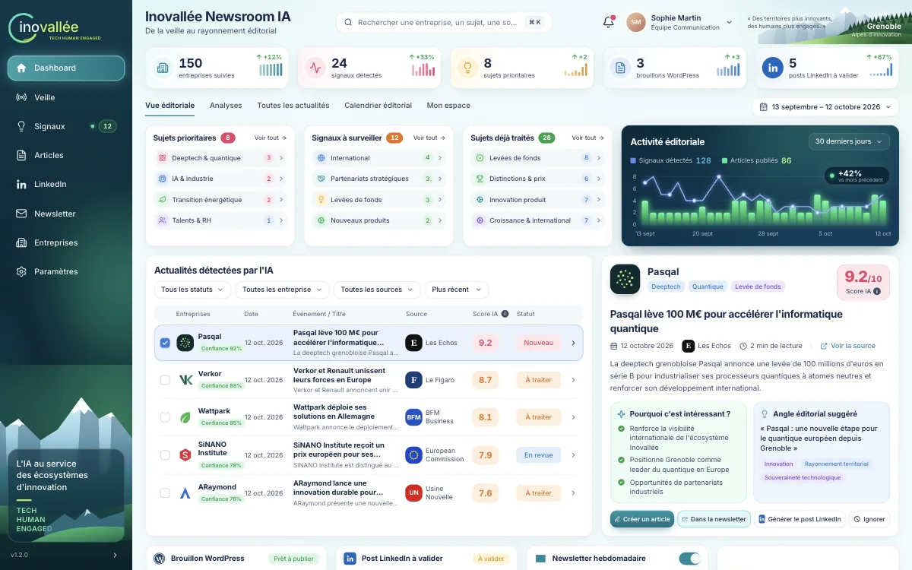

# Documentation KORA Newsroom IA — Inovallée

KORA Newsroom IA est l'espace éditorial d'Inovallée : il suit environ 150 entreprises de l'écosystème grenoblois, repère et classe leurs actualités, aide à rédiger des articles sourcés, et prépare leur diffusion sur WordPress, LinkedIn et la newsletter. Chaque sujet garde ses sources, chaque arbitrage laisse une trace, chaque diffusion repose sur une version approuvée.

Cette documentation répond à la liste de livrables du cahier des charges (§10 : architecture, dictionnaire des données, flux tiers, guide utilisateur, procédures d'incident et de restauration ; §13 : formats d'export et instructions de récupération).

## Documents

| Document | Contenu | Pour qui |
|---|---|---|
| [01 — Démarrage rapide](01-demarrage.md) | Installation, commandes, variables d'environnement, comptes de démonstration, règles de travail avec Lovable, dépannage. | Tout nouvel arrivant |
| [02 — Architecture](02-architecture.md) | Blocs, arborescence, trajet d'une requête, couches serveur, persistance, adaptateurs (dont OpenAI), écart avec l'architecture cible. | Ingénieurs |
| [03 — Référence API](03-reference-api.md) | Tous les endpoints `/api` : rôles, paramètres, corps, réponses, erreurs, exports. | Ingénieurs back et front |
| [04 — Dictionnaire des données](04-dictionnaire-des-donnees.md) | Entités, champs, énumérations, identifiants, stockage Supabase et schéma relationnel cible, données de démonstration, formats d'export. | Ingénieurs back, data |
| [05 — Règles métier](05-regles-metier.md) | Scoring, indicateur documentaire, workflows WF1 à WF6, approbation et publication, droits, quotas et budget. | Ingénieurs, chef de projet |
| [06 — Sécurité et flux tiers](06-securite-et-flux-tiers.md) | Contrôles en place, inventaire des flux vers les services tiers, secrets, écarts à combler avant production. | Ingénieurs, référent sécurité et données |
| [07 — Frontend](07-frontend.md) | Organisation du code front, routage, accès aux données, design system de la maquette, recettes. | Ingénieurs front |
| [08 — Guide utilisateur](08-guide-utilisateur.md) | Mode d'emploi écran par écran et parcours types. | Équipe éditoriale, ingénieurs en recette |
| [09 — Exploitation](09-exploitation.md) | Tests, déploiement, supervision, procédures d'incident, sauvegarde, exports, rétention. | Ingénieurs, exploitation |
| [10 — Couverture du cahier des charges](10-couverture-cahier-des-charges.md) | Statut de chaque exigence, préparation des épreuves R01 à R13, reste à faire. | Chef de projet, ingénieurs |
| [11 — Anomalies connues](11-anomalies-connues.md) | Bugs, incohérences et écarts relevés dans le code, classés par priorité, avec emplacement et piste de correction. | Ingénieurs, chef de projet |

## Parcours de lecture conseillés

- **Ingénieur qui reprend le projet** : 01, 02, puis 10 pour savoir ce qui reste à construire, 11 pour les bugs connus, et 03 à 07 selon le sujet.
- **Ingénieur front** : 01, 07, puis 08 pour comprendre l'usage.
- **Ingénieur back ou data** : 01, 02, 03, 04, 05.
- **Exploitation et sécurité** : 06, 09.
- **Équipe éditoriale** : 08.

## L'essentiel en dix lignes

1. Monolithe TanStack Start (React 19) : pages et API métier `/api` dans le même projet ; build Nitro pour Cloudflare Workers ; synchronisé avec Lovable.
2. Contrat front/back figé dans `src/lib/api/` (types, client, hooks).
3. API dans `src/server/` : routeur, handlers, services, domaine pur, repository, adaptateurs.
4. Données **persistantes** dans la base Supabase (PostgreSQL) de Lovable Cloud, en JSONB ; la production démarre vide. Le jeu de démonstration qui reproduit la maquette ne sert plus qu'aux tests et à la démonstration locale (`SUPABASE_URL= bun run dev`).
5. Textes générés par gabarits, réécrits par OpenAI (`gpt-4o-mini`) si `AI_API_KEY` est définie, avec repli automatique.
6. Collecte **réelle** par flux RSS et Google News, déclenchée à la main ; WordPress **simulé** ; LinkedIn et newsletter en export, conformément au pilote. Le flux Google News est réservé par ses conditions à un usage personnel et non commercial : à faire valider avant production.
7. Score éditorial 0–100 (affiché sur 10) issu d'une grille versionnée ; indicateur documentaire distinct.
8. Toute diffusion exige une approbation valide de la version courante ; une modification l'invalide ; publication idempotente.
9. Quatre rôles contrôlés côté serveur ; budget API réservé avant chaque appel payant, suspension à 100 %.
10. Avant production : **authentification** (urgent, la base est aujourd'hui modifiable par quiconque connaît l'adresse), collecte sortie du budget API (elle l'épuise en une douzaine de passages), transactions et sauvegardes, client WordPress réel, recette R01 à R13. Liste complète dans [Anomalies connues](11-anomalies-connues.md).

## Références

- Cahier des charges : *KORA Newsroom IA — Proposition commerciale et technique v2.0*, KOREV AI, 8 septembre 2026.
- Règles de synchronisation Lovable : [`AGENTS.md`](../AGENTS.md).
- Dépôt : https://github.com/Makk7709/koraino
